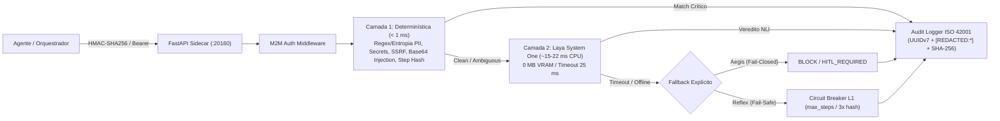

# 1. Análise de Raio de Impacto via `pcl-codegraph` (Pre-Flight Gate)

Antes de planejar alterações nos arquivos conectados aos God Nodes (`src/App.tsx`, `src/types/index.ts`), executamos `codegraph_impact_radius` (`max_hops=2`):
- `src/services/auth/authService.ts` -> **7 arquivos no raio de impacto** (`src/App.tsx`, `src/components/auth/LoginScreen.tsx`, `src/components/auth/DeviceLimitResolutionModal.tsx`, `src/components/admin/UserManagementSecurity.tsx`, `src/components/layout/Sidebar.tsx`, `tests/e2e/02-auth-zindex-history-help.spec.ts`).
- **Decisão de Design (Zero Quebra de Assinatura):** Todas as assinaturas públicas consumidas pelos componentes React (`getCurrentUser`, `getActiveSessions`, `loginWithOAuth`, `loginWithEmail`, `requestMagicLink`, `resolveThirdSessionConflict`, `revokeSession`, `simulateThirdDeviceAttempt`, `logout`) permanecem 100% compatíveis, sincronizando o estado local reativo com as novas rotas `/api/aeos/auth/*` do `server/aeosBackendApp.ts`.

---

# 2. Arquitetura da Frente A — Marco M1 (`server/aeosBackendApp.ts` + `authService.ts`)

## 2.1 Rotas HTTP de Identidade, Sessões & Anti-Abuso (`/api/aeos/auth/*` e `/api/aeos/entitlements/*`)

1. **`POST /api/aeos/auth/oauth/pkce-init`**
   - Recebe `{ provider: 'google' | 'microsoft' | 'github' | 'linkedin', codeChallenge: string, codeChallengeMethod: 'S256', deviceName?: string, deviceFingerprint?: string }`.
   - Armazena o desafio PKCE (`state`, `codeChallenge`, `provider`, `expiresAt`) em memória/vault e retorna `{ ok: true, state, authorizationCode, provider, codeChallengeMethod: 'S256' }`.

2. **`POST /api/aeos/auth/oauth/exchange`**
   - Recebe `{ provider, state, authorizationCode, codeVerifier, deviceName, deviceFingerprint }`.
   - Calcula `BASE64URL(SHA256(codeVerifier))` e compara em tempo constante com o `codeChallenge` registrado no `pkce-init`. Se divergir, retorna `HTTP 401 Unauthorized` (`PKCE_VERIFICATION_FAILED`).
   - Verifica o limite físico de dispositivos (`maxConcurrentDevices = 2`). Se já houver 2 sessões ativas e o `deviceFingerprint` pertencer a um 3º dispositivo, retorna **`HTTP 409 Conflict`** com `{ ok: false, requiresDeviceLimitResolution: true, activeSessions, pendingSessionAttempt }` e grava `AUTH_3RD_DEVICE_BLOCKED` na trilha SHA-256.
   - Caso contrário, cria/atualiza a sessão em `cockpit.sessions`, emite cookie `Set-Cookie: pcl_cockpit_session=<token>; HttpOnly; Path=/; SameSite=Lax; Max-Age=604800` e retorna `{ ok: true, user, activeSessions, session }`.

3. **`POST /api/aeos/auth/login`**
   - Recebe `{ email, password, deviceName, deviceFingerprint }`.
   - Valida a senha contra o hash Scrypt (`scrypt:v1:<saltHex>:<derivedKeyHex>`) armazenado no cofre/DB (`cockpit.user_credentials`) usando `crypto.scryptSync` e `crypto.timingSafeEqual`.
   - Aplica a mesma regra física de bloqueio do 3º dispositivo (`HTTP 409 Conflict` quando `activeSessions >= 2` para novo dispositivo) e emite cookie `HttpOnly` em caso de sucesso.

4. **`GET /api/aeos/auth/sessions` | `POST /api/aeos/auth/sessions/revoke` | `POST /api/aeos/auth/sessions/resolve-conflict` | `POST /api/aeos/auth/logout`**
   - `GET /api/aeos/auth/sessions`: Lista as sessões ativas (não revogadas) do usuário/tenant.
   - `POST /api/aeos/auth/sessions/revoke`: Revoga imediatamente `sessionId` (`revoked_at = NOW()`, `revoked_reason = 'USER_REVOKED_UI'`) e grava `AUTH_SESSION_REVOKED` na cadeia SHA-256.
   - `POST /api/aeos/auth/sessions/resolve-conflict`: Revoga atomicamente `revokeSessionId`, ativa a sessão pendente do 3º dispositivo, emite cookie `HttpOnly` e grava `AUTH_DEVICE_CONFLICT_RESOLVED`.
   - `POST /api/aeos/auth/logout`: Revoga a sessão atual e limpa o cookie `HttpOnly` (`Max-Age=0`).

5. **`POST /api/aeos/entitlements/start-trial` (Trava Anti-Trial-Hopping)**
   - Recebe `{ tenantId, moduleKey, emailDomain, deviceFingerprint }`.
   - Calcula `trialFingerprint = SHA256(moduleKey + ':' + emailDomain.toLowerCase() + ':' + deviceFingerprint)` e verifica também se o `tenantId` ou `emailDomain` já possui histórico de ativação de trial para o `moduleKey`.
   - Se já ativado anteriormente, bloqueia com **`HTTP 403 Forbidden`** (`errorCode: 'ANTI_TRIAL_HOPPING_LOCK'`, `accessState: 'locked_upsell'`) e registra `SECURITY_TRIAL_HOPPING_BLOCKED` na trilha SHA-256.

---

# 3. Arquitetura da Frente B — `services/laya-gatekeeper/` (`PROAA-15` & `PROAA-16`)

- **Execução 100% CPU (`0 MB VRAM`):** `app/layers/l2_laya.py` carrega `LayaClassifierEngine` diretamente em processo em `CPUExecutionProvider` (com suporte a timeout estrito de `25 ms` e flag de simulação de falha/timeout para validação determinística dos modos `fail-closed` e `fail-safe`).
