# 1. Análise de Raio de Impacto via `pcl-codegraph` (Pre-Flight Gate)

Consultamos `codegraph_impact_radius` (`depth=2`) no MCP `pcl-codegraph` antes de planejar alterações nos arquivos conectados aos God Nodes:
- `src/types/index.ts` -> **39 arquivos dependentes** (`risk_level: HIGH`). Decisão: apenas adicionar propriedades opcionais e novas interfaces (`TokenTaxSavedMetrics`, `VectorDocumentChunk`, `DeduplicationSummary`), mantendo 100% de retrocompatibilidade.
- `src/App.tsx` -> **2 arquivos no raio de impacto direto** (`src/App.tsx`, `src/main.tsx`).
- `src/services/laya/layaCoprocessorService.ts` -> **3 arquivos** (`src/App.tsx`, `src/main.tsx`, `layaCoprocessorService.ts`).
- `src/services/study/studyIngestionService.ts` -> **4 arquivos** (`ContextPopover.tsx`, `SuperChatbubble.tsx`, `studyIngestionService.ts`, `tests/unit/studyIngestion.test.ts`).
- `src/services/governance/budgetControlService.ts` -> **6 arquivos** (`App.tsx`, `CostsTokenDashboard.tsx`, `SettingsModal.tsx`, `RightSidebarStatus.tsx`, `budgetControlService.ts`, `tests/unit/helpCenterAndSettings.test.tsx`).
- `src/services/audit/isoAuditService.ts` -> **3 arquivos** (`AuditComplianceBoard.tsx`, `SettingsModal.tsx`, `isoAuditService.ts`).

---

# 2. Arquitetura Integrada da Ordem 4 (Padrão Cortex v7 `flowchart LR`)

```mermaid
flowchart LR
    subgraph UI["<b>1. PCL Cockpit (:3001)</b><br/>Chat, #documentos, FinOps & Aba 7"]
        direction TB
        Chat["<b>SuperChatbubble & App.tsx</b><br/>Chat Multi-Turn + Fontes Retráteis"]
        Study["<b>StudyIngestionService</b><br/>Upload #documentos + Persistência F5"]
        FinUI["<b>CostsTokenDashboard</b><br/>Hard Lock + Token Tax Saved (PROAA-17)"]
        AuditUI["<b>AuditComplianceBoard (Aba 7)</b><br/>Verificação Matemática SHA-256"]
    end

    subgraph Backend["<b>2. Server Backend (/api/aeos/*)</b><br/>Orquestração, Busca Web & Persistência"]
        direction TB
        LayaRoute["<b>POST /api/aeos/laya/classify</b><br/>Ponte Laya v2.0 + Gatekeeper Aegis"]
        MemRoute["<b>/api/aeos/memory/documents/*</b><br/>Vetorização 384d + Auto-Limpeza"]
        FinRoute["<b>/api/aeos/finops/token-tax</b><br/>Fórmula Auditável PROAA-17 + Hard Lock"]
        AuditRoute["<b>/api/aeos/audit/chain</b><br/>Merkle / Hash Chain SHA-256"]
    end

    subgraph Engines["<b>3. Motores Soberanos & Enclave</b><br/>0 MB VRAM CPU + PostgreSQL 17 PGVector"]
        direction TB
        LayaSvc["<b>pcl-laya (:20140) & Gatekeeper (:20160)</b><br/>match_intent + deduplicate_memory + Aegis"]
        PGVec["<b>PostgreSQL 17 + PGVector / Vault</b><br/>cockpit.document_vectors & SQL 003/004"]
        Ollama["<b>Ollama Local (:11434)</b><br/>Fallback Automático $0.00 no Hard Lock"]
    end

    UI ==> Backend
    Backend ==> Engines
```

---

# 3. Especificação dos Novos Contratos e Tabelas (SQL 003/004 + Backend)

## 3.1 Evolução do Schema SQL (`cockpit.document_vectors` e `cockpit.finops_token_tax_ledger`)
Adicionadas à migração SQL 003 (`003_create_cockpit_iam_finops_entitlements_schema.sql`) com `CREATE TABLE IF NOT EXISTS`:
1. **`cockpit.document_vectors` (Memória Vetorial Permanente PGVector para `#documentos`):**
   - `id VARCHAR(100) PRIMARY KEY`, `tenant_id VARCHAR(100)`, `study_id VARCHAR(100)`, `filename VARCHAR(255)`, `chunk_index INT`, `page_number INT`, `content_text TEXT`, `content_sha256 VARCHAR(64)`, `embedding_json JSONB` (e suporte a `vector(384)` quando extensão `vector` ativa), `dedup_action VARCHAR(30)` (`ACTION_ADD`, `ACTION_UPDATE`, `ACTION_KEEP_BOTH`), `created_at TIMESTAMPTZ`.
2. **`cockpit.finops_token_tax_ledger` (`PROAA-17` — Contador Auditável `Token Tax Saved`):**
   - Armazena `decisions_resolved_local BIGINT`, `estimated_tokens_saved BIGINT`, `baseline_tariff_per_1m_usd NUMERIC(10,4)` (padrão OmniRoute Cloud Baseline `US$ 3.50 / 1M tokens` combinados I/O), `baseline_llm_latency_ms INT` (`1450 ms`), `monetary_savings_usd NUMERIC(12,4)`, `time_saved_ms BIGINT`, `last_decision_receipt_sha256 VARCHAR(64)`.

## 3.2 Endpoints Backend (`server/aeosBackendApp.ts`)
1. **`POST /api/aeos/laya/classify`**
   - Inspeciona o prompt contra regras determinísticas L1 do Gatekeeper (`laya-gatekeeper`) e aciona o classificador `pcl-laya` v2.0 (`:20140/v1/systemone` quando online ou motor determinístico/ONNX local em `0 MB VRAM`).
   - Incrementa automaticamente o contador real **`Token Tax Saved` (`PROAA-17`)** a cada decisão local resolvida e grava na cadeia SHA-256 quando houver bloqueio Aegis.
2. **`POST /api/aeos/memory/documents/ingest` | `GET /api/aeos/memory/documents` | `POST /api/aeos/memory/documents/query`**
   - `ingest`: Recebe `{ studyId, filename, mimeType, sizeBytes, pageCount, chunks: [{ id, pageNumber, text }] }`.
   - Executa **Memória Auto-Limpante (`laya_deduplicate_memory`)**: compara cada novo chunk com os chunks existentes no PGVector/Vault; se similaridade semântica `>= 0.90` -> `ACTION_DISCARD`; se entre `0.75` e `0.90` com atualização numérica/temporal -> `ACTION_UPDATE` (substitui o chunk antigo); caso contrário -> `ACTION_ADD` com vetor `384d` normalizado L2.
   - `GET /api/aeos/memory/documents`: Retorna todos os documentos e chunks persistidos (hidratando `studyIngestionService` após F5).
   - `POST /api/aeos/memory/documents/query`: Calcula o vetor `384d` da query e executa busca híbrida (similaridade de cosseno vetorial + BM25 lexical) sobre todos os chunks persistidos no PGVector/Vault.
3. **`GET /api/aeos/finops/token-tax` | `POST /api/aeos/finops/token-tax/record`**
   - Calcula em tempo real a fórmula `PROAA-17` e retorna o recibo auditável com `decisionsResolvedLocal`, `estimatedTokensSaved`, `baselineTariffPer1MUsd`, `monetarySavingsUsd`, `monetarySavingsBrl`, `timeSavedMs` e `sha256Receipt`.
