# 1. Análise de Raio de Impacto via `pcl-codegraph` (Pre-Flight Gate)

Antes de editar arquivos conectados aos God Nodes (`src/App.tsx`, `src/types/index.ts`), consultamos `codegraph_impact_radius`:
- `src/components/admin/IntegrationsLibrary.tsx` -> **4 arquivos no raio de impacto** (`src/App.tsx`, `IntegrationsLibrary.tsx`, `SettingsModal.tsx`, `tests/unit/helpCenterAndSettings.test.tsx`).
- `src/components/workspace/ActionPreviewCard.tsx` -> **3 arquivos no raio de impacto** (`src/App.tsx`, `ActionPreviewCard.tsx`, `DualPlexWorkspace.tsx`).
- `src/types/index.ts` -> **39 arquivos dependentes**. Apenas tipos aditivos (`OfficialMcpConnectorM31`, `GrowthOsPluginManifest`, `HitlActionProposal`, `TenantQuotaPreFlightResult`, `SsrfValidationResult`) serão adicionados.

---

# 2. Arquitetura Integrada da Ordem 5 (Padrão Cortex v7 `flowchart LR`)

```mermaid
flowchart LR
    subgraph Cockpit["<b>1. PCL Cockpit (:3001)</b><br/>Hub MCP M3.1 & HITL ActionPreviewCard"]
        direction TB
        Hub["<b>IntegrationsLibrary.tsx</b><br/>Onda M3.1: Google, M365, ClickUp, GitHub"]
        HITL["<b>ActionPreviewCard.tsx</b><br/>Aprovação Humana Obrigatória (Stage Gate)"]
    end

    subgraph GrowthOS["<b>2. Fundação PCL GrowthOS™</b><br/>PROAA-20 Manifests & PROAA-21 Hardening"]
        direction TB
        Manifest["<b>plugin.manifest.json Registry</b><br/>Grafo Unificado tenant_id + Laya + OmniRoute"]
        Quota["<b>Pre-Flight Atomic Quota</b><br/>100% Trial ➔ Degradação Laya CPU ($0.00)"]
        SSRF["<b>Anti-SSRF Scrape URL Guard</b><br/>Bloqueio RFC1918, Loopback & Cloud Metadata"]
    end

    subgraph Enclave["<b>3. Enclave Soberano SQL 003</b><br/>Cofre AES-256-GCM + PostgreSQL 17 RLS"]
        direction TB
        Vault["<b>cockpit.connector_vault_aes256</b><br/>OAuth 2.1 PKCE Selado AES-256-GCM"]
        RLS["<b>PostgreSQL 17 RLS Policy</b><br/>Isolamento Estrito por tenant_id"]
        Audit["<b>cockpit.audit_chain_sha256</b><br/>Recibo Imutável de HITL, Quota & SSRF"]
    end

    Cockpit ==> GrowthOS
    GrowthOS ==> Enclave
```

---

# 3. Especificação Técnica dos Componentes

## 3.1 Marco M3.1 — Conectores MCP Oficiais, Streamable HTTP & HITL (`server/aeosBackendApp.ts`)
- **Catálogo Oficial M3.1 (`GET /api/aeos/mcp/connectors/m31`):**
  1. `google-workspace` (Gmail, Google Calendar, Google Drive — OAuth 2.1 PKCE + Streamable HTTP)
  2. `microsoft-365` (Outlook, Microsoft Teams, OneDrive / SharePoint — Entra ID OAuth 2.1 PKCE + Streamable HTTP)
  3. `clickup` (Tasks, Lists, Spaces & Docs — OAuth 2.1 PKCE + Streamable HTTP)
  4. `github` (Repositories, Issues, Pull Requests & Commits — OAuth 2.1 PKCE + Streamable HTTP)
- **Cliente MCP Streamable HTTP com Gate HITL (`POST /api/aeos/mcp/streamable/call`):**
  - Recebe `{ tenantId, connectorId, toolName, arguments, hitlConfirmed?: boolean, hitlProposalId?: string }`.
  - Verifica se a ferramenta pertence ao conjunto de **ações externas mutáveis (`EXTERNAL_WRITE_TOOLS`)**.
  - Se for ação externa mutável e `hitlConfirmed !== true`:
    - Gera proposta HITL (`hitlProposalId = 'hitl_' + randomHex`), armazena no estado e grava `MCP_HITL_APPROVAL_REQUESTED` na cadeia SHA-256.
    - Retorna **`HTTP 202 Accepted`** com `{ ok: true, status: 'HITL_REQUIRED', requiresHitlApproval: true, hitlProposalId, connectorId, toolName, previewCard }`.
  - Quando o operador confirma (`hitlConfirmed === true` ou via `POST /api/aeos/mcp/hitl/confirm`):
    - Valida o cofre AES-256-GCM do conector, executa a chamada JSON-RPC 2.0 Streamable HTTP, grava `MCP_HITL_ACTION_EXECUTED` na cadeia SHA-256 e retorna `HTTP 200` com `{ ok: true, status: 'EXECUTED', executed: true, sha256Receipt }`.

## 3.2 Contrato `plugin.manifest.json` (`PROAA-20`)
- Rotas `GET /api/aeos/growthos/manifests` e `POST /api/aeos/growthos/manifests/register`:
  - Valida campos obrigatórios do schema `PROAA-20`: `id`, `version`, `vendor`, `tier`, `tenantGraphBinding` (`isolNamespace`, `memorySchema: 'memory'`, `cockpitSchema: 'cockpit'`), `requiredConnectors`, `layaSystemOneBindings` (`laya_match_intent`, `laya_deduplicate_memory`, `laya_verify_policy`, `laya_lightning_council`), `omnirouteProfile`, `quotaPolicy` (`trialLimitUnits`, `exhaustionBehavior: 'DEGRADE_TO_LOCAL_LAYA_CPU'`) e `manifest_sha256`.

## 3.3 Hardening SaaS (`PROAA-21`): RLS, Cotas Pre-Flight e Anti-SSRF
1. **RLS no PostgreSQL 17 + Guarda Cross-Tenant (`POST /api/aeos/growthos/rls/verify` e validação em rotas):**
   - Se `authenticatedTenantId !== requestedTenantId`, bloqueia imediatamente com **`HTTP 403 Forbidden`** (`errorCode: 'CROSS_TENANT_RLS_VIOLATION'`) e grava `SECURITY_CROSS_TENANT_BLOCKED` na trilha SHA-256.
2. **Cotas Atômicas Pre-Flight (`POST /api/aeos/growthos/quota/consume`):**
   - Atualiza atomicamente `quotaUsedUnits` do módulo para o `tenantId`.
   - Se `accessState === 'trial_14d'` e `quotaUsedUnits >= quotaLimitUnits`:
     - Ativa degradação graciosa: `allowed: true`, `degradedToLocalLayaCpu: true`, `executionEngine: 'pcl-laya-cpu-int8'`, `vramAllocatedMb: 0`, `marginalCostUsd: 0.0`, `upsellCta: 'Limite de cota cloud do Trial atingido — operando em modo degradado soberano via Laya CPU Local ($0.00).'`
3. **Bloqueio Anti-SSRF para `Scrape URL` (`POST /api/aeos/growthos/scrape-url/validate`):**
   - Rejeita URLs com esquemas proibidos, loopback, metadata cloud (`169.254.169.254`), IPs privados RFC 1918 (`10.0.0.0/8`, `172.16.0.0/12`, `192.168.0.0/16`), link-local (`169.254.0.0/16`), CGNAT (`100.64.0.0/10`) ou sufixos internos (`.local`, `.internal`, `.corp`, `.lan`) com **`HTTP 403 Forbidden`** (`errorCode: 'SSRF_TARGET_BLOCKED'`).
