# 1. Análise de Raio de Impacto via `pcl-codegraph` (Pre-Flight Gate)

Consultamos `codegraph_impact_radius` (`depth=2`) antes de editar os arquivos conectados aos God Nodes:
- `src/services/audio/whisperService.ts` -> **3 arquivos** (`SuperChatbubble.tsx`, `VoiceRecorderButton.tsx`, `whisperService.ts`).
- `src/components/admin/NoCodeAgentBuilder.tsx` -> **6 arquivos** (`App.tsx`, `NoCodeAgentBuilder.tsx`, `SettingsModal.tsx`, `SkillsManager.tsx`, `skillsService.ts`, `tests/unit/helpCenterAndSettings.test.tsx`).
- `src/components/workspace/MeetingsIntelligenceView.tsx` -> **3 arquivos** (`App.tsx`, `MeetingsIntelligenceView.tsx`, `main.tsx`).
- `src/components/workspace/FlowsAutomationCanvas.tsx` -> **3 arquivos** (`App.tsx`, `FlowsAutomationCanvas.tsx`, `main.tsx`).

---

# 2. Arquitetura Integrada da Ordem 6 (Padrão Cortex v7 `flowchart LR`)

```mermaid
flowchart LR
    subgraph UI["<b>1. PCL Cockpit (:3001)</b><br/>Voz, @Sistemas, No-Code, Reuniões & DAG"]
        direction TB
        Vox["<b>VoiceRecorder & WhisperService</b><br/>Microfone Real ➔ Base PCL VoxCanvas™"]
        NoCode["<b>NoCodeAgentBuilder & Skills</b><br/>Persistência Real SQL + Vault"]
        Meet["<b>MeetingsIntelligenceView</b><br/>Upload Áudio ➔ Action Items ➔ HITL"]
        DAG["<b>FlowsAutomationCanvas</b><br/>Executor Topológico DAG + Merkle SHA-256"]
    end

    subgraph M32["<b>2. Onda M3.2 & Gate HITL</b><br/>Conectores Comerciais & Engenharia"]
        direction TB
        HubJira["<b>HubSpot & Atlassian Jira/Confluence</b><br/>MCP Oficial Streamable HTTP + PKCE"]
        RDLink["<b>RD Station v2 & LinkedIn OIDC</b><br/>REST Oficial (Zero Cookie Scraping)"]
    end

    subgraph Storage["<b>3. Enclave PostgreSQL 17 RLS</b><br/>Persistência & Auditoria Imutável"]
        direction TB
        Tables["<b>cockpit.custom_agents / skills</b><br/>cockpit.meetings / dag_workflow_runs"]
        Chain["<b>cockpit.audit_chain_sha256</b><br/>Trilha Encadeada + PROAA-17 Token Tax"]
    end

    UI ==> M32
    M32 ==> Storage
```

