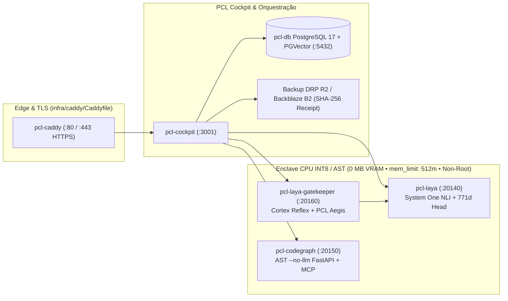

# Design de Arquitetura — Ordem 7: Marco M5 + Casca Visual `PCL GrowthOS™`

## 1. Topologia de Containers CPU (`0 MB VRAM`) no `docker-compose.aeos.yml`

## 2. Arquitetura da Casca Visual `PCL GrowthOS™` (`CLS = 0` & Zero Frankenstein)

- **`Header.tsx`:**
  - `data-testid="growthos-trial-pill"`: Exibe `"14d Trial • Todos os Módulos"` (no modo Trial D0–D14) ou `"Núcleo Laya + X Módulos"` (após consolidação do Dia 14), abrindo o modo `Dual-Plex GrowthOS` ao clicar.
  - `data-testid="header-token-tax-pill"`: Exibe o resumo em tempo real do `Token Tax Saved` (`$USD` + tokens locais) clicável para inspeção FinOps.
- **`LeftSidebar.tsx`:**
  - Seção retrátil **Growth Store (4 Divisões)** com indicadores de divisão ativa e acionamento direto do `Dual-Plex (Split)`.
- **`SuperChatbubble.tsx`:**
  - Botão `+ /` (`data-testid="progressive-disclosure-chips-btn"`) que revela sob *Progressive Disclosure* os *chips* multimodais das 4 Divisões sem ocupar espaço vertical permanente.
- **`GrowthOsDualPlexPanel.tsx` + `DualPlexWorkspace.tsx`:**
  - Renderiza os cards `BlockSchema` com `min-h-[156px]` fixo (`CLS = 0`), selo **"Laya™ Inside"**, *Confidence Surfacing* (Verde/Âmbar/Vermelho), **Canvas de Preview + Micro-ROI** e a régua interativa **Onboarding Telepático D0–D14** com **Ranking de ROI no Dia 14**.
