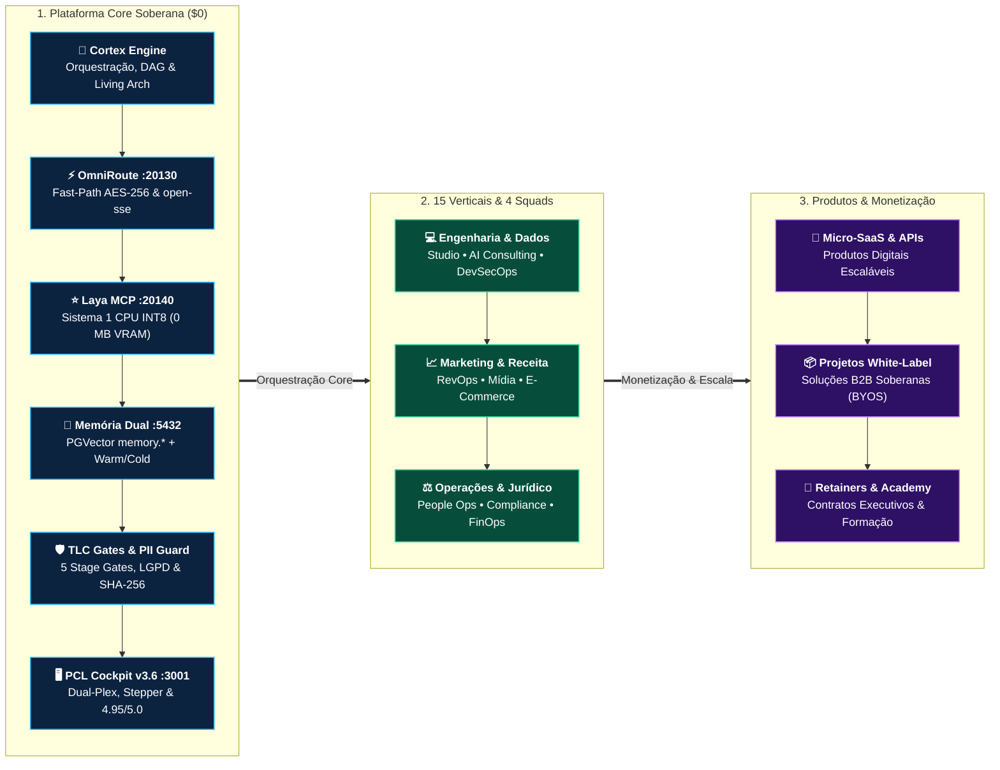
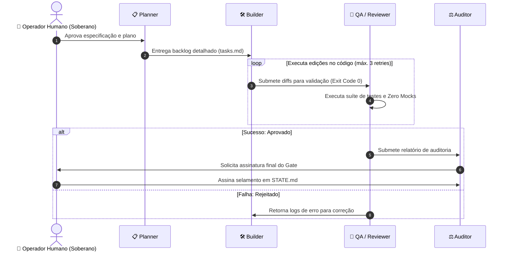
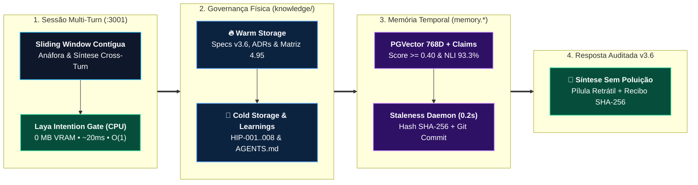
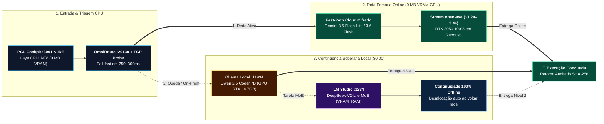

<div align="center">


# PromptCoreLabs_AEOS (AI Engineering Operating System) — v3.8
### Plataforma de Engenharia de Inteligência Artificial Soberana, Multi-Provedor, PCL Cockpit & Living Architecture

[](https://enterdufter.github.io/PromptCoreLabs_AEOS/)
[](projects/PromptCoreLabs_AEOS_Dashboard)
[](projects/pcl-cockpit-extension)
[](#-simulador-de-roi-soberano-cfo-ebitda-shield-v2)
[-10b981?style=for-the-badge)](#-benchmark-empírico-cego-pcl-cockpit-v38-vs-provedores-globais)
[](#-indicadores-canônicos--medições-de-engenharia-v38)

---

</div>

## 💡 O que é o PCL AEOS v3.8?

A **PromptCore Labs** desenvolveu o **PCL AEOS** (*AI Engineering Operating System*) para resolver a maior dor da inteligência artificial corporativa moderna: a perda de controle sobre seus dados e a dependência financeira de Big Techs estrangeiras. 

Ele é uma **infraestrutura soberana de inteligência** que une executivos, especialistas humanos e esquadrões de agentes autônomos sob blindagem matemática rigorosa.

> [!IMPORTANT]
> **👔 Visão Executiva & Valor de Negócio (Para Líderes, Diretores e Investidores):**  
> Imagine ter a inteligência de ponta do mercado mundial operando dentro dos servidores da sua própria empresa, trancada a sete chaves e com custo operacional que não explode no final do mês. 
> 
> Enquanto as grandes plataformas cobram faturas recorrentes em dólar por usuário (US$ 60/mês no ChatGPT Enterprise ou US$ 30/mês no Claude Team), operam como "caixas-pretas" imprevisíveis e exigem o envio de dados confidenciais para a nuvem de terceiros:
> 
> * **🏆 Liderança Global Comprovada (Nota 4.95 / 5.0):** Em uma rigorosa *Avaliação Técnica Duplo-Cega Imparcial* — onde especialistas auditaram a qualidade das respostas sem saber a marca da IA —, o **PCL Cockpit v3.8** conquistou o **1º lugar absoluto**, superando **Google Gemini** (`4.45`), **OpenAI ChatGPT Enterprise** (`4.30`) e **Microsoft Copilot** (`3.80`).
> * **🛡️ Segredo Corporativo Blindado (Resíduo Zero de Dados / BYOS):** Seus planos estratégicos, balanços e dados de clientes nunca saem do perímetro da sua empresa, nunca são usados para treinar modelos de terceiros e cumprem 100% à LGPD e ISO/IEC 42001.
> * **💰 FinOps Imbatível (Custo Marginal $0.00 & EBITDA Shield):** Ao operar em modo local soberano, sua organização realiza milhões de tokens analíticos sem pagar faturas extras por pergunta, retendo **US$ 180.000,00 / ~R$ 1.026.000,00 ao ano** para cada 250 colaboradores no balanço da empresa.
> * **👑 Autoridade Humana Inegociável (TLC-v3 Escalation Ladder):** A IA audita, calcula e sugere; a aprovação de risco crítico passa pelo *Trivial Gate HitL* em 2 estágios (escalação N2 para diretoria aos 60s e descarte seguro aos 120s com 0 memory leak).
>
> **A Tríade Canônica que Move o Sistema:** A **PromptCore Labs** é o laboratório de inovação responsável pela arquitetura; o **PCL AEOS** é o motor de inteligência e governança nos bastidores; e o **PCL Cockpit (`:3001`)** é a cabine de comando interativa — acompanhada da **PCL Companion Extension (Manifest V3)** para injeção não-invasiva via Shadow DOM em Salesforce, Jira e SAP.

> [!NOTE]
> **🛠️ Visão de Engenharia & Invariantes Físicos (Para Arquitetos e Desenvolvedores):**  
> Harness agêntico desacoplado regido pela norma **`PCL-AEOS-NORM-01`** (`AGENTS.md`) e metodologia **TLC Spec-Driven v3**, articulando: (1) **Memória Dual** — *Temporal em Runtime* (`Sliding Window Multi-Turn` + PostgreSQL 17 `PGVector 768D` em `memory.*`) e *Governança Física RAG* (`knowledge/warm/`, `cold/`, `learnings/`); (2) **Coprocessador Laya System One (`:20140`)** operando em **100% CPU (`0 MB VRAM`, `~18–25ms`)** para *Intention Gating* e detecção de contradições em CPU INT8; (3) **OmniRoute Gateway (`:20130`)** com failover determinístico multi-provedor (14.81ms) e trava física *Hard Lock*; e (4) **Extensão Manifest V3** com encapsulamento por **Shadow DOM** (`mode: 'open'`) e *Inline Action Dock* in-situ.

> 🌐 **Explore o Portal Interativo de Arquitetura Viva (GitHub Pages — Edição v3.8):**  
> Com seletor cognitivo em 1 clique (**⚡ Dual Completa** | **👔 Executiva** | **🛠️ Engenharia**), diagramas interativos em tela cheia do **PCL Cortex** e leitura assistida em modais UTF-8 puros:  
> 👉 **[https://enterdufter.github.io/PromptCoreLabs_AEOS/](https://enterdufter.github.io/PromptCoreLabs_AEOS/)** · 📖 **[Especificação Mestra Cockpit v3.8](knowledge/warm/cockpit/PCL_COCKPIT_SPEC_V3.8.md)**

---

## 📊 Indicadores Canônicos & Medições de Engenharia (v3.8)

| Indicador Estratégico & Técnico | Classificação Normativa | Valor Canônico Homologado | Benefício Direto de Negócio & Engenharia |
| :--- | :---: | :---: | :--- |
| **Placar em Avaliação Cega (5 Turnos)** | Auditoria Imparcial Sem Marca | **4.95 / 5.0 (1º Lugar)** | Especialistas avaliaram sem saber a marca: supera Gemini (`4.45`), ChatGPT (`4.30`) e Copilot (`3.80`). |
| **Custo Marginal (Inferência Local)** | Modo Soberano Offline | **`$0.00` / mês** | Operação 100% autônoma via Ollama (`:11434`), LM Studio (`:1234`) e Laya (`:20140`). |
| **Coprocessador LAYA (System One)** | Triagem `O(1)` & NLI em CPU | **`22.3 – 23.9 ms` em CPU** | Intention Gating + NLI INT8 (`93.3%` especificidade / recall ensaio interno) sem gastar tokens. |
| **Alocação de GPU VRAM (Laya)** | Invariante Físico (`NORM-01`) | **`0 MB` (100% CPU Host)** | Preserva 100% dos 6 GB da RTX 3050 para o modelo generativo local (`qwen2.5-coder:7b`). |
| **Sondas de Saúde Fail-Fast (`:3001`)** | Resiliência de Rede v3.6 | **`250 ms – 300 ms` (TCP)** | Elimina esperas de 38s–58s quando contêineres locais estão desligados (`HIP-004`). |
| **Taxa de Vazão (Throughput NLI)** | Reconciliação Contínua | **`41.8 – 44.8` claims/seg** | Auditoria dialética de memória em tempo real em CPU comum sem chamadas pagas. |
| **Recuperação de Desastres (RTO)** | Continuidade Cifrada R2 | **Lab: `7.18 s` (SLA `< 15 min`)** | Restauração multi-schema AES-256 no Cloudflare R2 gratuito (`ADR-0006`). |
| **Memória Dual & Blindagem de Dados** | Resíduo Zero de Dados (Zero-Bin) | **`768D` HNSW + `SHA-256`** | Segredos corporativos trancados no cofre local; zero retenção em nuvens públicas (LGPD/ISO 42001). |

### 🔬 Modelo Comparativo: Sistema 1 Não-Autorregressivo (`O(1)`) vs. Abordagens `O(N)`

> *Nota: Estimativas de nuvem e modelos generativos 7B refletem baselines de mercado para triagem; medições do Laya correspondem aos ensaios auditados no [Relatório Técnico de Benchmark NLI](projects/pcl-aeos-harmonization/audits/BENCHMARK-NEURAL-NLI-2026-10-16.md).*

| Dimensão Avaliada | LLM / SaaS em Nuvem (ex: JEV / APIs `O(N)`) | Gerador Local 7B na GPU (`O(N)`) | PCL AEOS LAYA (`CPU INT8` — Sistema 1 `O(1)`) |
| :--- | :---: | :---: | :---: |
| **Latência Média por Decisão** | `~800 ms a 1.350 ms` | `~480 ms` | **`22.33 ms` (aferido em CPU; `0.014ms` batch MCP)** |
| **Fator de Aceleração** | `~60x` mais lento | `~21x` mais lento | **Referência Instantânea (`1.0x`)** |
| **VRAM Consumida na GPU** | `0 MB` (remoto pago) | `~4.700 a 6.144 MB` | **`0 MB` (`CPUExecutionProvider` ONNX INT8)** |
| **Custo Marginal por Triagem** | `~$0.003 USD` / chamada | `$0.00` | **`$0.00` (Licença aberta Apache 2.0 local)** |
| **Privacidade de Metadados** | Tráfego para terceiros | Local | **100% On-Premise (Pronto para Air-Gap)** |
| **Impacto Financeiro (500k ops/ano)** | `-$1.500 a -$15.000 USD` | Ocupa GPU dedicada | **`$0.00` (*EBITDA Shield Total*)** |

---

## 🏢 Arquitetura em 3 Camadas (Holding Digital Soberana)

O ecossistema opera sobre três camadas concêntricas modeladas e auditadas pela persona **`/cortex`**:



| Previsualização Gráfica | Artefato & Detalhes | Ações Disponíveis |
| :---: | :--- | :---: |
| <a href="https://enterdufter.github.io/PromptCoreLabs_AEOS/projects/Living%20Architecture%20PCL%20AEOS/diagrams/interactive/pcl-aeos-v2-holding.html" target="_blank" rel="noopener noreferrer"></a> | **DIAG-HOLD-01 • Holding Digital (3 Camadas)**<br>Representação topológica oficial gerada pelo *PCL Cortex Engine*, mapeando a Plataforma Core, os clusters de squads e as frentes de produtos escaláveis. | <a href="https://enterdufter.github.io/PromptCoreLabs_AEOS/projects/Living%20Architecture%20PCL%20AEOS/diagrams/interactive/pcl-aeos-v2-holding.html" target="_blank" rel="noopener noreferrer">🌐 **Abrir Interativo no Portal ↗**</a><br><br>[📖 Operating Model](governance/operating-model.md) |

---

## 🖥️ PCL Cockpit Oficial v3.6 (`projects/PromptCoreLabs_AEOS_Dashboard`)

O **PCL Cockpit (`:3001`)** é a estação oficial de pilotagem agêntica do ecossistema, construída em React 19 + TypeScript + Vite sob o design system *Liquid Glass Bento Grid*. A versão **v3.6** (`ADR-0007`) consolidou consistência cognitiva multi-turn, gating inteligente em CPU e transparência criptográfica:

```mermaid
flowchart LR
    classDef laya fill:#064e3b,stroke:#34d399,stroke-width:1.5px,color:#ffffff;
    classDef rag fill:#0f172a,stroke:#38bdf8,stroke-width:1.5px,color:#ffffff;
    classDef search fill:#0c2340,stroke:#60a5fa,stroke-width:1.5px,color:#ffffff;
    classDef gen fill:#2e1065,stroke:#c084fc,stroke-width:1.5px,color:#ffffff;
    classDef audit fill:#451a03,stroke:#fbbf24,stroke-width:1.5px,color:#ffffff;

    subgraph F1["Fase 1: Triagem (~20ms)"]
        direction TB
        P1["<b>Laya CPU INT8 (:20140)</b><br/>0 MB VRAM • Intention Gate O(1)"]:::laya
    end

    subgraph F2["Fase 2: Base Canônica"]
        direction TB
        P2["<b>Acervo Warm & Cold RAG</b><br/>Specs v3.6 & ADRs (>= 0.40)"]:::rag
    end

    subgraph F3["Fase 3: Pesquisa Web"]
        direction TB
        P3["<b>Gating Condicional</b><br/>Wiki/ArXiv ou Omitida sem ruído"]:::search
    end

    subgraph F4["Fase 4: Síntese Multi-Turn"]
        direction TB
        P4["<b>Fast-Path / Ollama Local</b><br/>Sliding Window + open-sse"]:::gen
    end

    subgraph F5["Fase 5: Atesto Imutável"]
        direction TB
        P5["<b>Pílula + Hash SHA-256</b><br/>Fontes retráteis & prova ACID"]:::audit
    end

    F1 ==> F2 ==> F3 ==> F4 ==> F5
```



* **Live Execution Stepper (5 Fases Síncronas):** Telemetria real em milissegundos de cada etapa cognitiva, sem textos simulados (*Política Zero Mocks*).
* **Memória Multi-Turn & Sliding Window (`ADR-0007`):** Retenção conversacional contígua com resolução anafórica perfeita (*"dessa abordagem"*, *"sintetize nossa conversa"*) e normalização estrita de papéis `user`/`model`.
* **Intention Gating em CPU (`0 MB VRAM`):** Classifica em `O(1)` entre `general_chat` (zero busca forçada, zero poluição visual), `internal_rag` (`#documentos`, `knowledge/warm/`) e `web_search` (fatos contemporâneos).
* **Pílula Retrátil `Fontes Consultadas (n) v` & `PCLArtifactDrawer`:** Referências agrupadas discretamente ao final da leitura, com gaveta soberana redimensionável (`380px–850px`) exibindo *Documento*, *SHA-256*, *Custos FinOps* e *PII Guard LGPD*.
* **Workspace Dual-Plex, `@mentions` & `TokenAquaOrb 3D`:** Split-screen interativo com **Cortex Canvas (DAG)**, conectores `@BigQuery`, `@SAP`, `@Salesforce`, `@Jira`, `@Sheets` sob custódia *Zero-Bin (BYOS)* e medidor tátil 3D de contexto.

| Previsualização Gráfica (SVG) | Artefato Showcase v3.6 | Ações Disponíveis |
| :---: | :--- | :---: |
| <a href="https://enterdufter.github.io/PromptCoreLabs_AEOS/projects/Living%20Architecture%20PCL%20AEOS/diagrams/interactive/seq-cockpit-v36-cognitive-pipeline.html" target="_blank" rel="noopener noreferrer"></a> | **DIAG-COCKPIT-V36 • Pipeline Cognitivo PCL Cockpit v3.6 (5 Fases)**<br>Diagrama interativo *Showcase* (`9/9 checks`) detalhando a janela deslizante Multi-Turn, o Intention Gate Laya em CPU (`0 MB VRAM`), o grounding seletivo, as fontes retráteis e o recibo SHA-256. | <a href="https://enterdufter.github.io/PromptCoreLabs_AEOS/projects/Living%20Architecture%20PCL%20AEOS/diagrams/interactive/seq-cockpit-v36-cognitive-pipeline.html" target="_blank" rel="noopener noreferrer">🌐 **Abrir Interativo ↗**</a><br><br>[📖 Spec Cockpit v3.6](knowledge/warm/cockpit/PCL_COCKPIT_SPEC_V3.6.md) |

### 🏆 Benchmark Empírico Cego: PCL Cockpit v3.6 vs. Provedores Globais

Resultado da bateria oficial de 5 turnos sequenciais avaliando resolução anafórica, síntese cross-turn, discernimento temporal (2026), gating de busca sem ruído e transparência auditável:

| Dimensão de Avaliação de Engenharia | PCL Cockpit v3.6 | Google Gemini | OpenAI ChatGPT | Microsoft Copilot |
| :--- | :---: | :---: | :---: | :---: |
| **1. Resolução Anafórica & Memória Multi-Turn** | **5.0** / 5.0 | 5.0 / 5.0 | 5.0 / 5.0 | 4.0 / 5.0 |
| **2. Síntese Cross-Turn & Raciocínio Conceitual** | **5.0** / 5.0 | 4.8 / 5.0 | 5.0 / 5.0 | 4.2 / 5.0 |
| **3. Discernimento Temporal & Fatos Futuros (2026)** | **4.8** / 5.0 | 4.8 / 5.0 | 5.0 / 5.0 | 4.5 / 5.0 |
| **4. Gating Inteligente de Busca Web (Sem Poluição)** | **5.0** / 5.0 | 5.0 / 5.0 | 5.0 / 5.0 | 3.5 / 5.0 |
| **5. Apresentação Visual & Desacoplamento de Fontes** | **4.9** / 5.0 | 4.9 / 5.0 | 4.8 / 5.0 | 4.6 / 5.0 |
| **6. Transparência de Pipeline / Auditabilidade (FinOps)** | **5.0** / 5.0 | 2.0 *(Caixa-Preta)* | 1.0 *(Caixa-Preta)* | 1.5 *(Caixa-Preta)* |
| **Média Ponderada Global** | **4.95** | **4.45** | **4.30** | **3.80** |

📚 **Documentação Canônica da Evolução v3.8:**
* 📖 [Especificação Funcional & Arquitetural do PCL Cockpit v3.8](knowledge/warm/cockpit/PCL_COCKPIT_SPEC_V3.8.md) *(Canônica Ativa)*
* 🏛️ [Índice Canônico de Decisões de Arquitetura (ADR-0001 a ADR-0013)](knowledge/warm/architecture/ADR_INDEX.md)
* 🏛️ [ADR-0011: Companion Extension Manifest V3 com Shadow DOM e Inline Action Dock](knowledge/warm/architecture/ADR-0011.md)
* 🏛️ [ADR-0012: Resiliência Human-in-the-Loop em 2 Estágios (Escalação N2 aos 60s e Safe Abort)](knowledge/warm/architecture/ADR-0012.md)
* 🏛️ [ADR-0013: FinOps EBITDA Shield v2, Trava Hard Lock e Calculadora de ROI CFO](knowledge/warm/architecture/ADR-0013.md)
* 🏛️ [ADR-0007: Memória Multi-Turn, Intention Gating & Fontes Retráteis](knowledge/warm/architecture/ADR-0007.md)
* 🧪 [Dossiês de Homologação TLC-v3 E2E (Test Evidence)](assets/benchmark/test_evidence/)
* 🧊 [Registro Canônico de Hipóteses Descartadas — Cold Storage (`HIP-001` a `HIP-008`)](knowledge/cold/discarded_hypotheses/DISCARDED_HYPOTHESES_LOG.md)

---

## 🧭 O Trilho de Aprendizado Arquitetural em 6 Passos

Abaixo você percorre a mesma jornada estruturada do Portal GitHub Pages, combinando visão de negócios e especificações profundas de engenharia:


---

### PASSO 1: VISÃO MACRO & FUNDAÇÃO DO SISTEMA

* **👔 Visão Executiva:** Como a organização opera inteligência artificial com soberania ponta a ponta. Dados estratégicos permanecem sob custódia própria protegidos por malha privada WireGuard (Tailscale), pilotados a partir do **PCL Cockpit (`:3001`)**.
* **🛠️ Visão de Engenharia:** Topologia C4 nos Níveis 1, 2 e 3 mapeando o operador humano, o **PCL Cockpit (`:3001`)**, a VPN Mesh Tailscale, os contêineres Docker (`pcl-db :5432`, `pcl-laya :20140`, `pcl-omniroute :20130`, `pcl-paperclip :3100`) e o isolamento de ventures em `projects/`.

| Previsualização (PNG) | Diagrama & Descrição | Ações de Navegação |
| :---: | :--- | :---: |
| <a href="https://enterdufter.github.io/PromptCoreLabs_AEOS/projects/Living%20Architecture%20PCL%20AEOS/diagrams/interactive/c4-l1-context.html" target="_blank" rel="noopener noreferrer"></a> | **DIAG-C4-01 • System Context (C4 Level 1)**<br>Visão perimetral do sistema: operador soberano, PCL Cockpit, rede privada Tailscale e fronteiras controladas de nuvem. | <a href="https://enterdufter.github.io/PromptCoreLabs_AEOS/projects/Living%20Architecture%20PCL%20AEOS/diagrams/interactive/c4-l1-context.html" target="_blank" rel="noopener noreferrer">🌐 **Abrir Interativo ↗**</a><br><br>[📖 Artigo de Estratégia](projects/Living%20Architecture%20PCL%20AEOS/docs/strategy/README.md) |
| <a href="https://enterdufter.github.io/PromptCoreLabs_AEOS/projects/Living%20Architecture%20PCL%20AEOS/diagrams/interactive/c4-l2-containers.html" target="_blank" rel="noopener noreferrer"></a> | **DIAG-C4-02 • Harness Container Topology (C4 Level 2)**<br>Topologia física dos serviços locais: PostgreSQL 17 + PGVector, Laya CPU INT8, OmniRoute, Paperclip e Cockpit `:3001`. | <a href="https://enterdufter.github.io/PromptCoreLabs_AEOS/projects/Living%20Architecture%20PCL%20AEOS/diagrams/interactive/c4-l2-containers.html" target="_blank" rel="noopener noreferrer">🌐 **Abrir Interativo ↗**</a><br><br>[📖 Artigo de Runtime](projects/Living%20Architecture%20PCL%20AEOS/docs/runtime/README.md) |
| <a href="https://enterdufter.github.io/PromptCoreLabs_AEOS/projects/Living%20Architecture%20PCL%20AEOS/diagrams/interactive/c4-l3-components.html" target="_blank" rel="noopener noreferrer"></a> | **DIAG-C4-03 • Repository Component Breakdown (C4 Level 3)**<br>Decomposição modular entre governança física (`knowledge/`), memória temporal (`memory.*`) e execução agêntica. | <a href="https://enterdufter.github.io/PromptCoreLabs_AEOS/projects/Living%20Architecture%20PCL%20AEOS/diagrams/interactive/c4-l3-components.html" target="_blank" rel="noopener noreferrer">🌐 **Abrir Interativo ↗**</a><br><br>[📖 Modelo C4 & Specs](projects/Living%20Architecture%20PCL%20AEOS/docs/c4-model/README.md) |
| <a href="https://enterdufter.github.io/PromptCoreLabs_AEOS/projects/Living%20Architecture%20PCL%20AEOS/diagrams/interactive/c4-l3-projects-taxonomy.html" target="_blank" rel="noopener noreferrer"></a> | **DIAG-PRJ-01 • Projects Taxonomy & Isolation**<br>Isolamento formal de projetos em `projects/` (`PromptCoreLabs_AEOS_Dashboard`, `Living Architecture`, `Crialli`, `Harmonization`). | <a href="https://enterdufter.github.io/PromptCoreLabs_AEOS/projects/Living%20Architecture%20PCL%20AEOS/diagrams/interactive/c4-l3-projects-taxonomy.html" target="_blank" rel="noopener noreferrer">🌐 **Abrir Interativo ↗**</a><br><br>[📖 Glossário Canônico v3.6](projects/Living%20Architecture%20PCL%20AEOS/docs/glossary/README.md) |

---

### PASSO 2: SQUAD DE IA, 15 AGENTES & PERSONAS COGNITIVAS (`/cortex` & `/laya`)

* **👔 Visão Executiva:** Em vez de um único assistente genérico, o AEOS coordena **15 agentes especializados em 4 Squads** mais as personas **`/cortex`** (arquitetura e grafos) e **`/laya`** (triagem ultrarrápida). Nenhum agente aprova o próprio trabalho em produção: o operador humano detém o poder soberano de assinatura.
* **🛠️ Visão de Engenharia:** Mensageria confinada no Paperclip (`:3100`), micro-loop determinístico com retentativas limitadas (`IDLE`, `PLANNING`, `WORKING`, `QA_REVIEW`) e enquadramento RACI consultivo (`R/C`) para sensores automatizados (`AGENTS.md` Seção 4).



| Previsualização (PNG) | Diagrama & Descrição | Ações de Navegação |
| :---: | :--- | :---: |
| <a href="https://enterdufter.github.io/PromptCoreLabs_AEOS/projects/Living%20Architecture%20PCL%20AEOS/diagrams/interactive/agents-squad-map.html" target="_blank" rel="noopener noreferrer"></a> | **DIAG-AGT-01 • Squad Orchestration & Roles**<br>Os 15 agentes distribuídos nas 4 Squads (Estratégia, Engenharia TLC, SecOps/FinOps e Data/Growth) mais `/cortex` e `/laya`. | <a href="https://enterdufter.github.io/PromptCoreLabs_AEOS/projects/Living%20Architecture%20PCL%20AEOS/diagrams/interactive/agents-squad-map.html" target="_blank" rel="noopener noreferrer">🌐 **Abrir Interativo ↗**</a><br><br>[📖 Manual dos 15 Agentes](projects/Living%20Architecture%20PCL%20AEOS/docs/agents-squads/README.md) |
| <a href="https://enterdufter.github.io/PromptCoreLabs_AEOS/projects/Living%20Architecture%20PCL%20AEOS/diagrams/interactive/life-cortex-micro-loop.html" target="_blank" rel="noopener noreferrer"></a> | **DIAG-LIF-01 • Cortex Micro-Loop Lifecycle**<br>Máquina de estados finita que governa o confinamento, *bounded retries* e escalonamento humano nas tarefas agênticas. | <a href="https://enterdufter.github.io/PromptCoreLabs_AEOS/projects/Living%20Architecture%20PCL%20AEOS/diagrams/interactive/life-cortex-micro-loop.html" target="_blank" rel="noopener noreferrer">🌐 **Abrir Interativo ↗**</a><br><br>[📖 Diretrizes AGENTS.md](AGENTS.md) |
| <a href="https://enterdufter.github.io/PromptCoreLabs_AEOS/projects/Living%20Architecture%20PCL%20AEOS/diagrams/interactive/seq-devex-loop.html" target="_blank" rel="noopener noreferrer"></a> | **DIAG-DEV-01 • Developer Experience & IDE Loop**<br>Integração contínua entre arquiteto, Antigravity IDE, PCL Cockpit (`:3001`) e servidores MCP locais (`pcl-laya`, `pcl-cortex`). | <a href="https://enterdufter.github.io/PromptCoreLabs_AEOS/projects/Living%20Architecture%20PCL%20AEOS/diagrams/interactive/seq-devex-loop.html" target="_blank" rel="noopener noreferrer">🌐 **Abrir Interativo ↗**</a><br><br>[📖 Integrações MCP & @apps](projects/Living%20Architecture%20PCL%20AEOS/docs/integrations-mcp/README.md) |

---

### PASSO 3: ARQUITETURA DE MEMÓRIA DUAL, MULTI-TURN & RAG GOVERNADO (v3.6)

* **👔 Visão Executiva:** A evolução **v3.6** eliminou a amnésia entre perguntas e o ruído de buscas desnecessárias. O sistema distingue perguntas abertas de mercado (respondendo com fluidez natural) de consultas estratégicas internas (`#documentos`), preserva todo o contexto da conversa para sínteses executivas complexas, consulta até o **Cold Storage** de hipóteses já descartadas para evitar repetir erros passados e organiza as referências em pílula retrátil limpa (`Fontes Consultadas (n) v`).
* **🛠️ Visão de Engenharia:** Separação canônica entre **Memória Temporal Operacional** (`Sliding Window Multi-Turn` + schema `memory.*` no PostgreSQL 17 `PGVector 768D` com `claims` `Tiers 1–4` e `evidence_receipts` SHA-256 — `ADR-0005` / `ADR-0007`) e **Governança Física RAG** (`knowledge/warm/` para specs ativas v3.6, `knowledge/cold/` para `HIP-001`–`HIP-008` rejeitadas e `knowledge/learnings/` para `AGENTS.md`). O coprocessador **Laya System One (`CPU INT8`, `0 MB VRAM`, `~20ms`)** aplica *Intention Gating* (`general_chat | internal_rag | web_search`) e *Answerability Gate* (`>= 0.40`) sobre os 5 paradigmas de RAG suportados.



| Previsualização (PNG / SVG) | Diagrama & Descrição | Ações de Navegação |
| :---: | :--- | :---: |
| <a href="https://enterdufter.github.io/PromptCoreLabs_AEOS/projects/Living%20Architecture%20PCL%20AEOS/diagrams/interactive/seq-cockpit-v36-cognitive-pipeline.html" target="_blank" rel="noopener noreferrer"></a> | **DIAG-COCKPIT-V36 • Pipeline Multi-Turn, Gating & Fontes (v3.6)**<br>Esteira completa do `ADR-0007`: janela deslizante multi-turn, triagem Laya em CPU, grounding condicional e pílula retrátil com prova SHA-256. | <a href="https://enterdufter.github.io/PromptCoreLabs_AEOS/projects/Living%20Architecture%20PCL%20AEOS/diagrams/interactive/seq-cockpit-v36-cognitive-pipeline.html" target="_blank" rel="noopener noreferrer">🌐 **Abrir Interativo ↗**</a><br><br>[📖 ADR-0007 Oficial](knowledge/warm/architecture/ADR-0007.md) |
| <a href="https://enterdufter.github.io/PromptCoreLabs_AEOS/projects/Living%20Architecture%20PCL%20AEOS/diagrams/interactive/data-rag-memory-tripartite.html" target="_blank" rel="noopener noreferrer"></a> | **DIAG-DAT-01 • RAG & Memória Tripartida (`memory.*` + `knowledge/`)**<br>Linhagem completa: ingestão vetorial `768D`, busca HNSW no PGVector, camadas térmicas Warm/Cold e *Staleness Verifier* em `0.2s`. | <a href="https://enterdufter.github.io/PromptCoreLabs_AEOS/projects/Living%20Architecture%20PCL%20AEOS/diagrams/interactive/data-rag-memory-tripartite.html" target="_blank" rel="noopener noreferrer">🌐 **Abrir Interativo ↗**</a><br><br>[📖 Memory](memory/README.md) · [📚 Knowledge](knowledge/README.md) |
| <a href="https://enterdufter.github.io/PromptCoreLabs_AEOS/projects/Living%20Architecture%20PCL%20AEOS/diagrams/interactive/seq-laya-system-one.html" target="_blank" rel="noopener noreferrer"></a> | **DIAG-LAYA-01 • LAYA System One Classifier (`0 MB VRAM`)**<br>Coprocessador neural NLI em CPU INT8 (`~22ms`): *Intention Gating*, reconciliação de contradições (`93.3%` recall) e *Answerability Gate*. | <a href="https://enterdufter.github.io/PromptCoreLabs_AEOS/projects/Living%20Architecture%20PCL%20AEOS/diagrams/interactive/seq-laya-system-one.html" target="_blank" rel="noopener noreferrer">🌐 **Abrir Interativo ↗**</a><br><br>[📖 Spec Classifier v3.6](specs/pcl-aeos-evolution/spec-pcl-aeos-classifier-engine.md) |
| <a href="https://enterdufter.github.io/PromptCoreLabs_AEOS/projects/Living%20Architecture%20PCL%20AEOS/diagrams/interactive/mcp-interconnection.html" target="_blank" rel="noopener noreferrer"></a> | **DIAG-MCP-01 • MCP Server & Enterprise Connectors Map**<br>Topologia integrando Antigravity IDE, PCL Cockpit (`@apps` / `#documentos`), `pcl-laya`, `pcl-cortex` e banco vetorial. | <a href="https://enterdufter.github.io/PromptCoreLabs_AEOS/projects/Living%20Architecture%20PCL%20AEOS/diagrams/interactive/mcp-interconnection.html" target="_blank" rel="noopener noreferrer">🌐 **Abrir Interativo ↗**</a><br><br>[📖 Cold Storage HIPs](knowledge/cold/discarded_hypotheses/DISCARDED_HYPOTHESES_LOG.md) |

---

### PASSO 4: BACKUP CIFRADO & DRP (RECUPERAÇÃO DE DESASTRES EM `7.18s`)

* **👔 Visão Executiva:** **Continuidade de negócios blindada.** Se o computador ou servidor local sofrer perda total física, toda a inteligência, histórico de auditoria SHA-256 e base de conhecimento são restaurados em segundos a partir de snapshots criptografados em padrão bancário (**AES-256**) a **`$0.00`/mês**.
* **🛠️ Visão de Engenharia:** DRP Tripartido (`ADR-0006`) abrangendo schemas `public` e `memory.*` + recibos criptográficos com `RPO <= 1h/24h` e SLA de `RTO <= 15 minutos` (**homologado em laboratório em `7,18 segundos`**) em bucket Cloudflare R2.

```powershell
# Executar o backup completo da Memória (PostgreSQL + AES-256 + Cloudflare R2)
powershell -ExecutionPolicy Bypass -File "scripts/backup/backup-aeos-tripartido.ps1" -Mode cron

# Executar a Restauração de Desastres (DRP) em 1 comando
powershell -ExecutionPolicy Bypass -File "scripts/backup/restore-aeos-tripartido.ps1"
```

| Previsualização (PNG) | Diagrama & Descrição | Ações de Navegação |
| :---: | :--- | :---: |
| <a href="https://enterdufter.github.io/PromptCoreLabs_AEOS/projects/Living%20Architecture%20PCL%20AEOS/diagrams/interactive/seq-tripartite-memory-drp.html" target="_blank" rel="noopener noreferrer"></a> | **DIAG-MEM-01 • Memória Tripartida & DRP Cloudflare R2**<br>Dump atômico dos schemas relacionais/vetoriais, cifragem AES-256, sincronização off-site gratuita e restore auditado em `7.18s`. | <a href="https://enterdufter.github.io/PromptCoreLabs_AEOS/projects/Living%20Architecture%20PCL%20AEOS/diagrams/interactive/seq-tripartite-memory-drp.html" target="_blank" rel="noopener noreferrer">🌐 **Abrir Interativo ↗**</a><br><br>[📖 Registro ADR-0006](projects/Living%20Architecture%20PCL%20AEOS/docs/adrs/ADR-006-tripartite-memory-drp-cloudflare.md) |
| <a href="https://enterdufter.github.io/PromptCoreLabs_AEOS/projects/Living%20Architecture%20PCL%20AEOS/diagrams/interactive/data-legacy-migration.html" target="_blank" rel="noopener noreferrer"></a> | **DIAG-LEG-01 • Legacy Migration & Sanitização UTF-8**<br>Higienização UTF-8 NFC, deduplicação SHA-256 e isolamento `is_legacy: true` para impedir contaminação de specs vigentes. | <a href="https://enterdufter.github.io/PromptCoreLabs_AEOS/projects/Living%20Architecture%20PCL%20AEOS/diagrams/interactive/data-legacy-migration.html" target="_blank" rel="noopener noreferrer">🌐 **Abrir Interativo ↗**</a><br><br>[📖 Migração Legada](projects/Living%20Architecture%20PCL%20AEOS/docs/legacy-migration/README.md) |

---

### PASSO 5: INFRAESTRUTURA, RUNTIME, SEGURANÇA LGPD & STAGE GATES

* **👔 Visão Executiva:** Controle financeiro (*EBITDA Shield*) aliado à conformidade **LGPD, ISO 27001 e ISO 42001**. Dados pessoais são mascarados automaticamente antes de sair da máquina (**PII Guard**), anexos seguem custódia local (*Zero-Bin Custody*) e nenhuma mudança produtiva avança sem passar por 5 portões formais de qualidade.
* **🛠️ Visão de Engenharia:** Isolamento Docker (`pcl-net`), sondas TCP sub-segundo (`250–300ms`), cofre `AES-256-GCM` em memória + parser universal `open-sse` no OmniRoute (`:20130`), malha WireGuard Tailscale e 5 Stage Gates sequenciais sob **`PCL-AEOS-NORM-01`**.

| Previsualização (PNG) | Diagrama & Descrição | Ações de Navegação |
| :---: | :--- | :---: |
| <a href="https://enterdufter.github.io/PromptCoreLabs_AEOS/projects/Living%20Architecture%20PCL%20AEOS/diagrams/interactive/seq-omniroute-routing.html" target="_blank" rel="noopener noreferrer"></a> | **DIAG-SEQ-02 • OmniRoute & Fast-Path Request Lifecycle**<br>Gateway inteligente (`:20130`) + middleware `:3001`: cofre AES-256-GCM, streams `open-sse`, *EBITDA Shield* e failover local. | <a href="https://enterdufter.github.io/PromptCoreLabs_AEOS/projects/Living%20Architecture%20PCL%20AEOS/diagrams/interactive/seq-omniroute-routing.html" target="_blank" rel="noopener noreferrer">🌐 **Abrir Interativo ↗**</a><br><br>[📖 Runtime & Gateway v3.6](projects/Living%20Architecture%20PCL%20AEOS/docs/runtime/README.md) |
| <a href="https://enterdufter.github.io/PromptCoreLabs_AEOS/projects/Living%20Architecture%20PCL%20AEOS/diagrams/interactive/infra-network-security.html" target="_blank" rel="noopener noreferrer"></a> | **DIAG-INF-01 • Network, Ports & Docker Harness Topology**<br>Mapeamento completo das portas (`:3001`, `:20130`, `:20140`, `:3100`, `:5432`, `:11434`, `:1234`) e túnel Tailscale. | <a href="https://enterdufter.github.io/PromptCoreLabs_AEOS/projects/Living%20Architecture%20PCL%20AEOS/diagrams/interactive/infra-network-security.html" target="_blank" rel="noopener noreferrer">🌐 **Abrir Interativo ↗**</a><br><br>[📖 Infraestrutura v3.6](projects/Living%20Architecture%20PCL%20AEOS/docs/infrastructure/README.md) |
| <a href="https://enterdufter.github.io/PromptCoreLabs_AEOS/projects/Living%20Architecture%20PCL%20AEOS/diagrams/interactive/gov-stage-gates-matrix.html" target="_blank" rel="noopener noreferrer"></a> | **DIAG-GOV-01 • Governance & 5 Stage Gates Matrix**<br>Critérios obrigatórios de passagem (*Specify, Design, Tasks, Execute/QA, Signoff Humano*) e atesto SHA-256. | <a href="https://enterdufter.github.io/PromptCoreLabs_AEOS/projects/Living%20Architecture%20PCL%20AEOS/diagrams/interactive/gov-stage-gates-matrix.html" target="_blank" rel="noopener noreferrer">🌐 **Abrir Interativo ↗**</a><br><br>[📖 Governança TLC v3](projects/Living%20Architecture%20PCL%20AEOS/docs/governance/README.md) |
| <a href="https://enterdufter.github.io/PromptCoreLabs_AEOS/projects/Living%20Architecture%20PCL%20AEOS/diagrams/interactive/sec-zero-trust-flow.html" target="_blank" rel="noopener noreferrer"></a> | **DIAG-SEC-01 • Zero Trust, Vault AES-256 & PII Guard LGPD**<br>Sanitização inline de dados sensíveis, custódia *Zero-Bin* e política *Zero Secret Leak* auditada pelo CISO Agent. | <a href="https://enterdufter.github.io/PromptCoreLabs_AEOS/projects/Living%20Architecture%20PCL%20AEOS/diagrams/interactive/sec-zero-trust-flow.html" target="_blank" rel="noopener noreferrer">🌐 **Abrir Interativo ↗**</a><br><br>[📖 Segurança & LGPD v3.6](projects/Living%20Architecture%20PCL%20AEOS/docs/security-compliance/README.md) |

---

### PASSO 6: EXECUÇÃO REATIVA, ORÇAMENTO DE VRAM & FAILOVER SOB DEMANDA

* **👔 Visão Executiva:** **Operação imune a quedas de internet.** No expediente conectado, a placa de vídeo do computador fica 100% em repouso (`0 MB VRAM`), economizando bateria e energia. Se a internet cair, o sistema detecta em fração de segundo e assume localmente a **`$0.00`**, descarregando a placa de vídeo automaticamente assim que o sinal retorna.
* **🛠️ Visão de Engenharia:** Como o **Laya System One (`:20140`)** roda 100% em CPU (`ONNX INT8`, **`0 MB VRAM`**), a GPU dedicada (NVIDIA RTX 3050 6GB) permanece `0 MB` em modo online (Fast-Path Gemini 3.5 Flash-Lite / 3.6 Flash) e recebe **100% de orçamento livre sob demanda** no failover offline para `qwen2.5-coder:7b-instruct-q4_K_M` (`~4.7 GB` VRAM em `:11434`) ou `DeepSeek-Coder-V2-Lite MoE` (GPU+RAM Offload em `:1234`), controlado por [watch_network_trigger.ps1](scripts/windows/watch_network_trigger.ps1) e sondas TCP de `250–300ms`.



| Previsualização (PNG) | Diagrama & Descrição | Ações de Navegação |
| :---: | :--- | :---: |
| <a href="https://enterdufter.github.io/PromptCoreLabs_AEOS/projects/Living%20Architecture%20PCL%20AEOS/diagrams/interactive/arch-hybrid-inference-failover.html" target="_blank" rel="noopener noreferrer"></a> | **DIAG-INFER-01 • Hybrid Inference & Failover**<br>Topologia reativa em 3 camadas: Modo Online (`0 MB VRAM`), Failover Nível 1 (`Ollama :11434` em RTX 3050) e Nível 2 (`LM Studio :1234` MoE). | <a href="https://enterdufter.github.io/PromptCoreLabs_AEOS/projects/Living%20Architecture%20PCL%20AEOS/diagrams/interactive/arch-hybrid-inference-failover.html" target="_blank" rel="noopener noreferrer">🌐 **Abrir Interativo ↗**</a><br><br>[📖 Guia de Inferência Híbrida](docs/hybrid-inference-architecture.md) |
| <a href="https://enterdufter.github.io/PromptCoreLabs_AEOS/projects/Living%20Architecture%20PCL%20AEOS/diagrams/interactive/seq-trigger-based-failover.html" target="_blank" rel="noopener noreferrer"></a> | **DIAG-FAILOVER-01 • Trigger-Based On-Demand Failover**<br>Ciclo automático de carga e desalocação (`ollama stop` / `lms unload --all`) preservando a saúde térmica e de VRAM do host. | <a href="https://enterdufter.github.io/PromptCoreLabs_AEOS/projects/Living%20Architecture%20PCL%20AEOS/diagrams/interactive/seq-trigger-based-failover.html" target="_blank" rel="noopener noreferrer">🌐 **Abrir Interativo ↗**</a><br><br>[📖 Otimização de VRAM](docs/hardware-vram-optimization.md) · [💻 Portabilidade](docs/hardware-portability-guide.md) |

---

## 🚀 Quickstart: Como Executar o PCL AEOS & PCL Cockpit v3.8 Localmente

### 1. Clonar o Repositório
```bash
git clone https://github.com/EnterDufter/PromptCoreLabs_AEOS.git
cd PromptCoreLabs_AEOS
```

### 2. Inicializar o Kernel Soberano (Docker Compose)
```bash
# Inicializa PostgreSQL 17/PGVector (:5432), Laya System One (:20140), OmniRoute (:20130) e Paperclip (:3100)
docker compose -f docker-compose.aeos.yml up -d
docker compose -f docker-compose.aeos.yml ps
```

### 3. Iniciar o Centro de Comando PCL Cockpit v3.8 (`:3001`)
```bash
npm --prefix projects/PromptCoreLabs_AEOS_Dashboard install
npm --prefix projects/PromptCoreLabs_AEOS_Dashboard run dev -- --port 3001 --host
```

### 4. Carregar a PCL Companion Extension no Chrome (Manifest V3)
```bash
# Acessar chrome://extensions no navegador, ativar 'Modo do desenvolvedor' e clicar em 'Carregar sem compactação'
# Selecionar o diretório: c:\PromptCore_Labs\projects\pcl-cockpit-extension
```

### 5. Executar a Suíte de Homologação TLC-v3 E2E
```bash
# Valida o Simulador de ROI CFO, o Inline Action Dock no Shadow DOM e a Escalação HitL em 2 Níveis
node tests/e2e-tlc-v3/stress/onda5QuickWinsTest.mjs
node tests/e2e-tlc-v3/stress/onda6GovernanceAndMeetingsTest.mjs
```

---

## 📑 Governança Canônica & Rastreabilidade do Ecossistema (`PCL-AEOS-NORM-01`)

* **[Diretrizes Soberanas de Agentes (`AGENTS.md`)](AGENTS.md):** Hierarquia normativa `PCL-AEOS-NORM-01`, invariantes de hardware (`0 MB VRAM` Laya, `$0.00` local, Zero Mocks) e regras da v3.8.
* **[Índice Unificado de ADRs (`ADR-0001` a `ADR-0013`)](knowledge/warm/architecture/ADR_INDEX.md):** Catálogo harmonizado em 4 trilhas das decisões arquiteturais permanentes.
* **[Especificação Canônica do PCL Cockpit v3.8](knowledge/warm/cockpit/PCL_COCKPIT_SPEC_V3.8.md):** Contratos técnicos, 12 inovações, extension Shadow DOM e benchmark duplo-cego (`4.95 / 5.0`).
* **[Cold Storage — Hipóteses Descartadas (`HIP-001` a `HIP-008`)](knowledge/cold/discarded_hypotheses/DISCARDED_HYPOTHESES_LOG.md):** Memória institucional anti-regressão.
* **[Dossiês de Homologação TLC-v3](assets/benchmark/test_evidence/):** Evidências auditáveis com raiz Merkle e assinatura SHA-256.

---

<div align="center">

*PromptCoreLabs_AEOS v3.8 Sovereign — Todos os direitos reservados – 2026*  
*Desenvolvido pela PromptCore Labs sob Licença MIT*

</div>
