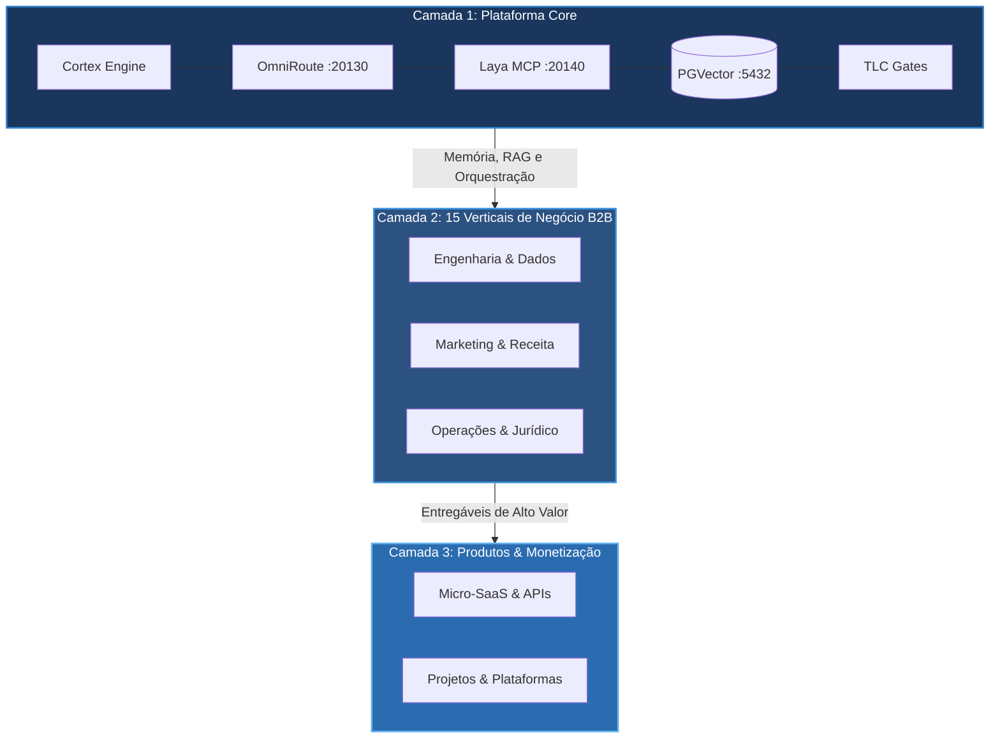
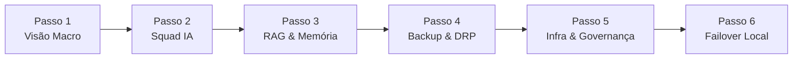
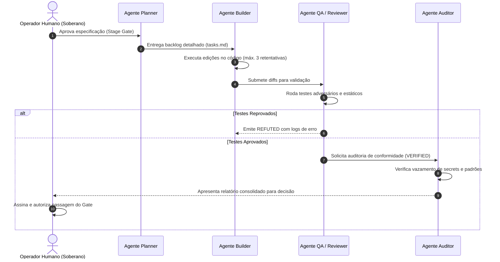
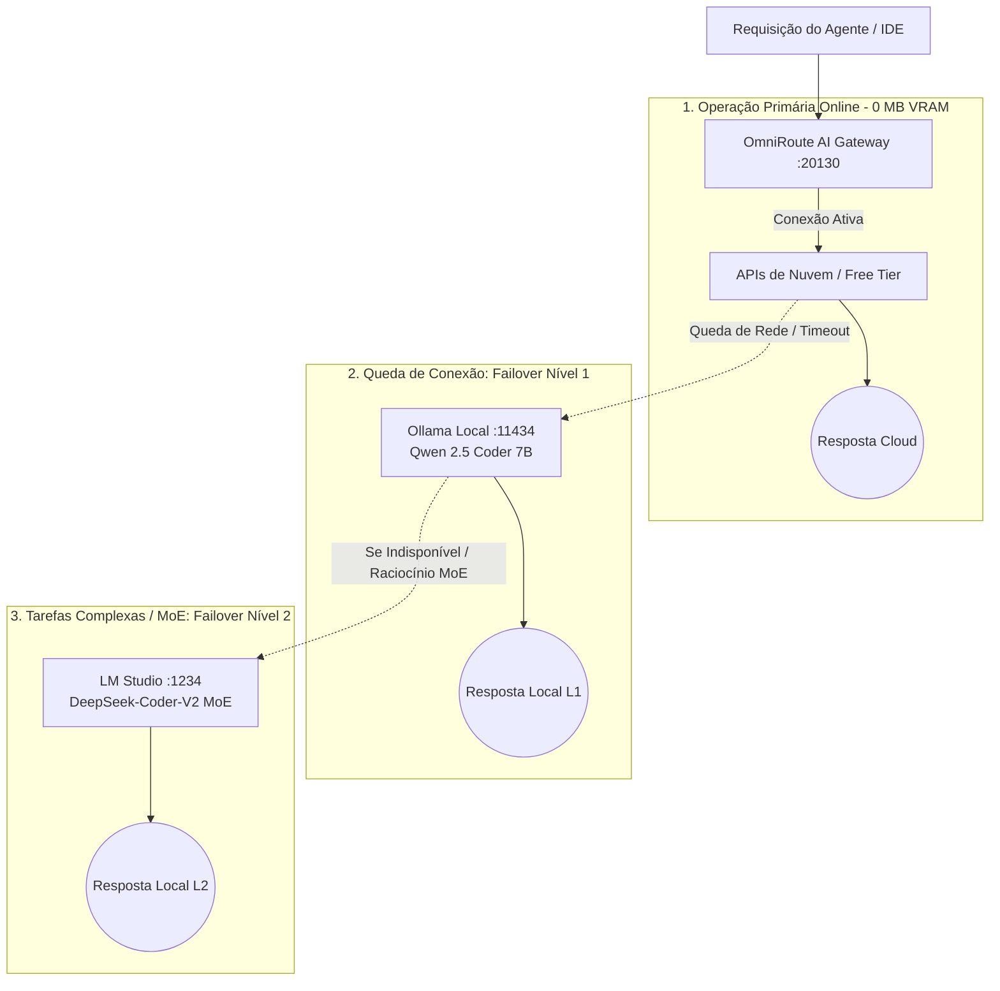

<div align="center">


# PromptCoreLabs_AEOS (AI Engineering Operating System) — v2.0
### Plataforma de Engenharia de Inteligência Artificial Soberana, Multi-Provedor e Living Architecture

[](https://enterdufter.github.io/PromptCoreLabs_AEOS/)
[](projects/pcl-aeos-harmonization/foundation-readiness.md)
[](LICENSE)
[-purple?style=for-the-badge)](#indicadores-canônicos)

---

</div>

## 💡 O que é o PCL AEOS?

O **PromptCoreLabs_AEOS** é um sistema operacional de engenharia de software desenhado para governar o trabalho conjunto de agentes de inteligência artificial e desenvolvedores humanos.

* **Em Linguagem Simples (Para Leigos e Líderes):**  
  Pense no PCL AEOS como um **escritório virtual hiper-eficiente com um cofre digital integrado**. Em vez de usar modelos de IA avulsos na nuvem que esquecem o contexto da sua empresa e cobram caro por token, o AEOS roda localmente no seu computador ou servidor próprio. Ele possui uma memória permanente que nunca esquece seus manuais e regras, garante privacidade absoluta dos dados (custo marginal zero de nuvem) e coloca uma equipe de agentes especialistas (planejador, desenvolvedor, revisor) para trabalhar sob a sua supervisão.
* **Sob a Ótica Técnica (Para Engenheiros e Arquitetos):**  
  Trata-se de um harness orquestrador agêntico desacoplado, assentado sobre **Memória Tripartida** no PostgreSQL 17 + PGVector, coprocessador reflexivo não-autoregressivo **LAYA (System One)** operando 100% em CPU (0 MB de VRAM), gateway inteligente de inferência **OmniRoute** e governança determinística orientada a especificações (**TLC Spec-Driven v3**).

> 🌐 **Explore o Portal Interativo (GitHub Pages):**  
> Para uma experiência imersiva com alternância de visão (👔 Executiva vs. 🛠️ Técnica), navegação interativa em tela cheia dos diagramas do **PCL Cortex** e leitura assistida em modais, acesse:  
> 👉 **[https://enterdufter.github.io/PromptCoreLabs_AEOS/](https://enterdufter.github.io/PromptCoreLabs_AEOS/)**

---

## 📊 Indicadores Canônicos (v2.0 Harmonizado)

| Indicador | Classificação Normativa | Valor Canônico | Benefício Prático e de Negócio |
|---|:---:|:---:|---|
| **Custo de Nuvem (Inferência Local)** | Modo Soberano Local | **$0.00 / mês** | 100% autônomo na máquina local do operador (Ollama, LM Studio e Laya). |
| **Coprocessador LAYA (System One)** | Target / Benchmark MCP | **< 35 ms** (MCP: ~0.014 ms) | Decisões tipadas instantâneas em CPU sem gastar tokens de nuvem. |
| **Alocação de GPU VRAM (Laya)** | Invariante de Hardware | **0 MB (100% CPU)** | GPU dedicada totalmente livre para modelos pesados (LLMs e SLMs). |
| **Recuperação de Desastres (RTO)** | SLA / Baseline Histórico | **SLA < 15 min** (Lab: 7.18s) | Restauração rápida multi-schema criptografada em AES-256 no Cloudflare R2. |
| **Memória Vetorial Soberana** | PGVector HNSW Local | **768 Dimensões** | Indexação semântica e RAG relacional isolado no schema `memory.*`. |
| **Governança Canônica** | Precedência Normativa | **PCL-AEOS-NORM-01** | Decisão humana soberana; sem fusão silenciosa de regras conflitantes. |

---

## 🏢 Arquitetura em 3 Camadas (Holding Digital)

O ecossistema opera sobre um modelo de três camadas concêntricas gerado pelo **PCL Cortex Engine**:



| Previsualização Gráfica | Artefato & Detalhes | Ações Disponíveis |
|:---:|---|:---:|
| <a href="https://enterdufter.github.io/PromptCoreLabs_AEOS/projects/Living%20Architecture%20PCL%20AEOS/diagrams/interactive/pcl-aeos-v2-holding.html" target="_blank" rel="noopener noreferrer"></a> | **DIAG-HOLD-01 • Holding Digital (3 Camadas)**<br>Representação topológica oficial gerada pelo *PCL Cortex Engine*, mapeando a Plataforma Core, os 15 clusters de squads e a saída para produtos de valor agregado. | <a href="https://enterdufter.github.io/PromptCoreLabs_AEOS/projects/Living%20Architecture%20PCL%20AEOS/diagrams/interactive/pcl-aeos-v2-holding.html" target="_blank" rel="noopener noreferrer">🌐 **Abrir Interativo no Portal ↗**</a><br><br>[📖 Operating Model](governance/operating-model.md) |

---

## 🧭 O Trilho de Aprendizado Arquitetural em 6 Passos

Abaixo você encontra a mesma jornada estruturada presente na GitHub Page, permitindo navegar pelos artefatos visuais e documentações de forma sequencial.



---

### PASSO 1: VISÃO MACRO & FUNDAÇÃO DO SISTEMA

* **💡 Para Leigos e Líderes:**  
  Como a sua empresa opera a inteligência artificial com segurança de ponta a ponta. Seus dados ficam protegidos no seu computador por uma rede virtual criptografada (Tailscale), e o sistema decide quando consultar modelos locais e quando falar com provedores externos de forma vigiada.
* **🛠️ Para Engenheiros e Técnicos:**  
  Topologia C4 em Níveis 1, 2 e 3. Mapeia a fronteira entre o operador humano, a VPN Mesh Tailscale, os contêineres Docker do cluster (`pcl-db`, `pcl-laya`, `pcl-omniroute`, `paperclip`) e a segregação de projetos em `projects/`.

| Previsualização (PNG) | Diagrama & Descrição | Ações de Navegação |
|:---:|---|:---:|
| <a href="https://enterdufter.github.io/PromptCoreLabs_AEOS/projects/Living%20Architecture%20PCL%20AEOS/diagrams/interactive/c4-l1-context.html" target="_blank" rel="noopener noreferrer"></a> | **DIAG-C4-01 • System Context (C4 Level 1)**<br>Visão perimetral do sistema: usuário, infraestrutura local soberana, VPN Tailscale e fronteiras de nuvem. | <a href="https://enterdufter.github.io/PromptCoreLabs_AEOS/projects/Living%20Architecture%20PCL%20AEOS/diagrams/interactive/c4-l1-context.html" target="_blank" rel="noopener noreferrer">🌐 **Abrir Interativo ↗**</a><br><br>[📖 Artigo de Estratégia](projects/Living%20Architecture%20PCL%20AEOS/docs/strategy/README.md) |
| <a href="https://enterdufter.github.io/PromptCoreLabs_AEOS/projects/Living%20Architecture%20PCL%20AEOS/diagrams/interactive/c4-l2-containers.html" target="_blank" rel="noopener noreferrer"></a> | **DIAG-C4-02 • Harness Container Topology (C4 Level 2)**<br>Topologia física dos contêineres Docker soberanos na rede interna `aeos-net`: PostgreSQL 17, Laya System One, OmniRoute e Paperclip. | <a href="https://enterdufter.github.io/PromptCoreLabs_AEOS/projects/Living%20Architecture%20PCL%20AEOS/diagrams/interactive/c4-l2-containers.html" target="_blank" rel="noopener noreferrer">🌐 **Abrir Interativo ↗**</a><br><br>[📖 Artigo de Runtime](projects/Living%20Architecture%20PCL%20AEOS/docs/runtime/README.md) |
| <a href="https://enterdufter.github.io/PromptCoreLabs_AEOS/projects/Living%20Architecture%20PCL%20AEOS/diagrams/interactive/c4-l3-components.html" target="_blank" rel="noopener noreferrer"></a> | **DIAG-C4-03 • Repository Component Breakdown (C4 Level 3)**<br>Decomposição dos módulos e fluxo de dados entre governança, memória e execução agêntica. | <a href="https://enterdufter.github.io/PromptCoreLabs_AEOS/projects/Living%20Architecture%20PCL%20AEOS/diagrams/interactive/c4-l3-components.html" target="_blank" rel="noopener noreferrer">🌐 **Abrir Interativo ↗**</a><br><br>[📖 Modelo C4 & Specs](projects/Living%20Architecture%20PCL%20AEOS/docs/c4-model/README.md) |
| <a href="https://enterdufter.github.io/PromptCoreLabs_AEOS/projects/Living%20Architecture%20PCL%20AEOS/diagrams/interactive/c4-l3-projects-taxonomy.html" target="_blank" rel="noopener noreferrer"></a> | **DIAG-PRJ-01 • Projects Taxonomy & Isolation**<br>Regras formais de isolamento para subprojetos contidos na pasta `projects/` (Living Architecture, Crialli, Harmonização). | <a href="https://enterdufter.github.io/PromptCoreLabs_AEOS/projects/Living%20Architecture%20PCL%20AEOS/diagrams/interactive/c4-l3-projects-taxonomy.html" target="_blank" rel="noopener noreferrer">🌐 **Abrir Interativo ↗**</a><br><br>[📖 Glossário & Taxonomia](projects/Living%20Architecture%20PCL%20AEOS/docs/glossary/README.md) |

---

### PASSO 2: SQUAD DE IA & AGENTES INTELIGENTES

* **💡 Para Leigos e Líderes:**  
  Em vez de confiar em um único "robô faz-tudo", o AEOS opera com uma **equipe especializada de 15 agentes**. Um agente planeja, outro constrói o código, um terceiro atua como auditor de qualidade e o último verifica a segurança. Nenhum agente pode aprovar o próprio trabalho; o humano é o chefe soberano que assina a entrega final.
* **🛠️ Para Engenheiros e Técnicos:**  
  Protocolo de mensageria confinada, orquestração Paperclip e micro-execução governada pela persona **Cortex** com limites de retentativas e transição de estados (`IDLE`, `PLANNING`, `WORKING`, `QA_REVIEW`).



| Previsualização (PNG) | Diagrama & Descrição | Ações de Navegação |
|:---:|---|:---:|
| <a href="https://enterdufter.github.io/PromptCoreLabs_AEOS/projects/Living%20Architecture%20PCL%20AEOS/diagrams/interactive/agents-squad-map.html" target="_blank" rel="noopener noreferrer"></a> | **DIAG-AGT-01 • Squad Orchestration & Roles**<br>Os 15 agentes distribuídos nas 4 camadas: Negócios/Estratégia, Especificação, Execução e Qualidade/Compliance. | <a href="https://enterdufter.github.io/PromptCoreLabs_AEOS/projects/Living%20Architecture%20PCL%20AEOS/diagrams/interactive/agents-squad-map.html" target="_blank" rel="noopener noreferrer">🌐 **Abrir Interativo ↗**</a><br><br>[📖 Manual dos 15 Agentes](projects/Living%20Architecture%20PCL%20AEOS/docs/agents-squads/README.md) |
| <a href="https://enterdufter.github.io/PromptCoreLabs_AEOS/projects/Living%20Architecture%20PCL%20AEOS/diagrams/interactive/life-cortex-micro-loop.html" target="_blank" rel="noopener noreferrer"></a> | **DIAG-LIF-01 • Cortex Micro-Loop Lifecycle**<br>Máquina de estados finita que governa o confinamento e o controle de falhas nas tarefas agênticas. | <a href="https://enterdufter.github.io/PromptCoreLabs_AEOS/projects/Living%20Architecture%20PCL%20AEOS/diagrams/interactive/life-cortex-micro-loop.html" target="_blank" rel="noopener noreferrer">🌐 **Abrir Interativo ↗**</a><br><br>[📖 Matriz RACI da Squad](projects/Living%20Architecture%20PCL%20AEOS/docs/agents-squads/README.md) |
| <a href="https://enterdufter.github.io/PromptCoreLabs_AEOS/projects/Living%20Architecture%20PCL%20AEOS/diagrams/interactive/seq-devex-loop.html" target="_blank" rel="noopener noreferrer"></a> | **DIAG-DEV-01 • Developer Experience & IDE Loop**<br>Ciclo de interação contínua entre o desenvolvedor, a IDE Antigravity, os servidores MCP locais e os relatórios. | <a href="https://enterdufter.github.io/PromptCoreLabs_AEOS/projects/Living%20Architecture%20PCL%20AEOS/diagrams/interactive/seq-devex-loop.html" target="_blank" rel="noopener noreferrer">🌐 **Abrir Interativo ↗**</a><br><br>[📖 Integrações MCP](projects/Living%20Architecture%20PCL%20AEOS/docs/integrations-mcp/README.md) |

---

### PASSO 3: CONHECIMENTO & MEMÓRIA PERSISTENTE (RAG TRIPARTIDO)

* **💡 Para Leigos e Líderes:**  
  A inteligência artificial aprende com a história da sua empresa. Toda informação, regulamento ou código é guardado com recibo de autenticidade (hash criptográfico). O sistema sabe quando um documento ficou velho (*obsoleto*) e alerta imediatamente para não usar respostas desatualizadas.
* **🛠️ Para Engenheiros e Técnicos:**  
  Arquitetura de **Memória Tripartida** (Episódica, Semântica e Procedural) isolada no schema `memory.*` do PostgreSQL 17 + PGVector. O coprocessador **LAYA (System One)** atua na triagem reflexiva em CPU (~0.014ms em lote via MCP stdio e porta 20140), garantindo 0 MB de VRAM alocada na GPU.

| Previsualização (PNG) | Diagrama & Descrição | Ações de Navegação |
|:---:|---|:---:|
| <a href="https://enterdufter.github.io/PromptCoreLabs_AEOS/projects/Living%20Architecture%20PCL%20AEOS/diagrams/interactive/data-rag-memory-tripartite.html" target="_blank" rel="noopener noreferrer"></a> | **DIAG-DAT-01 • RAG & Memória Tripartida**<br>Linhagem completa: ingestão vetorial (768D), busca vetorial HNSW no PGVector, verificação de staleness determinístico e reranker rápido. | <a href="https://enterdufter.github.io/PromptCoreLabs_AEOS/projects/Living%20Architecture%20PCL%20AEOS/diagrams/interactive/data-rag-memory-tripartite.html" target="_blank" rel="noopener noreferrer">🌐 **Abrir Interativo ↗**</a><br><br>[📖 Módulo Memory & RAG](memory/README.md) |
| <a href="https://enterdufter.github.io/PromptCoreLabs_AEOS/projects/Living%20Architecture%20PCL%20AEOS/diagrams/interactive/seq-laya-system-one.html" target="_blank" rel="noopener noreferrer"></a> | **DIAG-LAYA-01 • LAYA System One Classifier**<br>Coprocessador não-autoregressivo em CPU INT8 (< 35ms): triagem de contradições, guardrails, answerability check e roteamento. | <a href="https://enterdufter.github.io/PromptCoreLabs_AEOS/projects/Living%20Architecture%20PCL%20AEOS/diagrams/interactive/seq-laya-system-one.html" target="_blank" rel="noopener noreferrer">🌐 **Abrir Interativo ↗**</a><br><br>[📖 Skill do Laya (.agents)](.agents/skills/laya/SKILL.md) |
| <a href="https://enterdufter.github.io/PromptCoreLabs_AEOS/projects/Living%20Architecture%20PCL%20AEOS/diagrams/interactive/mcp-interconnection.html" target="_blank" rel="noopener noreferrer"></a> | **DIAG-MCP-01 • MCP Server Interconnection Map**<br>Topologia do Model Context Protocol integrando a IDE ao servidor nativo `pcl-laya` e ferramentas locais. | <a href="https://enterdufter.github.io/PromptCoreLabs_AEOS/projects/Living%20Architecture%20PCL%20AEOS/diagrams/interactive/mcp-interconnection.html" target="_blank" rel="noopener noreferrer">🌐 **Abrir Interativo ↗**</a><br><br>[📖 Protocolo MCP](projects/Living%20Architecture%20PCL%20AEOS/docs/integrations-mcp/README.md) |

---

### PASSO 4: BACKUP CIFRADO & DRP (RECUPERAÇÃO DE DESASTRES)

* **💡 Para Leigos e Líderes:**  
  **O cofre inabalável da sua empresa.** Se o servidor ou a máquina local sofrer uma falha física ou pane elétrica, tudo pode ser restaurado em poucos minutos a partir de um arquivo blindado por criptografia de nível bancário (AES-256), sem custo adicional de nuvem.
* **🛠️ Para Engenheiros e Técnicos:**  
  Plano de Recuperação de Desastres (DRP) multi-schema com RPO $\le$ 1h/24h e SLA de RTO $\le$ 15 minutos (validado em laboratório com restauração completa em 7,18 segundos). Os dados frios são enviados cifrados para bucket Cloudflare R2 com hash SHA-256.

```powershell
# Executar o backup completo da Memória (PostgreSQL + AES-256 + Cloudflare R2)
powershell -ExecutionPolicy Bypass -File "scripts/backup/backup-aeos-tripartido.ps1" -Mode cron

# Executar a Restauração de Desastres (DRP) em 1 comando
powershell -ExecutionPolicy Bypass -File "scripts/backup/restore-aeos-tripartido.ps1"
```

| Previsualização (PNG) | Diagrama & Descrição | Ações de Navegação |
|:---:|---|:---:|
| <a href="https://enterdufter.github.io/PromptCoreLabs_AEOS/projects/Living%20Architecture%20PCL%20AEOS/diagrams/interactive/seq-tripartite-memory-drp.html" target="_blank" rel="noopener noreferrer"></a> | **DIAG-MEM-01 • Memória Tripartida & DRP**<br>Fluxo automatizado de resiliência: dump relacional do banco, cifragem AES-256, sincronização em bucket R2 ($0.00/mês) e restore testado. | <a href="https://enterdufter.github.io/PromptCoreLabs_AEOS/projects/Living%20Architecture%20PCL%20AEOS/diagrams/interactive/seq-tripartite-memory-drp.html" target="_blank" rel="noopener noreferrer">🌐 **Abrir Interativo ↗**</a><br><br>[📖 Registro ADR-006](projects/Living%20Architecture%20PCL%20AEOS/docs/adrs/ADR-006-tripartite-memory-drp-cloudflare.md) |
| <a href="https://enterdufter.github.io/PromptCoreLabs_AEOS/projects/Living%20Architecture%20PCL%20AEOS/diagrams/interactive/data-legacy-migration.html" target="_blank" rel="noopener noreferrer"></a> | **DIAG-LEG-01 • Legacy Migration Dataflow**<br>Dataflow de sanitização e migração de dados do acervo legado para o novo padrão de memória vetorial unificado. | <a href="https://enterdufter.github.io/PromptCoreLabs_AEOS/projects/Living%20Architecture%20PCL%20AEOS/diagrams/interactive/data-legacy-migration.html" target="_blank" rel="noopener noreferrer">🌐 **Abrir Interativo ↗**</a><br><br>[📖 Migração Legada](projects/Living%20Architecture%20PCL%20AEOS/docs/legacy-migration/README.md) |

---

### PASSO 5: INFRAESTRUTURA, RUNTIME & GOVERNANÇA

* **💡 Para Leigos e Líderes:**  
  Como economizar até 90% da fatura de inteligência artificial. O sistema possui um roteador inteligente (*OmniRoute*) que direciona perguntas corriqueiras para modelos locais gratuitos e apenas desafios de alta complexidade para provedores de nuvem. Além disso, nenhuma decisão é tomada sem respeitar as regras aprovadas pelo patrocinador.
* **🛠️ Para Engenheiros e Técnicos:**  
  Isolamento estrito na sub-rede Docker `aeos-net`, malha VPN Tailscale com princípios Zero Trust, e compliance garantido por 5 Stage Gates sequenciais (G-00 a G-04) sob a [Matriz de Precedência Normativa](projects/pcl-aeos-harmonization/design/normative-hierarchy.md).

| Previsualização (PNG) | Diagrama & Descrição | Ações de Navegação |
|:---:|---|:---:|
| <a href="https://enterdufter.github.io/PromptCoreLabs_AEOS/projects/Living%20Architecture%20PCL%20AEOS/diagrams/interactive/seq-omniroute-routing.html" target="_blank" rel="noopener noreferrer"></a> | **DIAG-SEQ-02 • OmniRoute LLM Request Lifecycle**<br>Gateway inteligente (porta 20130): cache de prompt (EBITDA Shield), roteamento dinâmico entre cloud e modelos locais e failover. | <a href="https://enterdufter.github.io/PromptCoreLabs_AEOS/projects/Living%20Architecture%20PCL%20AEOS/diagrams/interactive/seq-omniroute-routing.html" target="_blank" rel="noopener noreferrer">🌐 **Abrir Interativo ↗**</a><br><br>[📖 Runtime & Gateway](projects/Living%20Architecture%20PCL%20AEOS/docs/runtime/README.md) |
| <a href="https://enterdufter.github.io/PromptCoreLabs_AEOS/projects/Living%20Architecture%20PCL%20AEOS/diagrams/interactive/infra-network-security.html" target="_blank" rel="noopener noreferrer"></a> | **DIAG-INF-01 • Network & Security Topology**<br>Arquitetura de rede física: segregação de contêineres e comunicação privada via VPN Mesh Tailscale. | <a href="https://enterdufter.github.io/PromptCoreLabs_AEOS/projects/Living%20Architecture%20PCL%20AEOS/diagrams/interactive/infra-network-security.html" target="_blank" rel="noopener noreferrer">🌐 **Abrir Interativo ↗**</a><br><br>[📖 Topologia de Rede](projects/Living%20Architecture%20PCL%20AEOS/docs/infrastructure/README.md) |
| <a href="https://enterdufter.github.io/PromptCoreLabs_AEOS/projects/Living%20Architecture%20PCL%20AEOS/diagrams/interactive/gov-stage-gates-matrix.html" target="_blank" rel="noopener noreferrer"></a> | **DIAG-GOV-01 • Governance & Stage Gates Matrix**<br>Matriz operacional que fixa critérios de passagem, artefatos obrigatórios e autoridade humana soberana de aprovação. | <a href="https://enterdufter.github.io/PromptCoreLabs_AEOS/projects/Living%20Architecture%20PCL%20AEOS/diagrams/interactive/gov-stage-gates-matrix.html" target="_blank" rel="noopener noreferrer">🌐 **Abrir Interativo ↗**</a><br><br>[📖 Stage Gates Oficiais](governance/stage-gates.md) |
| <a href="https://enterdufter.github.io/PromptCoreLabs_AEOS/projects/Living%20Architecture%20PCL%20AEOS/diagrams/interactive/sec-zero-trust-flow.html" target="_blank" rel="noopener noreferrer"></a> | **DIAG-SEC-01 • Secret Management & Zero Trust**<br>Diretriz Zero Secret Leak: proteção contra vazamento de tokens e isolamento de variáveis de ambiente. | <a href="https://enterdufter.github.io/PromptCoreLabs_AEOS/projects/Living%20Architecture%20PCL%20AEOS/diagrams/interactive/sec-zero-trust-flow.html" target="_blank" rel="noopener noreferrer">🌐 **Abrir Interativo ↗**</a><br><br>[📖 Políticas de Segurança](governance/policies.md) |

---

### PASSO 6: EXECUÇÃO REATIVA & FAILOVER SOB DEMANDA

* **💡 Para Leigos e Líderes:**  
  **Autonomia 100% offline.** Se a internet da sua empresa cair ou a VPN falhar, você não é interrompido. O sistema percebe a queda em menos de 10 segundos, liga os motores de inteligência artificial locais (instalados no seu computador) e você continua trabalhando normalmente. Quando a internet volta, ele desliga os modelos locais e libera a placa de vídeo.
* **🛠️ Para Engenheiros e Técnicos:**  
  Invariante de 0 MB de VRAM na GPU em modo online (com a RTX 3050 em repouso). Monitor reativo em background via PowerShell ([watch_network_trigger.ps1](scripts/windows/watch_network_trigger.ps1)) que aciona o carregamento sob demanda no Ollama (`qwen2.5-coder:7b`) e LM Studio (`DeepSeek-Coder-V2-Lite MoE`), com desalocação automática (`lms unload --all`) ao restabelecer a conectividade.



| Previsualização (PNG) | Diagrama & Descrição | Ações de Navegação |
|:---:|---|:---:|
| <a href="https://enterdufter.github.io/PromptCoreLabs_AEOS/projects/Living%20Architecture%20PCL%20AEOS/diagrams/interactive/arch-hybrid-inference-failover.html" target="_blank" rel="noopener noreferrer"></a> | **DIAG-INFER-01 • Hybrid Inference & Failover**<br>Topologia de inferência reativa em 3 camadas gerada pelo *PCL Cortex Engine*: Modo Online (0 MB VRAM), Failover Nível 1 (Ollama) e Nível 2 (LM Studio). | <a href="https://enterdufter.github.io/PromptCoreLabs_AEOS/projects/Living%20Architecture%20PCL%20AEOS/diagrams/interactive/arch-hybrid-inference-failover.html" target="_blank" rel="noopener noreferrer">🌐 **Abrir Interativo ↗**</a><br><br>[📖 Guia de Inferência Híbrida](docs/hybrid-inference-architecture.md) |
| <a href="https://enterdufter.github.io/PromptCoreLabs_AEOS/projects/Living%20Architecture%20PCL%20AEOS/diagrams/interactive/seq-trigger-based-failover.html" target="_blank" rel="noopener noreferrer"></a> | **DIAG-FAILOVER-01 • Trigger-Based On-Demand Failover**<br>Máquina de estados de failover gerada pelo *PCL Cortex Engine*, monitorando conectividade e desalocando a GPU ao retornar a rede. | <a href="https://enterdufter.github.io/PromptCoreLabs_AEOS/projects/Living%20Architecture%20PCL%20AEOS/diagrams/interactive/seq-trigger-based-failover.html" target="_blank" rel="noopener noreferrer">🌐 **Abrir Interativo ↗**</a><br><br>[📖 Otimização de VRAM](docs/hardware-vram-optimization.md) |

---

## 🚀 Quickstart: Como Executar o PCL AEOS Localmente

Para subir a infraestrutura completa do PCL AEOS no seu computador ou servidor:

### 1. Clonar o Repositório e Configurar o Ambiente
```bash
git clone https://github.com/EnterDufter/PromptCoreLabs_AEOS.git
cd PromptCoreLabs_AEOS
```

### 2. Inicializar os Contêineres Docker (Kernel Soberano)
```bash
# Inicializa PostgreSQL/PGVector, Laya System One, OmniRoute e Paperclip
docker compose -f docker-compose.aeos.yml up -d

# Verificar a saúde dos serviços
docker compose -f docker-compose.aeos.yml ps
```

### 3. Conectar o Coprocessador LAYA via MCP na IDE
O servidor MCP do Laya já vem pré-configurado no repositório. Para testar o coprocessador em CPU (0 MB VRAM):
```bash
python scripts/tests/test_mcp_protocol_handshake.py
```

### 4. Iniciar o Monitor de Failover Reativo (Opcional para Windows)
```powershell
powershell -ExecutionPolicy Bypass -File "scripts/windows/watch_network_trigger.ps1"
```

---

## 📑 Governança Canônica & Rastreabilidade do Projeto

O ecossistema PCL AEOS é regido pela documentação canônica aprovada no processo de harmonização estrutural:

* **[Certificado Foundation Ready](projects/pcl-aeos-harmonization/foundation-readiness.md):** Homologação formal da fundação do sistema.
* **[Matriz de Precedência Normativa](projects/pcl-aeos-harmonization/design/normative-hierarchy.md):** Hierarquia de autoridade soberana e RACI de governança (`PCL-AEOS-NORM-01`).
* **[Boundary Register & Arquitetura Canônica](projects/pcl-aeos-harmonization/design/canonical-architecture.md):** Delimitação formal de Core, Satélites e Módulos Externos.
* **[Registro Calibrado de Métricas e Claims](projects/pcl-aeos-harmonization/design/claims-register.md):** SLAs, targets de engenharia e medições históricas de laboratório.

---

<div align="center">

*PromptCoreLabs_AEOS v2.0 Sovereign — Todos os direitos reservados – 2026*  
*Desenvolvido pela comunidade PromptCore Labs sob Licença MIT*

</div>
