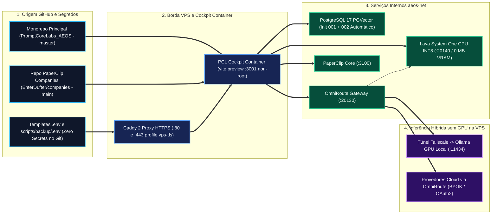

# 🚀 Guia de Bootstrap VPS, Sincronização Multi-Repo e Gate de Aceitação (`verify:all`)

Este documento orienta a **preservação integral no GitHub**, o **pré-voo containerizado (`docker-compose.aeos.yml`) com proxy HTTPS Caddy** e a **reprodução determinística em VPS Linux/Windows** do ecossistema **PromptCore Labs / PCL AEOS / PCL Cockpit**, prevenindo perda de artefatos locais ignorados pelo `.gitignore` raiz.

---

## 1. Arquitetura Multi-Repo e Artefatos Fora do Controle de Versão

O ambiente completo do **PCL Cockpit** coordena repositórios Git independentes e ativos locais intencionalmente excluídos pelo `.gitignore` raiz:

1. **Monorepo Principal (`c:\PromptCore_Labs` -> `EnterDufter/PromptCoreLabs_AEOS`, branch `master`):**
   - Contém Kernel AEOS, ADRs, diagramas Cortex, frontend/BFF (`projects/PromptCoreLabs_AEOS_Dashboard` + `Dockerfile`), configuração de proxy (`infra/caddy/Caddyfile`), `docker-compose.aeos.yml`, migrações SQL (`scripts/database/migrations/`), scripts de DRP (`scripts/backup/`) e o coprocessador CPU (`services/pcl-laya/`).
2. **Repositório Companheiro PaperClip Companies (`PaperClip-Companies/` -> `EnterDufter/companies.git`, branch `main`):**
   - Listado no `.gitignore` raiz (`PaperClip-Companies/`), mantendo histórico Git autônomo com `COMPANY.md`, definições organizacionais (`teams/`, `agents/`) e `skills/` montados no `cockpit` e `paperclip`.
   - ⚠️ **Regra Crítica de Preservação:** Um `git push` no monorepo principal **não** envia alterações de `PaperClip-Companies/`. Ambos os repositórios devem ser commitados e sincronizados separadamente.
3. **Sub-repositórios Opcionais da Stack Completa (`OmniRoute/` e `PaperClip/`):**
   - Quando você optar por compilar e subir a stack integral com `docker-compose.aeos.yml`, os diretórios `./OmniRoute` e `./PaperClip` fornecem seus respectivos `Dockerfile`. Se `./OmniRoute/.env` ou `./PaperClip/.env` não existirem em uma máquina nova, o Compose prossegue normalmente (`required: false`) usando as variáveis do `.env` raiz.
4. **Ativos Provisionados em Bootstrap (Não Versionados):**
   - Variáveis e segredos locais: `.env` (raiz) e `scripts/backup/.env` (gerados a partir dos respectivos `.env.example`, nunca versionados).
   - Pesos ONNX INT8 do Laya System One e ambiente Python: `services/pcl-laya/models/nli-minilm/model.onnx` (`82.823.063` bytes, SHA-256 verificado por `download_model.py`) e ambiente isolado `services/pcl-laya/.venv/` (`0 MB VRAM`, `onnxruntime` CPU + `mcp<2`).
   - Volumes Docker gerenciados (`db-data`, `omniroute-data`, `paperclip-storage`, `cockpit-vault`, `caddy-data`, `caddy-config`) e diretórios operacionais (`node_modules/`, `.vite-aeos/`, `dist/`, `test-results/`).

---

## 2. Topologia Multi-Repo, Stack Compose VPS e Roteamento Híbrido (Padrão Cortex v7)



---

## 3. Fluxo de Sincronização Segura no Host Local (Antes da Migração)

Antes de provisionar uma VPS nova, garanta que nenhum trabalho local fique isolado fora dos remotos:

1. **Audite o repositório principal (`c:\PromptCore_Labs`):**
   ```powershell
   npm --prefix projects/PromptCoreLabs_AEOS_Dashboard run test:repo-gate
   git status -s
   ```
   Confirme que apenas arquivos fonte, testes, migrações, infra Docker e docs aparecem (jamais `.env`, `.venv/`, `.vite-aeos/`, `dist/` ou `test-results/`). Em seguida execute `git add` seletivo, `git commit` e `git push origin master`.
2. **Audite e sincronize o repositório companheiro (`PaperClip-Companies`):**
   ```powershell
   git -C PaperClip-Companies status -s
   git -C PaperClip-Companies add .
   git -C PaperClip-Companies commit -m "chore(paperclip): sync local squad-prototyping, AGENTS.md and skills"
   git -C PaperClip-Companies push origin main
   ```
   *(Nunca utilize `git push --force` em branches compartilhadas.)*

---

## 4. Passo a Passo de Bootstrap em VPS Limpa

### Passo 1 — Clonar os repositórios necessários
```bash
git clone -b master https://github.com/EnterDufter/PromptCoreLabs_AEOS.git PromptCore_Labs
cd PromptCore_Labs
git clone -b main https://github.com/EnterDufter/companies.git PaperClip-Companies

# Opcional: se for compilar toda a stack Docker (omniroute + paperclip), clone também os serviços core:
# git clone https://github.com/EnterDufter/OmniRoute.git OmniRoute
# git clone https://github.com/EnterDufter/PaperClip.git PaperClip
```

### Passo 2 — Provisionar arquivos `.env` a partir dos templates
```bash
cp .env.example .env
cp scripts/backup/.env.example scripts/backup/.env
```
Configure no `.env` os valores do ambiente de homologação/produção:
- Credenciais reais do PostgreSQL 17 (`POSTGRES_USER`, `POSTGRES_PASSWORD`, `POSTGRES_DB`);
- `APP_PUBLIC_URL=https://cockpit.seu-dominio.com` (base canônica para futuros callbacks OAuth2 PKCE);
- `COCKPIT_DOMAIN=cockpit.seu-dominio.com` (usado pelo Caddy para emitir certificado Let's Encrypt automático quando `--profile vps-tls` estiver ativo);
- `GITHUB_PERSONAL_ACCESS_TOKEN` (opcional para `mcp-github`) sem jamais versionar `.env`.

### Passo 3 — Opção Docker Compose Autossuficiente (Recomendada na VPS)

Os volumes em `docker-compose.aeos.yml` são autossuficientes (sem `external: true`), e o serviço `db` (`pgvector/pgvector:pg17`) aplica automaticamente `001_create_memory_schema.sql` e `002_create_cockpit_artifacts_schema.sql` na primeira inicialização de volume limpo:

```bash
# Validar o manifesto Compose antes de subir (com e sem proxy TLS)
docker compose -f docker-compose.aeos.yml config -q
docker compose -f docker-compose.aeos.yml --profile vps-tls config -q

# Subir stack base (acesso local / túnel SSH em 127.0.0.1:3001)
docker compose -f docker-compose.aeos.yml up -d --build

# Ou subir na VPS com terminação TLS automática via Caddy (portas 80/443)
docker compose -f docker-compose.aeos.yml --profile vps-tls up -d --build
```

> **Migrando de um host Windows/Linux antigo?** Se uma máquina anterior usava volumes nomeados `promptcore_labs_db-data`, `promptcore_labs_omniroute-data` ou `promptcore_labs_paperclip-storage` com `external: true`, faça um backup `pg_dump` / volume copy ou crie um `docker-compose.override.yml` local antes de alternar para os volumes autossuficientes `pcl-aeos_*`.

#### Roteamento Híbrido sem GPU Dedicada na VPS
Como VPS econômicas de homologação não possuem GPU NVIDIA RTX:
- **Via OmniRoute (BYOK / Nuvem):** Configure chaves ou contas OAuth nos provedores Cloud pelo gateway `omniroute` (`:20130`). O Laya System One continua rodando em **CPU INT8 (`0 MB VRAM`)** dentro da VPS para triagem rápida.
- **Via Tailscale para GPU Doméstica (Opcional):** Instale Tailscale na VPS e na estação com GPU, e defina no `.env` da VPS:
  ```dotenv
  OLLAMA_URL=http://100.x.y.z:11434
  ```
  *(Substitua `100.x.y.z` pelo IP Tailscale privado da estação GPU; nunca exponha a porta `:11434` na internet pública.)*

### Passo 4 — Provisionamento Bare-Metal / Host Windows Local (`verify:all` e `.venv`)

Para desenvolver no host local e rodar toda a suíte `verify:all` fora do Docker:

1. **Dependências Node do Dashboard (`PCL Cockpit`):**
   ```bash
   npm --prefix projects/PromptCoreLabs_AEOS_Dashboard ci
   # Para rodar Playwright E2E localmente:
   npx --prefix projects/PromptCoreLabs_AEOS_Dashboard playwright install chromium
   ```
2. **Runtime Python isolado do Laya System One (`0 MB VRAM` CPU INT8):**
   O arquivo `services/pcl-laya/requirements.txt` já inclui `mcp>=1.10.0,<2.0.0` (fixado na linha `1.x` para compatibilidade com `FastMCP`, evitando breaking changes de `mcp 2.x`).
   ```bash
   python3 -m venv services/pcl-laya/.venv
   source services/pcl-laya/.venv/bin/activate
   # Em Windows PowerShell: .\services\pcl-laya\.venv\Scripts\Activate.ps1
   pip install -r services/pcl-laya/requirements.txt
   python services/pcl-laya/scripts/download_model.py
   ```
   *(Se alguma arquitetura futura sem wheel de `onnxruntime` utilizar Python muito recente, crie a `.venv` com Python `3.11` ou `3.12` via `py -3.11 -m venv` / `python3.12 -m venv` ou defina `LAYA_PYTHON_BIN` no `.env`.)*
3. **Banco PostgreSQL 17 + PGVector (Host sem Docker):**
   ```bash
   psql "$DATABASE_URL" -f scripts/database/migrations/001_create_memory_schema.sql
   psql "$DATABASE_URL" -f scripts/database/migrations/002_create_cockpit_artifacts_schema.sql
   ```
4. **DRP (Backup Tripartido):**
   Revise `scripts/backup/.env` e utilize `scripts/backup/backup-aeos-tripartido.sh` (Linux) ou `scripts/backup/backup-aeos-tripartido.ps1` (Windows).

---

## 5. Gate Obrigatório de Aceitação (`verify:all` + `build`)

Antes de liberar tráfego de usuários na VPS, valide todas as 5 camadas automatizadas mais o build de produção e o Compose:

```bash
npm --prefix projects/PromptCoreLabs_AEOS_Dashboard run build
npm --prefix projects/PromptCoreLabs_AEOS_Dashboard run verify:all
docker compose -f docker-compose.aeos.yml --profile vps-tls config -q
```

Cobertura validada pelo comando:
1. **`test:unit`**: Testes unitários React/TS de agrupamento temporal, sanitização PII/TTS e hooks de interface.
2. **`test:api`**: Testes integrados do BFF Vite middleware (Auth, Fail-Closed Crypto, PaperClip Disk Sync, persistência).
3. **`test:mcp`**: Handshake JSON-RPC 2.0 ao vivo contra `mcp-pcl-sovereign` (com auditoria SHA-256 de `model.onnx`) e `mcp-pcl-laya` (priorizando automaticamente `services/pcl-laya/.venv` e exigindo `engine_mode: "neural_onnx"`, `is_ready: true` e `vram_allocated_mb: 0`).
4. **`test:e2e`**: Regressões reais no Chromium (`SettingsModal` 8 abas, Login Fail-Closed, Z-Index menu/Flows, History Grouping, HelpCenter, SuperChatbubble, Artefatos e placeholders `test.fixme` explícitos de Fase 2/3/4).
5. **`test:repo-gate`**: Auditoria estática de segredos, guardas anti-regressão, ativos de runtime, nomes proibidos e integridade UTF-8 pura.
