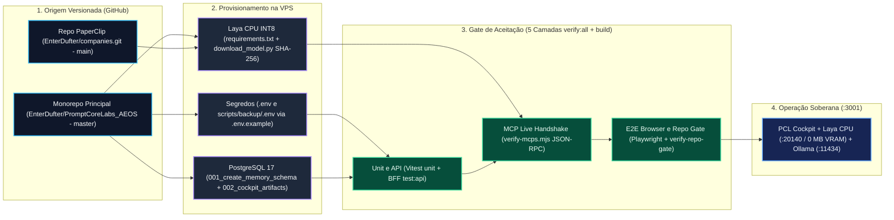

# 🚀 Guia de Bootstrap VPS, Sincronização Dual-Repo e Gate de Aceitação (`verify:all`)

Este documento orienta a **preservação integral no GitHub** e a **reprodução determinística em VPS Linux/Windows** do ecossistema **PromptCore Labs / PCL AEOS / PCL Cockpit**, prevenindo perda de artefatos locais ignorados pelo `.gitignore` raiz.

---

## 1. Arquitetura Dual-Repo e Artefatos Fora do Controle de Versão

O ambiente de produção do **PCL Cockpit** depende de **dois repositórios Git independentes** e de ativos locais binários/sigilosos intencionalmente excluídos pelo `.gitignore` da raiz:

1. **Monorepo Principal (`c:\PromptCore_Labs` -> `EnterDufter/PromptCoreLabs_AEOS`, branch `master`):**
   - Contém Kernel AEOS, ADRs, diagramas Cortex, frontend/BFF (`projects/PromptCoreLabs_AEOS_Dashboard`), migrações SQL (`scripts/database/migrations/`), scripts de DRP (`scripts/backup/`) e código-fonte do coprocessador CPU (`services/pcl-laya/`).
2. **Repositório Companheiro PaperClip (`PaperClip-Companies/` -> `EnterDufter/companies.git`, branch `main`):**
   - Listado no `.gitignore` raiz (`PaperClip-Companies/`), mantendo histórico Git autônomo com `COMPANY.md`, definições organizacionais (`teams/`, `agents/`) e `skills/` consumidos dinamicamente em disco por `/api/aeos/paperclip/sync`.
   - ⚠️ **Regra Crítica de Preservação:** Um `git push` no monorepo principal **não** envia alterações de `PaperClip-Companies/`. Ambos os repositórios devem ser commitados e sincronizados separadamente.
3. **Ativos Provisionados em Bootstrap (Não Versionados):**
   - Variáveis e segredos locais: `.env` (raiz) e `scripts/backup/.env` (gerados a partir dos respectivos `.env.example`, nunca versionados).
   - Pesos ONNX INT8 do Laya System One: `services/pcl-laya/models/nli-minilm/model.onnx` (`82.823.063` bytes), baixados e auditados via SHA-256 pelo script `services/pcl-laya/scripts/download_model.py`.
   - Bancos de runtime e diretórios operacionais: PostgreSQL 17 (`PGVector`), `data/`, `node_modules/`, `.vite-aeos/`, `test-results/`.

---

## 2. Topologia Dual-Repo, Provisionamento VPS e Gate `verify:all` (Padrão Cortex v7)



---

## 3. Fluxo de Sincronização Segura no Host Local (Antes da Migração)

Antes de provisionar uma VPS nova, garanta que nenhum trabalho local fique isolado fora dos remotos:

1. **Audite o repositório principal (`c:\PromptCore_Labs`):**
   ```powershell
   git status -s
   npm --prefix projects/PromptCoreLabs_AEOS_Dashboard run test:repo-gate
   ```
   Confirme que apenas arquivos fonte, testes, migrações e docs aparecem (jamais `.env`, `.vite-aeos`, `dist` ou `test-results`). Em seguida execute `git add` seletivo, `git commit` e `git push origin master`.
2. **Audite e sincronize o repositório companheiro (`PaperClip-Companies`):**
   ```powershell
   git -C PaperClip-Companies status -s
   git -C PaperClip-Companies add .
   git -C PaperClip-Companies commit -m "chore(paperclip): sync local squad-prototyping, AGENTS.md and skills"
   git -C PaperClip-Companies push origin main
   ```
   *(Nunca utilize `git push --force` em branches compartilhadas.)*

---

## 4. Passo a Passo de Bootstrap em VPS Limpa

### Passo 1 — Clonar ambos os repositórios
```bash
git clone -b master https://github.com/EnterDufter/PromptCoreLabs_AEOS.git PromptCore_Labs
cd PromptCore_Labs
git clone -b main https://github.com/EnterDufter/companies.git PaperClip-Companies
```

### Passo 2 — Provisionar arquivos `.env` a partir dos templates
```bash
cp .env.example .env
cp scripts/backup/.env.example scripts/backup/.env
```
Preencha no `.env` as credenciais reais do ambiente (PostgreSQL 17, chave AES-256-GCM/sessão, OAuth quando aplicável e `GITHUB_PERSONAL_ACCESS_TOKEN` opcional para `mcp-github`) sem jamais versioná-lo.

### Passo 3 — Instalar dependências do Dashboard (`PCL Cockpit`)
```bash
npm --prefix projects/PromptCoreLabs_AEOS_Dashboard ci
```
Para executar a suíte E2E na VPS também instale o navegador headless do Playwright (`npx --prefix projects/PromptCoreLabs_AEOS_Dashboard playwright install chromium`).

### Passo 4 — Provisionar Runtime CPU do Laya System One (`0 MB VRAM`)
```bash
python3 -m venv services/pcl-laya/.venv
source services/pcl-laya/.venv/bin/activate
pip install -r services/pcl-laya/requirements.txt mcp
python services/pcl-laya/scripts/download_model.py
```
O `download_model.py` baixa e valida o hash SHA-256 de `config.json`, `tokenizer.json` e `model.onnx` (`82.823.063` bytes). Sem `onnxruntime`, `tokenizers` e `numpy` no interpretador Python usado pelo BFF, o servidor MCP opera em modo `symbolic_fallback` transparente (`vram_allocated_mb: 0`).

### Passo 5 — Aplicar Migrações do PostgreSQL 17 + PGVector
Execute na ordem numérica contra o banco configurado em `.env`:
```bash
psql "$DATABASE_URL" -f scripts/database/migrations/001_create_memory_schema.sql
psql "$DATABASE_URL" -f scripts/database/migrations/002_create_cockpit_artifacts_schema.sql
```

### Passo 6 — Configurar DRP (Backup Tripartido)
Revise `scripts/backup/.env` e utilize `scripts/backup/backup-aeos-tripartido.sh` (Linux) ou `scripts/backup/backup-aeos-tripartido.ps1` (Windows) para rotinas de backup automatizado do banco, conhecimento térmico e `.env` cifrado.

---

## 5. Gate Obrigatório de Aceitação (`verify:all` + `build`)

Antes de liberar tráfego de usuários na VPS, valide todas as 5 camadas automatizadas mais o build de produção:

```bash
npm --prefix projects/PromptCoreLabs_AEOS_Dashboard run build
npm --prefix projects/PromptCoreLabs_AEOS_Dashboard run verify:all
```

Cobertura validada pelo comando:
1. **`test:unit`**: Testes unitários React/TS de agrupamento temporal, sanitização PII/TTS e hooks de interface.
2. **`test:api`**: Testes integrados do BFF Vite middleware (Auth, Fail-Closed Crypto, PaperClip Disk Sync, persistência).
3. **`test:mcp`**: Handshake JSON-RPC 2.0 ao vivo contra `mcp-pcl-sovereign` (com auditoria SHA-256 de `model.onnx`) e `mcp-pcl-laya`.
4. **`test:e2e`**: Regressões reais no Chromium (`SettingsModal` 8 abas, Login Fail-Closed, Z-Index menu/Flows, History Grouping, HelpCenter, SuperChatbubble, Artefatos e placeholders `test.fixme` explícitos de Fase 2/3/4).
5. **`test:repo-gate`**: Auditoria estática de segredos, guardas anti-regressão, ativos de runtime, nomes proibidos e integridade UTF-8 pura.

