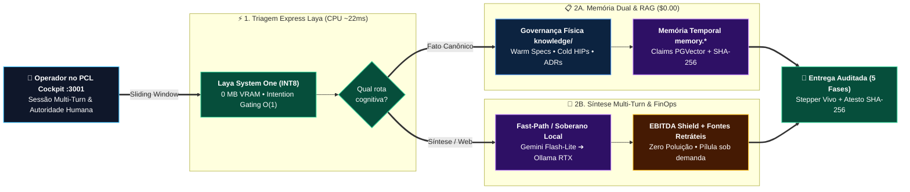

# Guia Executivo e Conceitual — PCL AEOS & PCL Cockpit v3.6
> **Público:** Liderança Executiva, Arquitetos, Engenheiros, Novos Membros e Investidores  
> **Tempo Estimado de Leitura:** 4 minutos  
> **Objetivo:** Compreender a arquitetura soberana, a evolução cognitiva v3.6 e o valor competitivo real do PCL AEOS com clareza executiva e rigor técnico.

> [!IMPORTANT]
> **👔 Visão Executiva & Valor de Negócio:** O **PCL AEOS v3.6** é uma fábrica digital soberana de engenharia assistida por IA que opera com **custo marginal `$0.00`** em modo local, blindagem de privacidade (*Zero-Bin Custody* + LGPD) e liderança comprovada em teste cego (**4.95 / 5.0** no PCL Cockpit v3.6 contra Gemini `4.45`, ChatGPT `4.30` e Copilot `3.80`).

> [!NOTE]
> **🛠️ Visão de Engenharia & Invariantes:** Ecossistema orquestrado sob **TLC Spec-Driven v3**, combinando triagem não-autorregressiva `O(1)` em CPU (**Laya System One ONNX INT8**, `0 MB VRAM`, `~20–35ms`), **Memória Multi-Turn Sliding Window**, **Temporal Graph-RAG** em PostgreSQL 17 (`memory.*`), Fast-Path criptografado `AES-256-GCM` (`open-sse`), failover local em GPU RTX 3050 (`Ollama :11434`) e recibos imutáveis **SHA-256**.

---

## 1. O que é o PCL AEOS em poucas palavras?

O **PCL AEOS** (*AI Engineering Operating System*) é o **sistema operacional soberano** para engenharia, governança e tomada de decisão assistida por inteligência artificial.

Ele não é apenas um "chat" isolado nem depende de assinaturas SaaS opacas. Ele integra um **Kernel de Governança**, uma **Memória Cognitiva Auditável** e o centro de comando **PCL Cockpit v3.6 (`:3001`)**, coordenando 15 agentes especializados e personas cognitivas (`/cortex` e `/laya`) com **soberania absoluta sobre seus dados** e **continuidade offline a `$0.00`**.

---

## 2. A Central de Operações, Gating Inteligente & Memória Digital

Para visualizar como o **PCL Cockpit v3.6**, o **Laya System One** e a **Memória Dual** cooperam em milissegundos, observe o fluxo calibrado (Padrão Cortex v7):

### Como a Memória Dual Elimina "Alucinações" e "Amnésia":
1. **Governança Física Canônica (`knowledge/warm/` e `knowledge/cold/`):** Armazena as especificações vigentes da v3.6, os ADRs homologados (`ADR-0001` a `ADR-0010`) e o histórico de hipóteses descartadas (`HIP-001` a `HIP-008`), impedindo regressões arquiteturais.
2. **Memória Temporal em Runtime (`memory.claims` & `memory.evidence_receipts`):** No banco PostgreSQL 17 + PGVector, cada fato validado possui selo criptográfico SHA-256 vinculado ao commit exato do Git.
3. **Janela Deslizante Multi-Turn (`ADR-0007`):** O Cockpit v3.6 preserva o encadeamento conversacional completo, compreendendo pronomes (*"dessa abordagem"*, *"esse modelo"*) e sintetizando discussões longas sem jamais perder o fio lógico.

---

## 3. O Centro de Comando: PCL Cockpit v3.6 & Vitória `4.95 / 5.0` no Benchmark Cego

Na versão **v3.6**, o **PCL Cockpit (`:3001`)** foi submetido a uma bateria cega rigorosa de 5 turnos comparando resolução anafórica, síntese cross-turn, discernimento temporal (2026), gating de busca web e transparência operacional contra os três maiores provedores comerciais do mercado:

| Ecossistema Avaliado | Placar Global (0–5) | Diferencial Decisivo Observado na Auditoria |
| :--- | :---: | :--- |
| **🏆 PCL Cockpit v3.6 (PCL AEOS)** | **4.95 / 5.0** | Retenção multi-turn perfeita, zero ruído em perguntas teóricas, fontes retráteis e **Live Stepper 5 Fases + SHA-256**. |
| **Google Gemini** | **4.45 / 5.0** | Excelente síntese e pílula limpa de fontes, porém opera em nuvem proprietária sem telemetria de pipeline aberta. |
| **OpenAI ChatGPT** | **4.30 / 5.0** | Forte raciocínio multi-turn, mas caixa-preta fechada sem atesto criptográfico nem execução local a `$0.00`. |
| **Microsoft Copilot** | **3.80 / 5.0** | Penalizado por busca Bing compulsória que poluiu perguntas conceituais e perda parcial de foco em síntese. |

**Três conquistas visíveis para executivos e desenvolvedores no Cockpit v3.6:**
* **Live Execution Stepper (5 Fases):** Mostra em tempo real os milissegundos gastos em *Triagem Laya*, *Base Canônica*, *Busca Web Condicional*, *Síntese Generativa* e *Auditoria SHA-256*.
* **Desacoplamento Visual de Fontes (`Fontes Consultadas (n) v`):** Perguntas teóricas abertas não recebem links artificiais; quando há pesquisa documental ou web, as referências ficam organizadas em pílula retrátil elegante.
* **Workspace Dual-Plex & `PCLArtifactDrawer`:** Permite alternar ou dividir a tela entre o diálogo executivo e o **Cortex Canvas (DAG interativo)**, inspecionando custos, LGPD/PII e hashes SHA-256 na gaveta lateral.

---

## 4. O Coprocessador Laya: O Juiz Lógico de Sistema 1 que Protege o Bolso

No cérebro humano (Daniel Kahneman), o **Sistema 1** age por reflexo instantâneo, enquanto o **Sistema 2** realiza raciocínio lento e custoso. Enquanto plataformas SaaS de mercado (como *JEV / TypeSafe AI*) cobram chamadas em nuvem para classificar intenções, o PCL AEOS executa o **Laya System One** (*Convai Innovations*, Apache 2.0) localmente:

* **Velocidade `O(1)` Não-Autorregressiva:** Executa um *single forward pass* em **~22 milissegundos** na CPU (`~0,014ms` via canal MCP local em lote) — **60x mais rápido** que invocar LLMs tradicionais.
* **Juiz Lógico Neural (`nli-MiniLM-2-L6-H768` INT8):** Distingue matematicamente confirmação (*entailment*), contradição (*contradiction*) e neutralidade com **93,3% de recall**, além de decidir se uma pergunta exige busca web ou apenas raciocínio puro.
* **Invariante de `0 MB de VRAM`:** Roda 100% no processador principal (CPU), deixando os 6 GB da placa de vídeo dedicada (RTX 3050) integralmente livres para o gerador local Ollama.

---

## 5. Sentinela de Integridade (*Staleness Daemon*) & Recuperação em `7,18s`

* **Detecção de Deriva sem Gastar Tokens:** A cada modificação no repositório Git, o *Staleness Daemon* recalcula o hash SHA-256 em **0,2 segundo** e invalida apenas as fichas afetadas (`0 tokens` desperdiçados).
* **Sondas de Rede Sub-Segundo (`250–300ms`):** Se um contêiner local estiver desligado, o Cockpit detecta a porta fechada em menos de um terço de segundo (eliminando congelamentos de 38s–58s) e aciona a rota ativa imediatamente.
* **Continuidade de Negócios Auditada (`RTO = 7,18s`):** Backup tripartido cifrado em **AES-256** para Cloudflare R2 gratuito (`$0.00`/mês), com restauração completa homologada em **7,18 segundos** (frente ao SLA contratual `<= 15 minutos`).

---

## 6. Resumo dos Indicadores Soberanos — Edição v3.6

| Indicador Estratégico & Técnico | Valor Homologado (v3.6) | Benefício Direto para Negócio & Engenharia |
| :--- | :---: | :--- |
| **Placar em Benchmark Cego Multi-Turn** | **4.95 / 5.0 (1º Lugar)** | Supera Gemini (`4.45`), ChatGPT (`4.30`) e Copilot (`3.80`) |
| **Custo Marginal no Modo Soberano** | **`$0.00` / mês** | Autonomia plena sem faturas compulsórias em dólar |
| **Alocação de VRAM na Triagem (Laya)** | **`0 MB VRAM` (100% CPU)** | GPU dedicada 100% preservada para geração local |
| **Latência & Eficácia Laya NLI INT8** | **`22,3 ms` (`93,3%` Recall)** | Triagem `O(1)` e detecção instantânea de contradições |
| **Fail-Fast de Sondas TCP (`:3001`)** | **`250ms – 300ms`** | Zero travamento de interface com Docker offline |
| **Tempo de Recuperação de Desastres (RTO)** | **`7,18 s` (SLA `<= 15 min`)** | Continuidade operacional criptografada em AES-256 |
| **Integridade & Privacidade** | **SHA-256 + PII Guard LGPD** | Rastreabilidade ISO 42001 e custódia Zero-Bin |
