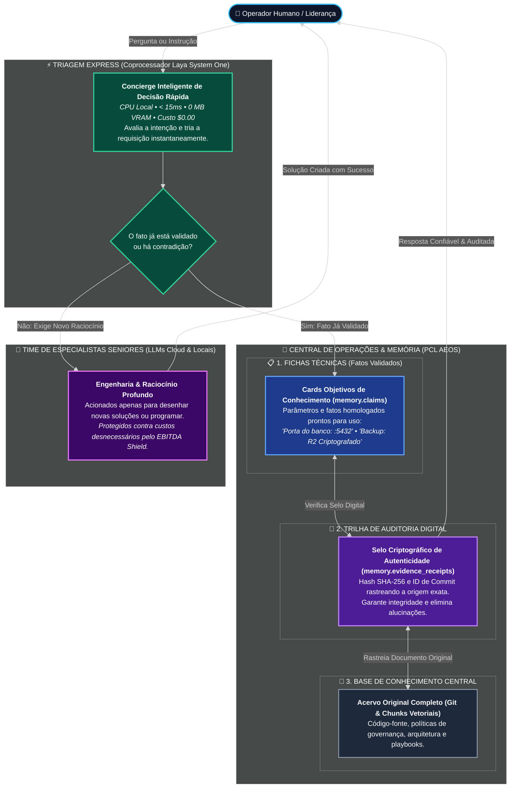

# Guia Executivo e Conceitual — PCL AEOS v2.0
> **Público:** Liderança, Executivos, Novos Membros da Equipe e Curiosos  
> **Tempo Estimado de Leitura:** 3 minutos  
> **Objetivo:** Compreender a inteligência, o propósito e o funcionamento do PCL AEOS sem jargões desnecessários.

---

## 1. O que é o PCL AEOS em poucas palavras?

O **PCL AEOS** (*AI Engineering Operating System*) é o **sistema operacional soberano** para engenharia e desenvolvimento assistido por inteligência artificial. 

Ele não é apenas um "chat" ou uma ferramenta isolada. Ele é uma **fábrica digital inteligente** que roda localmente no seu computador, orquestrando um squad de agentes especializados para arquitetar, programar, testar e proteger suas aplicações de forma contínua, com **soberania total sobre seus dados** e **custo zero de nuvem para operações corriqueiras**.

---

## 2. A Metáfora da Central de Operações & Memória Digital

Para entender como a **Memória Tripartida** e a inteligência do PCL AEOS funcionam na prática, imagine a dinâmica de um **Hub de Inteligência Digital de Alta Tecnologia**:

### Como a Estrutura se Divide:
1. **A Base de Conhecimento Central (Acervo Digital):** Onde residem o código-fonte, manuais, normas de governança e documentação completa indexados em blocos vetoriais 768D.
2. **As Fichas Técnicas de Fatos Validados (`memory.claims`):** Em vez de reler centenas de páginas a cada interação, o sistema mantém cartões objetivos com afirmações comprovadas (*"A porta do banco é :5432"*, *"A política de backup é diária"*).
3. **A Trilha de Auditoria Digital (`memory.evidence_receipts`):** Cada ficha técnica possui um selo digital criptográfico com hash SHA-256 e o commit exato do Git. Se alguém alterar o documento original, o sistema acusa a divergência no mesmo segundo.

### Por que essa abordagem elimina as "alucinações"?
Quando uma inteligência artificial convencional é questionada, ela tenta "adivinhar" o que soa verossímil.  
No PCL AEOS, os agentes são proibidos de inventar: eles consultam as Fichas Técnicas e exigem a Trilha de Auditoria com selo de evidência. Se uma informação for contraditória ou não comprovada, o sistema acusa o conflito de forma transparente.

---

## 3. O Coprocessador Laya: A Triagem Express que Protege o Bolso

No cérebro humano, quando você encosta a mão em uma chapa quente, seu braço recua antes mesmo de você raciocinar: isso é um **reflexo involuntário**.

O **Laya System One** é o reflexo involuntário do PCL AEOS:
* Ele é um microsserviço e MCP Server nativo que roda no processador comum (CPU) em **menos de 15 milissegundos** (com benchmark auditado em $\sim$0,014ms via MCP local).
* Ele **não gasta 1 megabyte sequer da placa de vídeo (GPU)**, deixando todo o hardware livre para trabalho pesado.
* Se você disser um simples *"Bom dia"* ou perguntar *"Qual é a porta do banco?"*, o Laya responde de imediato no computador local, **sem gastar tokens de nuvem nem um centavo de dólar ($0.00)**.
* Se a solicitação exigir raciocínio complexo ou programação sofisticada, o Laya direciona a tarefa para os modelos mais potentes através do cache inteligente padronizado (**EBITDA Shield**).

---

## 4. O Cão de Guarda Determinístico (*Staleness Daemon*)

Imagine que você editou uma única linha de um documento no Git. Sistemas tradicionais gastariam minutos e dinheiro lendo e reprocessando todo o acervo.

O PCL AEOS possui um sentinela silencioso:
* A cada alteração no código, ele calcula a "impressão digital" (hash SHA-256) do arquivo em **0,2 segundo**.
* Se nada mudou, ele gasta **zero tokens**.
* Se houve alteração, ele atualiza cirurgicamente apenas aquela ficha técnica específica.

---

## 5. Resiliência Absoluta: Recuperação de Desastres em Segundos

Se o computador queimar ou o disco for formatado, o PCL AEOS foi projetado e **auditado formalmente** para:
* Executar backup cifrado militarmente (AES-256) para nuvem gratuita Cloudflare R2 ($0.00/mês).
* Cumprir SLA contratual de RTO $\le$ 15 minutos, com restauração completa de dados, inteligência e memórias homologada e auditada em **apenas 7,18 segundos** em laboratório.

---

## 6. Resumo dos Indicadores Soberanos da Versão 2.0

| Indicador | Valor Aferido em Auditoria | Benefício Real |
|:---|:---:|:---|
| **Custo Mensal de Infraestrutura** | **$0.00 / mês** | Zero dependência de servidores pagos |
| **Alocação de VRAM na GPU** | **0 MB** | Placa de vídeo 100% livre |
| **Latência de Decisão (Laya)** | **< 15 ms (0.014ms MCP)** | Resposta instantânea e sem engasgos |
| **Tempo de Recuperação (RTO)** | **7,18 s (SLA $\le$ 15min)** | Continuidade de negócio inabalável |
| **Integridade de Fatos** | **100% Criptografado** | Rastreabilidade do commit à resposta |
