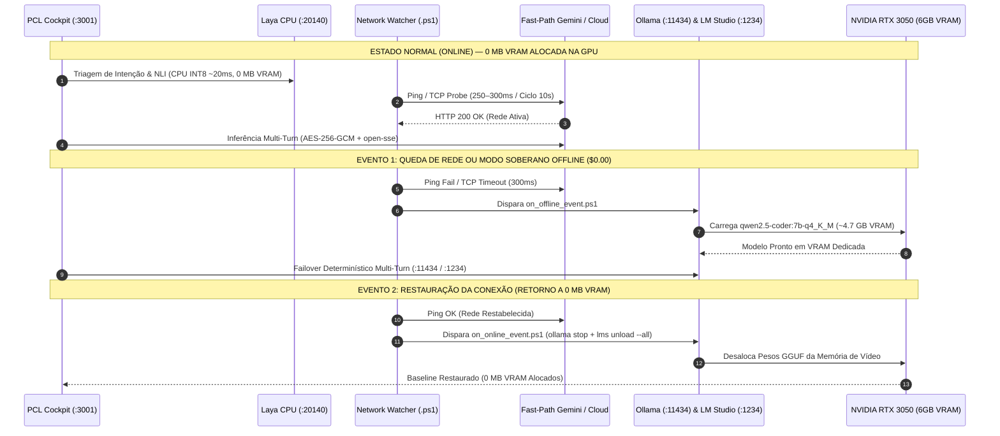
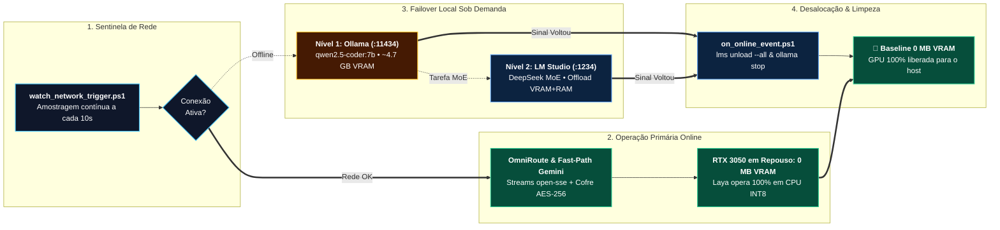

# Guia Oficial de Portabilidade de Hardware & Especificação de Scripts (PCL AEOS v3.6)

**Documento**: `docs/hardware-portability-guide.md`  
**Tipo**: Guia de Engenharia & Especificação de Portabilidade  
**Ecossistema**: PromptCoreLabs_AEOS v3.6 Sovereign  

> [!IMPORTANT]
> **👔 Visão Executiva & Valor de Negócio:** O **PCL AEOS v3.6** não exige servidores caros de datacenter para operar com soberania: ele escala desde notebooks corporativos sem placa de vídeo até workstations de engenharia, mantendo o computador leve no dia a dia (`0 MB de VRAM` consumida quando conectado) e assumindo localmente sem custo adicional (`$0.00`) em qualquer contingência de rede.

> [!NOTE]
> **🛠️ Visão de Engenharia & Invariantes:** Especifica a matriz de dimensionamento de modelos GGUF/ONNX (`Hardware Scaling Matrix`) e os daemons reativos PowerShell/Bash (`Trigger-Based On-Demand Failover`), preservando o invariante físico de **`0 MB VRAM` para o coprocessador Laya System One em CPU** em todos os perfis de máquina.

---

## 1. Matriz de Portabilidade e Perfis de Hardware (*Hardware Scaling Matrix*)

O PCL AEOS adapta-se dinamicamente ao hardware host. Em **todos** os perfis abaixo, o coprocessador **Laya System One (`:20140`)** roda exclusivamente em CPU (`ONNX Runtime INT8`), garantindo zero disputa por memória de vídeo:

| Perfil de Hardware | VRAM / RAM | Modelo Gerador Local Indicado | Quantização | Context Window | Configuração de Load (`lms load` / Ollama) |
| :--- | :--- | :--- | :---: | :---: | :--- |
| **Perfil 1: Ultra-Light** | `0–4 GB VRAM` / `8–16 GB RAM` | `gemma3:4b` / `Qwen2.5-Coder-1.5B` | `Q4_K_M` | `4096` tokens | `--gpu 0` (CPU Multi-thread) |
| **Perfil 2: Standard Laptop (Target LOQ)** | **`6 GB VRAM`** / **`16 GB RAM DDR5`** | **`qwen2.5-coder:7b-instruct`** | **`Q4_K_M`** | **`8192` tokens** | **`--gpu max --ttl 1800` (~4.7 GB VRAM)** |
| **Perfil 3: Workstation** | `8–12 GB VRAM` / `32 GB RAM` | `Qwen2.5-Coder-14B` / `DeepSeek-Lite` | `Q5_K_M` | `16384` tokens | `--gpu max --ttl 3600` |
| **Perfil 4: High-End Server** | `16–24+ GB VRAM` / `64+ GB RAM` | `Qwen2.5-Coder-32B` / `DeepSeek-V2.5` | `Q6_K` / `fp16` | `32768` tokens | `--gpu max --ttl 0` |

---

## 2. Ciclo de Vida Reativo (*Trigger-Based Sequence Diagram*)



---

## 3. Máquina de Estados de Transição de VRAM (Padrão Cortex v7)



---

## 4. Especificação Detalhada dos Scripts de Automação (`scripts/windows/`)

### 1. `scripts/windows/watch_network_trigger.ps1`
* **Responsabilidade**: Daemon ultraleve de monitoramento reativo da interface de rede.
* **Parâmetros**:
  * `-CheckIntervalSeconds` (Padrão: `10`): Intervalo de amostragem de ping.
  * `-TestEndpoints` (Padrão: `@("1.1.1.1", "8.8.8.8", "openrouter.ai")`): Endpoints testados para validação de conectividade.
  * `-LogFile`: Caminho do log auditável em `logs/network_watcher.log`.
* **Execução**:
  ```powershell
  powershell -ExecutionPolicy Bypass -File "scripts/windows/watch_network_trigger.ps1" -CheckIntervalSeconds 10
  ```

### 2. `scripts/windows/on_offline_event.ps1`
* **Responsabilidade**: Gatilho de failover executado na perda de rede para orquestrar a contingência local em 2 níveis.
* **Ações**:
  1. **Nível 1 (Alta Velocidade)**: Garante prontidão do serviço Ollama na porta `11434` rodando `qwen2.5-coder:7b-instruct-q4_K_M` (100% alocado na VRAM de 6 GB).
  2. **Nível 2 (MoE / Refatoração)**: Garante prontidão do LM Studio Server na porta `1234` com suporte ao `DeepSeek-Coder-V2-Lite-Instruct` em GPU Offload (`VRAM + RAM DDR5`).
* **Parâmetros**: `-OllamaPort` (`11434`), `-OllamaModel` (`"qwen2.5-coder:7b-instruct-q4_K_M"`), `-LMSPort` (`1234`), `-LMSModel` (`"deepseek-coder-v2-lite-instruct"`).

### 3. `scripts/windows/on_online_event.ps1`
* **Responsabilidade**: Gatilho de restauração executado ao restabelecer a conectividade externa.
* **Ações**:
  1. Executa `lms unload --all` para descarregar instâncias do LM Studio.
  2. Executa `ollama stop <OllamaModel>` para liberar pesos do Ollama.
  3. Garante o retorno estrito a **0 MB de VRAM alocada** na GPU física (RTX 3050) e registra auditoria em `logs/network_failover.log`.

---

## 5. Guia Prático de Migração entre Ambientes (Windows, Linux e macOS)

1. **Ajuste de Perfil de Hardware**: Altere `-OllamaModel` em `on_offline_event.ps1` conforme a tabela da Seção 1 caso a máquina destino possua menos ou mais de 6 GB de VRAM.
2. **Execução em Linux / macOS**: Mantenha os mesmos contratos de porta (`:3001` Cockpit, `:20130` OmniRoute, `:20140` Laya CPU, `:11434` Ollama, `:1234` LM Studio) utilizando equivalentes Bash (`ollama stop`, `lms unload --all`).
