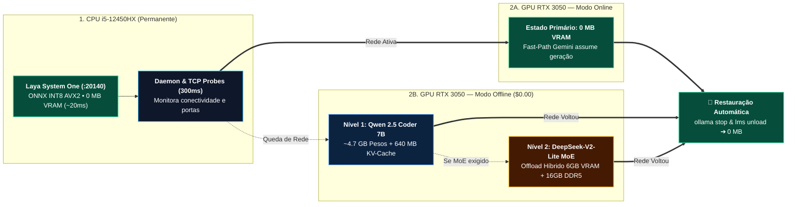

# Guia Técnico de Otimização de VRAM & Ciclo de Vida Reativo (PCL AEOS v3.6)

**Host Homologado de Referência**: Lenovo LOQ 15IAX9  
* **CPU**: Intel Core i5-12450HX (8 núcleos / 12 threads — aloja 100% do Laya System One INT8)
* **RAM**: 16 GB DDR5 4800MHz
* **GPU**: NVIDIA GeForce RTX 3050 Laptop (**6 GB VRAM GDDR6 Dedicada**)
* **OS & Runtime**: Windows 11 64-bit + Docker Desktop (WSL2 Engine) + PCL Cockpit (`:3001`)

> [!IMPORTANT]
> **👔 Visão Executiva & Valor de Negócio:** Em vez de exigir placas de vídeo corporativas de dezenas de milhares de reais, a engenharia de memória do **PCL AEOS v3.6** extrai desempenho de classe empresarial de um notebook padrão de 6 GB de VRAM, mantendo a máquina silenciosa, fria e responsiva durante o expediente conectado (`0 MB de VRAM` ocupada).

> [!NOTE]
> **🛠️ Visão de Engenharia & Invariantes:** Cumpre rigorosamente o **Invariante de Hardware `PCL-AEOS-NORM-01`**: o classificador e juiz semântico **Laya System One (`:20140`)** opera 100% em CPU (`CPUExecutionProvider` ONNX INT8, `~78.9 MB RAM`, **`0 MB VRAM`**), preservando os `6.144 MB` da RTX 3050 exclusivamente para os pesos `Q4_K_M` (`~4.7 GB`) + KV-Cache (`~640 MB`) do modelo generativo no failover offline.

---

## 1. Arquitetura de Alocação Reativa Sob Demanda (Padrão Cortex v7)

Diferente de stacks locais que mantêm múltiplos modelos residentes na GPU disputando VRAM e causando *thrashing* para PCIe/RAM, o PCL AEOS separa fisicamente **Sistema 1 (CPU)** e **Sistema 2 (GPU sob demanda)**:

---

## 2. Orçamento Matemático de VRAM no Modo Offline (RTX 3050 — `6.00 GB`)

Por que a proibição de modelos auxiliares na GPU (`AGENTS.md` Seção 2.1) é vital? Se um reranker ou classificador de embeddings alocasse apenas `1.2 GB` na placa de vídeo, o modelo principal de 7B transbordaria para a RAM do sistema, derrubando a velocidade de geração em até `5x`. Com o Laya em CPU (`0 MB VRAM`), o orçamento fecha com folga térmica e computacional:

| Componente em Execução Offline | Onde Reside | Consumo de VRAM (RTX 3050) | Margem de Segurança |
| :--- | :---: | :---: | :--- |
| **Laya System One (`nli-MiniLM-2-L6-H768` INT8)** | **CPU Host (DDR5)** | **`0 MB`** | Zero impacto na placa de vídeo |
| **Pesos `qwen2.5-coder:7b-instruct-q4_K_M` (Nível 1)** | **GPU GDDR6 (100% Layers)** | **`~4.70 GB`** | Carregamento integral sem *split* |
| **KV-Cache Contextual (`8192` tokens, Flash Attention)** | **GPU GDDR6** | **`~0.64 GB`** | Suporta janelas multi-turn fluidas |
| **Overhead Driver WDDM / Compositor Windows 11** | **GPU GDDR6** | **`~0.45 GB`** | Estabilidade gráfica sem *stutter* |
| **Total Alocado no Pico Offline (Nível 1)** | **Consolidado** | **`~5.79 GB / 6.00 GB`** | **🟢 100% Seguro (Zero OOM)** |

### Nível 2 Complementar: `DeepSeek-Coder-V2-Lite-Instruct (Q4_K_S)` no LM Studio (`:1234`)
* **Tamanho Total**: `~8.88 GiB` (Arquitetura MoE: `16B` parâmetros totais / apenas `2.4B` parâmetros ativos por token).
* **Alocação Híbrida**: Camadas de atenção críticas na VRAM (`6 GB`) + especialistas MoE nos `16 GB DDR5` (`4800MHz`), mantendo contexto de `8192` tokens com Flash Attention habilitado para refatorações profundas.

---

## 3. Automação Determinística de Estado (`scripts/windows/`)

1. **`watch_network_trigger.ps1`**: Monitor de conectividade em tempo real (amostragem a cada `10s`), complementado pelas sondas TCP de `250–300ms` do PCL Cockpit (`:3001`).
2. **`on_offline_event.ps1`**: Garante prontidão imediata do Ollama (`:11434`) e do LM Studio Server (`:1234`) sem intervenção manual.
3. **`on_online_event.ps1`**: Descarrega instantaneamente todos os pesos locais (`lms unload --all` e `ollama stop`), devolvendo a GPU ao estado estrito de **`0 MB de VRAM`**.
