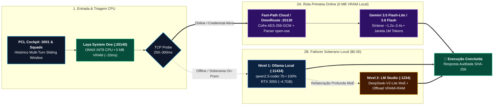
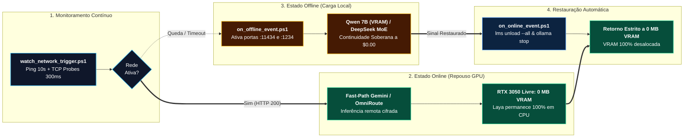

# Guia de Arquitetura: Inferência Híbrida, Fast-Path & Failover em 2 Níveis (PCL AEOS v3.6)

> [!IMPORTANT]
> **👔 Visão Executiva & Valor de Negócio:** A arquitetura de inferência híbrida do **PCL AEOS v3.6** entrega respostas executivas ultrarrápidas (`~1.2s a 3.4s`) quando conectada e **continuidade operacional ininterrupta a `$0.00`** caso a internet caia ou dados ultrassensíveis exijam processamento 100% *on-premise*, eliminando *vendor lock-in* e paradas produtivas.

> [!NOTE]
> **🛠️ Visão de Engenharia & Invariantes:** Combina **Intention Gating em CPU** (`Laya :20140`, `0 MB VRAM`), **Fast-Path Gemini 3.5 Flash-Lite / 3.6 Flash** autenticado via cofre `AES-256-GCM` do OmniRoute (`:20130`) com parser universal `open-sse`, sondas TCP sub-segundo (`250–300ms`) e failover local em dois níveis: **Nível 1 Ollama (`:11434`, `qwen2.5-coder:7b` em 100% VRAM RTX 3050)** e **Nível 2 LM Studio (`:1234`, `DeepSeek-Coder-V2-Lite MoE` em GPU+RAM Offload)**.

---

## 1. Topologia Panorâmica de Inferência Híbrida (Padrão Cortex v7)

O fluxo abaixo demonstra o alinhamento vertical entre a rota primária online (`0 MB VRAM` local) acima e as rotas soberanas locais sob demanda abaixo, convergindo obrigatoriamente à direita:



---

## 2. Estrutura da Estratégia em 3 Camadas Operacionais

### 1️⃣ Camada 1: Modo Primário Online & Fast-Path v3.6 (`0 MB VRAM` Local)
* **Provedores Ativos**: Google Gemini 3.5 Flash-Lite / 3.6 Flash (via credencial decriptada em memória do cofre `AES-256-GCM` do OmniRoute `pc-gemini-cloud`), além de conectores OpenRouter e Groq Free Tier.
* **Decodificação Universal `open-sse`**: O middleware `parseOpenAiOrSseResponse` processa nativamente streams Server-Sent Events (`data: {"object":"chat.completion.chunk"}`) e payloads JSON estritos sem erros de sintaxe.
* **Consumo de Hardware GPU Local**: **0 MB de VRAM Alocada** na NVIDIA GeForce RTX 3050 durante toda a operação online.
* **Mecanismo EBITDA Shield**: Cache semântico por hash + triagem prévia do Laya em CPU evitam consumo redundante de tokens externos.

### 2️⃣ Camada 2: Failover Nível 1 — Ollama Local (`:11434`, Alta Velocidade a `$0.00`)
* **Endpoint**: `http://localhost:11434/api/chat` e `/v1/chat/completions` (sonda TCP `250ms–300ms`).
* **Modelo Homologado**: `qwen2.5-coder:7b-instruct-q4_K_M` (`~4.7 GB` GGUF).
* **Alocação de Hardware**: **100% alocado sob demanda na VRAM** de 6 GB da NVIDIA GeForce RTX 3050 — viabilizado exclusivamente porque o coprocessador Laya consome **0 MB de VRAM**.
* **Finalidade**: Continuidade conversacional multi-turn no PCL Cockpit, geração de código ágil e operação desconectada com custo `$0.00`.

### 3️⃣ Camada 3: Failover Nível 2 — LM Studio (`:1234`, Lógica MoE & Refatoração Profunda)
* **Endpoint**: `http://localhost:1234/v1` (compatível com OpenAI API).
* **Modelo Homologado**: `deepseek-coder-v2-lite-instruct` (`~8.88 GiB` GGUF, `Q4_K_S`).
* **Arquitetura**: Mixture of Experts (`16B` parâmetros totais / `2.4B` parâmetros ativos por token).
* **Alocação de Hardware**: **GPU Offload híbrido** (camadas iniciais na VRAM de 6 GB + camadas de transição nos 16 GB de RAM DDR5, Flash Attention ativo e contexto de `8192` tokens).

---

## 3. Ciclo de Vida Reativo & Governança Dinâmica de VRAM

O estado físico da GPU transita automaticamente entre repouso absoluto (`0 MB VRAM`) e aceleração máxima sob demanda:



### Scripts de Automação no Host (`scripts/windows/`):
1. **`watch_network_trigger.ps1`**: Monitor contínuo de conectividade (amostragem a cada 10 segundos).
2. **`on_offline_event.ps1`**: Disparado na perda de sinal, garante prontidão imediata do Ollama (`:11434`) e do LM Studio Server (`:1234`).
3. **`on_online_event.ps1`**: Disparado no retorno da conexão, executa `lms unload --all` e `ollama stop qwen2.5-coder:7b-instruct-q4_K_M`, restaurando **0 MB de VRAM**.

---

## 4. Comandos de Auditoria e Inspeção no Host

```powershell
# 1. Verificar saúde em sub-segundo das portas no PCL Cockpit (:3001)
curl.exe -s http://localhost:3001/api/aeos/status

# 2. Verificar modelos instalados no Ollama Local e LM Studio
ollama list
lms ls

# 3. Testar inferência direta no Nível 1 (Ollama :11434)
curl.exe -s -X POST http://localhost:11434/v1/chat/completions `
  -H "Content-Type: application/json" `
  -d '{"model": "qwen2.5-coder:7b-instruct-q4_K_M", "messages": [{"role": "user", "content": "ping"}], "max_tokens": 5}'

# 4. Descarregar todos os modelos e restaurar baseline de 0 MB VRAM
powershell -ExecutionPolicy Bypass -File "scripts/windows/on_online_event.ps1"
```

---

## 5. Matriz de Portabilidade para Outros Perfis de Máquina

| Perfil de Máquina | VRAM / RAM Mínima | Configuração Recomendada (Laya sempre em CPU `0 MB VRAM`) |
| :--- | :--- | :--- |
| **Standard Laptop (Alvo LOQ)** | **6 GB VRAM / 16 GB RAM DDR5** | Nível 1: `qwen2.5-coder:7b` (100% VRAM) + Nível 2: `deepseek-coder-v2-lite` (GPU Offload) |
| **Workstation / PC Engenharia** | 12 GB VRAM / 32 GB RAM | Nível 1: `qwen2.5-coder:14b` + Nível 2: `DeepSeek-Coder-V2` completo em VRAM |
| **Servidor Sem GPU Dedicada** | 0 GB VRAM / 32 GB RAM | Execução 100% CPU multi-threading via Ollama (`Q4_K_M`) + Laya ONNX INT8 |
