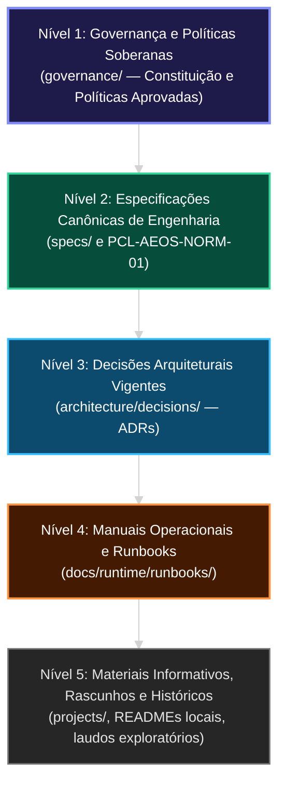

# Matriz de Precedência Normativa e Governança do PCL AEOS

**ID:** `PCL-AEOS-NORM-01` | **Versão:** 1.1.0 | **Status:** VIGENTE / SOBERANO  
**Âmbito:** Raiz Canônica de Governança (`governance/`)  
**Autoridade Suprema:** Patrocinador Humano Soberano (User / Sponsor)  
**Data de Homologação:** 2026-10-17  
**Rastreabilidade:** `HARM-DEC-001`, `HARM-DEC-002`, `HARM-FR-002`, `HARM-FR-005`, Reauditoria Rev-2 (2026-10-16)  

---

## 1. Objetivo e Princípio da Raiz Soberana Única

Este documento estabelece a **Fonte Normativa Canônica Suprema** para todo o ecossistema PCL AEOS. 

> [!IMPORTANT]
> **INVARIANTE DE AUTORIDADE E NÃO-CIRCULARIDADE:**  
> A governança e autoridade do PCL AEOS residem exclusivamente na raiz `governance/` e no operador humano soberano. Nenhum subprojeto (incluindo `projects/` ou artefatos temporários de harmonização) pode atuar como fonte primária de governança institucional. Qualquer documento, especificação técnica, agente ou código que contradiga a hierarquia aqui estabelecida é formalmente subordinado e deve ser interpretado segundo a ordem de precedência desta matriz.

---

## 2. Hierarquia e Ordem Estrita de Precedência (`HARM-DEC-002`)

Em caso de divergência, conflito terminológico, ambiguidade conceitual ou métricas concorrentes entre quaisquer documentos do repositório, a resolução é determinística e obedece à seguinte ordem estrita e decrescente de autoridade:

### Detalhamento dos Níveis de Autoridade:

| Nível | Categoria Normativa | Localização Canônica | Descrição e Força Normativa |
| :---: | :--- | :--- | :--- |
| **1** | **Governança & Políticas** | `governance/` | Regras soberanas de segurança, privacidade Zero Trust, soberania operacional e autoridade humana. Precedem qualquer decisão técnica ou ADR. |
| **2** | **Especificações Canônicas** | `specs/` | Contratos formais de interfaces, schemas, protocolos de comunicação e requisitos do sistema. |
| **3** | **Decisões Arquiteturais (ADRs)** | `architecture/decisions/` | Decisões técnicas fundamentadas para módulos e subsistemas específicos. Devem estrita conformidade às Políticas e Specs. |
| **4** | **Manuais e Runbooks** | `docs/runtime/runbooks/` | Procedimentos operacionais passo a passo, deploy, backup e recuperação. Não criam obrigações normativas novas. |
| **5** | **Informativos e Históricos** | Raiz, `projects/`, docs legados | Contexto de desenvolvimento, protótipos e baselines. Possuem caráter descritivo, subordinado às camadas superiores. |

---

## 3. Matriz RACI Canônica de Governança (`HARM-FR-002`, `HARM-NFR-003`)

Define a segregação de responsabilidades entre o Patrocinador Humano Soberano, o Agente de Desenvolvimento e o Coprocessador Laya:

| Atividade / Decisão Estrutural | Patrocinador Humano (User/Sponsor) | Agente Antigravity IDE | Coprocessador Laya System One |
| :--- | :---: | :---: | :---: |
| **Aprovação de Políticas e Normas** | **A (Aprovador Soberano)** | C (Consulta / Rascunho) | I (Informativo / Sem Ação) |
| **Aprovação de Mudanças Arquiteturais (ADRs)** | **A (Aprovador Soberano)** | R (Proponente Técnico) | I (Informativo / Sem Ação) |
| **Resolução de Conflitos Materiais de Documentação** | **A (Decisor Final)** | C (Sistematizador de Opções) | C / R (Sensor de Detecção NLI) |
| **Triagem Automatizada de Contradições e Staleness** | **A (Governante da Regra)** | R (Orquestrador do Pipeline) | **R (Executor Técnico da Inferência NLI)** |
| **Saneamento e Atualização de Documentos em Lotes** | **A (Validador do Lote)** | **R (Executor do Saneamento)** | C (Validador de Integridade) |
| **Supersessão ou Exclusão em Memória Tripartida** | **A (Autorizador Exclusivo)** | R (Executor Supervisionado) | C (Sensor Consultivo de Score) |
| **Declaração de Readiness (*Foundation Ready*)** | **A (Homologador Final)** | R (Compilador de Evidências) | C (Verificador de Consistência) |

*Legenda RACI:*  
- **A (Accountable):** Autoridade soberana e irrevogável que responde pela decisão final. **Exclusiva do Patrocinador Humano.**  
- **R (Responsible):** Quem executa a tarefa técnica ou a computação.  
- **C (Consulted):** Sensor, especialista ou classificador consultado para emissão de pontuações ou pareceres técnicos.  
- **I (Informed):** Entidade informada do resultado da decisão.  

> [!CAUTION]
> **DELIMITAÇÃO CRÍTICA DO LAYA (SYSTEM ONE):**  
> O Coprocessador Laya é classificado estritamente como **Executor Técnico de Inferência (R)** e **Sensor Consultivo (C)**. Sob nenhuma circunstância o Laya possui papel de *Accountable (A)*. O classificador neural **não tem autoridade autônoma irrevogável para aplicar código em produção, alterar regras de governança ou sobrescrever permanentemente a memória corporativa** sem aprovação do operador humano soberano.

---

## 4. Ciclo de Vida e Estados Documentais Canônicos (`HARM-FR-005`)

Todo artefato do ecossistema PCL AEOS pertencerá a um dos seguintes estados rastreáveis:

1. **`PROPOSTO`**: Em elaboração técnica; sem valor normativo ativo; aguardando revisão e aprovação.
2. **`VIGENTE`**: Documento canônico ativo aprovado pelo Patrocinador Humano. Constitui a verdade operacional.
3. **`SUPERSEDIDO`**: Documento que foi substituído por especificação mais recente. Contém cabeçalho obrigatório indicando o documento canônico vigente substituto.
4. **`HISTÓRICO`**: Relatório, ensaio exploratório ou registro imutável de medições passadas (ex.: relatórios de auditoria).
5. **`DEPRECIADO`**: Módulo ou especificação em processo de desativação planejada com plano de migração.

---

## 5. Mapeamento Unificado de Stage Gates (`HARM-DEC-003`)

Fica formalizada a correspondência e a taxonomia unificada de Stage Gates para o ciclo de vida do PCL AEOS:

| Gate Unificado | Fase TLC | Objetivo Principal | Critério de Passagem Obrigatório |
| :---: | :---: | :--- | :--- |
| **G-00** | **SPECIFY** | Alinhamento de Escopo e Problema | Termo de Especificação aprovado pelo Sponsor. |
| **G-01** | **DESIGN** | Arquitetura Canônica e Contratos | Matriz Normativa e Boundary Register aprovados. |
| **G-02** | **IMPLEMENT** | Construção / Saneamento e Adaptações | Código testado e documentação reconciliada sem contradições. |
| **G-03** | **VALIDATE** | Verificação Lógica e Integridade | Varredura de contradições limpa via Laya MCP e testes controlados. |
| **G-04** | **RELEASE** | Liberação de Fundação (*Foundation Ready*) | Certificado assinado pelo Sponsor autorizando camadas de produto. |

---

## 6. Procedimento Determinístico para Resolução de Conflitos e Reconciliação Dialética

Quando dois documentos, claims ou memórias apresentarem declarações mutuamente incompatíveis:
1. **Passo 1 (Sinalização Reflexiva):** O Coprocessador Laya (`laya_check_contradiction` ou `/v1/classifier/evaluate/nli`) sinaliza a probabilidade de contradição factual (`contradiction >= 0.60`).
2. **Passo 2 (Aplicação da Hierarquia Soberana):** Aplica-se a precedência da Seção 2: o documento do nível superior prevalece sobre o de nível inferior.
3. **Passo 3 (Conflito no Mesmo Nível):** Se o conflito ocorrer entre dois documentos do mesmo nível (ex.: duas políticas ou duas ADRs concorrentes), a divergência é formalizada e submetida ao **Patrocinador Humano Soberano**, único dotado de autoridade irrevogável para homologar a versão canônica. Modificações ou descarte silencioso de informações são terminantemente proibidos.
