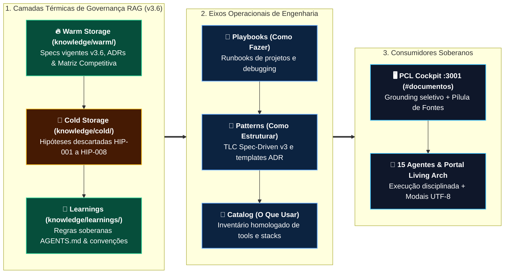

# 📚 Módulo Knowledge — Governança Física RAG & Patrimônio Intelectual (PCL AEOS v3.6)

> [!IMPORTANT]
> **👔 Visão Executiva & Valor de Negócio:** Códigos, modelos de IA e fornecedores mudam rapidamente, mas o **patrimônio intelectual da organização** deve ser perene, auditável e imune a esquecimentos. O módulo **Knowledge** organiza as especificações ativas, os playbooks operacionais e até as decisões técnicas descartadas para que nenhum erro passado volte a gerar custo futuro.

> [!NOTE]
> **🛠️ Visão de Engenharia & Invariantes:** Constitui a camada de **Governança Física Declarativa** do PCL AEOS v3.6 (`PCL-AEOS-NORM-01`), estruturada em **3 Camadas Térmicas de RAG (`warm/`, `cold/`, `learnings/`)** somadas a **3 Eixos Operacionais (`playbooks/`, `patterns/`, `catalog/`)**, indexadas nativamente pelo PCL Cockpit (`:3001`, menção `#documentos`) e pelo motor PGVector (`memory.*`).

---

## 1. Arquitetura em 2 Dimensões: Camadas Térmicas RAG v3.6 + Eixos Operacionais

Na evolução **v3.6**, o diretório `knowledge/` deixou de conter apenas templates estáticos e assumiu o papel de **Fonte Canônica Primária (SSOT)** para o Grounding Híbrido Federado:



---

## 2. Taxonomia Completa de Diretórios (`knowledge/`)

```text
knowledge/
├── README.md                                          ← Arquitetura canônica do Knowledge v3.6
│
├── warm/                                              ← [RAG ATIVO] Verdade vigente de alta prioridade
│   ├── cockpit/
│   │   ├── PCL_COCKPIT_SPEC_V3.6.md                   ← Especificação oficial homologada (:3001)
│   │   └── PCL_COCKPIT_SPEC_V3.5.md                   ← Histórico marcado como Superseded
│   ├── architecture/
│   │   ├── ADR_INDEX.md                               ← Índice unificado em 3 trilhas (ADRs 0001–0010)
│   │   └── ADR-0007.md                                ← Memória Multi-Turn, Gating Laya & Fontes Retráteis
│   └── competitive/
│       └── PCL_COCKPIT_COMPETITIVE_MATRIX.md          ← Benchmark Cego 4.95/5.0 vs Gemini/ChatGPT/Copilot
│
├── cold/                                              ← [ANTI-REGRESSÃO] Memória histórica de rejeições
│   └── discarded_hypotheses/
│       └── DISCARDED_HYPOTHESES_LOG.md                ← Registro canônico HIP-001 a HIP-008
│
├── learnings/                                         ← [GOVERNANÇA AGÊNTICA] Regras operacionais aprendidas
│   └── AGENTS.md                                      ← Espelho normativo PCL-AEOS-NORM-01 v3.6
│
├── playbooks/                                         ← Procedimentos passo a passo (new-project, debugging)
├── patterns/                                          ← Padrões estruturais (tlc-spec-driven, adr-pattern)
└── catalog/                                           ← Catálogo oficial de ferramentas homologadas
```

---

## 3. Padrão Obrigatório de Metadados (YAML Frontmatter `PCL-AEOS-NORM-01`)

Todo documento inserido em `knowledge/warm/`, `knowledge/cold/` ou `knowledge/learnings/` deve declarar cabeçalho YAML estruturado para indexação determinística e filtragem de status (`Approved` vs. `Superseded` vs. `Rejected`):

```yaml
---
title: "Título Canônico do Artefato"
system_scope: "PCL AEOS Kernel / PCL Cockpit"
kernel_version: "v3.6.0"
type: "Architecture_Spec | ADR | Competitive_Analysis | Cold_Log | Rule"
status: "Approved | Superseded | Rejected"
rag_tags: [pcl_cockpit, v3.6, rag, governance]
created_at: "2026-11-01"
last_updated: "2026-11-01"
author: "PromptCore Labs Architecture"
normative_ref: "PCL-AEOS-NORM-01"
---
```

---

## 4. Princípios Permanentes de Gestão do Conhecimento

1. **Separação Contextual Estrita (`AGENTS.md` Seção 3.1):** O acervo em `knowledge/` é consultado quando o operador menciona explicitamente o ecossistema (`PCL`, `AEOS`, `Cockpit`, `ADR`) ou aciona `#documentos`. Perguntas abertas de mercado são respondidas com fluidez natural sem jargão corporativo forçado (`HIP-006`).
2. **Prioridade Térmica Determinística:** Especificações `Approved` em `warm/` prevalecem sobre versões `Superseded`; registros em `cold/` bloqueiam a reintrodução de arquiteturas já reprovadas.
3. **Independência de Agente & Codificação Pura:** Arquivos mantidos em Markdown puro (`UTF-8` sem BOM / zero mojibake), legíveis tanto por executivos quanto por parsers RAG.

---

## 5. Quickstart: Consulta Rápida e Evolução

```bash
# 1. Consultar a especificação vigente do PCL Cockpit v3.6 (Warm Storage)
cat knowledge/warm/cockpit/PCL_COCKPIT_SPEC_V3.6.md

# 2. Auditar por que alternativas técnicas foram descartadas (Cold Storage)
cat knowledge/cold/discarded_hypotheses/DISCARDED_HYPOTHESES_LOG.md

# 3. Consultar playbooks e padrões operacionais de engenharia
cat knowledge/playbooks/new-project-playbook.md
cat knowledge/patterns/tlc-spec-driven.md
```

---

## 6. Fontes Normativas Relacionadas

* `AGENTS.md` (`PCL-AEOS-NORM-01`)
* `memory/README.md` (Memória Temporal `memory.*` & Pipeline Multi-Turn)
* `foundation/FOUNDATION.md` & `architecture/principles.md`
