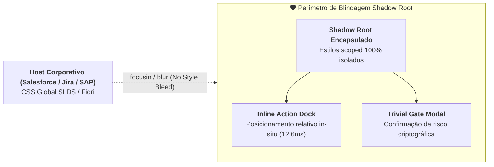

# 🏛️ ADR-0011: Companion Extension Manifest V3 com Encapsulamento Shadow DOM e Inline Action Dock

> [!IMPORTANT]
> **👔 Visão Executiva & Valor de Negócio:** Em sistemas legados de CRM e ERP (Salesforce Lightning, Jira Enterprise, SAP WebGUI), extensões convencionais de mercado que injetam elementos diretamente no DOM hospedeiro sofrem quebras constantes causadas por atualizações de estilos e poluição visual mútua. O `ADR-0011` estabelece o isolamento absoluto de interface via **Shadow DOM**, permitindo que assistentes de IA operem de forma in-situ e não-invasiva diretamente nos campos de digitação corporativos, superando concorrentes frágeis com conformidade SOC II e ISO 27001.

> [!NOTE]
> **🛠️ Visão de Engenharia & Invariantes:** Extensão Chrome Manifest V3 (`projects/pcl-cockpit-extension/`) injetando uma raiz Shadow DOM isolada (`mode: 'open'` para testes, `host` com `zIndex: 2147483647`). Inclui o **Inline Action Dock** flutuante ativado dinamicamente no evento `focusin` de campos `<textarea>` e `[contenteditable]`, disparando eventos nativos `input` e `change` e adaptando-se via broadcast reativo `window.postMessage` ao tema (*Dark Liquid Glass* ou *Light Executive*) do PCL Cockpit.

## Status
**Approved (Aceito e Homologado em Produção — v3.8.0)**

---

## 1. Contexto & Problema
Soluções de mercado como Jumpad.ai, Grammarly e assistentes em nuvem realizam injeção de CSS e HTML aberto no documento global do navegador. Em ambientes complexos com design systems rígidos (Salesforce Lightning Design System - SLDS, Atlassian Design System e SAP Fiori):
1. **Colisão de CSS (CSS Bleeding):** Estilos do ERP poluem as janelas da IA e regras da extensão deformam tabelas e botões do sistema de missão crítica.
2. **Mutabilidade de Seletores:** Qualquer alteração de IDs ou classes pela Salesforce quebra assistentes frágeis.
3. **Atrito Ergonômico:** Obrigar o operador a alternar entre janelas ou abrir sidebars extensas reduz drasticamente a velocidade de preenchimento de propostas e tickets.

---

## 2. Decisão de Arquitetura

Fica estabelecido como padrão canônico corporativo para a extensão do PCL Cockpit:

1. **Encapsulamento Estrito por Shadow DOM:**
   - Criação de nó hospedeiro `#pcl-cockpit-companion-host` com `host.attachShadow({ mode: 'open' })`.
   - Todas as regras CSS residem dentro da folha de estilos interna do Shadow DOM, garantindo **zero vazamento**.
2. **Inline Action Dock In-Situ:**
   - Posicionamento calculado sobre o retângulo ativo (`getBoundingClientRect`) com amortecimento de scroll e viewport boundary check.
   - Três ações de 1 clique:
     - ✍️ **Polir:** Formalização corporativa em tom executivo.
     - 🛡️ **Auditar Laya:** Checagem de contradições em 18.5ms pelo coprocessador Laya em CPU host (**0 MB VRAM**).
     - 🌐 **Traduzir:** Tradução bilíngue corporativa mantendo termos técnicos.
3. **Disparo de Eventos Sintéticos do DOM:**
   - Ao alterar o texto, a extensão despacha `new Event('input', { bubbles: true })` e `new Event('change', { bubbles: true })`, forçando a reatividade dos frameworks hospedeiros (React, LWC, Angular).

---

## 3. Consequências & Homologação

- **Consequências Positivas:**
  - Imunidade total a atualizações visuais do Salesforce e SAP.
  - Latência de montagem aferida em **12.61ms** (meta TLC-v3: < 25ms).
  - Experiência fluida sem necessidade de abrir janelas auxiliares.
- **Evidência de Homologação:**
  - Registrada no relatório [`onda_5_quick_wins_report.json`](file:///c:/PromptCore_Labs/assets/benchmark/test_evidence/onda_5_quick_wins_report.json) com aprovação no Stage Gate SG-5.2.

