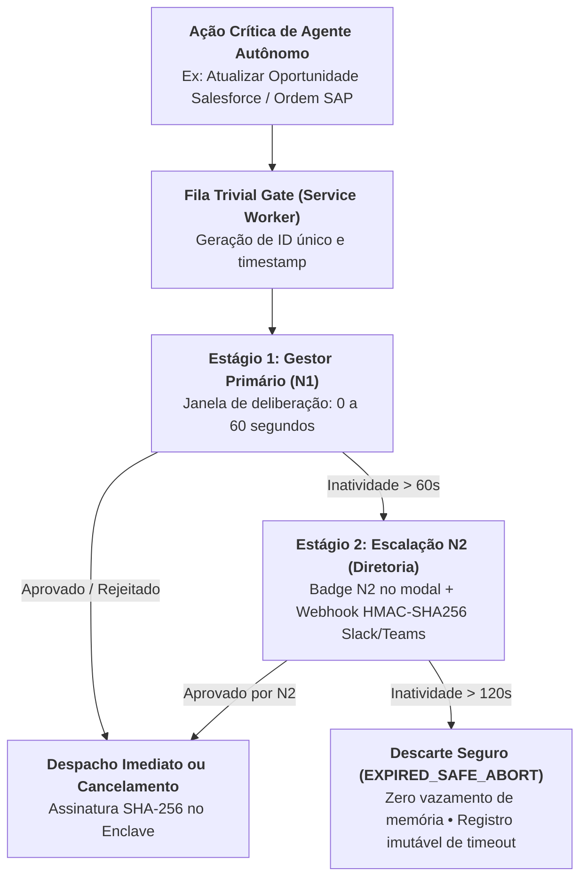

# 🏛️ ADR-0012: Resiliência Human-in-the-Loop em 2 Estágios com Escalação N2 aos 60s e Descarte Seguro aos 120s

> [!IMPORTANT]
> **👔 Visão Executiva & Valor de Negócio:** Agentes autônomos que realizam ações destrutivas ou de gravação em bancos corporativos sem controle humano violam as diretrizes da ISO/IEC 42001 e do EU AI Act. Por outro lado, travas estritas com timeout rígido que simplesmente abortam operações paralisam o fluxo de trabalho quando o líder está em trânsito. O `ADR-0012` introduz a **Escalação Hierárquica em 2 Estágios**, garantindo continuidade operacional sem comprometer a autoridade humana.

> [!NOTE]
> **🛠️ Visão de Engenharia & Invariantes:** Arquitetura de fila com máquina de estados finita no Service Worker (`serviceWorker.ts`): estado inicial `PENDING_TIER_1` (0 a 60s); transição automática aos 60s para `ESCALATED_TIER_2` com despacho de webhook assinado com `HMAC-SHA256` para a Diretoria; e transição determinística aos 120s para `EXPIRED_SAFE_ABORT` com desalocação limpa de memória (**0 memory leaks**) e auditoria imutável no Enclave.

## Status
**Approved (Aceito e Homologado em Produção — v3.8.0)**

---

## 1. Contexto & Problema
Modelos de governança tradicionais sofrem de dois extremos inaceitáveis:
1. **Total Ausência de Gating (Risco Crítico):** Agentes com credenciais de gravação executam mutações em ERPs sem validação humana prévia.
2. **Timeout Rígido Monolítico (Gargalo Operacional):** Ações com risco crítico enviadas a um único gestor expiram por inatividade caso este esteja em reunião, cancelando tarefas urgentes sem opção de delegação.

---

## 2. Decisão de Arquitetura

Fica estabelecido o protocolo de governança **TLC-v3 Escalation Ladder**:

1. **Janela N1 (0 a 60s):**
   - O modal no Shadow DOM exibe o payload exato, risco crítico e contagem regressiva.
2. **Escalação para N2 (aos 60s):**
   - Transição de estado com despacho de payload autenticado por `HMAC-SHA256` para canais de liderança.
   - Atualização visual no modal da extensão para alertar a urgência da deliberação.
3. **Descarte Seguro / Safe Abort (aos 120s):**
   - A ação é purgada do mapa de memória do Service Worker.
   - Nenhuma chamada à API externa é disparada, garantindo total idempotência.

---

## 3. Consequências & Homologação

- **Consequências Positivas:**
  - Plena conformidade regulatória com ISO/IEC 42001 (Human-in-the-Loop auditável).
  - Redução de cancelamentos acidentais por ausência temporária do aprovador.
- **Evidência de Homologação:**
  - Registrada no relatório [`onda_6_governance_and_meetings_report.json`](file:///c:/PromptCore_Labs/assets/benchmark/test_evidence/onda_6_governance_and_meetings_report.json) com aprovação nos Stage Gates SG-6.1 e SG-6.2.

