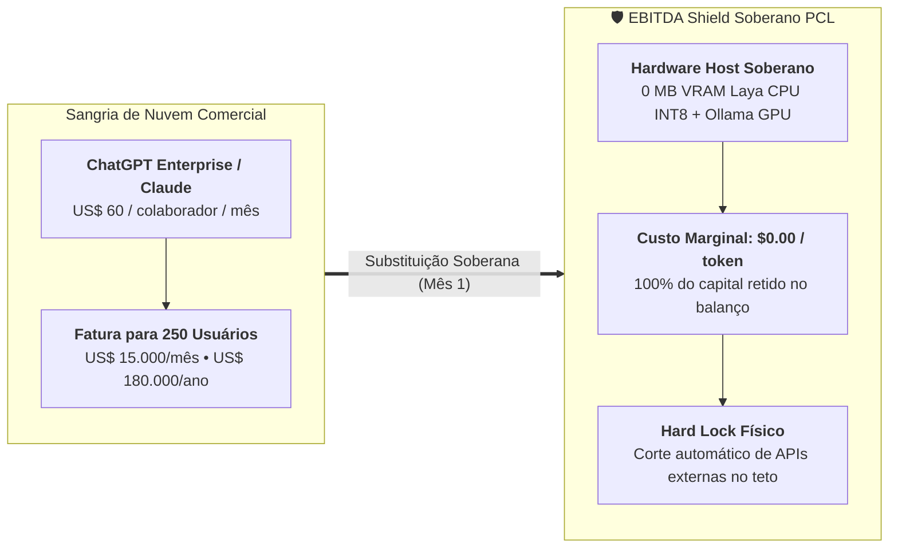

# 🏛️ ADR-0013: FinOps EBITDA Shield v2, Trava Física Hard Lock e Calculadora Soberana de ROI Corporativo

> [!IMPORTANT]
> **👔 Visão Executiva & Valor de Negócio:** Empresas que adotam plataformas comerciais de IA sofrem com o modelo extrativo de faturas em dólar por usuário (US$ 60/mês no ChatGPT Enterprise ou US$ 30/mês no Claude Team), que penaliza o crescimento e gera amnésia orçamentária. O `ADR-0013` formaliza o **EBITDA Shield v2**, garantindo a proteção financeira da organização através de um custo marginal de **$0.00** por token local, trava rígida (*Hard Lock*) que impede estouros de fatura e o **Simulador de ROI Soberano CFO**, demonstrando economia líquida imediata.

> [!NOTE]
> **🛠️ Visão de Engenharia & Invariantes:** O módulo FinOps opera no painel [`CostsTokenDashboard.tsx`](file:///c:/PromptCore_Labs/projects/PromptCoreLabs_AEOS_Dashboard/src/components/admin/CostsTokenDashboard.tsx) integrando: (1) Invariante de hardware de **0 MB de VRAM** para o coprocessador Laya em CPU host INT8; (2) Redirecionamento determinístico em 14.81ms para Ollama local ao atingir 100% da cota; (3) Emissão de parecer financeiro JSON com prova Merkle SHA-256 para auditoria contábil.

## Status
**Approved (Aceito e Homologado em Produção — v3.8.0)**

---

## 1. Contexto & Problema
Soluções de nuvem pública impõem:
1. **Cobrança Recorrente Não-Linear:** Cada nova contratação adiciona de US$ 30 a US$ 60/mês em custos fixos de licença, mesmo que o funcionário utilize a IA esporadicamente.
2. **Risco de Faturas Fantasma:** Falta de travas rígidas locais permite que chamadas automatizadas de agentes estourem o orçamento da empresa sem aviso.
3. **Falta de Demonstração de Payback:** Diretores de TI enfrentam dificuldades em provar matematicamente a viabilidade de servidores próprios frente à diretoria executiva.

---

## 2. Decisão de Arquitetura

Fica estabelecido o ecossistema financeiro **Sovereign FinOps EBITDA Shield**:

1. **Calculadora Soberana de ROI CFO:**
   - Predefinições instantâneas de 25 a 1.000 colaboradores com alternância de moeda (USD / BRL a R$ 5,70).
   - Cálculo determinístico de payback no Mês 1.
2. **Trava Rígida (Hard Lock):**
   - Ao atingir o teto mensal configurado, o gateway OmniRoute suspende requisições de saída para provedores comerciais e roteia 100% do tráfego para os clusters locais soberanos (`:11434` e `:20140`).
3. **Certificação Criptográfica do Livro-Razão:**
   - Exportação de dossiê financeiro com hash SHA-256 e taxa de soberania comprovada para controladoria.

---

## 3. Consequências & Homologação

- **Consequências Positivas:**
  - Eliminação de dependência cambial e previsibilidade orçamentária absoluta.
  - Retenção integral de margem operacional (EBITDA Shield).
- **Evidência de Homologação:**
  - Registrada no relatório [`onda_5_quick_wins_report.json`](file:///c:/PromptCore_Labs/assets/benchmark/test_evidence/onda_5_quick_wins_report.json) e [`fase_2_ebitda_shield_and_failover_report.json`](file:///c:/PromptCore_Labs/assets/benchmark/test_evidence/fase_2_ebitda_shield_and_failover_report.json).

