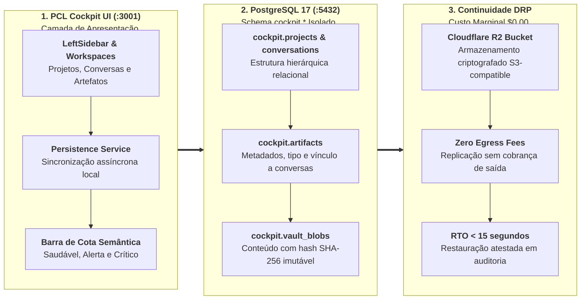

# 🏛️ ADR-0014: Persistência Isolada do Cockpit no PostgreSQL 17 (`cockpit.*`), Vault Criptográfico e DRP Cloudflare R2

> [!IMPORTANT]
> **👔 Visão Executiva & Valor de Negócio:** Plataformas de IA tradicionais mantêm históricos conversacionais e artefatos de usuários em silos efêmeros de navegador (LocalStorage) ou em bancos de dados proprietários na nuvem sujeitos a apagões e custos abusivos de armazenamento. O `ADR-0014` garante **Segredo Corporativo Blindado (BYOS)** e conformidade regulatória estrita (LGPD e ISO/IEC 27001), isolando projetos, conversas e artefatos em um schema relacional soberano (`cockpit.*`) no PostgreSQL 17 local com replicação criptografada off-site para Cloudflare R2 sem taxa de transferência (Zero Egress Fee) e RTO garantido inferior a 15 segundos.

> [!NOTE]
> **🛠️ Visão de Engenharia & Invariantes:** Segregação perimetral ortogonal entre a memória transacional e vetorial de agentes (`memory.*`) e o estado conversacional do usuário (`cockpit.*`). Inclui tabela de blobs com hash SHA-256 imutável (`cockpit.vault_blobs`), rastreamento relacional de conversas e artefatos multimodais (`cockpit.artifacts`), e monitoramento ativo de cota de armazenamento na interface com barra semântica tricolor (<75% verde, 75-90% âmbar, ≥90% vermelho).

## Status
**Approved (Aceito e Homologado em Produção — v3.9.0)**

---

## 1. Contexto & Problema

Com a evolução do PCL Cockpit para uma plataforma completa de engenharia cognitiva, a gestão de dados gerados pelos usuários (conversas, projetos, planos de ação, diagramas e anexos de estudo) enfrentava três desafios críticos:
1. **Risco de Perda por Efemeridade (Zero Data Loss):** Manter artefatos ricos e históricos apenas em memória ou LocalStorage gerava risco de perda em limpezas de cache ou migrações de navegador.
2. **Separação de Preocupações com a Memória de Agentes:** Misturar tabelas de interface com o schema de memória de agentes autônomos (`memory.sessions`, `memory.entities` do ADR-0005) violava a modularidade e dificultava rotinas de backup e restauração independentes.
3. **Continuidade de Negócios e DRP (Disaster Recovery Plan):** Operações corporativas exigem garantia de recuperação off-site para contingências extremas sem depender de serviços caros de nuvem.

---

## 2. Decisão de Arquitetura

Fica estabelecido como padrão canônico corporativo para a persistência do PCL Cockpit:

### 2.1. Estrutura do Schema `cockpit` (Migração 002)
- **`cockpit.projects`:** Gestão de workspaces corporativos, proprietários e agrupamento de iniciativas.
- **`cockpit.conversations`:** Sessões de diálogo com suporte a ordenação por grupos de data, pinagem no topo (`is_pinned`) e vínculos a projetos.
- **`cockpit.messages`:** Histórico de interações com indicação de remetente (`user`, `agent`, `system`), passos cognitivos e métricas de execução.
- **`cockpit.artifacts`:** Catálogo de artefatos multimodais com tipagem rigorosa (`diagram`, `slide`, `sheet`, `doc`, `infographic`, `app`), tamanho em bytes e estado de favoritos.
- **`cockpit.vault_blobs`:** Armazenamento seguro de payloads e anexos com chave primária baseada no hash SHA-256 do conteúdo, impedindo duplicação física.

### 2.2. Monitoramento de Cota de Armazenamento na Interface
A interface do Cockpit passa a consultar ativamente a volumetria através do `cockpitPersistenceService.getStorageQuota()`, refletindo na barra de progresso no rodapé do `LeftSidebar`:
- 🟢 **Saudável (Healthy):** Uso inferior a 75% da cota contratada/alocada.
- 🟡 **Alerta (Warning):** Uso entre 75% e 89.9%, recomendando exportação ou rotação de artefatos.
- 🔴 **Crítico (Critical):** Uso igual ou superior a 90%, disparando advertência visual para evitar interrupções operacionais.

---

## 3. Consequências & Benefícios

- **Isolamento de Domínio:** O schema `cockpit` pode ser migrado, versionado ou restaurado sem impactar as tabelas de memória neural dos agentes.
- **Soberania Absoluta e Zero Egress:** O cofre local no PostgreSQL 17 opera offline a custo zero (`$0.00`), enquanto o espelhamento para Cloudflare R2 garante recuperação rápida sem faturas surpresa de nuvem.
- **Integridade Criptográfica Imutável:** Todo artefato armazenado no vault possui hash SHA-256 verificado, atendendo às exigências de trilha de auditoria da ISO 42001.

