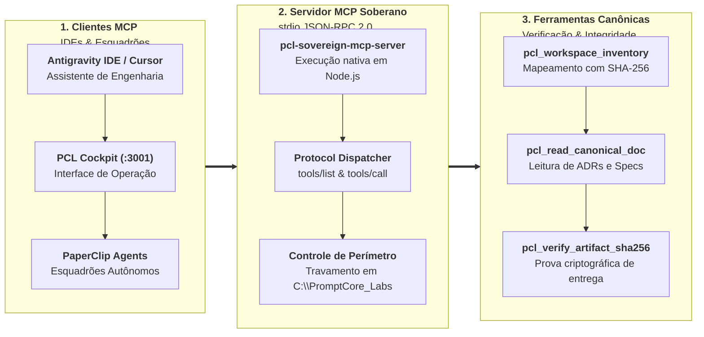

# 🏛️ ADR-0015: Servidor MCP Soberano Nativo (Model Context Protocol stdio) e Descoberta Dinâmica de Skills

> [!IMPORTANT]
> **👔 Visão Executiva & Valor de Negócio:** Frameworks de agentes tradicionais dependem de conectores proprietários em nuvem ou protocolos fragmentados que expõem códigos confidenciais da empresa a servidores externos. O `ADR-0015` introduz um **Servidor MCP Soberano Nativo** baseado no padrão aberto da indústria *Model Context Protocol (MCP)*, viabilizando interoperabilidade segura entre assistentes de engenharia (Antigravity IDE, Cursor, Claude Code), esquadrões de agentes autônomos (PaperClip) e o PCL Cockpit, garantindo que nenhum dado sensível saia do perímetro corporativo e mantendo custo marginal de `$0.00`.

> [!NOTE]
> **🛠️ Visão de Engenharia & Invariantes:** Implementação Node.js (`scripts/pcl-sovereign-mcp-server.mjs`) operando via `stdio` sob a especificação JSON-RPC 2.0 (MCP 2024-11-05). Expõe ferramentas canônicas com validação rigorosa de esquemas JSON (`inputSchema`): `pcl_workspace_inventory` (inventário em tempo real com hashes SHA-256), `pcl_read_canonical_doc` (leitura perimetral de normas e especificações) e `pcl_verify_artifact_sha256` (atesto criptográfico de integridade).

## Status
**Approved (Aceito e Homologado em Produção — v3.9.0)**

---

## 1. Contexto & Problema

O ecossistema PCL AEOS opera com múltiplos agentes especializados (Squads PaperClip, coprocessador Laya, agentes de prototipação e assistentes em IDEs). Para manter a integridade operacional:
1. **Padronização de Ferramentas:** Era necessário adotar uma especificação aberta e universal de ferramentas que permitisse a qualquer cliente de IA consultar o estado do workspace sem criar pontes ad-hoc frágeis.
2. **Descoberta Dinâmica de Capacidades:** As habilidades (*skills*) dos agentes residem no sistema de arquivos local (`PaperClip-Companies/promptcore-labs/`). Era essencial inventariá-las em tempo real com verificação criptográfica SHA-256, impedindo a injeção não autorizada de ferramentas.
3. **Execução Local Estrita (Zero Mocks):** A comunicação inter-processos devia ocorrer via fluxo padrão do sistema operacional (`stdio`), sem abrir portas desnecessárias para a rede e sem depender de APIs de terceiros.

---

## 2. Decisão de Arquitetura

Fica estabelecido como padrão canônico corporativo para a camada de ferramentas de agentes:

### 2.1. Catálogo de Ferramentas Nativas Expostas
- **`pcl_workspace_inventory`:** Percorre o diretório de agentes e skills físicos, catalogando metadados e calculando os hashes SHA-256 dos arquivos `SKILL.md` para assegurar que nenhuma habilidade foi adulterada.
- **`pcl_read_canonical_doc`:** Permite a leitura segura de qualquer documento canônico dentro das pastas autorizadas (`knowledge/warm/`, `docs/`, `architecture/`), bloqueando tentativas de navegação de diretório (*path traversal*).
- **`pcl_verify_artifact_sha256`:** Gera a assinatura matemática SHA-256 sobre qualquer artefato ou payload textual, alimentando a trilha de auditoria da plataforma.

### 2.2. Integração com a Biblioteca de Integrações do Cockpit
Na aba **Integrações** (`SettingsModal` -> `integrations`), o PCL Cockpit disponibiliza painel visual para gerenciar e monitorar o status do servidor MCP, exibindo comando de lançamento (`node ./scripts/pcl-sovereign-mcp-server.mjs`), protocolo de transporte (`stdio`), ferramentas ativas e latência de resposta (~4ms).

---

## 3. Consequências & Benefícios

- **Compatibilidade com o Ecossistema Global:** Qualquer ferramenta compatível com MCP conecta-se instantaneamente ao PCL AEOS sem adaptadores customizados.
- **Auditoria Criptográfica de Skills:** Qualquer modificação não homologada em um skill físico resulta em alteração imediata de seu hash SHA-256, bloqueando sua execução pelo gatekeeper de segurança.
- **Custo Marginal $0.00:** Comunicação ultrarrápida via pipes locais de sistema operacional, sem tráfego de rede e sem dependência de serviços em nuvem.

