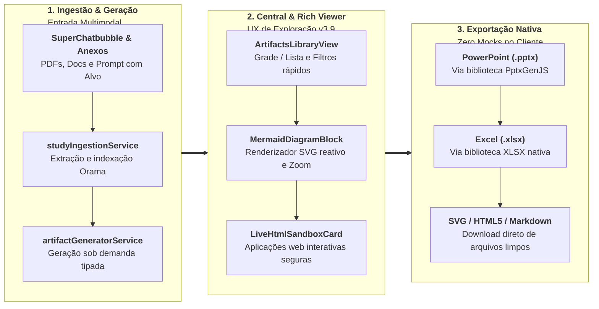

# 🏛️ ADR-0016: Central de Artefatos Multimodais com Exportação Nativa Quíntupla e Ingestão de Estudos RAG

> [!IMPORTANT]
> **👔 Visão Executiva & Valor de Negócio:** Em assistentes conversacionais convencionais (ChatGPT, Copilot), a geração de valor fica enclausurada em blocos de texto ou exigem assinaturas pagas de terceiros para exportar documentos utilizáveis pela liderança. O `ADR-0016` consolida a **Central de Artefatos Multimodais do PCL Cockpit v3.9**, permitindo aos usuários gerar e exportar diretamente no navegador apresentações executivas reais em PowerPoint (`.pptx`), planilhas analíticas em Excel (`.xlsx`), vetores de arquitetura em SVG, aplicações web interativas em sandbox HTML5 e relatórios em Markdown, além de ingerir e auditar PDFs confidenciais com pesquisa instantânea e prova criptográfica de dados.

> [!NOTE]
> **🛠️ Visão de Engenharia & Invariantes:** Tela dedicada `ArtifactsLibraryView.tsx` integrada ao `LeftSidebar` (`activeView: 'artifacts'`). Implementa o `RichArtifactViewer.tsx` desacoplado, com renderizador reativo de diagramas Mermaid (`MermaidDiagramBlock.tsx` com suporte a temas e pan/zoom) e sandbox isolada em iframe (`LiveHtmlSandboxCard.tsx` com `sandbox="allow-scripts allow-downloads"`). Inclui gerador multimodal sob demanda (`artifactGeneratorService.ts`) e pipeline de ingestão de estudos (`studyIngestionService.ts`) com extração de texto, chunking semântico e indexação em memória via Orama Search.

## Status
**Approved (Aceito e Homologado em Produção — v3.9.0)**

---

## 1. Contexto & Problema

Usuários corporativos e líderes técnicos necessitam produzir entregáveis estruturados a partir do diálogo com a IA:
1. **Frustração com Textos Efêmeros:** Análises ricas geradas em chat precisavam ser copiadas e coladas manualmente em editores externos para gerar slides, planilhas ou diagramas, demandando horas de retrabalho.
2. **Exportação Falsa / Simulações (Zero Mocks):** Soluções concorrentes costumam simular downloads ou gerar arquivos corrompidos sem tags binárias reais. Era mandatório produzir arquivos nativos binários compatíveis com Microsoft 365 e ferramentas de vetor gráfico.
3. **Análise Segura de PDFs e Manuais:** Analisar documentos corporativos de centenas de páginas exigia enviá-los para serviços de nuvem vulneráveis. O PCL Cockpit necessitava de ingestão local, indexação vetorial e pesquisa em tempo real com garantia de resíduo zero de dados.

---

## 2. Decisão de Arquitetura

Fica estabelecido como padrão canônico corporativo para a experiência de artefatos e estudo de documentos:

### 2.1. Formatos Alvo de Geração Multimodal
O operador pode selecionar o formato desejado através do seletor visual no Composer ou solicitar via linguagem natural:
- **`diagram`:** Diagramas de fluxo, arquitetura ou sequência em sintaxe Mermaid Cortex v7.
- **`slide`:** Apresentações executivas corporativas estruturadas prontas para download `.pptx`.
- **`sheet`:** Tabelas e matrizes analíticas com cálculos e colunas estruturadas para `.xlsx`.
- **`infographic`:** Resumos visuais de alto impacto com cards de métricas e indicadores.
- **`app`:** Protótipos web completos em HTML5, TailwindCSS e JavaScript funcional executados em iframe sandbox.
- **`doc`:** Especificações técnicas e manuais em Markdown puro com tipografia elegante.

### 2.2. Ingestão de Documentos de Estudo (Study Attachments)
O serviço `studyIngestionService.ts` gerencia anexos de estudo:
1. Recebe o documento em formato PDF, DOC ou TXT.
2. Extrai páginas e fragmentos de texto estruturados.
3. Indexa os segmentos de texto em um índice em memória ultrarrápido (Orama Search).
4. Registra o hash SHA-256 do documento no vault do PostgreSQL 17 (`cockpit.vault_blobs`).
5. Fornece ao RAG do Cockpit contexto exato com citação direta de página e parágrafo.

---

## 3. Consequências & Benefícios

- **Produtividade Executiva Instantânea:** Apresentações de diretoria e planilhas orçamentárias são geradas e baixadas em segundos, eliminando trabalho operacional braçal.
- **Segurança de Execução em Sandbox:** Aplicações web geradas pela IA rodam em iframe isolado com permissões restritas, prevenindo ataques XSS ou contaminação de contexto da sessão.
- **Exportação Fidedigna e Aberta:** Arquivos `.pptx` e `.xlsx` gerados são 100% compatíveis com Microsoft PowerPoint, Excel, LibreOffice e Google Workspace.

