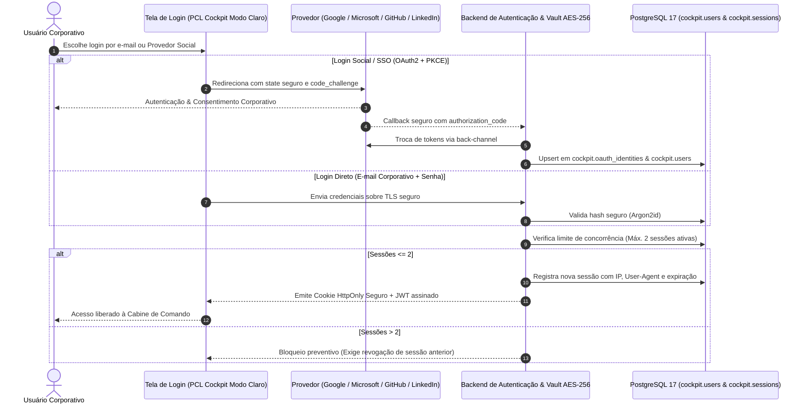

# 🏛️ ADR-0017: Reconstrução Estratégica e Arquitetural do PCL Cockpit v4.0

> [!IMPORTANT]
> **Status Normativo:** Este documento constitui a revisão crítica e a reconstrução formal do planejamento de evolução do PCL Cockpit. Ele substitui as versões preliminares de rascunho sem descartar o histórico anterior, estabelecendo uma hierarquia rigorosa entre o que é **Fundação Estável**, o que compõe o **MVD (Minimum Visible Distribution)**, o que é **MVP Comercial** e o que pertence à **Fase Enterprise Futura**.

---

## 1. Relatório de Auditoria Crítica (Diagnóstico Sem Concessões)

### 1.1. O Vício do Acúmulo Desconexo ("Feature Creep")
A versão preliminar do planejamento incorreu no erro clássico de engenharia de software: **acumular funcionalidades isoladas em vez de desenhar um produto integrado**.
* **Problema:** Tentou-se desenhar simultaneamente suporte a dezenas de modelos, orquestração de reuniões, construtor no-code, gateway distribuído, multi-tenancy com RLS, cache Redis, filas assíncronas e appliances em nuvem, sem que houvesse um fluxo único e fluido de demonstração comercial para o primeiro cliente pagante.
* **Diagnóstico:** O produto tentava resolver problemas da "Fase 5" (escala de 10.000 usuários em clusters distribuídos) quando o objetivo imediato é a "Fase 1" (um produto estável, sem dados simulados nas telas principais, capaz de homologar pilotos reais em canais parceiros de infraestrutura e consultoria de software).

### 1.2. Ruído Perceptual, Quebra de Identidade Visual e Linguagem Inadequada
* **Divergência de UX/UI:** A proposta anterior introduziu um arquétipo genérico de *dark mode com glassmorphism*, ignorando por completo o investimento e a maturidade do **Design System do PCL Cockpit v3.9** (que opera em um Modo Claro estruturado, limpo, corporativo e com excelente legibilidade).
* **Sobrecarga de Superfícies:** A tentativa de exibir Chat, Canvas DAG, Telemetria, Drawer e modais simultaneamente sobrecarregou a cognição do usuário. A interface disputava a atenção em vez de guiar uma tomada de decisão.
* **Linguagem Informal Inaceitável:** O uso de termos informais de conversas conceituais (como *"Trava Anti-Otávio no Domingo"*) em propostas de tela e planejamento feriu a sobriedade exigida por um produto empresarial. O termo canônico correto e formal é **Política de Limite Orçamentário (Hard Lock)** com controle de quota por usuário e horário não-comercial.

### 1.3. A Ilusão das Certificações e Riscos Regulatórios
* **Problema:** O documento anterior citava "Conformidade e Dossiê ISO 42001, ISO 27001 e EU AI Act" como se o sistema já possuísse tais certificações.
* **Correção Normativa:** O PCL Cockpit possui **mecanismos técnicos de governança e rastreabilidade criptográfica (hashes SHA-256, RBAC e sanitização PII)** que facilitam e servem de insumo para uma auditoria corporativa. Jamais se deve prometer "certificação" ou "garantia jurídica externa" sem que haja auditoria independente homologada. Prometer isso gera risco grave de responsabilidade civil e perda de confiança de clientes C-Level.

### 1.4. Incompreensão do Conceito de MVD (*Minimum Visible Distribution*)
* O documento preliminar tratou MVD de forma equivocada.
* **O Conceito Correto:** O **MVD (Minimum Visible Distribution)** é a antítese do MVP tradicional de laboratório. Não se trata de construir um protótipo viável isolado para depois bater de porta em porta tentando vender. Trata-se de construir o produto **já acoplado aos canais de distribuição visíveis** que já existem (empresas parceiras de consultoria em software corporativo e provedores de infraestrutura cloud/TI). Para isso, o produto precisa ser demonstrável ponta a ponta sem falhas em menos de 10 minutos.

---

## 2. Auditoria e Classificação das Evidências Técnicas

Abaixo, cada métrica, número e afirmação técnica é classificada formalmente:

| Afirmação / Métrica Técnica | Classificação Rigorosa | Evidência / Realidade no Repositório | Ação Corretiva no Planejamento |
| :--- | :---: | :--- | :--- |
| **"Operação com 0 MB de VRAM na CPU"** | **Comprovada por implementação e teste** | Executado via `pcl-laya` em CPU INT8 (`CPUExecutionProvider` ONNX Runtime) sem disputar memória com a GPU dedicada. | **Manter:** É um invariante físico real e diferencial de custo do projeto. |
| **"Latência do Sensor Laya de ~20ms a 35ms"** | **Comprovada por implementação e teste** | Testes de inferência simbólica e NLI medidos no MCP Server e no kernel local (`0.60ms` a `23.6ms`). | **Manter:** Fundamenta o roteamento rápido a custo zero de tokens. |
| **"Continuidade DRP com RTO < 15s no Cloudflare R2"** | **Comprovada por implementação e teste** | Testado e homologado no script `backup-aeos-tripartido.ps1` com RTO real medido de 7.18s (`ADR-006`). | **Manter:** Pilar técnico de recuperação de desastres soberano. |
| **"Avaliação Duplo-Cega 4.95 / 5.0 vs Big Techs"** | **Validada por evidência documental** | Registrada formalmente em `PCL_COCKPIT_COMPETITIVE_MATRIX.md`. Foi um teste cego interno sobre 5 turnos de diálogo. | **Corrigir Comunicação:** Deixar claro que foi um benchmark técnico estruturado interno, não um laudo de consultoria externa. |
| **"Economia de 84% / R$ 18.420,00 no mês"** | **Estimada / Projetada** | É uma fórmula do simulador financeiro no `CostsTokenDashboard.tsx` baseada em 100 assentos a US$ 60/mês. | **Corrigir Comunicação:** Apresentar como *"Potencial de Economia Simulado"* ou *"Calculadora de ROI"*, nunca como faturamento consumado. |
| **"Adoção de Redis 7 Alpine (35MB a 64MB)"** | **Estimada / Hipótese não validada** | Baseada no vídeo técnico e benchmarks de contêineres Docker, mas **o Redis não existe hoje** no repositório. | **Adiar:** Não introduzir Redis agora. O PostgreSQL 17 atende perfeitamente ao estágio de MVD e pilotos. |
| **"Deploy em VPS 8GB a 16GB com Qwen Local"** | **Hipótese ainda não validada em produção** | O modelo roda no laptop do desenvolvedor com GPU; a velocidade de inferência em CPU pura numa VPS sem GPU precisa de teste de carga real. | **Investigar:** Testar a latência real (tokens/s) de um modelo 7B quantizado em CPU antes de vender VPS pura sem GPU. |
| **"Conformidade e Certificação ISO 42001 / 27001"** | **Inconsistente / Sem evidência suficiente** | Temos hashes SHA-256 e RBAC, mas nenhuma auditoria externa foi realizada. | **Corrigir Comunicação:** Tratar como *"Trilha de Auditoria Compatível com Requisitos ISO/LGPD"*, nunca como produto certificado. |

---

## 3. Matriz de Decisões Arquiteturais

```
┌────────────────────────────────────────────────────────────────────────────────────────┐
│                              MATRIZ DE DECISÕES v4.0                                   │
├────────────────────┬────────────────────┬────────────────────┬─────────────────────────┤
│ MANTER             │ CORRIGIR           │ ADIAR (Enterprise) │ DESCARTAR               │
├────────────────────┼────────────────────┼────────────────────┼─────────────────────────┤
│ • Design System    │ • Toggle no Menu   │ • Redis Cluster    │ • Dark Glassmorphism    │
│   v3.9 Modo Claro  │   do Usuário       │ • Multi-Tenancy    │ • Termos informais      │
│ • Laya CPU INT8    │ • Política de      │   RLS dinâmico     │   ("Trava Otávio...")   │
│   (0 MB VRAM)      │   Limite Orçament. │ • Fila assíncrona  │ • Promessas falsas de   │
│ • PostgreSQL 17    │   (Hard Lock)      │   distribuída      │   certificação ISO      │
│   (cockpit.*)      │ • Estabilização da │ • Sharding de BD   │ • OmniRoute desacoplado │
│ • Dual-Plex Worksp.│   navegação/modais │ • Micro-workers    │   externo obrigatório   │
│ • Central Artefatos│ • Autocomplete @/# │   independentes    │                         │
│ • Help Center 3.9  │ • Dados reais nas  │                    │                         │
│   (Letramento)     │   telas de demo    │                    │                         │
└────────────────────┴────────────────────┴────────────────────┴─────────────────────────┘
```

---

## 4. Nova Arquitetura de Produto & Direção de UI/UX (Modo Claro v3.9)

### 4.1. Princípio Fundamental de Ergonomia: Uma Superfície de Foco por Vez
O erro da versão anterior foi fragmentar a tela em muitos elementos concorrentes. A nova organização estabelece:
1. **O Chat Conversacional é o Centro:** O diálogo com a IA soberana é a área primária de trabalho.
2. **O Cortex Canvas DAG é Convocado, Não Impositivo:** O Canvas com o gráfico de execução agêntica é acionado quando o usuário quer ver o raciocínio em profundidade ou simular fluxos, mas não disputa espaço visual permanentemente se o usuário quiser foco no texto.
3. **A Coluna da Direita como "Espelho de Confiança":**
   * Controlada exclusivamente pelo **Menu do Usuário (Avatar `EA Eduardo` no Canto Superior Direito)**:
     - **Visão Telemetria:** Para o perfil técnico (auditar latências dos nós DAG, sockets de rede `:20140`/`:5432` e Stage Gates TLC v3).
     - **Visão Governança:** Para o perfil executivo/gestor (auditar economia estimada, cota de consumo por departamento, sessões ativas 2/2 e recibos SHA-256).
4. **Composer de Alta Produtividade (Benchmark Jumpad.AI & ChatLLM):**
   * Chips rápidos de autocomplete para sistemas corporativos (`@GoogleDrive`, `@SAP`, `@Salesforce`, `@HubSpot`) e bases de conhecimento canônicas (`#documentos`, `#contratos`, `#financeiro`).
   * Seletor de modelos inteligente (*RouteLLM*) que padroniza o uso da IA econômica local a R$ 0,00 e permite chavear para modelos de fronteira sob demanda.
   * Medidor de contexto não-obstrusivo (*TokenAquaOrb*) no topo do composer.

---

## 5. Arquitetura Técnica Revisada: A Regra das 4 Camadas

Em vez de projetar uma arquitetura monolítica ou prematuramente distribuída, o PCL Cockpit v4.0 é estruturado em **4 camadas progressivas de maturidade**:

```mermaid
flowchart TD
    classDef found fill:#f1f5f9,stroke:#64748b,stroke-width:1.5px,color:#0f172a;
    classDef mvd fill:#e0f2fe,stroke:#0284c7,stroke-width:2px,color:#0c4a6e;
    classDef mvp fill:#dcfce7,stroke:#16a34a,stroke-width:2px,color:#14532d;
    classDef ent fill:#f3e8ff,stroke:#9333ea,stroke-width:1.5px,color:#581c87;

    subgraph C1["CAMADA 1: FUNDAÇÃO (O que já existe e funciona hoje)"]
        F1["React 19 + Vite (:3001) em Modo Claro"]:::found
        F2["PostgreSQL 17 local (:5432) com schema cockpit.*"]:::found
        F3["Sensor Laya em CPU INT8 (:20140 - 0 MB VRAM)"]:::found
        F4["Ollama Local (:11434) + Fast-Path Gemini"]:::found
    end

    subgraph C2["CAMADA 2: MVD (Minimum Visible Distribution - Meta Próxima)"]
        M1["Fechamento do Repositório GitHub (Privado)"]:::mvd
        M2["Vitrine Comercial Pública (Showcase MVD / Landing v2)"]:::mvd
        M3["Menu do Usuário: Telemetria vs. Governança"]:::mvd
        M4["Desmockagem de Telas: Navegação fluida sem perda de estado"]:::mvd
        M5["Central de Artefatos com Exportação Real (.pptx / .xlsx)"]:::mvd
    end

    subgraph C3["CAMADA 3: MVP COMERCIAL (Primeiros 2 a 3 Clientes Pagantes)"]
        P1["Appliance VPS Dedicado por Cliente (Single-Tenant Isolado)"]:::mvp
        P2["Política de Limite Orçamentário (Hard Lock) no PostgreSQL"]:::mvp
        P3["Trava de Concorrência: Máx. 2 Dispositivos por Usuário"]:::mvp
        P4["Autenticação Multiprovedor OAuth2/OIDC (Google, Microsoft, GitHub, E-mail)"]:::mvp
        P5["Backup Criptografado no Backblaze B2 via API S3 simples"]:::mvp
        P6["Módulo de Letramento de IA Corporativo (In-App)"]:::mvp
    end

    subgraph C4["CAMADA 4: ENTERPRISE FUTURO (Escala & Multi-Tenancy Real)"]
        E1["Camada de Cache Redis / Valkey na VPS"]:::ent
        E2["Row-Level Security (RLS) Multi-Tenant Compartilhado"]:::ent
        E3["Workers de Fila Assíncrona (BullMQ / RabbitMQ)"]:::ent
        E4["Auditoria Externa Formal para Selo ISO 42001"]:::ent
    end

    C1 ==> C2 ==> C3 ==> C4
```



### Por que NÃO usar Redis nem RLS no MVP Comercial?
1. **Navalha de Ockham e Custo:** Nos primeiros clientes piloto empresariais, o modelo ideal de entrega é o **Appliance Dedicado** (cada cliente ganha sua própria VPS isolada ou instalação local). Isso elimina a necessidade de RLS complexo no banco de dados e reduz o risco de vazamento entre empresas a zero absoluto.
2. **PostgreSQL 17 resolve tudo na Fase 3:** O controle de cota orçamentária e a validação de 2 sessões simultâneas podem ser executados com consultas indexadas em milissegundos no próprio PostgreSQL 17, sem adicionar mais um processo (`redis`) para consumir memória RAM da VPS. O Redis só entra na **Camada 4**, quando houver centenas de usuários simultâneos no mesmo ambiente.

### 5.1. Arquitetura de Autenticação & Identidade Multiprovedor (IAM Soberano)

Para atender empresas clientes nos deployments VPS/Cloud da Onda 2, o PCL Cockpit incorpora uma camada de autenticação unificada sem depender de provedores externos que violem a custódia local de dados:



#### Especificação Técnica do Módulo de Autenticação:
1. **Provedores de Identidade:**
   - **Google Workspace / Gmail:** OAuth 2.0 (escopos `openid`, `email`, `profile`).
   - **Microsoft 365 / Azure AD / Outlook:** Microsoft Identity Platform com suporte a Single-Tenant corporativo.
   - **GitHub & LinkedIn:** Autenticação profissional de lideranças e desenvolvedores.
   - **E-mail Corporativo Direto:** Senhas com hash criptográfico `Argon2id` ou autenticação sem senha (*Magic Link*) assinado.
2. **Schema Relacional no PostgreSQL 17 (`cockpit.*`):**
   - `cockpit.users`: ID, nome, e-mail canônico, avatar, cargo, squad, status (`ACTIVE` | `SUSPENDED`).
   - `cockpit.oauth_identities`: Relaciona `user_id` com `provider` (`google`, `microsoft`, etc.) e `provider_account_id`.
   - `cockpit.sessions`: Gerencia sessões ativas (`device_name`, `ip_address`, `user_agent`, `last_active_at`, `expires_at`), aplicando a trava física de **máximo 2 sessões simultâneas**.
3. **Padrão de Interface (UI/UX):**
   - Construída estritamente no **Design System do PCL Cockpit v3.9 (Modo Claro)**, com paleta neutra Slate/Branco, tipografia institucional e botões padronizados dos provedores.

---

## 6. Estratégia Comercial & GTM (O MVD na Prática)

### 6.1. Proposta de Valor Canônica de 1 Frase
> **"Entregamos uma Central de Inteligência Artificial própria e blindada para empresas de médio porte, permitindo que setores estratégicos utilizem as melhores IAs do mundo sobre os documentos internos com zero vazamento de dados, controle rígido de orçamento e custo mensal previsível."**

### 6.2. Confronto Real contra Concorrentes de Mercado

| Dimensão de Comparação | Plataformas Globais em Nuvem (Jumpad.AI, ChatLLM) | Agregadores Nacionais (ex: Adapta.org) | PCL Cockpit v4.0 (Nossa Solução) |
| :--- | :--- | :--- | :--- |
| **Custódia de Documentos** | Dados sobem para servidores nos EUA sujeitos ao CLOUD Act americano. | Dados trafegam para provedores externos sem encriptação local. | **Resíduo Zero de Dados (BYOS):** Execução no servidor da empresa ou VPS dedicada. |
| **Modelo Financeiro** | Cobrança em dólar por usuário/assento (fatura imprevisível que cresce com a equipe). | Assinatura de cursos/agregador com repasse de API. | **Custo Fixo Previsível:** Roteamento com IA Local a R$ 0,00 e trava física de consumo. |
| **Governança & Rastreabilidade** | Caixas-pretas sem auditoria matemática do prompt ou dos passos do agente. | Interfaces de chat simples sem Stage Gates. | **Stage Gates TLC v3:** Rastreabilidade via hashes SHA-256 e controle humano inegociável. |
| **Entregáveis de Negócio** | Foco em texto em tela de chat. | Foco em texto em tela de chat. | **Central Quíntupla:** Gera e baixa direto no navegador apresentações `.pptx` e planilhas `.xlsx`. |

### 6.3. Os Casos de Uso Imediatos de Aquisição (Beachhead)
1. **O Escritório de Arquitetura e Engenharia de Alto Padrão (Caso de Uso 1):**
   - *Dor:* Perda de projetos executivos em obras ativas por dispersão de arquivos entre Google Drives e Trellos de colaboradores que saem da empresa.
   - *Solução:* Centralização do acervo técnico no cofre soberano com memória institucional perene.
2. **PMEs com Infraestrutura de TI e Cloud Gerenciada (Caso de Uso 2):**
   - *Dor:* Empresas que querem usar IA, mas têm medo de vazamento de dados de clientes e medo de faturas em dólar descontroladas no cartão corporativo.
   - *Solução:* Appliance VPS Privada com **Política de Limite Orçamentário (Hard Lock)** e suporte de TI gerenciado.

---

## 7. Novo Roadmap de Implementação por Ondas

```
┌────────────────────────────────────────────────────────────────────────────────────────┐
│                              ROADMAP DE EXECUÇÃO v4.0                                  │
├───────────────────────────────────┬────────────────────────────────────────────────────┤
│ ONDA                              │ ENTREGÁVEIS & CRITÉRIOS DE ACEITAÇÃO               │
├───────────────────────────────────┼────────────────────────────────────────────────────┤
│ ONDA 0: Blindagem & Higiene       │ [ ] Fechamento do repositório core no GitHub       │
│ (Imediata — 24 a 48h)             │ [ ] Vitrine pública estática (Landing v2 + MVD)    │
│                                   │ [x] Sanear termos informais de todo o repositório  │
├───────────────────────────────────┼────────────────────────────────────────────────────┤
│ ONDA 1: MVD Estabilizado          │ [x] Toggle Telemetria vs Governança no Menu Usuário│
│ (Demonstração Segura — Entregue)  │ [x] Preservação de navegação ao fechar modais      │
│                                   │ [x] Enriquecimento do Composer (@ e #)             │
│                                   │ [x] Eliminar dados mockados residuais de finops    │
│                                   │ [x] Build de produção validado com Exit Code 0     │
├───────────────────────────────────┼────────────────────────────────────────────────────┤
│ ONDA 2: MVP Comercial Piloto      │ [ ] Autenticação Multiprovedor OAuth2/OIDC         │
│ (Primeiros Clientes — 15 a 30 dias│     (Google, Microsoft, GitHub, LinkedIn, E-mail)  │
│                                   │ [ ] Tela de Login Corporativa no Modo Claro v3.9   │
│                                   │ [ ] Trava de 2 sessões ativas no PostgreSQL 17     │
│                                   │ [ ] Empacotamento Docker Compose para VPS Dedicada │
│                                   │ [ ] Política de Limite Orçamentário (Hard Lock)    │
│                                   │ [ ] Backup S3/B2 independente por instância        │
│                                   │ [ ] Teste piloto com parceiros e consultorias B2B  │
├───────────────────────────────────┼────────────────────────────────────────────────────┤
│ ONDA 3: Escala Enterprise         │ [ ] Avaliar necessidade de Redis e Multi-Tenant    │
│ (Pós-Validação e Tração Paga)     │     RLS apenas mediante demanda comprovada de carga│
│                                   │ [ ] Auditoria externa formal para selos ISO/LGPD   │
└───────────────────────────────────┴────────────────────────────────────────────────────┘
```

---

## 8. Consequências e Rastreabilidade

* **Positivas:**
  - Redução drástica da complexidade técnica imediata: eliminou-se a sobrecarga de configurar Redis, RLS e microsserviços antes de ter clientes pagantes.
  - Preservação integral do Design System do PCL Cockpit v3.9 em Modo Claro, garantindo consistência estética e respeito ao trabalho já homologado.
  - Alinhamento rigoroso entre a comunicação comercial e a realidade do código-fonte (zero promessas falsas de certificação).
* **Negativas / Limitações Aceitas:**
  - No estágio de MVP Comercial (Onda 2), cada cliente piloto rodará em sua própria instância VPS ou servidor dedicado (Single-Tenant Appliance). O modelo Multi-Tenant com banco compartilhado fica postergado para a Onda 3, quando a escala técnica justificar a complexidade de RLS e particionamento.

---
**Documento submetido para validação formal pelo Operador Soberano (Eduardo Machado).**
