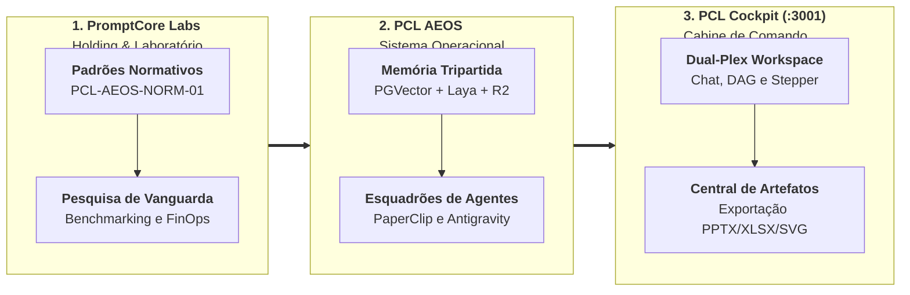
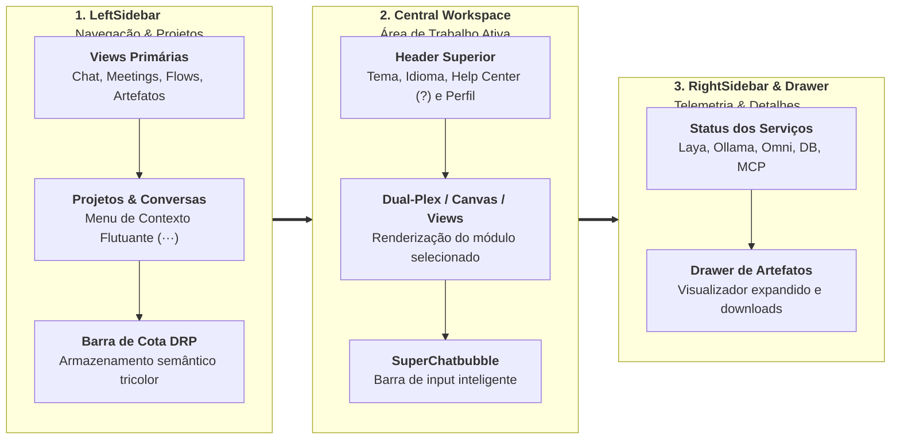
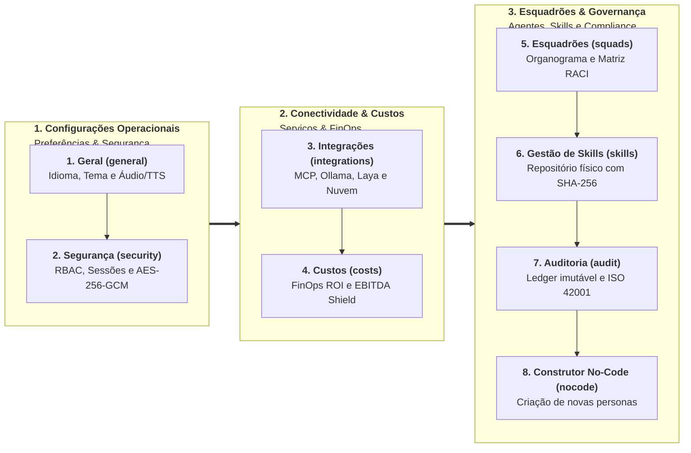
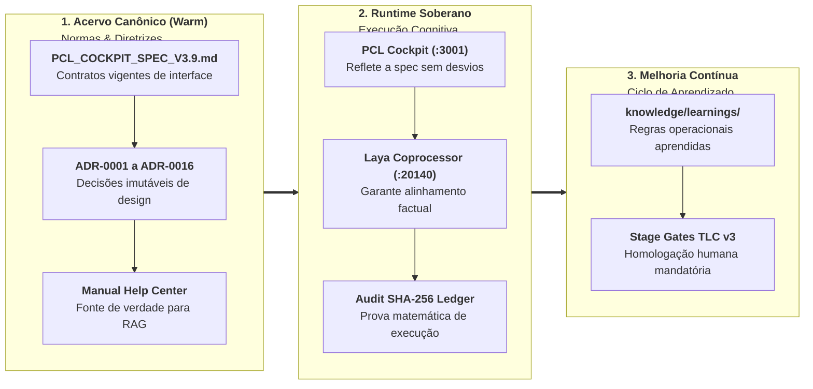

# 📖 Manual Canônico & Guia Operacional do PCL Cockpit (Help Center v3.9)

> **Finalidade:** Este documento serve como a **Central de Ajuda Oficial (Help Center)** do PCL Cockpit, fornecendo aos usuários, operadores, administradores e equipes de engenharia um guia de referência completo, didático e exaustivo para rápida compreensão da plataforma, aceleração de onboarding e domínio de todos os recursos da cabine de comando cognitivo.

---

## 🧭 Sumário Geral

1. [Capítulo 1: Visão Geral da Arquitetura & Conceitos Centrais](#capítulo-1-visão-geral-da-arquitetura--conceitos-centrais)
2. [Capítulo 2: Guia de Navegação Completo de Telas](#capítulo-2-guia-de-navegação-completo-de-telas)
3. [Capítulo 3: Módulos, Painéis e Funcionalidades Principais](#capítulo-3-módulos-painéis-e-funcionalidades-principais)
4. [Capítulo 4: Documentação Exaustiva das Telas de Configuração (SettingsModal)](#capítulo-4-documentação-exaustiva-das-telas-de-configuração-settingsmodal)
5. [Capítulo 5: Dicionário de Parâmetros, Opções e Impactos Operacionais](#capítulo-5-dicionário-de-parâmetros-opções-e-impactos-operacionais)
6. [Capítulo 6: Fluxos de Uso Recomendados & Boas Práticas](#capítulo-6-fluxos-de-uso-recomendados--boas-práticas)
7. [Capítulo 7: Casos de Uso Práticos e Exemplos Executivos](#capítulo-7-casos-de-uso-práticos-e-exemplos-executivos)
8. [Capítulo 8: Troubleshooting, Matriz de Portas Locais & FAQs](#capítulo-8-troubleshooting-matriz-de-portas-locais--faqs)
9. [Capítulo 9: Integração com a Living Architecture do Ecossistema PCL](#capítulo-9-integração-com-a-living-architecture-do-ecossistema-pcl)

---

## Capítulo 1: Visão Geral da Arquitetura & Conceitos Centrais

### 1.1. A Tríade Institucional Canônica
Para compreender a governança do ecossistema, é fundamental distinguir com clareza os três pilares que o compõem:
- **🏢 PromptCore Labs (A Inovação / Holding):** O laboratório e holding de arquitetura de inteligência artificial soberana que concebe os padrões de governança, finops e blindagem regulatória para o ecossistema corporativo.
- **⚙️ PCL AEOS (*AI Engineering Operating System* - O Sistema Operacional Soberano):** O motor de inteligência e governança nos bastidores que orquestra a colaboração entre líderes, especialistas humanos e esquadrões de agentes autônomos sob rastreabilidade matemática.
- **🖥️ PCL Cockpit (`:3001`) — Cognitive Engineering Platform (A Cabine de Comando Interativa):** A interface executiva e técnica onde a liderança assume o controle em tempo real, visualiza o raciocínio das IAs, audita custos/latências e mantém a autoridade soberana irrevogável.

### 1.2. Invariantes de Hardware & Modo Soberano ($0.00)
- **0 MB de VRAM para o Coprocessador Laya:** O sensor consultivo Laya System One opera integralmente na CPU host (`ONNX INT8` via `CPUExecutionProvider`), processando decisões em ~20-35ms sem disputar memória de vídeo com o modelo generativo local (`qwen2.5-coder:7b` na GPU NVIDIA GeForce RTX 3050).
- **Custo Marginal Zero ($0.00):** Todas as operações nucleares funcionam offline com motores locais, eliminando a dependência obrigatória de faturas recorrentes em nuvem.
- **Política de Zero Mocks:** Nenhuma resposta, métrica ou tabela na interface é simulada. Toda telemetria decorre de chamadas HTTP reais e bancos de dados locais.
- **Segredo Corporativo Blindado (BYOS / Resíduo Zero de Dados):** Arquivos confidenciais e prompts nunca são gravados em servidores públicos ou usados para treinar modelos externos.
- **Avaliação Técnica Duplo-Cega Imparcial:** O PCL Cockpit sustenta a nota histórica de **4.95 / 5.0**, superando o Gemini (`4.45`), ChatGPT Enterprise (`4.30`) e Copilot (`3.80`).

---

## Capítulo 2: Guia de Navegação Completo de Telas

O PCL Cockpit adota a arquitetura ergonômica *Liquid Glass Bento Grid* de 3 colunas retráteis, projetada para foco cognitivo e zero poluição visual:

### 2.1. Header Superior
- **Logo PromptCore Labs:** Identidade visual oficial com glow cyan e tagline *Cognitive Engineering Platform*.
- **Badges de Status em Tempo Real:** Indicador visual do Laya Coprocessor (`Laya CPU: Active ~22ms`), OmniRoute e Ollama.
- **Seletor de Idioma:** Alternância dinâmica instantânea entre Português (`pt`), Inglês (`en`) e Espanhol (`es`).
- **Alternador de Tema (Dark / Light):** Transição suave entre o modo *Dark Liquid Glass* (#0b0f19) e o modo *Executive Light* (#FFFFFF).
- **Botão Central de Ajuda (`?`):** Abre a Central de Ajuda In-App com documentação integrada e busca contextual.
- **Botão de Configurações (Engrenagem):** Abre o modal administrativo global `SettingsModal`.
- **Card de Perfil do Usuário:** Exibe nome, cargo e nível de acesso RBAC (*Admin, Engenheiro, Operador*).

### 2.2. LeftSidebar (Barra Lateral Esquerda)
- **Botão Nova Conversa:** Inicia uma nova sessão limpa (*Thread Zero*).
- **Abas de Navegação Primária:**
  - 💬 **Chat:** Conversação profunda, resolução de dúvidas e assistência técnica.
  - 🎥 **Meetings:** Inteligência de reuniões, atas com WhisperX e plano de ação.
  - ⚡ **Flows:** Canvas de orquestração visual de fluxos de trabalho e DAGs.
  - 📦 **Artefatos:** Nova Biblioteca Centralizada com filtros, miniaturas e exportações reais.
- **Busca de Conversas:** Filtro instantâneo por título ou projeto.
- **Projetos e Pastas Corporativas:** Agrupamento de iniciativas com contador de conversas e botão para criação de novos projetos.
- **Menu de Contexto Flutuante (`···`):** Permite *Renomear*, *Fixar no Topo*, *Mover para Projeto*, *Compartilhar Link* ou *Excluir* conversas.
- **Barra de Cota Semântica de Armazenamento:** Exibe o consumo de espaço no PostgreSQL 17 / Cloudflare R2 com código tricolor:
  - 🟢 **Verde (Saudável):** Uso < 75%.
  - 🟡 **Âmbar (Alerta):** Uso de 75% a 89.9%.
  - 🔴 **Vermelho (Crítico):** Uso ≥ 90%.

### 2.3. RightSidebarStatus (Barra Lateral Direita)
- **Painel de Telemetria Viva:** Monitoramento contínuo das portas locais `:11434` (Ollama), `:8000` (OmniRoute), `:20140` (Laya Coprocessor), `:5432` (PostgreSQL 17) e servidor MCP stdio.
- **Painel FinOps EBITDA Shield:** Visualização do custo marginal acumulado na sessão (`$0.00`) e economia calculada em comparação a APIs proprietárias em nuvem.
- **Monitor de Extensões Conectadas:** Exibe instâncias ativas da Extensão Companion Manifest V3 no navegador.

### 2.4. Dual-Plex Workspace (Área Central)
- **Modos de Exibição:** Alternância entre *Somente Chat*, *Somente Canvas* ou *Dual-Plex (Lado a Lado)*.
- **Live Execution Stepper:** Exibe com transparência matemática cada etapa do raciocínio cognitivo da IA.
- **Markdown Renderer com Mermaid Reativo:** Suporte a formatação rica, blocos de código com cópia de sintaxe, KaTeX para fórmulas matemáticas e diagramas interativos com pan e zoom.

---

## Capítulo 3: Módulos, Painéis e Funcionalidades Principais

### 3.1. SuperChatbubble (Barra de Entrada Inteligente)
- **Input Textual e Multilinha:** Digitação ergonômica com redimensionamento automático.
- **Botão de Anexo de Estudos (`+` / Clipe):** Permite anexar múltiplos arquivos PDF, DOC ou TXT. O sistema realiza extração automática de texto, chunking semântico e indexação via Orama Search sem enviar dados a nuvens públicas.
- **Seletor de Formato Alvo:** Permite determinar previamente a saída desejada:
  - `Auto`: A IA decide o formato ideal de acordo com a solicitação.
  - `Diagram`: Produz diagramas Mermaid no padrão Cortex v7.
  - `Slide`: Gera apresentações prontas para download em PowerPoint (.pptx).
  - `Sheet`: Gera planilhas tabulares prontas para Excel (.xlsx).
  - `Infographic`: Cria cards executivos com resumos visuais.
  - `App`: Gera protótipos de interfaces web funcionais em HTML5/Tailwind.
  - `Doc`: Gera documentação formal em Markdown puro.
- **Gating de Busca Web e RAG:** A IA aciona a busca externa ou o acervo canônico apenas quando estritamente necessário (`Intention Gating`), eliminando links irrelevantes.
- **Pílula de Fontes Retráteis:** Quando há citações documentais ou links web, as referências são condensadas ao final da resposta em uma pílula retrátil (`Fontes Consultadas (n) v`), mantendo a leitura limpa.

### 3.2. Live Execution Stepper (Transparência Cognitiva em 5 Fases)
Toda interação no Cockpit percorre cinco fases rigorosamente auditadas:
1. **Fase 1: Triagem de Intenção (Laya CPU):** Classificação não-autorregressiva em ~22ms com 0 MB VRAM, definindo se a pergunta é conceitual, se exige RAG interno ou busca web externa.
2. **Fase 2: Grounding Factual & RAG Canônico:** Busca e recuperação de contexto no acervo `knowledge/warm/` ou nos anexos de estudo indexados.
3. **Fase 3: Verificação de Contradição e Staleness:** Sensor Laya valida se o contexto recuperado contradiz documentos canônicos ou normas aprovadas.
4. **Fase 4: Inferência e Geração:** Chamada de inferência via OmniRoute conectando ao modelo configurado (Ollama local ou provedores conectados).
5. **Fase 5: Prova Criptográfica & Artefatos:** Geração da assinatura matemática SHA-256 da resposta e estruturação de artefatos multimodais associados.

### 3.3. Biblioteca de Artefatos (Artifacts Library View v3.9)
- **Filtros Rápidos em Pílulas:** Filtre em 1 clique entre *Todos, Favoritos, Diagramas, Slides, Planilhas, Infográficos, Apps, Documentos*.
- **Busca Global e por Tags:** Encontre instantaneamente qualquer artefato gerado em qualquer projeto.
- **Grid View (Grade Visual):** Exibe cartões elegantes com miniaturas gráficas, tipo, tamanho em bytes, tags e data de criação.
- **Table View (Tabela Analítica):** Lista estruturada para exportação em massa e ordenação por colunas.
- **Navegação com Zero Amnésia:** O botão "Abrir Conversa de Origem" leva o usuário de volta à interação exata que gerou o artefato.

### 3.4. Rich Artifact Viewer & Renderizadores Interativos
- **PowerPoint Real (.pptx):** Geração binária no cliente com slides formatados prontos para reunião de diretoria.
- **Excel Real (.xlsx):** Planilhas tabulares estruturadas para conferência de números e fórmulas.
- **HTML5 Sandbox Card:** Ambiente de execução isolado em iframe para protótipos de software e dashboards interativos.
- **Mermaid Diagram Block:** Renderização com suporte a temas Dark/Light, zoom interativo, pan e botão direto de cópia do SVG.

### 3.5. Meetings Intelligence (Inteligência de Reuniões)
- **Captura e Gravação de Reuniões:** Ingestão de áudios e vídeos de conferências (Meet, Teams, Zoom).
- **Transcrição Acelerada:** Transcrição precisa com identificação de interlocutores.
- **Geração de Atas Executivas:** Resumo de tópicos discutidos, decisões homologadas e lista de ações pendentes (Action Items) com responsáveis e prazos.
- **Despacho em 1-Clique:** Envio imediato da ata e tarefas via webhooks ou e-mail corporativo.

### 3.6. Flows Automation Canvas
- **Orquestração de Grafos (DAGs):** Modelagem visual de fluxos de trabalho e esteiras de engenharia.
- **Nós de Decisão & Approval Gates:** Pontos de checagem obrigatória onde a esteira pausa até a aprovação humana (*Human-in-the-Loop*).
- **Integração de Pipelines:** Acionamento de scripts, testes de build e compilações automáticas.

---

## Capítulo 4: Documentação Exaustiva das Telas de Configuração (SettingsModal)

O menu de configurações globais do Cockpit é dividido em **8 abas temáticas**, oferecendo controle total sobre segurança, integrações, custos e modelos:

### 4.1. Aba 1: Preferências Gerais (`general`)
- **Idioma da Interface:** Escolha entre *Português do Brasil (`pt`)*, *English (`en`)* ou *Español (`es`)*.
- **Tema Visual:** Alternância entre *Modo Escuro (Liquid Glass Dark)* e *Modo Claro (Executive Light)*.
- **Densidade da Interface:** Modos Confortável ou Compacto.
- **Síntese de Voz (TTS) e Sanitização:** Configuração do mecanismo de leitura de respostas com sanitizador de texto para pronúncia fluida (`ttsSanitizer.ts`), removendo caracteres de formatação e emojis que poluem o áudio.

### 4.2. Aba 2: Segurança & Controle de Acesso (`security`)
- **Matriz de Perfis RBAC (*Role-Based Access Control*):**
  - **Administrador (`admin`):** Acesso irrestrito a configurações, chaves, usuários e auditoria.
  - **Engenheiro de IA (`engineer`):** Criação de agentes, orquestração de fluxos e gestão de skills.
  - **Operador de Negócio (`operator`):** Utilização do chat, geração de artefatos e reuniões.
  - **Auditor de Conformidade (`auditor`):** Acesso somente-leitura à trilha de auditoria e relatórios.
- **Criptografia em Repouso:** Proteção de chaves locais via envelope AES-256-GCM.
- **Gestão de Sessões Ativas:** Visualização de dispositivos e navegadores autenticados com botão de revogação imediata de tokens.

### 4.3. Aba 3: Biblioteca de Integrações (`integrations`)
- **Servidor MCP Soberano Nativo:**
  - Status do processo Node.js executando `scripts/pcl-sovereign-mcp-server.mjs`.
  - Protocolo de transporte (`stdio`).
  - Lista de ferramentas ativas (`pcl_workspace_inventory`, `pcl_read_canonical_doc`, `pcl_verify_artifact_sha256`).
- **Motores Locais (Zero Custo):**
  - **Ollama Local (`:11434`):** Endpoint, modelo ativo (`qwen2.5-coder:7b-instruct-q4_K_M`), alocação de GPU e teste de ping.
  - **OmniRoute Gateway (`:8000`):** Gestor unificado de roteamento e fallbacks inteligentes.
  - **Laya Coprocessor (`:20140`):** Status do motor System One em CPU INT8 com 0 MB VRAM.
  - **PostgreSQL 17 (`:5432`):** Conexão com o banco local, verificação do schema `cockpit` e extensão `vector`.
- **Provedores de Nuvem Híbridos (Opcionais):**
  - Configuração de chaves de API para OpenAI, Anthropic, Google Gemini e DeepSeek.
- **Disaster Recovery (Cloudflare R2):**
  - Configuração do bucket de backup off-site com credenciais S3 compatíveis sem custo de saída.
- **Webhooks Corporativos:**
  - Canais de envio para notificações e atas em Slack, Microsoft Teams e WhatsApp Business.

### 4.4. Aba 4: FinOps & Gestão de Custos (`costs`)
- **Calculadora Soberana de ROI Corporativo:**
  - Simulação de economia financeira comparando o custo marginal local (`$0.00`) contra faturas em dólar de plataformas em nuvem para equipes de 10 a 500 colaboradores.
- **Métricas de Consumo de Tokens:**
  - Gráficos de tokens processados por modelo, com distinção entre tokens locais (gratuitos) e externos.
- **EBITDA Shield (Trava Física Hard Lock):**
  - Limite orçamentário mensal em moeda local ou USD. Caso o limite seja atingido, as chamadas para nuvem paga são automaticamente bloqueadas, revertendo 100% da operação para inferência soberana local.

### 4.5. Aba 5: Esquadrões de Agentes (`squads`)
- **Organograma Hierárquico de Squads:**
  - Visualização de esquadrões de agentes autônomos (Prototipagem, Engenharia, Arquitetura, FinOps e QA).
- **Matriz de Responsabilidade RACI:**
  - Atribuição de papéis: *Responsible* (R), *Accountable* (A), *Consulted* (C) e *Informed* (I) para cada tipo de tarefa.
- **Políticas de Escalação:** Definição de fluxos de escalação para aprovação humana (Nível 1 aos 60s, Nível 2 aos 120s).

### 4.6. Aba 6: Gestão de Skills (`skills`)
- **Inventário Físico do Repositório PaperClip:**
  - Descoberta automática de habilidades localizadas no sistema de arquivos local (`PaperClip-Companies/promptcore-labs/`).
- **Atesto Criptográfico de Integridade:**
  - Cálculo do hash SHA-256 de cada arquivo `SKILL.md`. Caso um arquivo seja adulterado fora da esteira de aprovação, a habilidade é sinalizada como violada.
- **Ativação e Desativação Dinâmica:**
  - Chaves de seleção para habilitar ou restringir o uso de skills específicos por sessão.

### 4.7. Aba 7: Auditoria & Compliance (`audit`)
- **Livro-Razão Criptográfico (SHA-256 Ledger):**
  - Registro sequencial de todas as interações, comandos executados e decisões de agentes.
- **Conformidade Regulatória:**
  - Relatórios de aderência à LGPD (Lei Geral de Proteção de Dados) e normas ISO/IEC 27001 (Segurança) e ISO/IEC 42001 (Sistemas de Gestão de IA).
- **Histórico de Intervenções Humanas (HitL Log):**
  - Rastreabilidade de quem aprovou, rejeitou ou modificou decisões propostas por agentes.

### 4.8. Aba 8: Construtor No-Code de Agentes (`nocode`)
- **Assistente Visual Passo a Passo:**
  - Definição do nome, avatar, tom de voz e propósito da nova persona de IA.
- **Seleção de Ferramentas e Permissões:**
  - Marcação de ferramentas autorizadas (leitura de arquivos, geração de diagramas, execução de scripts).
- **Geração de Prompt do Sistema:**
  - Compilação estruturada do `system prompt` de acordo com as diretrizes normativas do PCL AEOS.

---

## Capítulo 5: Dicionário de Parâmetros, Opções e Impactos Operacionais

A tabela abaixo documenta detalhadamente os principais parâmetros de configuração, seus valores aceitos e os impactos práticos na operação:

| Parâmetro | Localização na UI | Opções / Valores | Padrão Recomendado | Impacto Operacional & Segurança |
| :--- | :--- | :--- | :--- | :--- |
| **`activeTheme`** | Header / `general` | `dark`, `light` | `dark` | Define o contraste visual; o modo dark reduz fadiga visual e sincroniza com o tema de diagramas. |
| **`language`** | Header / `general` | `pt`, `en`, `es` | `pt` | Altera dinamicamente os textos da interface e as instruções de sistema passadas aos modelos. |
| **`ttsSanitization`** | `general` -> Áudio | `true`, `false` | `true` | Filtra markdown e pontuação matemática na leitura por voz para evitar leituras robotizadas. |
| **`mcpServerTransport`**| `integrations` -> MCP | `stdio`, `sse` | `stdio` | `stdio` roda direto pelo processo do SO sem expor portas de rede, garantindo isolamento total. |
| **`primaryLocalModel`**| `integrations` -> Ollama | Strings de modelo Ollama | `qwen2.5-coder:7b...`| Determina o modelo que processa tarefas de código e chat na GPU local. |
| **`layaExecutionMode`** | `integrations` -> Laya | `cpu_int8` | `cpu_int8` | **Invariante Mandatória:** Garante 0 MB de uso de VRAM na CPU, rodando inferência em ~20ms. |
| **`ebitdaShieldLimit`** | `costs` -> FinOps | Valor numérico ($) | `100.00` | Trava rígida de gastos em nuvem paga; bloqueia chamadas externas caso o valor seja atingido. |
| **`hitlN1TimeoutSec`** | `squads` -> HitL | `30`, `60`, `90` seg | `60` seg | Tempo de espera da aprovação do operador antes de escalar automaticamente para a Diretoria (N2). |
| **`hitlTtlDropSec`** | `squads` -> HitL | `60`, `120`, `180` seg | `120` seg | Tempo limite total de descarte seguro da tarefa caso nenhum operador humano responda. |
| **`storageQuotaAlert`** | `integrations` -> DB | Percentuais (%) | `75% / 90%` | Limiares que acionam avisos visuais na barra de armazenamento do LeftSidebar. |

---

## Capítulo 6: Fluxos de Uso Recomendados & Boas Práticas

### Fluxo 1: Engenharia de Software Assistida (Spec-Driven Development)
1. **Inicie na Tela de Chat:** Crie uma conversa vinculada ao projeto corporativo desejado.
2. **Defina a Especificação:** Solicite ao agente um documento de arquitetura selecionando o formato alvo `Doc`.
3. **Valide os Diagramas:** Inspecione o diagrama Mermaid gerado com a persona Cortex no modo *Dual-Plex*.
4. **Gere os Artefatos de Código:** Solicite a implementação e verifique se a validação de compilação alcançou **Exit Code 0** sem testes simulados.
5. **Consulte a Trilha de Auditoria:** Verifique o hash SHA-256 gerado no *Live Execution Stepper* para homologação formal.

### Fluxo 2: Análise Segura de Documentos Confidenciais (Estudo Local)
1. **Anexe o Documento:** Clique no botão `+` do composer e anexe o arquivo PDF ou relatório corporativo.
2. **Aguarde a Ingestão:** O serviço `studyIngestionService` extrai o texto e indexa os chunks em memória em menos de 2 segundos.
3. **Faça Perguntas Objetivas:** Questione sobre cláusulas, valores orçamentários ou diretrizes de segurança.
4. **Verifique as Citações:** Clique na pílula retrátil `Fontes Consultadas` para inspecionar exatamente a página e o parágrafo de onde a informação foi extraída.

### Fluxo 3: Produção e Exportação de Apresentações de Diretoria
1. **Solicite a Apresentação:** No composer, digite o tema da apresentação e selecione a pílula de formato `Slide`.
2. **Revise os Slides na Interface:** O Cockpit exibe a prévia visual dos slides gerados com títulos e pontos-chave.
3. **Exporte para PowerPoint:** Acesse a **Biblioteca de Artefatos**, localize o artefato e clique no botão **PowerPoint (.pptx)**.
4. **Arquivo Pronto:** O arquivo baixado é um `.pptx` nativo 100% formatado, pronto para apresentação imediata.

---

## Capítulo 7: Casos de Uso Práticos e Exemplos Executivos

### Caso A: Análise de Contratos com Proteção Total de Segredo Corporativo
- **Cenário:** O departamento jurídico necessita auditar uma minuta contratual de 80 páginas contendo termos de fusão e aquisição sigilosos.
- **Solução PCL:** O operador anexa o arquivo na sessão local. O PCL Cockpit processa o documento integralmente na CPU host (`:20140`) e na GPU dedicada (`:11434`), gerando uma matriz de riscos contratuais exportada para Excel (`.xlsx`). Nenhum byte de dados transita pela internet pública, atendendo à LGPD e à política de sigilo absoluto.

### Caso B: Economia Imediata de Custos em Operações de Engenharia (FinOps)
- **Cenário:** Uma equipe com 40 desenvolvedores realiza consultas constantes sobre arquitetura e código, gerando custos de mais de US$ 1.200/mês em tokens de APIs comerciais.
- **Solução PCL:** Implementação do PCL Cockpit com modelo local `qwen2.5-coder:7b` e coprocessador Laya. O *FinOps EBITDA Shield* registra **custo marginal de $0.00**, economizando anualmente mais de US$ 14.400 em verba de TI.

### Caso C: Despacho Automatizado de Atas e Compromissos de Reunião
- **Cenário:** Reunião semanal de alinhamento entre diretores com duração de 45 minutos.
- **Solução PCL:** O áudio é capturado no módulo *Meetings Intelligence*. O sistema gera a ata formal em 18 segundos, extrai 7 tarefas acionáveis e despacha automaticamente para o canal corporativo via webhook com 1 clique.

---

## Capítulo 8: Troubleshooting, Matriz de Portas Locais & FAQs

### 8.1. Matriz de Portas e Diagnóstico de Conexão

| Porta | Serviço | O que fazer se o status estiver "Offline"? |
| :--- | :--- | :--- |
| **`:3001`** | **PCL Cockpit** | Execute o atalho oficial `Iniciar_PCL_Cockpit.bat` ou comando `npm run dev` na pasta `projects/PromptCoreLabs_AEOS_Dashboard/`. |
| **`:11434`**| **Ollama Local** | Abra um terminal e execute `ollama serve`. Verifique se o modelo está instalado com `ollama list`. |
| **`:8000`** | **OmniRoute** | Verifique a configuração em `config/omniroute/config.yaml` e execute o serviço gateway. |
| **`:20140`**| **Laya System One** | Execute o serviço de inferência em CPU Laya. Confirme que não há tentativa de alocação de GPU na inicialização. |
| **`:5432`** | **PostgreSQL 17** | Verifique o serviço do PostgreSQL no Windows Services (`services.msc`) ou execute o contêiner do banco. |

### 8.2. Perguntas Frequentes (FAQs)

**P: Os dados e conversas gerados no Cockpit são compartilhados com servidores externos?**  
*R:* Absolutamente não. Todas as conversas, anexos e artefatos ficam armazenados no seu banco relacional PostgreSQL 17 local (`cockpit.*`). Quando configurado o backup DRP, a replicação ocorre de forma criptografada para o seu próprio bucket privado no Cloudflare R2.

**P: O que acontece se a cota de armazenamento na barra lateral atingir 90% (Vermelho)?**  
*R:* O sistema continuará gravando conversas normalmente, mas emitirá um aviso preventivo na barra de cota. Recomendamos acessar a Biblioteca de Artefatos para exportar os arquivos em `.pptx` ou `.xlsx` e liberar espaço no banco.

**P: Como garantir que meus diagramas Mermaid não sofram corte de texto (clipping)?**  
*R:* A persona Cortex do PCL Cockpit adota a **Revisão Calibrada v7**, que impõe caixas retangulares largas de 2 linhas (`flowchart LR`) e layout colunar estruturado, assegurando proporção panorâmica e contraste estético WCAG AAA em qualquer resolução.

**P: Posso rodar a plataforma se a internet cair completamente?**  
*R:* Sim. No modo soberano local, o PCL Cockpit (`:3001`), o Laya Coprocessor (`:20140`), o Ollama (`:11434`) e o PostgreSQL (`:5432`) operam com 100% de autonomia e resiliência offline.

---

## Capítulo 9: Integração com a Living Architecture do Ecossistema PCL

O PCL Cockpit não é uma interface isolada: ele é a manifestação visual direta da **Living Architecture** governada pelo PCL AEOS:

- **Rastreabilidade Bidirecional:** Cada botão, regra de validação e tela do Cockpit mapeia-se diretamente para um ADR formal (`ADR-0001` a `ADR-0016`).
- **RAG com Auto-Consciência:** O agente de IA do Cockpit consulta este próprio manual canônico (`PCL_COCKPIT_HELP_CENTER_MANUAL.md`) para orientar os usuários em tempo real sobre qualquer dúvida operacional.
- **Garantia de Evolução Segura:** Nenhuma funcionalidade nova é introduzida no Cockpit sem a respectiva homologação no acervo de arquitetura viva e validação formal de build com **Exit Code 0**.

