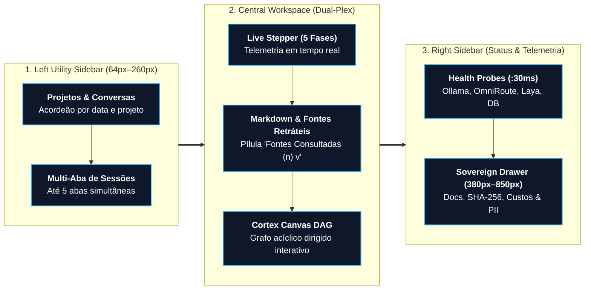

# 🖥️ Especificação Funcional & Arquitetural: PCL Cockpit v3.6

> **Definição Canônica:** O **PCL Cockpit** é o centro de comando agêntico soberano e a interface primária de pilotagem do ecossistema PromptCoreLabs_AEOS, executada na porta local **`:3001`**. A versão **v3.6** consolida a eliminação definitiva de amnésia conversacional, o gating inteligente de intenções via coprocessador não-autorregressivo Laya (em CPU), o desacoplamento visual de fontes e a observabilidade ponta a ponta com auditoria criptográfica SHA-256.

---

## 1. Topologia de Apresentação (3 Colunas Retráteis)

1. **Left Utility Sidebar (64px a 260px):**
   - Acordeão de Projetos (`Next Gen Sports`, `Arch Living`, `Defesa B2B`, etc.) com persistência local.
   - Histórico cronológico inteligente com multi-abas ativas simultâneas.
2. **Central Workspace (Dual-Plex & Live Stepper v3.6):**
   - **Modo `chat`:** Stream de inferência em tempo real com o novo **Live Execution Stepper** de 5 fases síncronas.
   - **Modo `canvas`:** Visualizador e editor de grafos acíclicos dirigidos (DAG) interativos via HTML5 Canvas API com zoom, pan e tracking.
   - **Modo `dual`:** Split-screen ajustável por arraste entre Chat e Cortex Canvas.
3. **Right Sidebar (Status & Telemetria de Hardware):**
   - Monitoramento contínuo dos 4 pilares: Ollama GPU local (`:11434`), Laya CPU INT8 (`:20140`), OmniRoute Gateway (`:20130`) e PostgreSQL Audit (`:5432`).
   - Drawer soberano redimensionável com 4 abas (*Documento*, *Audit Trail SHA-256*, *Custos FinOps* e *LGPD/PII*).

---

## 2. Pipeline Cognitivo em 5 Fases (Live Execution Stepper)

Toda mensagem submetida ao PCL Cockpit v3.6 percorre deterministicamente a seguinte esteira observável:

```mermaid
flowchart LR
    classDef laya fill:#064e3b,stroke:#34d399,stroke-width:1.5px,color:#ffffff;
    classDef rag fill:#0f172a,stroke:#38bdf8,stroke-width:1.5px,color:#ffffff;
    classDef search fill:#1e293b,stroke:#60a5fa,stroke-width:1.5px,color:#ffffff;
    classDef gen fill:#2e1065,stroke:#c084fc,stroke-width:1.5px,color:#ffffff;
    classDef audit fill:#0c2340,stroke:#38bdf8,stroke-width:1.5px,color:#ffffff;

    subgraph F1["Fase 1: Triagem Semântica"]
        direction TB
        P1["<b>Laya Coprocessor (CPU)</b><br/>Single Forward Pass INT8 (~20ms)"]:::laya
    end

    subgraph F2["Fase 2: Base Canônica"]
        direction TB
        P2["<b>Consulta PCL AEOS</b><br/>ADRs, Specs & Warm Storage"]:::rag
    end

    subgraph F3["Fase 3: Pesquisa Web"]
        direction TB
        P3["<b>Gating Condicional</b><br/>Wikipedia, ArXiv ou Omitida"]:::search
    end

    subgraph F4["Fase 4: Síntese Factual"]
        direction TB
        P4["<b>OmniRoute Engine</b><br/>Gemini 3.5 Flash-Lite / Ollama Local"]:::gen
    end

    subgraph F5["Fase 5: Validação"]
        direction TB
        P5["<b>Auditoria de Prova</b><br/>Hash SHA-256 Imutável no PostgreSQL"]:::audit
    end

    F1 ==> F2 ==> F3 ==> F4 ==> F5
```

### Detalhamento das Fases do Stepper

| Fase | Título Exibido na UI | Motor Tecnológico | Latência Típica | Consumo de Hardware |
| :---: | :--- | :--- | :---: | :---: |
| **1** | **Triagem Semântica & Intenção** | Coprocessador Laya System One (ONNX Runtime INT8) | `~20ms a 35ms` | **0 MB VRAM** (100% CPU Host) |
| **2** | **Consulta à Base Canônica PCL AEOS** | Recuperação Semântica de ADRs e Specs canônicas em `knowledge/warm/` | `~15ms a 40ms` | Leitura local indexada |
| **3** | **Pesquisa Web Avançada** | Gating inteligente: executada apenas se `intent == web_search`; omitida em perguntas teóricas | `~200ms a 350ms` (quando ativa) | Zero (I/O de rede Node.js) |
| **4** | **Síntese de Resposta Factual Fundamentada** | Fast-path Gemini 3.5 Flash-Lite com fallback para Ollama Local (`qwen2.5-coder:7b`) | `~1.2s a 3.5s` | GPU dedicada liberada para o modelo |
| **5** | **Validação de Evidências & Auditoria** | Cálculo criptográfico do recibo e atesto SHA-256 no banco de dados | `< 15ms` | Persistência transacional ACID |

---

## 3. Inovações Cognitivas da v3.6

### 3.1. Memória Multi-Turn & Janela Deslizante (Sliding Window)
- **Fim da Amnésia Conversacional:** O histórico de diálogo completo é preservado e enviado ao modelo em formato estruturado (`role: user | assistant`).
- **Resolução Anafórica Perfeita:** Suporte nativo à interpretação de pronomes e referências implícitas (ex: *"dessa abordagem"*, *"esse modelo"*).
- **Orçamento Inteligente de Tokens:** Estratégia de corte contíguo que mantém intactos a mensagem de sistema, as primeiras definições de contexto e as últimas $K$ interações, prevenindo estouro de janela de contexto.

### 3.2. Intention Gating & Desacoplamento de Fontes
- **Gating Determinístico:** O Laya Coprocessor classifica as solicitações em:
  - `general_chat`: Respondido diretamente pelo modelo, sem busca web e com **zero poluição de fontes**.
  - `internal_rag`: Consulta focada nas especificações canônicas do PCL AEOS.
  - `web_search`: Aciona a busca factual contemporânea em tempo real.
- **Pílula Retrátil `Fontes Consultadas (n) v`:** Inspirada nas melhores interfaces de pesquisa (Gemini e Perplexity), as fontes não competem visualmente com o texto. São agrupadas ao final da resposta em um componente retrátil (`
`), expansível sob demanda pelo operador.

---

## 4. Invariantes Soberanas e FinOps

1. **Invariante de 0 MB de VRAM na CPU para o Laya:**
   - O Laya opera exclusivamente em CPU host via `CPUExecutionProvider`. A GPU dedicada (NVIDIA GeForce RTX 3050) permanece com 100% de sua memória dedicada à inferência de modelos pesados do Ollama local.
2. **Invariante de Custo Zero ($0.00) no Modo Soberano:**
   - Em caso de desconexão externa ou operação sensível on-premise, o pipeline comuta automaticamente para o Ollama local e banco de dados embarcado, mantendo autonomia total sem cobrança de nuvem.
3. **Política de Zero Mocks:**
   - Toda resposta e telemetria decorre de computação real. Em caso de falha de conexão com portas de serviço, o sistema emite diagnóstico transparente ao invés de simular dados.

