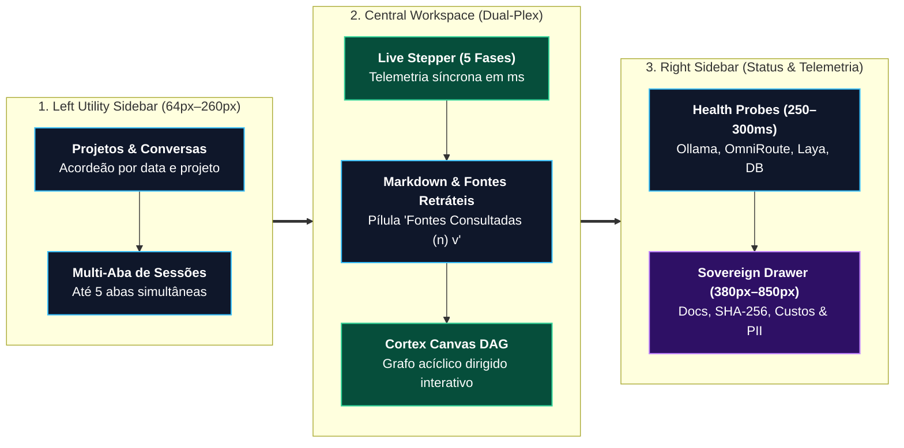

# 🖥️ Especificação Funcional & Arquitetural: PCL Cockpit v3.6

> **Definição Canônica:** O **PCL Cockpit** é o centro de comando agêntico soberano e a interface primária de pilotagem do ecossistema PromptCoreLabs_AEOS, executada na porta local **`:3001`**. A versão **v3.6** consolida a eliminação definitiva de amnésia conversacional, o gating inteligente de intenções via coprocessador não-autorregressivo Laya (em CPU), o desacoplamento visual de fontes e a observabilidade ponta a ponta com auditoria criptográfica SHA-256.

> [!IMPORTANT]
> **👔 Visão Executiva & Valor de Negócio (Para Líderes e Diretores):**  
> Desenvolvido pela **PromptCore Labs**, o **PCL Cockpit v3.6** é a cabine de comando executiva e técnica do **PCL AEOS**. Em rigorosa **avaliação técnica duplo-cega** (na qual especialistas julgaram a qualidade sem saber a marca), conquistou o **1º lugar com 4.95 / 5.0** — superando Google Gemini (`4.45`), ChatGPT Plus (`4.30`) e Microsoft Copilot (`3.80`). Garante **segredo corporativo blindado (Resíduo Zero de Dados / Zero-Bin)**, **custo marginal `$0.00`** em modo local, retenção multi-turn sem amnésia e soberania humana inegociável.

> [!NOTE]
> **🛠️ Visão de Engenharia & Invariantes:** Aplicação React 19 + TypeScript + Vite (`:3001`) com *Liquid Glass Bento Grid* de 3 colunas retráteis, **Memória Multi-Turn Sliding Window**, **Intention Gating determinístico** via Laya System One em CPU (`ONNX INT8`, `0 MB VRAM`, `~20–35ms`), decodificador universal `open-sse`, sondas TCP sub-segundo (`250–300ms`) e atesto criptográfico imutável **SHA-256**.

---

## 1. Topologia de Apresentação (3 Colunas Retráteis)

1. **Left Utility Sidebar (64px a 260px):**
   - Acordeão de Projetos (`Next Gen Sports`, `Arch Living`, `Defesa B2B`, etc.) com persistência local.
   - Histórico cronológico inteligente com multi-abas ativas simultâneas.
2. **Central Workspace (Dual-Plex & Live Stepper v3.6):**
   - **Modo `chat`:** Stream de inferência em tempo real com o **Live Execution Stepper** de 5 fases síncronas.
   - **Modo `canvas`:** Visualizador e editor de grafos acíclicos dirigidos (DAG) interativos via HTML5 Canvas API com zoom, pan e tracking.
   - **Modo `dual`:** Split-screen ajustável por arraste entre Chat e Cortex Canvas.
3. **Right Sidebar (Status & Telemetria de Hardware):**
   - Monitoramento contínuo dos 4 pilares: Ollama GPU local (`:11434`), Laya CPU INT8 (`:20140`), OmniRoute Gateway (`:20130`) e PostgreSQL Audit (`:5432`).
   - Drawer soberano redimensionável (`PCLArtifactDrawer.tsx`, `380px–850px`) com 4 abas (*Documento*, *Audit Trail SHA-256*, *Custos FinOps* e *LGPD/PII*).

---

## 2. Pipeline Cognitivo em 5 Fases (Live Execution Stepper)

Toda mensagem submetida ao PCL Cockpit v3.6 percorre deterministicamente a seguinte esteira observável:

```mermaid
flowchart LR
    classDef laya fill:#064e3b,stroke:#34d399,stroke-width:1.5px,color:#ffffff;
    classDef rag fill:#0f172a,stroke:#38bdf8,stroke-width:1.5px,color:#ffffff;
    classDef search fill:#0c2340,stroke:#60a5fa,stroke-width:1.5px,color:#ffffff;
    classDef gen fill:#2e1065,stroke:#c084fc,stroke-width:1.5px,color:#ffffff;
    classDef audit fill:#451a03,stroke:#fbbf24,stroke-width:1.5px,color:#ffffff;

    subgraph F1["Fase 1: Triagem Semântica"]
        direction TB
        P1["<b>Laya Coprocessor (CPU)</b><br/>Single Forward Pass INT8 (~20ms)"]:::laya
    end

    subgraph F2["Fase 2: Base Canônica"]
        direction TB
        P2["<b>Consulta PCL AEOS</b><br/>ADRs, Specs & Warm Storage"]:::rag
    end

    subgraph F3["Fase 3: Pesquisa Web"]
        direction TB
        P3["<b>Gating Condicional</b><br/>Wikipédia, ArXiv ou Omitida"]:::search
    end

    subgraph F4["Fase 4: Síntese Factual"]
        direction TB
        P4["<b>OmniRoute Engine</b><br/>Gemini 3.5 Flash-Lite / Ollama Local"]:::gen
    end

    subgraph F5["Fase 5: Validação"]
        direction TB
        P5["<b>Auditoria de Prova</b><br/>Hash SHA-256 Imutável no PostgreSQL"]:::audit
    end

    F1 ==> F2 ==> F3 ==> F4 ==> F5
```

### Detalhamento das Fases do Stepper

| Fase | Título Exibido na UI | Motor Tecnológico | Latência Típica | Consumo de Hardware |
| :---: | :--- | :--- | :---: | :---: |
| **1** | **Triagem Semântica & Intenção** | Coprocessador Laya System One (ONNX Runtime INT8) | `~20ms a 35ms` | **0 MB VRAM** (100% CPU Host) |
| **2** | **Consulta à Base Canônica PCL AEOS** | Recuperação Semântica de ADRs e Specs canônicas em `knowledge/warm/` e `cold/` (`>= 0.40`) | `~15ms a 40ms` | Leitura local indexada |
| **3** | **Pesquisa Web Avançada** | Gating inteligente: executada apenas se `needsWebSearch == true`; omitida em perguntas teóricas | `~200ms a 350ms` (quando ativa) | Zero (I/O de rede Node.js) |
| **4** | **Síntese de Resposta Factual Fundamentada** | Fast-Path Gemini 3.5 Flash-Lite / 3.6 Flash com fallback para Ollama Local (`qwen2.5-coder:7b`) | `~1.2s a 3.5s` | GPU RTX 3050 dedicada ao gerador |
| **5** | **Validação de Evidências & Auditoria** | Cálculo criptográfico do recibo e atesto SHA-256 imutável | `< 15ms` | Persistência transacional ACID |

---

## 3. Inovações Cognitivas da v3.6

### 3.1. Memória Multi-Turn & Janela Deslizante (Sliding Window)
- **Fim da Amnésia Conversacional:** O histórico de diálogo completo é preservado e enviado ao modelo em formato estruturado (`role: user | assistant`), com normalização estrita de alternância (`user` / `model`) na API do Google Gemini.
- **Resolução Anafórica Perfeita:** Suporte nativo à interpretação de pronomes e referências implícitas (ex: *"dessa abordagem"*, *"esse modelo"*, *"sintetize nossa discussão em um parágrafo"*).
- **Orçamento Inteligente de Tokens:** Estratégia de corte contíguo que mantém intactos a diretriz de sistema, as primeiras definições de alinhamento e os últimos `K` turnos ativos, prevenindo estouro de janela sem quebrar o encadeamento lógico.

### 3.2. Intention Gating & Desacoplamento de Fontes
- **Gating Determinístico (`intelligentGroundingService.ts` + Laya CPU):** O pipeline classifica as solicitações em três rotas:
  - `general_chat`: Respondido diretamente pelo modelo generativo, com `needsWebSearch: false` e **zero poluição de fontes**.
  - `internal_rag`: Aciona `needsCanonicalRAG: true` para consulta focada nas especificações canônicas (`knowledge/warm/` e `knowledge/cold/`).
  - `web_search`: Aciona `needsWebSearch: true` para busca factual contemporânea em tempo real (eventos recentes, cotações, lançamentos).
- **Pílula Retrátil `Fontes Consultadas (n) v`:** Inspirada nas melhores interfaces de pesquisa (Google Gemini, Perplexity AI e Read.ai), as fontes não competem visualmente com o texto executivo. São agrupadas ao final da resposta em um componente retrátil expansível sob demanda pelo operador, com inspeção detalhada no `PCLArtifactDrawer`.

---

## 4. Invariantes Soberanas e FinOps

1. **Invariante de 0 MB de VRAM na CPU para o Laya:**
   - O Laya opera exclusivamente em CPU host via `CPUExecutionProvider`. A GPU dedicada (NVIDIA GeForce RTX 3050 6GB) permanece com 100% de sua memória dedicada à inferência sob demanda de modelos do Ollama local (`qwen2.5-coder:7b-instruct-q4_K_M`).
2. **Invariante de Custo Zero (`$0.00`) no Modo Soberano:**
   - Em caso de desconexão externa ou operação sensível on-premise, o pipeline comuta automaticamente para o Ollama local (`:11434`) e acervo local indexado, mantendo autonomia plena sem cobrança de nuvem.
3. **Política de Zero Mocks & Blindagem de Resíduo Zero (Zero-Bin / BYOS):**
   - Toda resposta e telemetria decorre de computação real. Dados confidenciais e anexos corporativos seguem o padrão *Bring-Your-Own-Storage* com resíduo zero de dados (*Zero-Bin*), sanitização prévia via **PII Guard LGPD** inline no cliente e zero envio para retenção ou treinamento de terceiros.

---

## 5. Contratos de Middleware Local (`vite.config.ts`) & Acervo Indexado

O servidor local do Cockpit expõe três endpoints determinísticos de orquestração que eliminam gargalos de rede e garantem resiliência híbrida:

| Endpoint Local | Papel Operacional | Invariantes de Implementação v3.6 |
| :--- | :--- | :--- |
| **`POST /api/aeos/infer`** | Orquestração Híbrida de Inferência Multi-Turn | Descriptografa em memória a credencial do cofre `AES-256-GCM` (`pc-gemini-cloud`) para o Fast-Path Gemini (`~1.2s–3.4s`), decodifica streams `open-sse` via `parseOpenAiOrSseResponse`, normaliza papéis `user`/`model` e executa failover imediato para Ollama `/api/chat` (`:11434`) a `$0.00`. |
| **`POST /api/aeos/search`** | Grounding Factual Contemporâneo Verificável | Acionado exclusivamente quando `needsWebSearch === true`. Consulta fontes públicas auditáveis (Wikipédia PT/EN, ArXiv API e DuckDuckGo Instant Answer) sem injetar mocks sintéticos. |
| **`GET /api/aeos/status`** | Sondas de Saúde Sub-Segundo (Health Probes) | Executa `checkTcpPort` com timeout estrito de **`250ms–300ms`** nas portas `:11434` (Ollama), `:20130` (OmniRoute), `:20140` (Laya CPU) e `:5432` (PostgreSQL 17), erradicando esperas de 38s–58s quando contêineres estão offline. |
