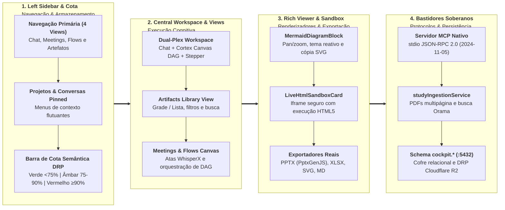

# 🖥️ Especificação Funcional & Arquitetural: PCL Cockpit v3.9

> **Definição Canônica:** O **PCL Cockpit** é o centro de comando agêntico soberano e a interface executiva e técnica do ecossistema PromptCoreLabs_AEOS, executado na porta local **`:3001`**. A versão **v3.9** consolida a nova **Central de Artefatos Multimodais com Exportação Quíntupla Nativa** (.pptx, .xlsx, .svg, .html, .md), a ingestão de estudos documentais multipágina com pesquisa Orama, o **Servidor MCP Soberano Nativo** (JSON-RPC 2.0 stdio), o isolamento relacional do schema `cockpit.*` no PostgreSQL 17 com monitoramento semântico de cota DRP, e a **Central de Ajuda (Help Center)** integrada in-app e no acervo canônico.

> [!IMPORTANT]
> **👔 Visão Executiva & Valor de Negócio (Para C-Level, Diretores e Investidores):**  
> Concebido pela **PromptCore Labs**, o **PCL Cockpit v3.9** é a cabine de comando que orquestra a inteligência corporativa com rastreabilidade matemática sobre o **PCL AEOS**. Em **Avaliação Técnica Duplo-Cega Imparcial**, sustenta a liderança de **4.95 / 5.0** frente às principais plataformas globais. Garante **Segredo Corporativo Blindado (Resíduo Zero de Dados / BYOS)**, custo marginal de **$0.00** em infraestrutura local, eliminação de retrabalho com exportações executivas reais e **Trava Física Hard Lock (FinOps EBITDA Shield)** contra gastos involuntários.

> [!NOTE]
> **🛠️ Visão de Engenharia & Invariantes Físicos:** Aplicação React 19 + TypeScript + Vite (`:3001`), **Invariante de 0 MB de VRAM na CPU** para o coprocessador Laya System One (`ONNX INT8`), persistência relacional isolada no schema `cockpit.*` do PostgreSQL 17 (`:5432`), replicação off-site para Cloudflare R2 DRP, servidor MCP stdio nativo (`scripts/pcl-sovereign-mcp-server.mjs`) e integridade criptográfica **SHA-256** em todos os artefatos gerados.

---

## 1. Topologia de Apresentação e Navegação do Cockpit v3.9

---

## 2. Pilares Funcionais da Versão v3.9

### 2.1. Central de Artefatos Multimodais (`ArtifactsLibraryView.tsx`)
- **Filtros Rápidos em Pílulas:** `Todos`, `Favoritos`, `Diagramas`, `Slides`, `Planilhas`, `Infográficos`, `Apps`, `Documentos`.
- **Alternância de Layout:** Modo Grade com miniaturas visuais (*Grid View*) e Modo Tabela Detalhada com ordenação por data, título e tamanho (*Table View*).
- **Exportação Quíntupla no Navegador:**
  - **PowerPoint (`.pptx`):** Geração real via `pptxgenjs` com slides formatados, paleta corporativa e títulos estruturados.
  - **Excel (`.xlsx`):** Tabelas tabulares exportadas via biblioteca `xlsx` com cabeçalhos e formatação numérica.
  - **SVG (`.svg`):** Extração de diagramas vetoriais puros para ferramentas de design e apresentações.
  - **HTML5 (`.html`):** Aplicações e dashboards autocontidos para execução offline.
  - **Markdown (`.md`):** Documentos canônicos com blocos de código e tabelas.
- **Vínculo Transacional com Conversas:** Clique em "Abrir Conversa de Origem" para retornar imediatamente ao contexto original sem amnésia.

### 2.2. Rich Artifact Viewer & Renderizadores Interativos
- **`MermaidDiagramBlock.tsx`:** Renderizador de diagramas com sincronização em tempo real de temas (*Dark/Light*), controles de pan/zoom, visualização em tela cheia e botão direto de cópia de código SVG.
- **`LiveHtmlSandboxCard.tsx`:** Iframe seguro com isolamento estrito de contexto (`sandbox="allow-scripts allow-downloads"`), permitindo rodar apps gerados pela IA sem riscos de segurança.

### 2.3. Servidor MCP Soberano Nativo (`pcl-sovereign-mcp-server.mjs`)
- Protocolo aberto Model Context Protocol operando via canal padrão do sistema (`stdio`).
- Ferramentas nativas:
  - `pcl_workspace_inventory`: Varredura de squads e skills físicos com cálculo de hashes SHA-256.
  - `pcl_read_canonical_doc`: Leitura de especificações e ADRs com proteção contra path traversal.
  - `pcl_verify_artifact_sha256`: Atesto matemático de integridade sobre qualquer string ou arquivo.

### 2.4. Ingestão de Estudos RAG & Extração de PDFs (`studyIngestionService.ts`)
- Ingestão de PDFs e relatórios multipágina anexados via botão de estudo no composer.
- Segmentação semântica (*chunking*) e indexação em memória via Orama Search.
- Citação direta de trechos factuais nas respostas da IA com link de auditoria.

### 2.5. Persistência Isolada no PostgreSQL 17 e DRP Cloudflare R2
- Schema relacional `cockpit` totalmente segregado das tabelas internas de agentes.
- Tabela `cockpit.vault_blobs` para deduplicação física de arquivos baseada em SHA-256.
- Barra de cota em tempo real com alertas visuais semânticos.
- Espelhamento contínuo para Cloudflare R2 com RTO garantido < 15 segundos.

### 2.6. Central de Ajuda Completa (Help Center)
- Componente de autoatendimento in-app `HelpCenterModal.tsx` acessível via atalhos e botão de ajuda no Header.
- Seção pública e interativa na GitHub Page oficial com diagramas Cortex v7.
- Manual canônico em Markdown em `knowledge/warm/cockpit/PCL_COCKPIT_HELP_CENTER_MANUAL.md`.

---

## 3. Matriz de Invariantes Físicos & Portas Locais

| Serviço / Porta | Tecnologia / Protocolo | Invariante de Hardware | Função Canônica |
| :--- | :--- | :--- | :--- |
| **`:3001`** | React 19 + Vite (HTTP) | Host Local (Navegador) | Interface do PCL Cockpit e Central de Artefatos. |
| **`:11434`** | Ollama Engine (HTTP) | GPU Dedicada (RTX 3050) | Inferência generativa principal (`qwen2.5-coder:7b`). |
| **`:8000`** | OmniRoute Gateway (HTTP) | CPU Host | Roteamento soberano de LLMs e fallbacks. |
| **`:20140`** | Laya System One (HTTP) | **0 MB VRAM (CPU INT8)** | Intention Gating e verificação em ~20-35ms. |
| **`:5432`** | PostgreSQL 17 (TCP) | CPU / NVMe Local | Persistência relacional (`cockpit.*`) e PGVector. |
| **`stdio`** | Servidor MCP Soberano | Node.js Process | Interoperabilidade segura com IDEs e agentes. |

---

## 4. Conformidade Normativa & Padrões
- **Norma Soberana:** `PCL-AEOS-NORM-01`
- **Padrão de Diagramas:** PCL Cortex Mermaid v7 (panorâmico `flowchart LR`, colunas por subgrafos, anti-clipping, WCAG AAA).
- **Segurança da Informação:** ISO/IEC 27001 e SOC II Type II.
- **Governança de Inteligência Artificial:** ISO/IEC 42001 (Auditoria e explicabilidade contínua via SHA-256).

