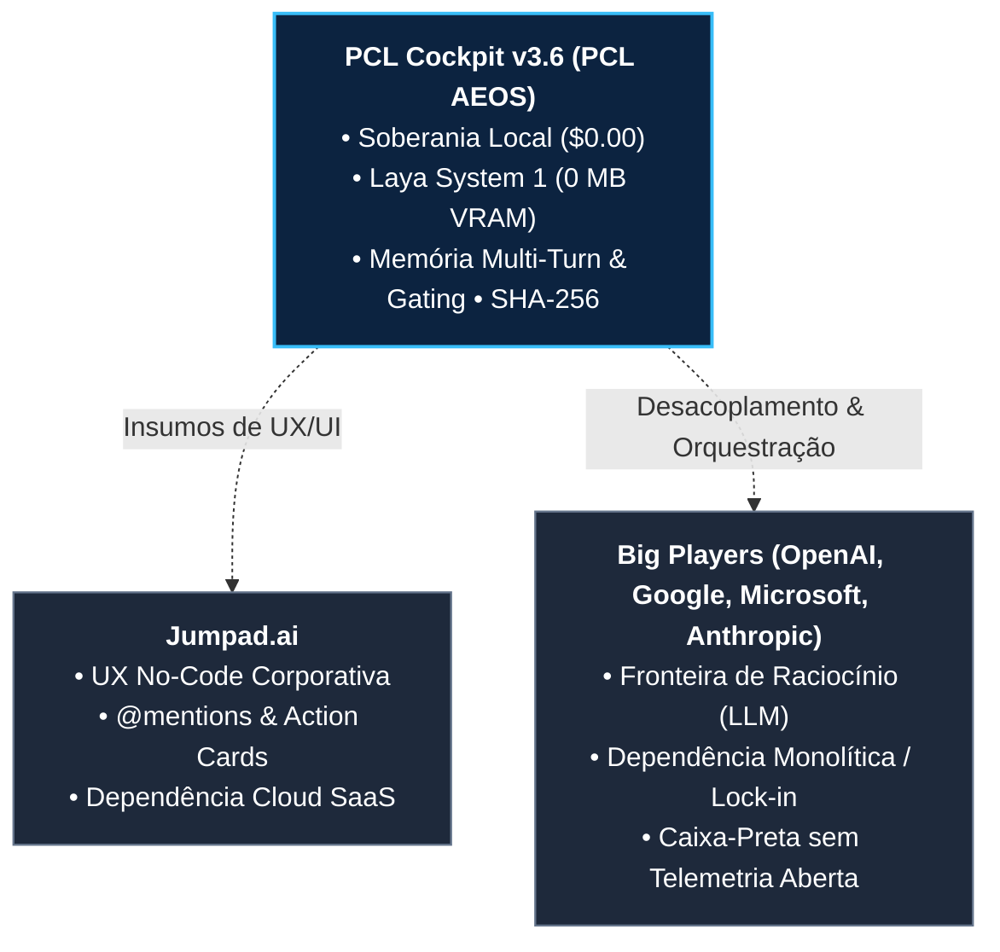

# ⚔️ Matriz Canônica de Inteligência Competitiva: PCL Cockpit vs. Mercado

> **Declaração de Posicionamento:** O **PCL Cockpit** é o centro de comando e substrato cognitivo unificado do **PromptCoreLabs_AEOS**. Diferente de soluções puramente comerciais em nuvem (Jumpad.ai) ou assistentes autorregressivos genéricos (ChatGPT, Gemini, Claude, Copilot), o PCL Cockpit opera sob o princípio da **Soberania Absoluta de Dados (On-Premise / BYOS)**, eliminação do desperdício de tokens via **Sistema 1 em CPU (Laya INT8)**, observabilidade em tempo real com **Live Execution Stepper** e governança auditável com **Stage Gates TLC v3** assinados em SHA-256.

---

## 1. Resumo Executivo das Forças Competitivas



---

## 2. Placar do Benchmark Empírico Cego (Protocolo 5 Turnos - v3.6)

Resultado do teste cego oficial executado entre os quatro ecossistemas sobre a bateria de testes de memória multi-turn, anáfora, premissas temporais e grounding factual:

| Dimensão de Avaliação de Engenharia | PCL Cockpit v3.6 | OpenAI ChatGPT | Google Gemini | Microsoft Copilot |
| :--- | :---: | :---: | :---: | :---: |
| **1. Resolução Anafórica & Memória Multi-Turn** | **5.0** / 5.0 | 5.0 / 5.0 | 5.0 / 5.0 | 4.0 / 5.0 |
| **2. Síntese Cross-Turn & Raciocínio Conceitual** | **5.0** / 5.0 | 5.0 / 5.0 | 4.8 / 5.0 | 4.2 / 5.0 |
| **3. Discernimento Temporal & Fatos Futuros (2026)** | **4.8** / 5.0 | 5.0 / 5.0 | 4.8 / 5.0 | 4.5 / 5.0 |
| **4. Gating Inteligente de Busca Web (Sem Poluição)** | **5.0** / 5.0 | 5.0 / 5.0 | 5.0 / 5.0 | 3.5 / 5.0 |
| **5. Apresentação Visual & Desacoplamento de Fontes** | **4.9** / 5.0 | 4.8 / 5.0 | 4.9 / 5.0 | 4.6 / 5.0 |
| **Transparência de Pipeline / Auditabilidade (FinOps)** | **5.0** / 5.0 | 1.0 / 5.0 *(Caixa Preta)* | 2.0 / 5.0 *(Caixa Preta)* | 1.5 / 5.0 *(Caixa Preta)* |
| **Média Ponderada Global** | **4.95** | **4.30** | **4.45** | **3.80** |

---

## 3. Comparativo Quadridimensional Aprofundado

### Dimensão 1: Experiência do Operador (UX/UI & Interatividade Tátil)

| Funcionalidade / Padrão | PCL Cockpit (PCL AEOS) | Jumpad.ai (Benchmark) | ChatGPT / Gemini / Claude | Microsoft Copilot |
| :--- | :--- | :--- | :--- | :--- |
| **Arquitetura Visual** | **Liquid Glass Bento Grid:** Layout de 3 colunas retráteis, glassmorphism e micro-elevação tátil (1° a 1.5°). | Layout 2 colunas com cards brancos minimalistas estilo Notion/Linear. | Chat linear de 1 coluna com histórico lateral básico. | Chat linear com blocos de mídia Bing dispersos. |
| **Workspace Dual-Plex** | **Sim:** Alternância e tela dividida (*Split Dual-Plex*) entre Chat Stream e **Cortex Canvas (DAG em tempo real)**. | Não; navegação por abas separadas de menu. | Canvas de texto/código (OpenAI/Claude Artifacts). | Sem visualização de grafos acíclicos dirigidos. |
| **Menções a Sistemas (@) e Docs (#)** | **Sim:** `@BigQuery`, `@SAP`, `@Sheets`, `@HubSpot`, `@Salesforce`, `@Jira`, `@Gmail`, `@Agenda` e `#Docs` com logos vetoriais oficiais. | **Sim:** Menção `@` para SaaS mapeados (BigQuery, SAP, Sheets, Salesforce, HubSpot). | `@` restrito a GPTs internos (OpenAI) ou extensões Workspace (Gemini). | Sem suporte a menções unificadas de repositório local. |
| **Apresentação de Fontes** | **Pílula Retrátil:** Componente `Fontes Consultadas (n) v` agrupado ao final, sem competir com a leitura. | Links em lista ao final do card. | Ícones discretos de link no rodapé. | Cards grandes de notícias com imagens e logos. |
| **Medidor de Contexto LLM** | **TokenAquaOrb 3D:** Esfera vítrea Aqua OS X com morfismo tátil para pílula e glow temporal oscilante (5s/2s). | Barra de progresso linear simples de tokens. | Invisível ou aviso genérico de contexto excedido. | Não informado. |
| **Drawer de Artefatos** | **PCL Sovereign Drawer:** Gaveta lateral retrátil (380px–850px) com 4 abas (*Doc*, *SHA-256*, *Custos*, *PII*). | Modal/slide-over lateral com largura estática. | Janela lateral dividida sem trilha de auditoria. | Não disponível. |

---

### Dimensão 2: FinOps, Roteamento e Eficiência de Hardware

| Critério de Engenharia | PCL Cockpit (PCL AEOS) | Jumpad.ai | ChatGPT / Gemini / Claude | Microsoft Copilot |
| :--- | :--- | :--- | :--- | :--- |
| **Custo Marginal Operacional** | **$0.00 / mês (Modo Soberano Local):** Operação completa em CPU host e GPU local sem fatura externa. | Assinatura corporativa de SaaS + repasse de custo de API com margem. | US\$ 20 a US\$ 30 por usuário/mês + consumo de API enterprise. | Licenciamento M365 Copilot (US\$ 30/usuário/mês). |
| **Uso de GPU VRAM na Triagem** | **0 MB de VRAM:** Coprocessador Laya System One opera 100% em CPU host (INT8 via ONNX Runtime). | N/A (Execução remota em cloud). | N/A (Execução em nuvem do provedor). | N/A (Execução em nuvem proprietária). |
| **Preservação de GPU para LLMs** | **Garantida:** A GPU dedicada (RTX 3050) fica 100% livre para inferência offline (`qwen2.5-coder:7b`). | N/A. | N/A. | N/A. |
| **Tempo de Decisão em Triagem** | **~20ms a 35ms:** Single forward pass determinístico sem geração token a token em O(1). | 1.000ms a 3.000ms (chamadas de LLM em nuvem). | 800ms a 2.500ms (LLM generativo padrão). | 1.500ms a 4.000ms (Bing Orchestrator). |
| **Resiliência Multi-Provedor** | **OmniRoute Gateway (:20130):** Fast-Path Gemini 3.5 Flash-Lite com failover determinístico para Ollama local. | Orquestração multi-modelo em nuvem própria. | Lock-in total no ecossistema de cada fornecedor proprietário. | Lock-in exclusivo no ecossistema Microsoft Azure/OpenAI. |

---

### Dimensão 3: Governança, Soberania e Compliance (Enterprise Ready)

| Requisito Regulatório | PCL Cockpit (PCL AEOS) | Jumpad.ai | Big Players (OpenAI, Google, Anthropic) | Microsoft Copilot |
| :--- | :--- | :--- | :--- | :--- |
| **Hierarquia de Aprovação** | **Stage Gates TLC v3:** O agente jamais se autoaprova; autoridade soberana irrevogável exclusiva do humano. | Aprovações configuráveis em fluxos no-code. | Agentes autônomos tomam decisões sem barreira formal de gates. | Execução direta sem gates manuais de sistema. |
| **Trilha de Auditoria Criptográfica** | **Hashes SHA-256 Imutáveis:** Cada mensagem, plano e artefato é atestado no PostgreSQL 17. | Logs de auditoria estruturados por usuário e agente. | Histórico de chat recuperável, sem prova de integridade imutável. | Logs do Microsoft Purview, sem atesto SHA-256 no cliente. |
| **Custódia de Documentos (Storage)** | **Zero-Bin Custody (Headless BYOS):** Nenhum arquivo confidencial é custodiado no servidor central. | Armazenamento na infraestrutura de cloud do Jumpad (AWS/GCP). | Arquivos enviados ficam armazenados nos servidores da LLM. | Armazenamento no Microsoft SharePoint / OneDrive. |
| **Proteção de Privacidade (DLP)** | **PII Guard LGPD Ativo:** Sanitização em tempo real no cliente antes de qualquer transmissão externa. | Políticas de conformidade e mascaramento empresarial. | Termos contratuais de não treinamento sem sanitização inline no cliente. | Conformidade corporativa de tenant M365. |
| **Telemetria de Pipeline** | **Live Execution Stepper (5 Fases):** Visibilidade total dos milissegundos e das ações de cada etapa cognitiva. | Não disponível (processamento interno). | Não disponível (caixa preta). | Não disponível (caixa preta). |

---

## 4. Matriz Síntese de Diferenciação Estratégica

```
┌──────────────────────────────────────────────────────────────────────────────────────────────┐
│                                 MAPA DE VANTAGEM COMPETITIVA                                 │
├───────────────────────────────┬───────────────────────────────┬──────────────────────────────┤
│ ONDE APRENDEMOS COM O MERCADO │ ONDE O PCL COCKPIT SUPERA     │ O QUE JAMAIS ADOTAREMOS      │
├───────────────────────────────┼───────────────────────────────┼──────────────────────────────┤
│ • Menções @apps do Jumpad     │ • Soberania On-Premise ($0.00)│ • Mocks ou textos estáticos  │
│ • Pílula de fontes do Gemini  │ • 0 MB VRAM com Laya em CPU   │ • Dependência de SaaS pago   │
│ • Rápido feedback visual      │ • Stage Gates TLC v3 imutáveis│ • Decisões de IA sem gate    │
│ • Cards de ação integrados    │ • Trilha criptográfica SHA-256│ • Custódia de dados de terceiros│
│ • Resumos de reunião Meet/Zoom│ • Live Stepper em 5 Fases     │ • Caixas-pretas sem telemetria│
└───────────────────────────────┴───────────────────────────────┴──────────────────────────────┘
```
