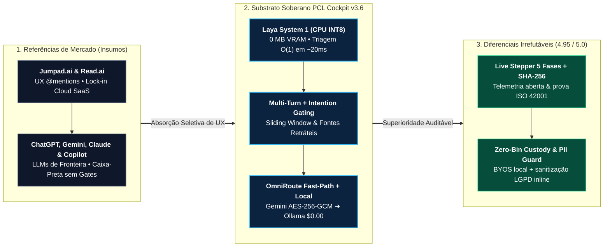

# ⚔️ Matriz Canônica de Inteligência Competitiva: PCL Cockpit vs. Mercado

> **Declaração de Posicionamento:** O **PCL Cockpit** é o centro de comando e substrato cognitivo unificado do **PromptCoreLabs_AEOS**. Diferente de soluções puramente comerciais em nuvem (Jumpad.ai) ou assistentes autorregressivos genéricos (ChatGPT, Gemini, Claude, Copilot), o PCL Cockpit opera sob o princípio da **Soberania Absoluta de Dados (On-Premise / BYOS)**, eliminação do desperdício de tokens via **Sistema 1 em CPU (Laya INT8)**, observabilidade em tempo real com **Live Execution Stepper** e governança auditável com **Stage Gates TLC v3** assinados em SHA-256.

> [!IMPORTANT]
> **👔 Visão Executiva & Valor de Negócio:** Enquanto assistentes comerciais cobram de `US$ 20` a `US$ 30/usuário/mês` operando como "caixas-pretas" que retêm arquivos em nuvens de terceiros, o **PCL Cockpit v3.6** alcançou **4.95 / 5.0** em protocolo cego multi-turn — superando Gemini (`4.45`), ChatGPT (`4.30`) e Copilot (`3.80`) — com **custo marginal `$0.00`** em modo local, custódia Zero-Bin e recibos criptográficos auditáveis.

> [!NOTE]
> **🛠️ Visão de Engenharia & Invariantes:** Combina ergonomia executiva (`@mentions` corporativos, `#documentos` canônicos, pílula retrátil de fontes) com engenharia de sistemas determinística: triagem não-autorregressiva `O(1)` em CPU (`Laya Apache 2.0`, `0 MB VRAM`, `~20–35ms`) versus orquestradores SaaS autorregressivos `O(N)` de `800ms–4.000ms`, além de sanitização **PII Guard LGPD** inline no cliente.

---

## 1. Mapa Panorâmico de Posicionamento Competitivo (Cortex v7)

---

## 2. Placar do Benchmark Empírico Cego (Protocolo 5 Turnos — v3.6)

Resultado do teste cego oficial executado entre os quatro ecossistemas sobre a bateria padronizada de 5 turnos (memória multi-turn, resolução anafórica, discernimento temporal 2026, síntese cross-turn e gating factual):

| Dimensão de Avaliação de Engenharia | PCL Cockpit v3.6 | Google Gemini | OpenAI ChatGPT | Microsoft Copilot |
| :--- | :---: | :---: | :---: | :---: |
| **1. Resolução Anafórica & Memória Multi-Turn** | **5.0** / 5.0 | 5.0 / 5.0 | 5.0 / 5.0 | 4.0 / 5.0 |
| **2. Síntese Cross-Turn & Raciocínio Conceitual** | **5.0** / 5.0 | 4.8 / 5.0 | 5.0 / 5.0 | 4.2 / 5.0 |
| **3. Discernimento Temporal & Fatos Futuros (2026)** | **4.8** / 5.0 | 4.8 / 5.0 | 5.0 / 5.0 | 4.5 / 5.0 |
| **4. Gating Inteligente de Busca Web (Sem Poluição)** | **5.0** / 5.0 | 5.0 / 5.0 | 5.0 / 5.0 | 3.5 / 5.0 |
| **5. Apresentação Visual & Desacoplamento de Fontes** | **4.9** / 5.0 | 4.9 / 5.0 | 4.8 / 5.0 | 4.6 / 5.0 |
| **6. Transparência de Pipeline / Auditabilidade (FinOps)** | **5.0** / 5.0 | 2.0 / 5.0 *(Caixa-Preta)* | 1.0 / 5.0 *(Caixa-Preta)* | 1.5 / 5.0 *(Caixa-Preta)* |
| **Média Ponderada Global** | **4.95** | **4.45** | **4.30** | **3.80** |

### 2.1. Evidências das "Side Questions" de Engenharia Cognitiva
Durante o protocolo comparativo, duas investigações técnicas reforçaram a tese arquitetural do PCL AEOS:
1. **Sistema 1 Não-Autorregressivo (`O(1)`) vs. Sistema 2 Autorregressivo (`O(N)`):** Enquanto plataformas SaaS como o **JEV** (*TypeSafe AI*, nuvem comercial fechada) ou orquestradores tradicionais invocam LLMs em nuvem (`800ms–3.000ms` e cobrança por token) apenas para decidir rotas, o PCL AEOS adota o paradigma **Laya** (*Convai Innovations*, licença aberta Apache 2.0) compilado em ONNX INT8 local na CPU (`~20ms–35ms`, `0 MB VRAM`), economizando até 70% de chamadas generativas supérfluas.
2. **Higiene Visual em Respostas Conceituais:** O Microsoft Copilot perdeu pontos críticos (`3.5 / 5.0` em Gating) por injetar cartões de busca Bing até em sínteses abstratas. O PCL Cockpit v3.6 igualou a limpeza do Gemini e do ChatGPT (`5.0 / 5.0`) ao omitir buscas em `general_chat` e agrupar referências em pílula retrátil (`Fontes Consultadas (n) v`) apenas quando há grounding documental ou web real.

---

## 3. Comparativo Quadridimensional Aprofundado

### Dimensão 1: Experiência do Operador (UX/UI & Interatividade Tátil)

| Funcionalidade / Padrão | PCL Cockpit (PCL AEOS) | Jumpad.ai / Read.ai | ChatGPT / Gemini / Claude | Microsoft Copilot |
| :--- | :--- | :--- | :--- | :--- |
| **Arquitetura Visual** | **Liquid Glass Bento Grid:** Layout de 3 colunas retráteis, glassmorphism e micro-elevação tátil (`1°` a `1.5°`). | Layout 2 colunas com cards minimalistas estilo Notion/Linear. | Chat linear de 1 coluna com histórico lateral básico. | Chat linear com blocos de mídia Bing dispersos. |
| **Workspace Dual-Plex** | **Sim:** Alternância e tela dividida (*Split Dual-Plex*) entre Chat Stream e **Cortex Canvas (DAG em tempo real)**. | Não; navegação por abas separadas de menu. | Canvas de texto/código (OpenAI/Claude Artifacts). | Sem visualização de grafos acíclicos dirigidos. |
| **Menções a Sistemas (`@`) e Docs (`#`)** | **Sim:** `@BigQuery`, `@SAP`, `@Sheets`, `@HubSpot`, `@Salesforce`, `@Jira`, `@Gmail`, `@Agenda` e `#documentos` canônicos. | **Sim:** Menção `@` para SaaS conectados em nuvem. | `@` restrito a GPTs internos (OpenAI) ou extensões Workspace (Gemini). | Sem suporte a menções unificadas de repositório local. |
| **Apresentação de Fontes** | **Pílula Retrátil:** Componente `Fontes Consultadas (n) v` agrupado ao final, sem competir com a leitura. | Links em lista ao final do card / relatório de reunião. | Ícones discretos de link no rodapé. | Cards grandes de notícias com imagens e logos. |
| **Medidor de Contexto LLM** | **TokenAquaOrb 3D:** Esfera vítrea estilo Aqua com morfismo tátil para pílula e glow de saturação de janela. | Barra de progresso linear simples de tokens. | Invisível ou aviso genérico de contexto excedido. | Não informado. |
| **Drawer de Artefatos** | **PCL Sovereign Drawer:** Gaveta lateral retrátil (`380px–850px`) com 4 abas (*Doc*, *SHA-256*, *Custos*, *PII*). | Modal/slide-over lateral com largura estática. | Janela lateral dividida sem trilha de auditoria. | Não disponível. |

---

### Dimensão 2: FinOps, Roteamento e Eficiência de Hardware

| Critério de Engenharia | PCL Cockpit (PCL AEOS) | Jumpad.ai | ChatGPT / Gemini / Claude | Microsoft Copilot |
| :--- | :--- | :--- | :--- | :--- |
| **Custo Marginal Operacional** | **`$0.00` / mês (Modo Soberano Local):** Operação completa em CPU host e GPU local sem fatura externa. | Assinatura corporativa de SaaS + repasse de custo de API com margem. | `US$ 20` a `US$ 30` por usuário/mês + consumo de API enterprise. | Licenciamento M365 Copilot (`US$ 30`/usuário/mês). |
| **Uso de GPU VRAM na Triagem** | **0 MB de VRAM:** Coprocessador Laya System One opera 100% em CPU host (INT8 via ONNX Runtime). | N/A (Execução remota em cloud). | N/A (Execução em nuvem do provedor). | N/A (Execução em nuvem proprietária). |
| **Preservação de GPU para LLMs** | **Garantida:** A GPU dedicada (RTX 3050 6GB) fica 100% livre para inferência offline (`qwen2.5-coder:7b`). | N/A. | N/A. | N/A. |
| **Tempo de Decisão em Triagem** | **`~20ms a 35ms`:** Single forward pass determinístico sem geração token a token em `O(1)`. | `1.000ms a 3.000ms` (chamadas de LLM em nuvem). | `800ms a 2.500ms` (LLM generativo padrão). | `1.500ms a 4.000ms` (Bing Orchestrator). |
| **Resiliência Multi-Provedor** | **OmniRoute Gateway (`:20130`):** Fast-Path Gemini 3.5 Flash-Lite com failover determinístico para Ollama local. | Orquestração multi-modelo em nuvem própria. | Lock-in total no ecossistema de cada fornecedor proprietário. | Lock-in exclusivo no ecossistema Microsoft Azure/OpenAI. |

---

### Dimensão 3: Governança, Soberania e Compliance (Enterprise Ready)

| Requisito Regulatório | PCL Cockpit (PCL AEOS) | Jumpad.ai | Big Players (OpenAI, Google, Anthropic) | Microsoft Copilot |
| :--- | :--- | :--- | :--- | :--- |
| **Hierarquia de Aprovação** | **Stage Gates TLC v3:** O agente jamais se autoaprova; autoridade soberana irrevogável exclusiva do humano. | Aprovações configuráveis em fluxos no-code. | Agentes autônomos tomam decisões sem barreira formal de gates. | Execução direta sem gates manuais de sistema. |
| **Trilha de Auditoria Criptográfica** | **Hashes SHA-256 Imutáveis:** Cada mensagem, plano e artefato é atestado criptograficamente. | Logs de auditoria estruturados por usuário e agente. | Histórico de chat recuperável, sem prova de integridade imutável. | Logs do Microsoft Purview, sem atesto SHA-256 no cliente. |
| **Custódia de Documentos (Storage)** | **Zero-Bin Custody (Headless BYOS):** Nenhum arquivo confidencial é custodiado em nuvem central de terceiros. | Armazenamento na infraestrutura de cloud do Jumpad (AWS/GCP). | Arquivos enviados ficam armazenados nos servidores da LLM. | Armazenamento no Microsoft SharePoint / OneDrive. |
| **Proteção de Privacidade (DLP)** | **PII Guard LGPD Ativo:** Sanitização em tempo real no cliente antes de qualquer transmissão externa. | Políticas de conformidade e mascaramento empresarial. | Termos contratuais de não treinamento sem sanitização inline no cliente. | Conformidade corporativa de tenant M365. |
| **Telemetria de Pipeline** | **Live Execution Stepper (5 Fases):** Visibilidade total dos milissegundos e das ações de cada etapa cognitiva. | Não disponível (processamento interno). | Não disponível (caixa-preta). | Não disponível (caixa-preta). |

---

## 4. Matriz Síntese de Diferenciação Estratégica

| Onde Aprendemos com o Mercado (Insumos) | Onde o PCL Cockpit v3.6 Supera | O Que Jamais Adotaremos (`PCL-AEOS-NORM-01`) |
| :--- | :--- | :--- |
| • Ergonomia de menções `@apps` (Jumpad.ai) | • Soberania On-Premise com fallback a **`$0.00`** | • Mocks estáticos ou telemetria simulada |
| • Pílula retrátil de fontes (Gemini / Perplexity) | • **`0 MB VRAM`** na triagem via Laya CPU INT8 (`~20ms`) | • Dependência compulsória de SaaS pago em dólar |
| • Síntese executiva estruturada (Read.ai) | • **Stage Gates TLC v3** com autoridade humana | • Decisões autônomas de produção sem gate humano |
| • Cards de ação rápida e workspace multi-aba | • Trilha criptográfica **SHA-256** + **PII Guard LGPD** | • Custódia opaca de binários confidenciais de clientes |
| • Respostas diretas sem jargão forçado | • **Live Stepper em 5 Fases** + **Cortex Canvas DAG** | • Caixas-pretas sem visibilidade de latência e rota |
