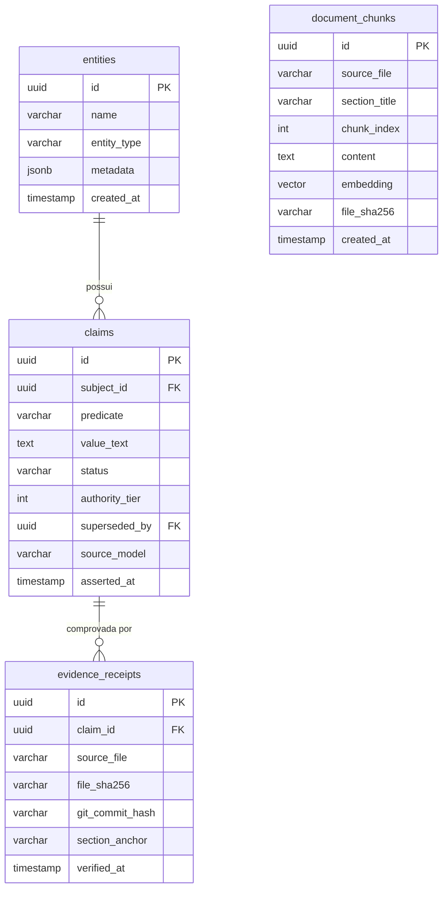

==================================================
OBJETIVO
==================================================

O módulo Memory do PromptCoreLabs_AEOS é responsável pela memória organizacional, persistência computacional, contexto persistente, indexação de RAG e caches semânticos da plataforma.

Toda a persistência de conhecimento ativo dos agentes e do Runtime é gerenciada a partir deste módulo.

==================================================
POSIÇÃO ARQUITETURAL
==================================================

O módulo Memory está situado na camada de suporte ao conhecimento e inteligência operacional:

Foundation
↓
Governance
↓
Bootstrap
↓
Knowledge / Memory
↓
Agents

A Memory trabalha em estreita colaboração com o Knowledge. Enquanto o Knowledge armazena documentação legível por humanos e playbooks estáticos, a Memory armazena índices lógicos, bancos vetoriais e logs históricos legíveis por máquinas e interpretados por agentes de IA.

==================================================
ESTRUTURA DO MÓDULO
==================================================

memory/
├── README.md                        ← este documento
│
├── rag/
│   ├── README.md                    ← princípios de RAG no AEOS
│   ├── vector-infrastructure.md     ← especificações de banco de dados vetorial
│   └── indexing-rules.md            ← regras de processamento e chunks de dados
│
└── context/
    ├── README.md                    ← papel do contexto persistente
    └── execution-history.md         ← persistência do histórico de Execution Cells

==================================================
PRINCÍPIOS DA MEMÓRIA
==================================================

1. Persistência Desacoplada
   A memória existe de forma separada do ciclo de vida das sessões dos agentes. A destruição ou reinicialização de um contêiner de agente não deve corromper a base de conhecimento persistente.

2. Soberania e Local-First
   Os índices vetoriais e dados de contexto devem ser armazenados localmente e criptografados, em conformidade com as regras de governança e segurança do AEOS.

3. Rastreabilidade de Origem
   Cada elemento indexado na memória vetorial deve apontar de volta para o arquivo fonte original do repositório, garantindo que o agente possa auditar a fonte primária.

==================================================
DIAGRAMA DE FLUXO: PIPELINE DE RAG TEMPORAL AUTOCORRETIVO
==================================================

Processamento de documentos, busca semântica híbrida e validação determinística de staleness:

```mermaid
graph TD
    A[Módulos Core .md] -->|Hierarchical Vectorless Parsing| B[Seções e Títulos]
    B -->|Local Ollama / nomic-embed-text| C[Embeddings 768D]
    C -->|Schema memory.*| D[(pcl-db / PGVector HNSW)]
    A -->|SHA-256 + Git Hash| E[(memory.evidence_receipts)]

    Q[Prompt / Pergunta do Agente] --> F[PCLHybridRAGEngine]
    F -->|Busca Híbrida 768D| D
    D -->|Candidatos Top-K| G[pcl-laya / System One (MCP stdio & Docker)]
    G -->|Classificador CPU <35ms (MCP: 0.014ms)| H{Score >= 0.40?}
    H -->|Não: Fora de Domínio| I[Fast Exit: 0 Tokens Gastos]
    H -->|Sim: Evidência Forte| J[Formatação de Bloco de Evidência]
    J -->|Injeção Sufixo / EBITDA Shield| K[OmniRoute :20130 / LLM]

    Daemon[DeterministicStalenessVerifier] -->|Crontab / Daemon| E
    Daemon -->|SHA-256 Drift Detection| L{Arquivo Fonte Mudou?}
    L -->|Sim| M[Status = STALE sem gastar tokens]
    L -->|Não| N[Status = TRUSTED]
```

==================================================
DIAGRAMA ERD: SCHEMA MEMORY (ISOLAMENTO TOTAL)
==================================================

O schema `memory.*` isola totalmente as estruturas de memória do schema operacional `public` do Paperclip:



==================================================
GUIA OPERACIONAL: TESTES E EXECUÇÃO (FASES 1, 2, 3 E 4)
==================================================

### 1. Ingestão de Documentos Arquiteturais (Fase 2)
Indexa os documentos no schema `memory` com hashing SHA-256, Git hash e embeddings nomic-embed-text (768D):
```bash
python scripts/memory/ingest_docs.py
```

### 2. Extração Multimodelo de Claims com Proveniência (Fase 3)
Extrai claims ontológicas categorizadas por níveis de autoridade formal (Tiers 1 a 4):
```bash
python scripts/memory/claim_extractor.py
```

### 3. Motor de Reconciliação Canônica & SSOT (Fase 3)
Harmoniza contradições multimodelo aplicando a Máquina de Estados da Hierarquia de Verdade PCL:
```bash
python scripts/memory/reconciliation_engine.py
```

### 4. Confinamento Agêntico & Tool Call Gating (Fase 4)
Executa o harness do worker daemon confinado ao Gate 3 com interceptação de comandos perigosos via Laya:
```bash
python scripts/agent/worker_daemon.py
```

### 5. Plano de Recuperação de Desastres (DRP) Tripartido (Fase 4)
Restaura os schemas `public` e `memory` em tempo recorde (< 10 segundos) com auditoria de integridade:
```powershell
powershell -ExecutionPolicy Bypass -File scripts/backup/restore-aeos-tripartido.ps1
```

### 6. Execução da Suite de Validação do Stage Gate 4
Valida confinamento ao Gate 3, tool call gating, parada no Gate 4 e disaster recovery RTO <= 15 min:
```bash
python scripts/tests/test_phase4_validation.py
```

### 7. Execução Manual do Staleness Daemon
Verifica a integridade de todas as claims contra os hashes atuais dos arquivos no repositório:
```bash
python scripts/memory/staleness_verifier.py
```

==================================================
FONTES DE REFERÊNCIA
==================================================

foundation/FOUNDATION.md
architecture/modules.md
architecture/principles.md
architecture/decisions/ADR-0005-tripartite-memory-system-one-evolution.md
specs/pcl-aeos-evolution/spec-pcl-aeos-temporal-graph-rag-and-reconciliation.md


