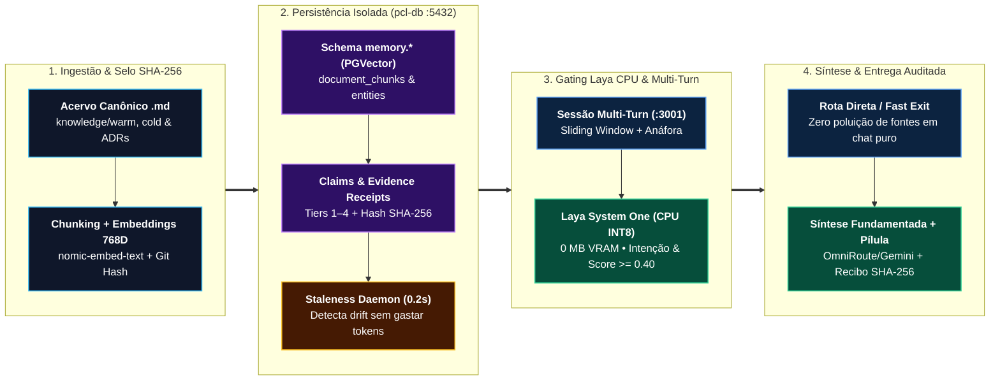
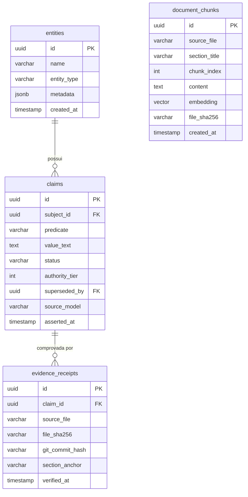

# 🧠 Módulo Memory — Memória Temporal, Multi-Turn & Graph-RAG Soberano (PCL AEOS v3.6)

> [!IMPORTANT]
> **👔 Visão Executiva & Valor de Negócio:** Enquanto assistentes comuns sofrem de "amnésia" entre turnos ou inventam dados desatualizados, o módulo **Memory** do PCL AEOS v3.6 combina **retenção conversacional multi-turn contínua** com uma **memória corporativa auditável em SHA-256** que roda a **`$0.00`/mês** dentro do PostgreSQL existente — sem servidores extras de grafos e com zero alucinação sobre normas internas.

> [!NOTE]
> **🛠️ Visão de Engenharia & Invariantes:** Gerencia a **Memória Temporal Computacional (`memory.*` no PostgreSQL 17 + PGVector 768D)** e o contrato de **Janela Deslizante Multi-Turn (`ADR-0007`)** do PCL Cockpit (`:3001`), operando em simbiose com o coprocessador **Laya System One** (`CPU INT8`, `0 MB VRAM`, Answerability Gate `>= 0.40`) e o sentinela determinístico de deriva (`DeterministicStalenessVerifier`).

---

## 1. Distinção Canônica: Memória Temporal (`memory/`) vs. Governança Física (`knowledge/`)

Uma premissa central da versão **v3.6** é não confundir os dois substratos complementares de conhecimento do ecossistema:

| Dimensão Arquitetural | Memória Temporal em Runtime (`memory/` & `memory.*`) | Governança Física Canônica (`knowledge/`) |
| :--- | :--- | :--- |
| **Natureza & Formato** | Índices vetoriais 768D (`HNSW`), grafo temporal de entidades/claims, sessões multi-turn e recibos SHA-256 em banco relacional ACID. | Documentos Markdown declarativos versionados no Git com YAML Frontmatter (`PCL-AEOS-NORM-01`). |
| **Camadas Internas** | `memory.entities`, `memory.claims`, `memory.evidence_receipts`, `memory.document_chunks` + `Sliding Window` ativa no Cockpit. | **`warm/`** (specs v3.6 vigentes), **`cold/`** (`HIP-001` a `HIP-008` descartadas), **`learnings/`** (`AGENTS.md`) + `playbooks/`, `patterns/`, `catalog/`. |
| **Consumidor Primário** | Motores de busca híbrida, reconciliador de contradições NLI e pipeline multi-turn dos agentes/Cockpit. | Humanos (executivos e engenheiros), Portal GitHub Pages e indexador local do PCL Cockpit (`#documentos`). |
| **Custo & Infraestrutura** | `$0.00` — Confinado ao schema isolado `memory.*` no `pcl-db` (`:5432`), sem JVM Neo4j (`HIP-001`). | `$0.00` — Versionado diretamente no repositório Git com backup criptografado AES-256 no Cloudflare R2. |

---

## 2. Os 5 Paradigmas de RAG Suportados & Evolução Multi-Turn v3.6

O motor cognitivo do PCL AEOS consolida cinco paradigmas progressivos de recuperação e memória:
1. **Standard Dense Vector RAG:** Embeddings locais `nomic-embed-text` (`768D`) indexados via `HNSW` no PGVector.
2. **Hybrid Lexical + Semantic RAG:** Combinação de busca vetorial densa com correspondência exata de identificadores normativos (`ADR-0007`, portas, hashes e tags).
3. **Cross-Encoder NLI Reranking & Answerability Gate:** Triagem em CPU pelo **Laya System One** (`< 35ms`, `0.014ms` via MCP stdio). Se `score < 0.40`, aplica *Fast Exit* (`0 tokens` gastos).
4. **Temporal Graph-RAG Soberano (`ADR-0005`):** Rastreamento temporal de afirmações (`claims`) com níveis de autoridade (`Tiers 1–4`), supersessão histórica (`superseded_by`) e prova criptográfica (`evidence_receipts`).
5. **Agentic Conditional Gated RAG + Multi-Turn Sliding Window (`ADR-0007` / v3.6):** No **PCL Cockpit (`:3001`)**, a memória conversacional preserva o histórico contíguo de turnos (`user`/`assistant`) com orçamento dinâmico de janela (resolvendo anáforas e sínteses cross-turn), enquanto o *Intention Gating* aciona `internal_rag` ou `web_search` apenas quando necessário, exibindo referências em pílula retrátil (`Fontes Consultadas (n) v`).

---

## 3. Pipeline Panorâmico de Memória Multi-Turn & RAG Autocorretivo (Cortex v7)



---

## 4. Estrutura do Módulo

```text
memory/
├── README.md                        ← Arquitetura canônica da Memória v3.6 (este documento)
├── rag/
│   ├── README.md                    ← Princípios de RAG híbrido e gating no AEOS
│   ├── vector-infrastructure.md     ← Especificações PGVector 768D HNSW
│   └── indexing-rules.md            ← Regras de parsing hierárquico e chunks
└── context/
    ├── README.md                    ← Papel do contexto persistente e Sliding Window
    └── execution-history.md         ← Histórico auditável de Execution Cells
```

---

## 5. Modelo Entidade-Relacionamento: Schema `memory.*` (Isolamento Total)

O schema `memory.*` isola integralmente as estruturas cognitivas do schema operacional `public` do Paperclip (`ADR-0001` e `ADR-0005`):



---

## 6. Guia Operacional: Comandos de Execução e Validação

### 1. Ingestão de Documentos Arquiteturais
Indexa os documentos no schema `memory.*` com hash SHA-256, commit Git e embeddings `nomic-embed-text` (`768D`):
```bash
python scripts/memory/ingest_docs.py
```

### 2. Extração Multimodelo de Claims com Proveniência
Extrai afirmações ontológicas categorizadas por níveis formais de autoridade (`Tiers 1 a 4`):
```bash
python scripts/memory/claim_extractor.py
```

### 3. Motor de Reconciliação Canônica & SSOT
Harmoniza contradições aplicando a Máquina de Estados da Hierarquia de Verdade (`PCL-AEOS-NORM-01`):
```bash
python scripts/memory/reconciliation_engine.py
```

### 4. Confinamento Agêntico & Tool Call Gating
Executa o worker daemon confinado ao Stage Gate 3 com interceptação de comandos sensíveis via Laya:
```bash
python scripts/agent/worker_daemon.py
```

### 5. Plano de Recuperação de Desastres (DRP) Tripartido (`RTO = 7,18s`)
Restaura os schemas `public` e `memory` a partir do backup cifrado AES-256 com auditoria de integridade:
```powershell
powershell -ExecutionPolicy Bypass -File scripts/backup/restore-aeos-tripartido.ps1
```

### 6. Suíte de Validação do Stage Gate 4 & Staleness Daemon
```bash
python scripts/tests/test_phase4_validation.py
python scripts/memory/staleness_verifier.py
```

---

## 7. Referências Normativas Canônicas

* `AGENTS.md` (`PCL-AEOS-NORM-01` — Diretrizes Soberanas v3.6)
* `knowledge/warm/cockpit/PCL_COCKPIT_SPEC_V3.6.md`
* `knowledge/warm/architecture/ADR-0007.md`
* `architecture/decisions/ADR-0005-tripartite-memory-system-one-evolution.md`
* `knowledge/cold/discarded_hypotheses/DISCARDED_HYPOTHESES_LOG.md`
