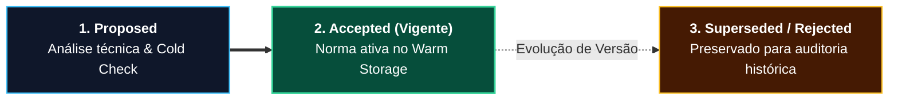

# Registros de Decisões Arquiteturais (ADRs 0001–0010) — PCL AEOS v3.6

> [!IMPORTANT]
> **👔 Visão Executiva & Valor de Negócio:** Os **Architecture Decision Records (ADRs)** constituem o livro societário-tecnológico da arquitetura **PromptCoreLabs_AEOS**. Eles documentam *por que* cada decisão estratégica foi tomada, protegendo a organização contra lock-in de fornecedores, custos ocultos em dólar e perda de memória institucional.

> [!NOTE]
> **🛠️ Visão de Engenharia & Invariantes:** Imutáveis por definição (decisões superadas recebem status `Superseded`, jamais são apagadas), os ADRs do monorepo estão unificados em **3 Trilhas Canônicas** sincronizadas com `knowledge/warm/architecture/ADR_INDEX.md` sob a norma **`PCL-AEOS-NORM-01`**.

---

## 1. Ciclo de Vida Normativo de um ADR

---

## 2. Catálogo Canônico Unificado (`ADR-0001` a `ADR-0010`)

### Trilha 1: Fundação do Kernel & Memória Tripartida (`architecture/decisions/`)

| ID | Título Oficial da Decisão | Status | Impacto Estrutural Principal |
| :--- | :--- | :---: | :--- |
| **`ADR-0001`** | Segregação do Módulo `memory/` do Módulo `knowledge/` | **Accepted** | Separa documentação declarativa humana (`knowledge/`) da persistência vetorial/relacional (`memory.*`). |
| **`ADR-0002`** | `bootstrap/` como Ponto de Entrada Oficial de Primeiro Nível | **Accepted** | Padroniza onboarding, provisionamento inicial e instanciação Spec-Driven. |
| **`ADR-0003`** | Higiene Constitucional da Foundation (`FOUNDATION.md`) | **Accepted** | Consolida a constituição imutável da plataforma e governança de gateways (`OmniRoute :20130`). |
| **`ADR-0004`** | Implementação Concorrente de `knowledge/` e `runtime/` | **Accepted** | Viabiliza evolução paralela entre playbooks normativos e contêineres Docker locais. |
| **`ADR-0005`** | Memória Cognitiva Tripartida, Temporal Graph-RAG & Laya System One | **Accepted** | Institui `memory.*` no PostgreSQL 17 + PGVector (`$0.00`, sem Neo4j) e coprocessador Laya em CPU (`0 MB VRAM`). |

### Trilha 2: Continuidade DRP & Evolução Cognitiva v3.6 (`docs/adrs/` & `knowledge/warm/`)

| ID | Título Oficial da Decisão | Status | Impacto Estrutural Principal |
| :--- | :--- | :---: | :--- |
| **`ADR-0006`** | Plano de Recuperação de Desastres Tripartido no Cloudflare R2 (`ADR-006`) | **Accepted** | Snapshots cifrados AES-256 a `$0.00`/mês com `RTO = 7,18s` homologado em laboratório (SLA `<= 15min`). |
| **`ADR-0007`** | **Memória Multi-Turn, Intention Gating & Desacoplamento de Fontes no PCL Cockpit v3.6** | **Accepted** | **Sliding Window multi-turn, triagem seletiva Laya CPU (`~20ms`), pílula retrátil de fontes e placar `4.95 / 5.0` no benchmark cego.** |

### Trilha 3: Volumes, Dual-Track SDD & Harness Operacional (`docs/adrs/`)

| ID | Título Oficial da Decisão | Status | Impacto Estrutural Principal |
| :--- | :--- | :---: | :--- |
| **`ADR-0008`** | Governança de Persistência de Volumes Docker & Namespace Isolation | **Accepted** | Binding explícito de volumes persistentes e travas contra destruição acidental de dados. |
| **`ADR-0009`** | Governança do Triage Gate & Abordagem Dual-Track SDD (*Lean vs. Full*) | **Accepted** | Seleção proporcional entre rota ágil (`tlc-spec-lean`) e rito completo de 5 Stage Gates. |
| **`ADR-0010`** | Refatoração da Squad Prototyping & Integração Auditável do Antigravity Harness | **Accepted** | Governança ISO/IEC 27001 e ISO/IEC 42001 unificando squads e assistente de engenharia. |

---

## 3. Destaques Executivos das Decisões Recentes (`ADR-0005` a `ADR-0007`)

* **📍 `ADR-0005` (Memória Tripartida + Laya CPU INT8):** Eliminou `4–8 GB` de RAM de servidores JVM de grafos (`HIP-001`) e manteve `100%` da GPU RTX 3050 livre ao executar inferência lógica NLI em CPU (`22,3ms`, `93,3%` recall).
* **📍 `ADR-0006` (Resiliência Imutável R2):** Assegurou continuidade empresarial contra perda catastrófica de host com restauração completa verificada em `7,18 segundos`.
* **📍 `ADR-0007` (Revolução Cognitiva do PCL Cockpit v3.6):** Erradicou a amnésia single-turn (`HIP-008`) e a busca web compulsória (`HIP-007`), consolidando o **Live Execution Stepper de 5 Fases** e a liderança empírica sobre assistentes comerciais fechados.
