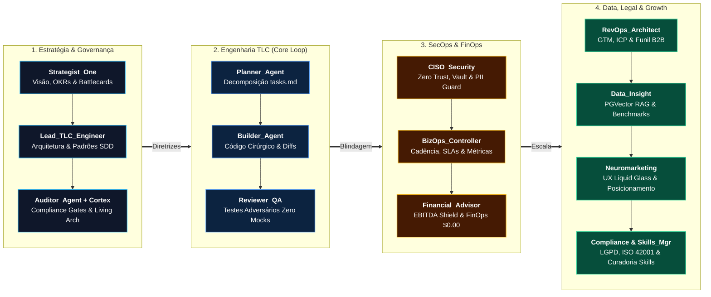
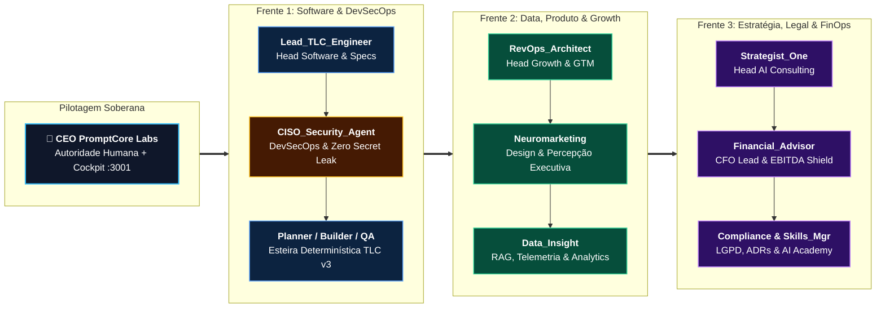
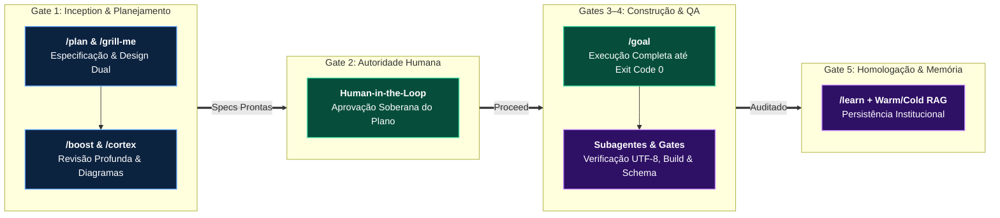

# Manual de Especificação dos 15 Agentes, Personas Cognitivas & Squads — PCL AEOS v3.6

> [!IMPORTANT]
> **👔 Visão Executiva & Valor de Negócio:** Em vez de depender de um único "assistente generalista" propenso a erros, o **PCL AEOS v3.6** organiza uma força de trabalho digital com **15 agentes especializados em 4 Squads** (Estratégia, Engenharia, SecOps/FinOps e Data/Growth) mais **2 Personas Cognitivas transversais (`/cortex` e `/laya`)**, sempre subordinadas à autoridade humana nos Stage Gates.

> [!NOTE]
> **🛠️ Visão de Engenharia & Invariantes:** Sistema Multi-Agente (*MAS*) regido por **`AGENTS.md` (`PCL-AEOS-NORM-01`)**, coordenado operacionalmente pelo **Paperclip (`:3100`)** e pilotado executivamente pelo **PCL Cockpit v3.6 (`:3001`)**, com *tool-call gating* em CPU (`0 MB VRAM`) e rastreabilidade criptográfica **SHA-256**.

---

## 1. Personas Cognitivas Transversais na v3.6 (`/cortex` & `/laya`)

Além das squads departamentais, dois motores atuam em tempo real na interface do **PCL Cockpit (`:3001`)** e no **Antigravity IDE**:
* **🧠 Persona `/cortex` (Orquestrador de Arquitetura & Guardião Visual):** Governa os Stage Gates TLC v3, renderiza o **Cortex Canvas (DAG interativo)** no Cockpit e audita todos os diagramas HTML/Mermaid sob o padrão Cortex v7 (anti-clipping e contraste WCAG AAA). *Autoridade RACI: Propositor técnico; jamais aprova deploy ou gastos sem aval humano.*
* **⚡ Persona `/laya` (Coprocessador de Sistema 1 em CPU):** Sensor consultivo não-autorregressivo (`ONNX INT8`, **`0 MB VRAM`**, `~20ms–35ms`) responsável pelo **Intention Gating v3.6** (`general_chat | internal_rag | web_search`), *Answerability Gate* (`>= 0.40`) e detecção NLI de contradições (`93,3%` recall).

---

## 2. Matriz Panorâmica de Responsabilidade dos 15 Agentes (Cortex v7)

---

## 2.1. Estrutura Organizacional da Holding no Paperclip (`flowchart LR` Cortex v7)

---

## 2.2. Matriz de Distribuição de Skills (Paperclip + TLC Skills)

| Agente / Papel | Liderança / Atuação nas Verticais | Skills Originais (Paperclip) | TLC Skills Soberanas |
| :--- | :--- | :--- | :--- |
| **CEO** | Orquestração Geral PCL, Venture Studio | `brainstorm-okrs`, `north-star-metric`, `product-vision`, `outcome-roadmap`, `summarize-meeting` | `ai-pricing`, `create-rfc`, `tlc-spec-driven` |
| **Strategist_One** | Head de AI Consulting, GovTech & Estratégia | `brainstorm-okrs`, `north-star-metric`, `product-vision`, `outcome-roadmap`, `swot-analysis`, `lean-canvas`, `competitor-analysis`, `business-model`, `competitive-battlecard` | `ai-pricing`, `create-rfc` |
| **RevOps_Architect** | Head de RevOps, CRM, Automação & Vendas B2B | `ideal-customer-profile`, `gtm-strategy`, `gtm-motions`, `cohort-analysis`, `growth-loops`, `user-segmentation`, `customer-journey-map` | `ai-sdr`, `ai-cold-outreach` |
| **Neuromarketing_Strategist** | Head de Marketing Digital, Branding & Mídia | `marketing-ideas`, `positioning-ideas`, `product-name`, `value-prop-statements`, `customer-journey-map`, `user-personas` | `ai-seo`, `ai-ugc-ads` |
| **Data_Insight_Agent** | Lead de Data & Analytics, BI e RAG | `ab-test-analysis`, `metrics-dashboard`, `cohort-analysis`, `growth-loops`, `user-segmentation`, `product-vision` | `ai-seo`, `best-practices` |
| **Lead_TLC_Engineer** | Head de Software Studio & Prototipagem | `user-stories`, `create-prd`, `sprint-plan`, `test-scenarios`, `prioritize-features`, `outcome-roadmap` | `tlc-spec-driven`, `create-adr`, `best-practices`, `perf-astro` |
| **BizOps_Controller** | Lead de Operações, Qualidade e Processos | `sprint-plan`, `prioritization-frameworks`, `prioritize-features`, `release-notes`, `summarize-meeting`, `retro` | `tlc-spec-driven`, `best-practices` |
| **CISO_Security_Agent** | Head de DevSecOps, CyberSecurity & Cloud | `pre-mortem`, `privacy-policy`, `test-scenarios` | `aws-advisor`, `best-practices` |
| **Financial_Advisor** | Head de Financeiro, FinOps & Pricing | `pricing-strategy`, `monetization-strategy`, `market-sizing`, `summarize-interview`, `draft-nda` | `ai-pricing` |
| **Compliance_Steward** | Lead de Jurídico, LGPD & Compliance | `draft-nda`, `privacy-policy` | `create-adr` |
| **Skills_Manager** | Lead de RH, People Ops & AI Academy | `review-resume`, `interview-script`, `summarize-interview`, `grammar-check` | `agent-skills-cli` |

---

## 2.3. Comandos Slash & Governança no Antigravity IDE

---

## 3. Especificação Detalhada dos 15 Agentes

### 🛠️ Squad Core de Engenharia (*Spec-Driven Loop*)
1. **Planner Agent (`planner.md`):** Decompõe `specify.md` e `design.md` em tarefas atômicas ordenadas (`tasks.md`). *Não escreve código de produção.*
2. **Builder Agent (`builder.md`):** Executa escrita cirúrgica de código e refatorações estritamente vinculadas ao `tasks.md`, validando `npm run build` (`Exit Code 0`).
3. **Reviewer QA (`reviewer-qa.md`):** Executa testes adversários, auditoria de integridade UTF-8 e bloqueia qualquer mock estático (`Zero Mocks`).
4. **Auditor Agent (`auditor.md`):** Verifica conformidade constitucional com `FOUNDATION.md` e `AGENTS.md`, detendo poder de veto antes do Signoff humano.

### 🏛️ Squad Executiva, Departamental & Cognitiva
5. **Strategist_One (`strategist-one.md`):** Visão corporativa, OKRs, matrizes competitivas e posicionamento estratégico.
6. **Lead TLC Engineer (`lead-tlc-engineer.md`):** Guardião técnico da metodologia TLC v3, ADRs e integridade do monorepo.
7. **CISO Security Agent (`ciso-security-agent.md`):** Zero Trust, cofre `AES-256-GCM`, **PII Guard LGPD** e varredura *Zero Secret Leak*.
8. **BizOps Controller (`bizops-controller.md`):** Fluxo operacional, SLAs de entrega e eliminação de gargalos entre squads.
9. **RevOps Architect (`revops-architect.md`):** Arquitetura de aquisição B2B, ICP e métricas de retenção.
10. **Financial Advisor (`financial-advisor.md`):** Governança do *EBITDA Shield*, auditoria de tokens e preservação do invariante `$0.00` local.
11. **Neuromarketing Strategist (`neuromarketing-strategist.md`):** Ergonomia cognitiva, *Liquid Glass Bento Grid* e clareza executiva.
12. **Data Insight Agent (`data-insight-agent.md`):** Otimização de embeddings `768D`, PGVector `HNSW` e protocolos de benchmark empírico.
13. **Compliance Steward (`compliance-steward.md`):** Alinhamento LGPD, ISO/IEC 27001, ISO/IEC 42001 e custódia *Zero-Bin*.
14. **Skills Manager (`skills-manager.md`):** Curadoria de skills (`SKILL.md`), plugins e evolução de `knowledge/learnings/`.
15. **Persona Cortex (`cortex/SKILL.md`):** Síntese visual interativa (`archify.mjs`), governança Mermaid Cortex v7 e manutenção da Arquitetura Viva.

---

## 4. Integração com os Diagramas Interativos

* 🔵 **[agents-squad-map.html](../../diagrams/interactive/agents-squad-map.html)** — Mapa interativo de orquestração dos 15 agentes e squads.
* 🟢 **[seq-tlc-execution.html](../../diagrams/interactive/seq-tlc-execution.html)** — Sequência formal entre Planner, Builder, Reviewer QA e Auditor.
* ⚡ **[seq-cockpit-v36-cognitive-pipeline.html](../../diagrams/interactive/seq-cockpit-v36-cognitive-pipeline.html)** — Atuação conjunta de `/laya` e `/cortex` no pipeline v3.6.
