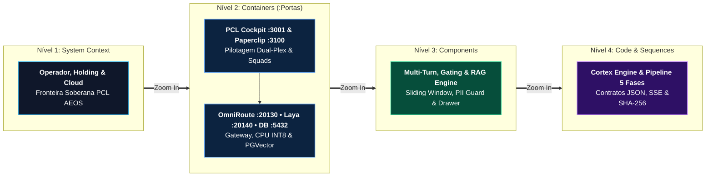

# C4 Model Specification — Living Architecture PCL AEOS v3.6

> [!IMPORTANT]
> **👔 Visão Executiva & Valor de Negócio:** Assim como o Google Maps permite alternar da visão de satélite do país até a planta de um edifício, a notação **C4 Model** permite que executivos compreendam o ecossistema estratégico no **Nível 1** e que engenheiros inspecionem contêineres, componentes e pipelines de código nos **Níveis 2 a 4**.

> [!NOTE]
> **🛠️ Visão de Engenharia & Invariantes:** Todos os modelos estruturais JSON são validados matematicamente pelo motor **`archify.mjs` (`--quality showcase`, 9/9 checks, 0 erros)** da persona `/cortex` e compilados em artefatos HTML autocontidos com SVG inline, incluindo na **v3.6** o container do **PCL Cockpit (`:3001`)** e sua esteira cognitiva de 5 fases.

---

## 1. Visão Panorâmica Multinível C4 (Padrão Cortex v7)

---

## 2. Catálogo de Modelos Estruturados (JSON) & Diagramas Interativos (HTML)

| Nível / Modalidade | Escopo Arquitetural | Especificação JSON (Fonte) | Artefato Interativo Cortex (HTML) |
| :--- | :--- | :--- | :--- |
| **C4 Level 1** | Contexto Geral do Sistema Soberano | [c4-l1-context.json](../../diagrams/c4-l1-context.json) | [c4-l1-context.html](../../diagrams/interactive/c4-l1-context.html) |
| **C4 Level 2** | Contêineres Docker & Portas Locais | [c4-l2-containers.json](../../diagrams/c4-l2-containers.json) | [c4-l2-containers.html](../../diagrams/interactive/c4-l2-containers.html) |
| **C4 Level 3** | Componentes Internos do Kernel & RAG | [c4-l3-components.json](../../diagrams/c4-l3-components.json) | [c4-l3-components.html](../../diagrams/interactive/c4-l3-components.html) |
| **C4 Level 4** | Motor Interno PCL Cortex Engine | [c4-l4-cortex-engine.json](../../diagrams/c4-l4-cortex-engine.json) | [c4-l4-cortex-engine.html](../../diagrams/interactive/c4-l4-cortex-engine.html) |
| **Sequence v3.6** | **Pipeline Cognitivo PCL Cockpit (5 Fases)** | [seq-cockpit-v36-cognitive-pipeline.json](../../diagrams/seq-cockpit-v36-cognitive-pipeline.json) | [seq-cockpit-v36-cognitive-pipeline.html](../../diagrams/interactive/seq-cockpit-v36-cognitive-pipeline.html) |
| **Sequence Laya** | Triagem NLI & Guardrails Laya CPU INT8 | [seq-laya-system-one.json](../../diagrams/seq-laya-system-one.json) | [seq-laya-system-one.html](../../diagrams/interactive/seq-laya-system-one.html) |

> 📑 **Registro de Fronteiras Canônico:**  
> A definição formal de limites entre módulos do Kernel, Cockpit e Ventures segue a norma **`PCL-AEOS-NORM-01`** (`AGENTS.md`) e o [Boundary Register Canônico](../../../pcl-aeos-harmonization/design/canonical-architecture.md).
