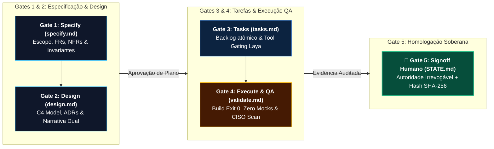

# Artigo Técnico: Governança TLC Spec-Driven v3, Norma `PCL-AEOS-NORM-01` & 5 Stage Gates (v3.6)

> [!IMPORTANT]
> **👔 Visão Executiva & Valor de Negócio:** Em inteligência artificial corporativa, autonomia sem freios gera risco jurídico, financeiro e reputacional. A governança **TLC Spec-Driven v3** garante que nenhum código produtivo, gasto em nuvem ou mudança arquitetural ocorra sem especificação prévia, auditoria técnica adversária e **aprovação final exclusiva do operador humano**.

> [!NOTE]
> **🛠️ Visão de Engenharia & Invariantes:** Regida pela norma soberana **`PCL-AEOS-NORM-01`** (`AGENTS.md`), articula **5 Stage Gates sequenciais** (`specify.md` ➔ `design.md` ➔ `tasks.md` ➔ `validate.md` ➔ `STATE.md`), triagem Dual-Track SDD (`ADR-0009`: *Lean* vs. *Full*), *tool-call gating* em CPU via Laya (`:20140`) e atesto criptográfico **SHA-256** na Fase 5 do **PCL Cockpit v3.6 (`:3001`)**.

---

## 1. Esteira Panorâmica dos 5 Stage Gates Sequenciais (Padrão Cortex v7)

---

## 2. Detalhamento Normativo dos Gates & RACI

| Stage Gate | Artefato Canônico | Validações Obrigatórias (v3.6) | Autoridade RACI |
| :---: | :--- | :--- | :--- |
| **Gate 1** | `specify.md` | Definição de problema, Requisitos Funcionais (`FR-001+`), Não Funcionais (`NFR-001+`) e consulta ao Cold Storage (`HIP-001`–`008`). | *Planner Agent / Strategist_One* (`R`) |
| **Gate 2** | `design.md` | Modelagem C4, diagramas Cortex v7 (`9/9 checks showcase`), conformidade `0 MB VRAM` Laya e plano de rollback. | *Lead TLC Engineer / Persona `/cortex`* (`R`) |
| **Gate 3** | `tasks.md` | Quebra em tarefas determinísticas (`TASK-001+`) com confinamento de ferramentas e verificação prévia Laya (`RACI: R/C`). | *Planner Agent / `/laya`* (`R/C`) |
| **Gate 4** | `validate.md` | Compilação `npm run build` (`Exit Code 0`), integridade `UTF-8` pura, *Zero Secret Leak* e política *Zero Mocks*. | *Builder / Reviewer QA / CISO Agent* (`R`) |
| **Gate 5** | `STATE.md` + `SHA-256` | Atesto criptográfico imutável no `PCLArtifactDrawer` / PostgreSQL 17 e **homologação final exclusiva do humano**. | **Operador Humano** (`A` — Soberano) |

---

## 3. Integração com Diagramas Interativos

* 🟢 **[seq-tlc-execution.html](../../diagrams/interactive/seq-tlc-execution.html)** — Sequência formal de validação Spec-Driven entre agentes e gates.
* 🔵 **[gov-stage-gates-matrix.html](../../diagrams/interactive/gov-stage-gates-matrix.html)** — Matriz interativa completa dos 5 Stage Gates sequenciais.
* ⚡ **[seq-cockpit-v36-cognitive-pipeline.html](../../diagrams/interactive/seq-cockpit-v36-cognitive-pipeline.html)** — Atesto SHA-256 na Fase 5 do Live Execution Stepper.
