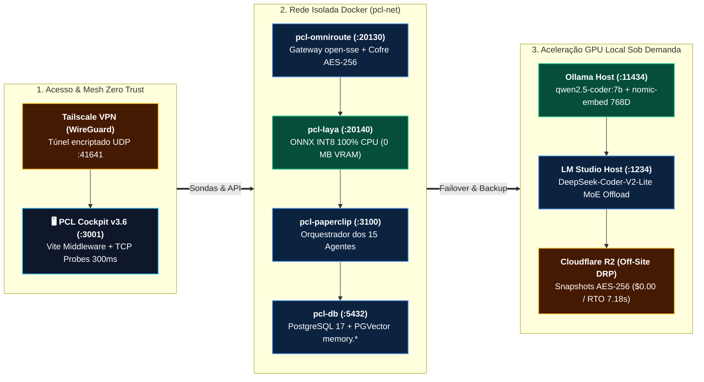

# Artigo Técnico: Infraestrutura Soberana, Portas Locais & Docker Harness — PCL AEOS v3.6

> [!IMPORTANT]
> **👔 Visão Executiva & Valor de Negócio:** Toda a infraestrutura crítica do **PCL AEOS v3.6** roda sob controle exclusivo da organização (*Local-First / On-Premise*), protegida por rede criptografada ponto a ponto (Tailscale WireGuard), sem exposição de portas administrativas na internet pública e com custo fixo de infraestrutura em nuvem igual a **`$0.00`/mês**.

> [!NOTE]
> **🛠️ Visão de Engenharia & Invariantes:** Topologia composta pela rede isolada Docker (`pcl-net`), pelo centro de comando **PCL Cockpit (`:3001`)** com sondas TCP sub-segundo (`250ms–300ms`), pelo coprocessador **Laya em CPU (`:20140`, `0 MB VRAM`)** e pelos motores GPU locais sob demanda (`Ollama :11434` e `LM Studio :1234`), em conformidade com o `ADR-0008` (persistência explícita de volumes).

---

## 1. Topologia Panorâmica do Host & Contêineres Docker (Padrão Cortex v7)

---

## 2. Tabela Oficial de Serviços, Portas e Recursos de Hardware (v3.6)

| Serviço / Componente | Execução | Porta Host | Alocação de Hardware | Função Arquitetural & Dependências |
| :--- | :---: | :---: | :--- | :--- |
| **PCL Cockpit v3.6** | Host Node/Vite | **`3001`** | CPU leve / Browser GPU | Centro de comando Dual-Plex, Stepper 5 Fases, Multi-Turn e `PCLArtifactDrawer`. |
| **`pcl-laya` (System One)** | Docker & MCP `stdio` | **`20140`** | **100% CPU INT8 (`0 MB VRAM`)** | Intention Gating `O(1)` (`~20ms`), NLI (`93.3%` recall) e *Answerability Gate*. |
| **`pcl-omniroute`** | Docker (`pcl-net`) | **`20130`** | CPU / I/O Rede | AI Gateway `open-sse`, *EBITDA Shield*, cofre `AES-256-GCM` e roteamento híbrido. |
| **`pcl-paperclip`** | Docker (`pcl-net`) | **`3100`** | CPU | Dashboard de governança operacional das 4 Squads / 15 agentes (`pcl-db`). |
| **`pcl-db`** | Docker (`pcl-net`) | **`5432`** | Disco SSD + RAM | PostgreSQL 17 + `pgvector` (`public` + `memory.*`), volume persistente `pcl-db-data`. |
| **Ollama Local** | Processo Host | **`11434`** | **GPU RTX 3050 (`~4.7 GB` sob demanda)** | Inferência soberana Nível 1 (`qwen2.5-coder:7b`) e embeddings `nomic-embed-text` (`$0.00`). |
| **LM Studio Server** | Processo Host | **`1234`** | GPU VRAM + DDR5 Offload | Inferência soberana Nível 2 (`DeepSeek-Coder-V2-Lite MoE`) para refatorações extensas. |
| **Tailscale Mesh** | Serviço OS | `41641/UDP` | Kernel WireGuard | Rede privada Zero Trust sem abertura de portas no roteador público. |

---

## 3. Integração com Diagramas Interativos

* 🟢 **[c4-l2-containers.html](../../diagrams/interactive/c4-l2-containers.html)** — Topologia C4 Level 2 completa dos contêineres e portas locais.
* 🟡 **[infra-network-security.html](../../diagrams/interactive/infra-network-security.html)** — Arquitetura perimetral WireGuard / Tailscale VPN Mesh.
