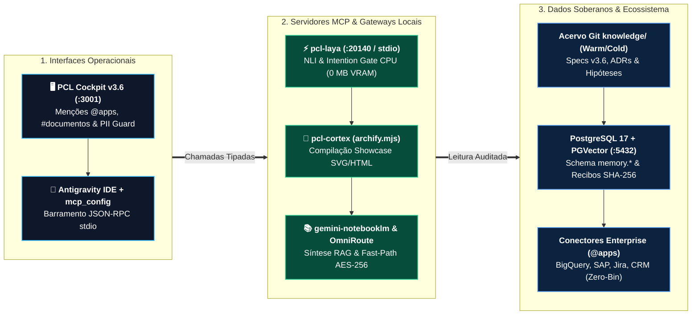

# Artigo Técnico: Integrações Corporativas (`@apps` / `#docs`) & Protocolo MCP — PCL AEOS v3.6

> [!IMPORTANT]
> **👔 Visão Executiva & Valor de Negócio:** O **PCL AEOS v3.6** conecta a inteligência artificial diretamente aos sistemas reais de gestão (`@BigQuery`, `@SAP`, `@Salesforce`, `@Jira`, `@Sheets`, `@HubSpot`) e ao acervo normativo interno (`#documentos`), eliminando o trabalho manual de copiar e colar relatórios entre plataformas sem entregar a custódia dos seus arquivos a nuvens externas.

> [!NOTE]
> **🛠️ Visão de Engenharia & Invariantes:** Opera em dupla camada de integração padronizada: **(1) Barramento `Model Context Protocol (MCP)` via JSON-RPC `stdio` e HTTP local** para ferramentas de baixa latência (`pcl-laya`, `pcl-cortex`, `gemini-notebooklm`) e **(2) Conectores Contextuais Tipados (`@mentions` e `#documentos`)** no **PCL Cockpit v3.6 (`:3001`)** sob custódia *Headless BYOS (Zero-Bin)* e filtro **PII Guard LGPD**.

---

## 1. Servidores MCP Nativo-Soberanos & Conectores do Cockpit v3.6

1. **`pcl-cortex` MCP & CLI Engine (`archify.mjs`):** Validação matemática (`9/9 checks showcase`), renderização SVG/HTML autocontida e auditoria de diagramas da Arquitetura Viva.
2. **`pcl-laya` MCP Server (`stdio` & `:20140`):** Coprocessador neural NLI INT8 em CPU (`0 MB VRAM`, `~0.014ms` batch stdio / `~20ms` HTTP) para *Intention Gating*, *Answerability Gate* e detecção de contradições.
3. **`gemini-notebooklm` MCP Server:** Pesquisa profunda assistida e síntese estruturada de cadernos técnicos.
4. **Conectores `@apps` & `#documentos` no PCL Cockpit (`:3001`):** Menções diretas com escopo explícito a fontes corporativas (`@BigQuery`, `@SAP`, `@Sheets`, `@HubSpot`, `@Salesforce`, `@Jira`, `@Gmail`, `@Agenda`) e injeção determinística de `knowledge/warm/` e `knowledge/cold/` via `#documentos`.

---

## 2. Topologia Panorâmica de Conexão MCP & Cockpit (Padrão Cortex v7)

---

## 3. Integração com Diagramas Interativos

* 🔵 **[mcp-interconnection.html](../../diagrams/interactive/mcp-interconnection.html)** — Mapa interativo de interconexão entre clientes de IA, servidores MCP e persistência.
* ⚡ **[seq-laya-system-one.html](../../diagrams/interactive/seq-laya-system-one.html)** — Sequência detalhada das primitivas MCP do coprocessador Laya System One.
