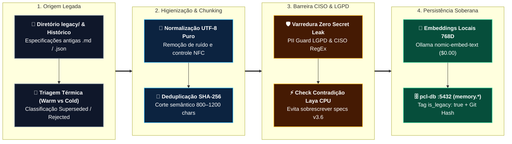

# 🔄 DIAG-LEG-01: Legacy Migration Dataflow & Sanitização de Dados Legados (PCL AEOS v3.6)

> **Especificação Técnica do Sistema Operacional PCL AEOS**  
> **ID**: `DIAG-LEG-01` | **Categoria**: Dataflow Architecture | **Norma**: `PCL-AEOS-NORM-01`  
> **Escopo**: Sanitização UTF-8, Deduplicação SHA-256, Gating CISO e Ingestão do Acervo Legado (`legacy/` & `knowledge/cold/`)

> [!IMPORTANT]
> **👔 Visão Executiva & Valor de Negócio:** Documentos históricos valiosos não precisam ser descartados nem podem contaminar decisões atuais. O pipeline **`DIAG-LEG-01`** higieniza o acervo legado, remove segredos acidentais e classifica documentos superados (`Superseded` / `Cold Storage`), preservando a memória institucional sem induzir erros nos agentes.

> [!NOTE]
> **🛠️ Visão de Engenharia & Invariantes:** Padroniza arquivos históricos em **UTF-8 puro (NFC, zero mojibake)**, aplica deduplicação criptográfica **SHA-256**, gera vetores locais `nomic-embed-text` (`768D`) a custo `$0.00` e isola metadados `is_legacy: true` na tabela `memory.document_chunks` (`pcl-db :5432`).

---

## 1. Pipeline Panorâmico de Migração & Higienização (Padrão Cortex v7)

---

## 2. Fases Determinísticas do Processo de Migração

### Fase 1: Extração, Normalização UTF-8 & Deduplicação
* **Varredura Controlada:** Mapeamento integral do diretório `legacy/` e versões superadas (ex: `PCL_COCKPIT_SPEC_V3.5.md` marcada como `Superseded`).
* **Integridade de Encoding:** Padronização estrita em UTF-8 NFC, eliminando caracteres de controle e dupla codificação.
* **Assinatura SHA-256:** Cálculo do hash por arquivo para impedir indexação duplicada.

### Fase 2: Fragmentação Semântica & Vetorização Local (`$0.00`)
* **Chunking Estruturado:** Blocos semânticos preservando cabeçalhos Markdown e tags `source_file`, `legacy_path`, `migrated_at` e `sha256_hash`.
* **Embeddings Soberanos:** Vetores densos de `768` dimensões via `nomic-embed-text` local sem envio de acervo histórico para APIs pagas.

### Fase 3: Auditoria de Governança (Stage Gate 3 & Cold Storage)
* **Sanitização CISO / LGPD:** Interceptação automática de qualquer credencial ou dado pessoal remanescente.
* **Proteção Anti-Regressão:** Todo fragmento legado recebe `is_legacy: true`, impedindo que sobreponha especificações `Approved` do `knowledge/warm/`.

---

## 3. Modelo Relacional da Migração (`memory.document_chunks`)

| Campo em `document_chunks` | Tipo SQL | Função no Dataflow Legado |
| :--- | :--- | :--- |
| `id` | `UUID` | Identificador único do fragmento migrado |
| `source_file` | `VARCHAR(512)` | Caminho original auditável em `legacy/` ou `knowledge/cold/` |
| `content` | `TEXT` | Texto higienizado em UTF-8 puro |
| `embedding` | `vector(768)` | Vetor denso local (`nomic-embed-text`) para busca por cosseno |
| `metadata` | `JSONB` | Contém `sha256`, `is_legacy: true`, `status` e `migrated_at` |

---

## 4. Artefatos Relacionados
* 🔄 **[data-legacy-migration.html](../../diagrams/interactive/data-legacy-migration.html)** — Diagrama interativo `DIAG-LEG-01`.
* 🧠 **[Módulo RAG Vetorial & Memory Dataflow v3.6](../memory-rag/README.md)** — Arquitetura completa da memória dual.
* 🧊 **[Registro Canônico de Hipóteses Descartadas](../../../../knowledge/cold/discarded_hypotheses/DISCARDED_HYPOTHESES_LOG.md)** — Cold Storage `HIP-001` a `HIP-008`.
