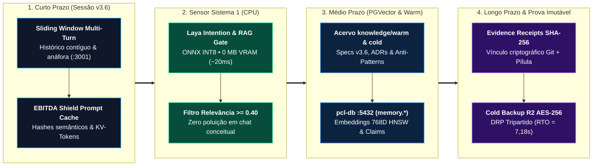
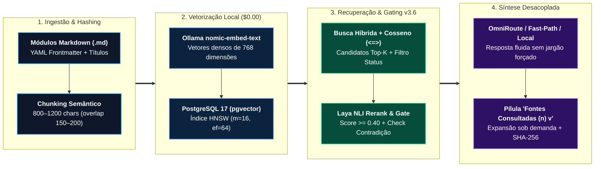
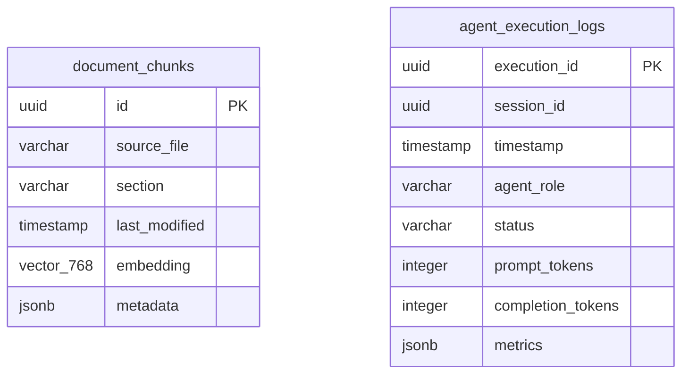

# Módulo RAG Vetorial, Memória Multi-Turn & Memory Dataflow — PCL AEOS v3.6

> ℹ️ **Documentação de Migração Legada (`DIAG-LEG-01`):** Para consultar a especificação de sanitização e migração do acervo `legacy/`, [abra o artigo oficial de Migração Legada](../legacy-migration/README.md).

> [!IMPORTANT]
> **👔 Visão Executiva & Valor de Negócio:** A arquitetura de memória **v3.6** resolve definitivamente os dois maiores gargalos de assistentes corporativos: a **amnésia entre perguntas** e a **alucinação por documentos irrelevantes**. O resultado foi comprovado no benchmark cego oficial (**4.95 / 5.0**), operando com banco vetorial próprio a **`$0.00`/mês** e referências organizadas em pílula retrátil limpa.

> [!NOTE]
> **🛠️ Visão de Engenharia & Invariantes:** Articula o **Modelo Temporal Operacional** (`Sliding Window Multi-Turn` + schema `memory.*` no PostgreSQL 17 `PGVector 768D HNSW`) com o **Modelo Físico de Governança RAG** (`knowledge/warm/`, `cold/`, `learnings/`), filtrados em `~20ms` pelo coprocessador **Laya CPU INT8 (`0 MB VRAM`, `score >= 0.40`)** sob `ADR-0005` e `ADR-0007`.

---

## 1. Clarificação Canônica v3.6: Modelo Temporal (`memory.*`) vs. Governança Física (`knowledge/`)

1. **Modelo Temporal Operacional (Runtime & Banco `memory.*`):** Governa o ciclo de vida dinâmico da informação em execução — **Curto Prazo** (*Sliding Window Multi-Turn* com resolução anafórica e KV-Cache), **Médio Prazo** (vetores `768D` `nomic-embed-text` e claims `Tiers 1–4` no PGVector) e **Longo Prazo** (recibos SHA-256, `STATE.md` e snapshots AES-256 no Cloudflare R2).
2. **Modelo Físico de Governança RAG (`knowledge/`):** Estrutura declarativa versionada em Git para consulta humana e indexação determinística (`#documentos`) — **Warm Storage** (`PCL_COCKPIT_SPEC_V3.6.md`, `ADR-0007.md`, Matriz Competitiva), **Cold Storage** (`HIP-001` a `HIP-008` descartadas) e **Learnings** (`AGENTS.md`).

### Arquitetura Panorâmica das Camadas de Memória (Padrão Cortex v7)



### Matriz Comparativa das Camadas de Memória

| Camada | Escopo Funcional | Retenção / Vida Útil | Latência | Tecnologia / Repositório |
| :--- | :--- | :--- | :---: | :--- |
| **Curto Prazo (v3.6)** | Contexto ativo multi-turn, anáfora e janela deslizante | Sessão ativa com orçamento contíguo `K` | `< 10ms` | Multi-Turn Buffer (`omniRouteService.ts`) |
| **Gating Sensor (Laya)** | Triagem não-autorregressiva `O(1)` de intenção e relevância | Decisão instantânea por turno | `~20ms a 35ms` | Laya System One ONNX INT8 (**`0 MB VRAM`**) |
| **Médio Prazo (RAG)** | Conhecimento semântico e normas vigentes (`warm/` + vetores) | Ciclo de vida evolutivo do monorepo | `~15ms a 120ms` | `knowledge/warm/` + PGVector (`PostgreSQL 17 :5432`) |
| **Longo Prazo & Cold** | Constituição, ADRs, hipóteses descartadas e DRP | Permanente e auditável (Imutável) | `< 50ms` / `7,18s` RTO | `knowledge/cold/`, `memory.evidence_receipts`, Cloudflare R2 |

---

## 2. Os 5 Paradigmas de RAG & Pipeline Vetorial Local (Cortex v7)

O ecossistema implementa cinco estágios complementares: **(1) Vector RAG 768D**, **(2) Hybrid Lexical+Semantic RAG**, **(3) Cross-Encoder NLI Reranking**, **(4) Temporal Graph-RAG (`claims` + `superseded_by`)** e **(5) Conditional Agentic Gated RAG (`ADR-0007`)**:



---

## 3. Especificação de Chunking & Metadados do Vetor (`JSONB`)

* **Tamanho do Chunk:** `800` a `1200` caracteres (`~200` a `300` tokens por fatia) com *overlap* de `150` a `200` caracteres.
* **Divisão Semântica:** Respeita hierarquia Markdown (`#`, `##`, `###`) e cabeçalhos YAML Frontmatter (`status: Approved | Superseded | Rejected`).

```json
{
  "source_file": "knowledge/warm/cockpit/PCL_COCKPIT_SPEC_V3.6.md",
  "section": "2. Pipeline Cognitivo em 5 Fases",
  "kernel_version": "v3.6.0",
  "status": "Approved",
  "taxonomy": "AEOS",
  "layer": "Warm_Storage",
  "sha_commit": "89a8f6d",
  "tokens": 260
}
```

---

## 4. Infraestrutura Relacional & Vetorial (`pcl-db :5432`)



---

## 5. Integração com Diagramas Interativos

* ⚡ **[seq-cockpit-v36-cognitive-pipeline.html](../../diagrams/interactive/seq-cockpit-v36-cognitive-pipeline.html)** — Pipeline Multi-Turn, Intention Gating e Fontes Retráteis v3.6.
* 🟡 **[data-rag-memory.html](../../diagrams/interactive/data-rag-memory.html)** — Dataflow completo de ingestão e busca vetorial RAG.
* 🔄 **[data-legacy-migration.html](../../diagrams/interactive/data-legacy-migration.html)** — Pipeline de sanitização e migração do acervo legado.
* 💜 **[obs-audit-trail.html](../../diagrams/interactive/obs-audit-trail.html)** — Coleta de telemetria e recibos de auditoria no `pcl-db`.
