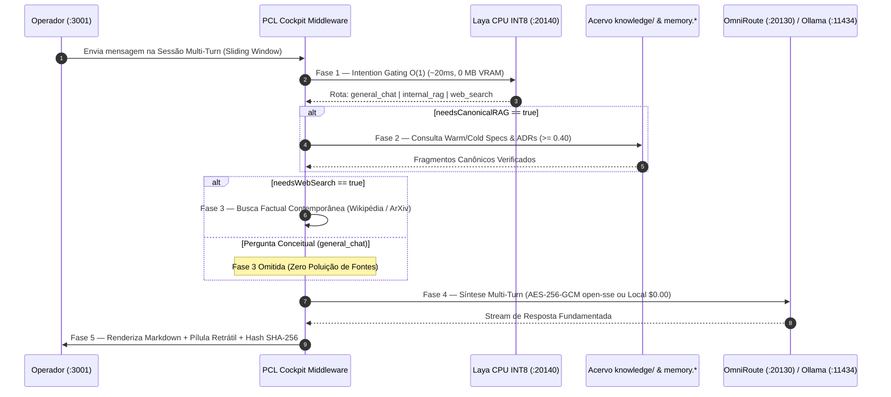

# Artigo Técnico: Runtime Híbrido, PCL Cockpit `:3001` & AI Gateway OmniRoute (v3.6)

> [!IMPORTANT]
> **👔 Visão Executiva & Valor de Negócio:** O Runtime do **PCL AEOS v3.6** une velocidade executiva em nuvem (`~1.2s–3.4s`) e autonomia local absoluta (`$0.00`), exibindo cada etapa do raciocínio em tempo real através do **Live Execution Stepper de 5 Fases** no PCL Cockpit (`:3001`), sem congelamentos de tela e com auditoria imutável SHA-256.

> [!NOTE]
> **🛠️ Visão de Engenharia & Invariantes:** Orquestra quatro motores cooperativos — **PCL Cockpit (`:3001`)**, **Laya Coprocessor CPU INT8 (`:20140`, `0 MB VRAM`)**, **OmniRoute AI Gateway (`:20130`, cofre `AES-256-GCM` + parser `open-sse`)** e **Paperclip Orchestrator (`:3100`)** — protegidos por sondas de socket TCP sub-segundo (`250ms–300ms`) e failover determinístico para Ollama (`:11434`).

---

## 1. Componentes-Chave do Runtime v3.6

### 1. 🖥️ PCL Cockpit v3.6 (Porta `:3001`)
* **Centro de Comando Dual-Plex:** Workspace de 3 colunas retráteis combinando Chat Multi-Turn (*Sliding Window*), **Cortex Canvas (DAG interativo)** e `PCLArtifactDrawer` (`380px–850px`).
* **Middlewares Determinísticos (`vite.config.ts`):**
  * `GET /api/aeos/status`: Sondas TCP em **`250ms–300ms`** para `:11434`, `:20130`, `:20140` e `:5432` (erradicando timeouts de 38s–58s quando contêineres estão desligados — `HIP-004`).
  * `POST /api/aeos/infer`: Fast-Path com credencial `AES-256-GCM` em memória, parser universal `open-sse` (`HIP-005`), normalização multi-turn (`user`/`model`) e failover imediato para Ollama local.
  * `POST /api/aeos/search`: Grounding factual aberto acionado apenas quando `needsWebSearch === true` (**Zero Mocks** — `HIP-003` e `HIP-007`).

### 2. ⚡ Laya System One Coprocessor (Porta `:20140` & MCP `stdio`)
* Triagem não-autorregressiva `O(1)` em CPU (`ONNX Runtime INT8`, **`0 MB VRAM`**) em `~20ms–35ms` (`~0.014ms` via MCP local em lote) para *Intention Gating*, *Answerability Gate* (`>= 0.40`) e detecção de contradições NLI (`93,3%` recall).

### 3. 🌐 OmniRoute AI Gateway (Porta `:20130`)
* **EBITDA Shield & Roteamento Multi-Provedor:** Cache semântico de prompts, controle de orçamento de tokens e chaveamento transparente entre Fast-Path Cloud (Gemini 3.5 Flash-Lite / 3.6 Flash) e GPU local (`qwen2.5-coder:7b` em `:11434` / `DeepSeek MoE` em `:1234`).

### 4. 🎛️ Paperclip Dashboard (Porta `:3100`)
* Painel de coordenação operacional dos 15 papéis de agentes, *Execution Cells*, triggers de tarefas e confinamento de Stage Gates.

---

## 2. Ciclo de Vida Completo da Requisição em 5 Fases (v3.6)

---

## 3. Resiliência & Recuperação de Desastres (`DRP Tripartido`)

* **Cold SQL & Knowledge Backup:** Snapshots dos schemas `public` e `memory.*` compactados e criptografados em **AES-256** enviados ao Cloudflare R2 gratuito (`pcl-backup-memoria-tripartida`, `$0.00`/mês).
* **RTO Homologado em `7,18 segundos`:** Restauração atômica auditada via `scripts/backup/restore-aeos-tripartido.ps1` (superando amplamente o SLA contratual `<= 15 minutos`).

---

## 4. Integração com Diagramas Interativos

* ⚡ **[seq-cockpit-v36-cognitive-pipeline.html](../../diagrams/interactive/seq-cockpit-v36-cognitive-pipeline.html)** — Pipeline Cognitivo de 5 Fases do PCL Cockpit v3.6.
* 🟡 **[seq-omniroute-routing.html](../../diagrams/interactive/seq-omniroute-routing.html)** — Ciclo de vida do roteamento híbrido OmniRoute.
* 🟡 **[seq-tripartite-memory-drp.html](../../diagrams/interactive/seq-tripartite-memory-drp.html)** — Ciclo de vida da Memória Tripartida & DRP R2.
* 🟡 **[life-cortex-micro-loop.html](../../diagrams/interactive/life-cortex-micro-loop.html)** — Máquina de estados do micro-loop de execução agêntica.
