# Artigo Técnico: Segurança Zero Trust, Cofre `AES-256-GCM`, LGPD & ISO 42001 — PCL AEOS v3.6

> [!IMPORTANT]
> **👔 Visão Executiva & Valor de Negócio:** Ao utilizar IA generativa comercial sem proteção perimetral, empresas expõem contratos, CPFs, segredos industriais e chaves de API em servidores externos. O **PCL AEOS v3.6** blinda a organização com **sanitização LGPD em tempo real antes do envio**, **custódia local de documentos (*Zero-Bin Custody*)** e **recibos criptográficos SHA-256** prontos para auditoria regulatória.

> [!NOTE]
> **🛠️ Visão de Engenharia & Invariantes:** Implementa defesa em profundidade sob **ISO/IEC 27001** e **ISO/IEC 42001**: (1) **PII Guard LGPD inline** no PCL Cockpit (`:3001`), (2) **Cofre `AES-256-GCM`** para credenciais de provedores sem texto claro em `.env`, (3) **Política *Zero Secret Leak*** varrida pelo CISO Agent, (4) isolamento de rede `pcl-net` + Tailscale WireGuard e (5) integridade **SHA-256** em todas as mensagens e artefatos.

---

## 1. Os 5 Pilares de Defesa em Profundidade (Edição v3.6)

1. **Zero Secret Leak (`AGENTS.md` Seção 5.3):** Proibição estrita de chaves de API, tokens JWT ou credenciais em texto claro em código, logs, Markdown ou diagramas.
2. **Cofre Criptográfico `AES-256-GCM` em Memória:** As credenciais de nuvem do OmniRoute (`pc-gemini-cloud`) permanecem cifradas em repouso e são descriptografadas efemeramente apenas em RAM durante a chamada Fast-Path (`POST /api/aeos/infer`).
3. **PII Guard LGPD Inline (Cliente `:3001`):** Antes de qualquer transmissão externa, o filtro inspeciona e mascara padrões sensíveis brasileiros e globais (CPF, CNPJ, cartões, chaves privadas, e-mails restritos), exibindo o relatório na aba *LGPD/PII* do `PCLArtifactDrawer`.
4. **Zero-Bin Custody (*Headless Bring-Your-Own-Storage*):** Nenhum binário ou documento confidencial é retido em servidores SaaS intermediários; o acervo reside localmente no repositório/storage soberano do operador.
5. **Trilha de Auditoria Imutável SHA-256:** Na Fase 5 do *Live Execution Stepper*, cada síntese e evidência recebe assinatura criptográfica SHA-256 persistida para conformidade ISO/IEC 42001.

---

## 2. Esteira Panorâmica de Sanitização, Criptografia & Atesto (Padrão Cortex v7)

```mermaid
flowchart LR
    classDef inp fill:#0f172a,stroke:#38bdf8,stroke-width:1.5px,color:#ffffff;
    classDef sec fill:#451a03,stroke:#fbbf24,stroke-width:1.5px,color:#ffffff;
    classDef vlt fill:#0c2340,stroke:#60a5fa,stroke-width:1.5px,color:#ffffff;
    classDef ok fill:#064e3b,stroke:#34d399,stroke-width:1.5px,color:#ffffff;

    subgraph Entrada ["1. Captura & DLP no Cliente (:3001)"]
        direction TB
        Prompt["<b>Prompt / Anexo BYOS</b><br/>Zero-Bin Custody no Host"]:::inp
        PIIGuard["<b>PII Guard LGPD + CISO RegEx</b><br/>Detecta CPF, CNPJ, Chaves & Tokens"]:::sec
        Prompt --> PIIGuard
    end

    subgraph Decisao ["2. Barreira Zero Secret Leak"]
        direction TB
        Check{"Dado Sensível<br/>Detectado?"}:::sec
        Redact["<b>Mascaramento Automático</b><br/>[REDACTED_PII / SECRET] + Log"]:::sec
        Check -->|"Sim"| Redact
    end

    subgraph Execucao ["3. Transporte & Cofre Cifrado"]
        direction TB
        Vault["<b>Cofre AES-256-GCM / Tailscale</b><br/>Decriptação efêmera em RAM"]:::vlt
        LayaGate["<b>Tool Gating Laya CPU (:20140)</b><br/>Bloqueio de comandos destrutivos"]:::vlt
        Vault --> LayaGate
    end

    subgraph Auditoria ["4. Conformidade ISO 27001 / 42001"]
        direction TB
        Receipt["<b>🎯 Recibo Imutável SHA-256</b><br/>Atesto no Sovereign Drawer & pcl-db"]:::ok
    end

    PIIGuard ==> Check
    Check ==>|"Limpo"| Vault
    Redact ==> Vault
    LayaGate ==> Receipt
```

---

## 3. Integração com Diagramas Interativos

* 💜 **[sec-zero-trust-flow.html](../../diagrams/interactive/sec-zero-trust-flow.html)** — Fluxo interativo completo de gerenciamento de segredos e imunização Zero Trust.
* 🟡 **[infra-network-security.html](../../diagrams/interactive/infra-network-security.html)** — Isolamento perimetral de rede Docker Bridge e WireGuard Mesh.
