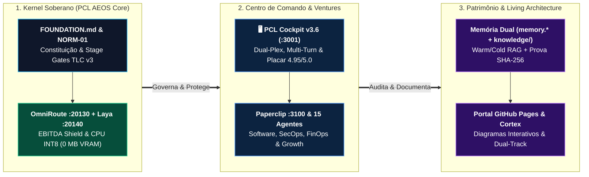

# Artigo Técnico: Estratégia Corporativa, Holding Digital & Visão PCL AEOS v3.6

> [!IMPORTANT]
> **👔 Visão Executiva & Valor de Negócio:** O **PromptCoreLabs_AEOS** opera como uma **Holding Digital Soberana em 3 Camadas** (Kernel de Governança, Venture Studio de Produtos e Arquitetura Viva). Na versão **v3.6**, seu centro de comando oficial (**PCL Cockpit `:3001`**) atingiu **4.95 / 5.0** em benchmark empírico cego contra Gemini (`4.45`), ChatGPT (`4.30`) e Copilot (`3.80`), aliando velocidade executiva a **custo marginal `$0.00`** em operação local.

> [!NOTE]
> **🛠️ Visão de Engenharia & Invariantes:** Arquitetura orientada a especificações (**TLC Spec-Driven v3**) regida pela norma **`PCL-AEOS-NORM-01`**, integrando triagem não-autorregressiva `O(1)` em CPU (`Laya System One`, `0 MB VRAM`), memória dual (`memory.*` PGVector + `knowledge/warm|cold|learnings`), Fast-Path criptografado `AES-256-GCM` e auditoria criptográfica **SHA-256**.

---

## 1. Arquitetura da Holding Digital em 3 Camadas (Padrão Cortex v7)

---

## 2. Princípios Fundacionais Inegociáveis

1. **Soberania de Dados & Continuidade Local (`$0.00`):** Nenhum binário confidencial fica custodiado em servidores SaaS de terceiros (*Zero-Bin Custody / BYOS*). Na ausência de internet, a operação segue 100% funcional via Ollama local (`:11434`) e Laya em CPU (`:20140`).
2. **Consistência Cognitiva Acima de Cosmética (`ADR-0007`):** Retenção conversacional multi-turn sem amnésia, resolução anafórica precisa e *Intention Gating* que elimina poluição de buscas irrelevantes.
3. **Disciplinaridade Spec-Driven (5 Stage Gates):** Especificar antes de construir (`specify.md`, `design.md`, `tasks.md`); validar adversariamente antes de homologar (`validate.md`, `STATE.md`).
4. **Eficiência de Capital (*EBITDA Shield*):** Triagem reflexa em CPU (`~20–35ms`, `0 MB VRAM`) evita desperdício de tokens generativos caros, reservando modelos de fronteira ou GPU local apenas para síntese real.
5. **Living Architecture Dual-Track:** Toda evolução técnica reflete-se simultaneamente para tomadores de decisão executivos e engenheiros de sistemas, com integridade criptográfica e visual garantida pela persona `/cortex`.

---

## 3. Integração com Diagramas Interativos & Especificações v3.6

* 🟢 **[c4-l1-context.html](../../diagrams/interactive/c4-l1-context.html)** — Diagrama C4 Nível 1 (Contexto Geral do Ecossistema).
* ⚡ **[seq-cockpit-v36-cognitive-pipeline.html](../../diagrams/interactive/seq-cockpit-v36-cognitive-pipeline.html)** — Pipeline Cognitivo em 5 Fases do PCL Cockpit v3.6.
* 📖 **[PCL_COCKPIT_SPEC_V3.6.md](../../../../knowledge/warm/cockpit/PCL_COCKPIT_SPEC_V3.6.md)** — Especificação Funcional e Arquitetural Oficial v3.6.
* ⚔️ **[PCL_COCKPIT_COMPETITIVE_MATRIX.md](../../../../knowledge/warm/competitive/PCL_COCKPIT_COMPETITIVE_MATRIX.md)** — Matriz Competitiva e Benchmark Cego `4.95 / 5.0`.
