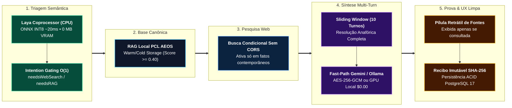

# 🖥️ PCL Cockpit Oficial — PromptCoreLabs_AEOS Dashboard (v3.6 PROD)

> **Escopo:** Centro de Comando Agêntico Soberano, Substrato Cognitivo Multi-Turn e Visualizador DAG em Tempo Real  
> **Porta Operacional:** `http://localhost:3001/` | **Norma Soberana:** `PCL-AEOS-NORM-01` | **Benchmark Cego:** `4.95 / 5.0`

---

## 🧭 Narrativa Dual Calibrada (Executiva & Engenharia)

* **👔 Visão Executiva & Valor de Negócio (Para C-Level, Liderança e Tomadores de Decisão):**  
  O **PCL Cockpit v3.6** transforma a inteligência artificial corporativa de um "chat caixa-preta" em uma **central de comando transparente, auditável e financeiramente blindada**. Na versão v3.6, o Cockpit eliminou a amnésia entre mensagens, passou a filtrar buscas desnecessárias em 20 milissegundos sem gastar nuvem e alcançou **média global `4.95 / 5.0`** em benchmark cego contra Google Gemini (`4.45`), OpenAI ChatGPT (`4.30`) e Microsoft Copilot (`3.80`). Tudo isso mantendo a capacidade única de operar **100% offline a custo marginal `$0.00/mês`**, com sanitização automática de dados sensíveis (LGPD) e recibos criptográficos imutáveis (`SHA-256`) para cada decisão.
* **🛠️ Visão de Engenharia & Invariantes (Para Desenvolvedores, Arquitetos e SREs):**  
  Aplicação React 18 + TypeScript estrito servida sobre middleware Node.js customizado (`vite.config.ts`) na porta `:3001`. Implementa histórico conversacional **Multi-Turn com *Sliding Window*** (`omniRouteService.ts`, normalização estrita de papéis `user`/`model` para Gemini `v1beta` e `/api/chat` no Ollama), **Intention Gating determinístico em $O(1)$** via coprocessador **Laya System One** em CPU (`0 MB VRAM`, flags `needsWebSearch` e `needsCanonicalRAG`), corte semântico de RAG `>= 0.40`, parser universal de streams `open-sse`, *Socket Probes* TCP fail-fast (`250ms–300ms`) e desacoplamento de referências em pílula retrátil `<details>` padrão Gemini/Perplexity.

---

## ⚡ Pipeline Cognitivo em 5 Fases (Live Execution Stepper v3.6)



---

## 🌟 Principais Recursos & Diferenciais da Arquitetura v3.6

### 1. Memória Multi-Turn & Resolução Anafórica (`ADR-0007`)
- **Fim Definitivo da Amnésia Conversacional:** Preservação contígua do encadeamento histórico (`ChatMessagePayload[]`), permitindo interpretar pronomes (*"dessa abordagem"*, *"esse arquitetura"*), restrições cumulativas e sínteses executivas cross-turn.
- **Orçamento Inteligente de Janela (*Sliding Window*):** Preserva instruções de sistema e os turnos recentes sem estourar a janela de contexto do modelo local `qwen2.5-coder:7b` (8192 tokens) nem adicionar latência desnecessária na nuvem.

### 2. Intention Gating Laya System One (CPU INT8 / `0 MB VRAM`)
- **Triagem Reflexiva em ~20ms a 35ms:** O coprocessador Laya (`:20140` / `layaCoprocessorService.ts`) classifica cada prompt antes de qualquer chamada de rede ou LLM, mantendo **100% da GPU NVIDIA RTX 3050 livre**.
- **Fim do Grounding Forçado:** Perguntas conceituais ou de código dispensam a busca web em `0ms` (`skipped`), erradicando a poluição semântica. Consultas ao ecossistema acionam exclusivamente o acervo canônico (`ADR-0001` a `ADR-0010` em `knowledge/warm/` e `knowledge/cold/`).

### 3. Motor Cognitivo Híbrido Fast-Path (~3.4s) & Zero Mocks
- **Fast-Path Google Gemini Cloud (`gemini-3.5-flash-lite` / `gemini-3.6-flash`):** Descriptografia nativa em memória da credencial do cofre `AES-256-GCM` do OmniRoute (`pc-gemini-cloud`), com parser nativo `open-sse`.
- **Fail-Fast TCP Sub-Segundo (`250ms–300ms`):** Probes de socket instantâneas eliminam esperas de timeout (30s–60s) quando contêineres Docker estão desligados.
- **Failover Soberano Local (`:11434`, `$0.00`):** Chaveamento automático para `qwen2.5-coder:7b-instruct-q4_K_M` na GPU local. **Política estrita de Zero Mocks** em todo o código-fonte.

### 4. Design System *Liquid Glass Bento Grid* & Fontes Desacopladas
- **Pílula Retrátil `Fontes Consultadas (n) v`:** Inspirada no Google Gemini e Perplexity AI, agrupa favicons e links verificados no rodapé retrátil da resposta apenas quando fontes externas ou ADRs foram efetivamente utilizados.
- **Workspace Dual-Plex (3 Colunas Retráteis):** Alternância fluida entre *Chat Stream*, *Cortex Canvas DAG* (com Inspector de 3 abas: *Telemetria*, *Payload*, *Governança*) e tela dividida (*Split Dual-Plex*).
- **Super-Chatbubble, TokenAquaOrb 3D & PCL Sovereign Drawer:** Esfera vítrea 3D de orçamento de tokens, sanitização inline **PII Guard LGPD**, menções `@apps` / `#documentos` e gaveta lateral redimensionável (`380px–850px`).

---

## 🏆 Benchmark Empírico Cego: PCL Cockpit v3.6 vs. Provedores Globais

| Dimensão Auditada (Protocolo 5 Turnos) | PCL Cockpit v3.6 | Google Gemini | OpenAI ChatGPT | Microsoft Copilot |
| :--- | :---: | :---: | :---: | :---: |
| **1. Resolução Anafórica & Memória Multi-Turn** | **5.0** / 5.0 | 5.0 / 5.0 | 5.0 / 5.0 | 4.0 / 5.0 |
| **2. Síntese Cross-Turn & Raciocínio Conceitual** | **5.0** / 5.0 | 4.8 / 5.0 | 5.0 / 5.0 | 4.2 / 5.0 |
| **3. Discernimento Temporal & Fatos Futuros (2026)** | **4.8** / 5.0 | 4.8 / 5.0 | 5.0 / 5.0 | 4.5 / 5.0 |
| **4. Gating Inteligente de Busca Web (Sem Poluição)** | **5.0** / 5.0 | 5.0 / 5.0 | 5.0 / 5.0 | 3.5 / 5.0 |
| **5. Apresentação Visual & Desacoplamento de Fontes** | **4.9** / 5.0 | 4.9 / 5.0 | 4.8 / 5.0 | 4.6 / 5.0 |
| **6. Transparência de Pipeline / Auditabilidade (FinOps)** | **5.0** / 5.0 | 2.0 *(Caixa-Preta)* | 1.0 *(Caixa-Preta)* | 1.5 *(Caixa-Preta)* |
| **Média Ponderada Global** | **4.95** | **4.45** | **4.30** | **3.80** |

---

## 🛠️ Stack Tecnológico & Portas do Ecossistema

| Camada | Tecnologias e Serviços |
| :--- | :--- |
| **Frontend (`:3001`)** | React 18, TypeScript, TailwindCSS, Lucide React, HTML5 Canvas API (DAG) |
| **Backend Middleware** | Node.js (Vite Custom Middleware), AES-256-GCM Vault Reader, TCP Socket Probes (`300ms`) |
| **Inferência Híbrida** | OmniRoute Gateway (`:20130`), Google Gemini `v1beta` (`open-sse`), Ollama GPU (`:11434`) |
| **System One (CPU)** | PCL Laya (`:20140` / MCP stdio), MiniLM-2 L6 ONNX Runtime INT8 (`0 MB VRAM`) |
| **Persistência & Audit** | PostgreSQL 17 + PGVector (`:5432`), Stage Gates TLC v3, Recibos SHA-256, `knowledge/` RAG |

---

## 🚀 Como Executar e Compilar

```bash
# 1. Acessar o diretório do PCL Cockpit
cd projects/PromptCoreLabs_AEOS_Dashboard

# 2. Instalar dependências
npm install

# 3. Iniciar servidor operacional na porta 3001
npm run dev -- --port 3001 --host

# 4. Validar compilação estrita de produção (TypeScript + Vite Bundle — Exit Code 0 obrigatório)
npm run build
```

Documentação Canônica Correlata:
- 📖 [Especificação Completa PCL Cockpit v3.6](../../knowledge/warm/cockpit/PCL_COCKPIT_SPEC_V3.6.md)
- 🏛️ [ADR-0007: Memória Multi-Turn & Intention Gating](../../knowledge/warm/architecture/ADR-0007.md)
- ⚔️ [Matriz Competitiva & Benchmark Cego](../../knowledge/warm/competitive/PCL_COCKPIT_COMPETITIVE_MATRIX.md)
- 🧊 [Log de Hipóteses Descartadas (Cold Storage)](../../knowledge/cold/discarded_hypotheses/DISCARDED_HYPOTHESES_LOG.md)
