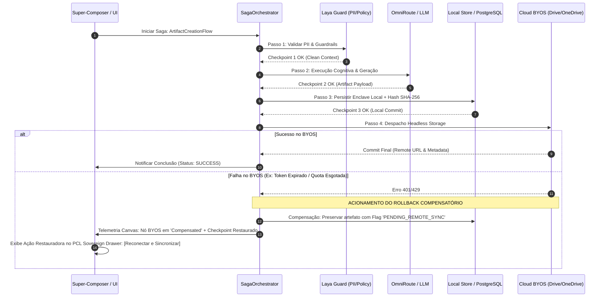
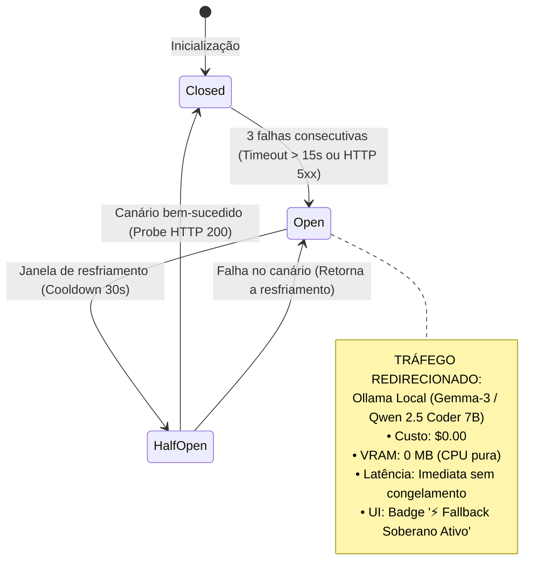
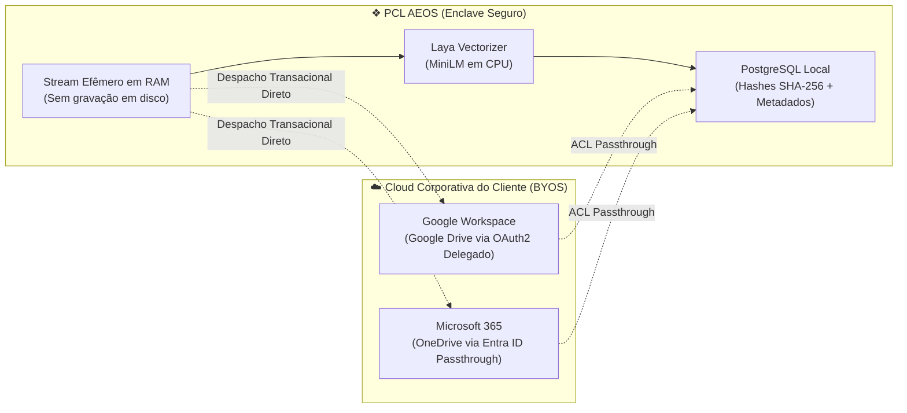

# 🏛️ System Design Document (SDD) — PCL AEOS v3.0.4 PROD
**PCL AEOS — Artificial Intelligence Engineering Operation System**  
**Subtítulo Oficial:** Cognitive Engineering Substrate  
*Documento de Design de Sistema e Arquitetura Técnica Detalhada*  
**Autor:** Eduardo Machado (Principal Systems & AI Architect | Founder, PromptCore Labs)  
**Co-Autor:** Antigravity IDE (Agentic Engineering Pair)  
**Versão Oficial:** v3.0.4 PROD  
**Design System Canônico:** `C:\PromptCore_Labs\legacy\liquid_glass_bento_grid_system.html`  
**Status:** Arquitetura Aprovada e Sincronizada  

---

## 1. Topologia Geral & Pilares de Engenharia

O **PCL AEOS (Artificial Intelligence Engineering Operation System — Cognitive Engineering Substrate)** é estruturado sobre o protocolo de desacoplamento soberano, garantindo que o usuário possua liberdade total para orquestrar e alternar entre nuvens proprietárias externas e infraestrutura local open-source via MCP, com 0 MB de dependência de GPU VRAM na camada base de governança.

```
┌──────────────────────────────────────────────────────────────────────────────────────────────┐
│                    CAMADA DE APRESENTAÇÃO: LIQUID GLASS BENTO GRID SYSTEM                    │
│   React 18 + TypeScript + Vite + TailwindCSS (Spatial Glass & Apple Aqua Morphic Tokens)      │
├───────────────────────────────┬───────────────────────────────┬──────────────────────────────┤
│ Left Utility Rail (64-260px)  │ Central Workspace (Dual-Plex) │ PCL Sovereign Drawer (Right) │
│ • Google Material Symbols     │ • Chat Stream (Editorial)     │ • Document In-Context Engine │
│ • Collapsible Flyouts         │ • Super-Composer + Aqua Orb   │ • Cortex Canvas DAG Live     │
│ • Squad Knowledge Spaces      │ • Splitter Resizável Drag     │ • Resizável 380px - 850px    │
└───────────────────────────────┴───────────────────────────────┴──────────────────────────────┘
                                                │
                                    (WebSocket / IPC Local)
                                                ▼
┌──────────────────────────────────────────────────────────────────────────────────────────────┐
│                              CAMADA DE GOVERNANÇA & ORQUESTRAÇÃO                              │
│ ┌───────────────────────────┐  ┌───────────────────────────┐  ┌────────────────────────────┐ │
│ │   OmniRoute Gateway       │  │ Laya Coprocessor (22ms)   │  │   Saga Orchestrator        │ │
│ │   Porta :20130 / MCP Hub  │  │ Non-autoregressive CPU    │  │   Distributed Compensation │ │
│ └───────────────────────────┘  └───────────────────────────┘  └────────────────────────────┘ │
│ ┌───────────────────────────┐  ┌───────────────────────────┐  ┌────────────────────────────┐ │
│ │   Idempotency Engine      │  │ Circuit Breaker Reactive  │  │   PII Guard LGPD Sanitizer │ │
│ │   SHA-256 Request Cache   │  │ External Cloud Isolation  │  │   Regex + Named Entity Filter  │ │
│ └───────────────────────────┘  └───────────────────────────┘  └────────────────────────────┘ │
└──────────────────────────────────────────────────────────────────────────────────────────────┘
                                                │
                                                ▼
┌──────────────────────────────────────────────────────────────────────────────────────────────┐
│                          CAMADA DE MEMÓRIA & CUSTÓDIA SOBERANA (BYOS)                         │
│ ┌─────────────────────────────┐ ┌─────────────────────────────┐ ┌──────────────────────────┐ │
│ │ Local Enclave (PostgreSQL)  │ │ PGVector + MiniLM Embeddings│ │ Google Workspace / M365  │ │
│ │ • SHA-256 Audit Immutability│ │ • Semantic Search (0 MB VRAM│ │ • Headless Storage (BYOS)│ │
│ │ • ISO 27001/42001 Logs      │ │ • Ephemeral Text Chunks     │ │ • ACL Passthrough & Auth │ │
│ └─────────────────────────────┘ └─────────────────────────────┘ └──────────────────────────┘ │
└──────────────────────────────────────────────────────────────────────────────────────────────┘
```

---

## 2. Design System Canônico: `liquid_glass_bento_grid_system.html`

O design system adotado como ponto de partida canônico é o especificado no arquivo de referência `C:\PromptCore_Labs\legacy\liquid_glass_bento_grid_system.html`, incorporando as seguintes classes e comportamentos físicos refinados:

### 2.1. Superfície dos Cartões Bento (`.liquid-glass-card`)
- Base: `backdrop-filter: blur(28px) saturate(210%)`.
- Bordas refrativas de alta definição:
  - Topo: `border-top: 1.5px solid rgba(255, 255, 255, 0.85)` (Light) / `rgba(255, 255, 255, 0.22)` (Dark).
  - Esquerda: `border-left: 1.5px solid rgba(255, 255, 255, 0.65)` (Light) / `rgba(255, 255, 255, 0.15)` (Dark).
  - Inset specular highlights: `inset 0 1px 2px rgba(255, 255, 255, 0.95)` para sensação de profundidade vítrea.
- **Atenuação de Rotação 3D**: O cálculo de inclinação do legado (que dividia por 45 e gerava inclinações de até 8°) é substituído por uma micro-elevação tátil estável (`translateY(-1.5px)` com rotação máxima de 1° a 1.5°), eliminando qualquer náusea visual.

### 2.2. Refração Dinâmica de Luz por Cursor
- Coordenadas do ponteiro injetadas globalmente em tempo real:
  ```css
  .liquid-glass-card::before {
    content: '';
    position: absolute;
    inset: 0;
    pointer-events: none;
    background: radial-gradient(
      550px circle at var(--mouse-x, 50%) var(--mouse-y, 50%),
      rgba(255, 255, 255, 0.08),
      transparent 50%
    );
    border-radius: inherit;
    z-index: 1;
  }
  ```

### 2.3. Chipset PCL Substrato
- Padrão vetorial sutil de trilhas de circuito impresso com 3% a 4% de opacidade no fundo do vidro, reagindo organicamente à passagem de luz.

---

## 3. Componentes Estruturais de Apresentação

### 3.1. PCL Sovereign Drawer (`PCLArtifactDrawer.tsx`)
- Substituição total da nomenclatura legada Bitrix.
- Painel lateral fixo sobreposto à margem direita com alça de redimensionamento (`col-resize`) entre 380px e 850px.
- Botões de controle explícitos: fechar `[×]`, recolher `[→]` e atalho global de teclado `Escape`.
- **Seletor de Modo Duplo**:
  - `Mode = 'document'`: Leitura, edição e despacho de artefatos.
  - `Mode = 'cortex'`: Alterna a visualização para o **Cortex Canvas DAG Live**, permitindo acompanhar o fluxo agêntico sem sair do chat.
- **Comportamento Mobile (< 768px)**: Abre como *Full-Screen Sheet* limpa com fechamento por gesto de arraste.

### 3.2. Cortex Canvas DAG Live Telemetry Engine (`CortexCanvas.tsx`)
- Renderização vetorial SVG de nós conectados por curvas de Bézier animadas com pulso esmeralda ativo.
- **Telemetria em Milissegundos**: Monitoramento de latência e contadores de cada nó da Cortex Engine.
- **Resguardo Superior Direito (`pr-14`)**: Garante resguardo de 56px para que o controle de zoom (`88%`) nunca colida com a aba recolhida de status.

### 3.3. Left Sidebar Tier 1 (Google Material Symbols)
- Eliminação total de siglas soltas (`CR`, `AR`, `DE`).
- Utilização dos ícones modernos do Google Fonts (*Material Symbols*):
  - 🏛️ `auto_stories` — Biblioteca de Conhecimento
  - 📁 `folder_open` — Projetos da Squad
  - 📄 `article` — Artefatos & Relatórios
  - ⚡ `psychology` — Agentes & Habilidades
  - 🔌 `extension` — Conexões & Plugins
- Colapso suave em 64px com *tooltips flutuantes instantâneos* de alto contraste.

### 3.4. Super-Composer com `TokenAquaOrb` (Física Apple OS X)
- Chips rápidos reposicionados **abaixo do campo de texto**.
- Esfera tridimensional vítrea (16px) com ponto de reflexo especular estilo Apple Aqua OS X.
- Morfismo no hover para figura oblonga (115px) exibindo `14.2k / 128k (11%)`.
- Keyframes de glow temporal dinâmico:
  - 🟡 Alerta (70% - 90%): Pulso suave oscilando a cada 5 segundos.
  - 🔴 Crítico (> 90%): Pulso crítico oscilando a cada 2 segundos.

---

## 4. Tríade de Resiliência Distribuída

O PCL AEOS implementa uma arquitetura de resiliência ativa em três camadas para garantir integridade transacional, tolerância a falhas distribuídas e continuidade operacional sem fricção.

```
┌────────────────────────────────────────────────────────────────────────────────────────┐
│                          TRÍADE DE RESILIÊNCIA PCL AEOS                                │
├──────────────────────────┬─────────────────────────────┬───────────────────────────────┤
│ 1. IDEMPOTÊNCIA          │ 2. SAGA PATTERN             │ 3. CIRCUIT BREAKER            │
│ SHA-256 Request Cache    │ Orquestração Compensatória  │ Tri-State Fallback Reativo    │
│ • Deduplicação de cliques│ • Transações distribuídas   │ • Closed / Open / Half-Open   │
│ • Resiliência WebSocket  │ • Rollback de checkpoints   │ • Fallback para Ollama Local  │
│ • TTL 15 min em LRU/RAM  │ • Telemetria DAG no Canvas  │ • $0.00 custo / 0 MB VRAM GPU │
└──────────────────────────┴─────────────────────────────┴───────────────────────────────┘
```

### 4.1. Camada 1: Idempotência Determinística (SHA-256 Token Cache)

#### 4.1.1. Formulação da Chave Criptográfica
Toda requisição gerada a partir da UI (envio no Super-Composer, clique em 'Gerar Artefato', despacho de pipeline) recebe uma chave de idempotência determinística calculada antes da transmissão de rede:

$$\text{IdempotencyKey} = \text{HMAC-SHA256}\left(\text{SessionID} \parallel \text{ActionType} \parallel \text{CanonicalPayload} \parallel \text{TimeWindow}_{10s}\right)$$

Onde:
- `SessionID`: UUID v4 da sessão ativa do usuário.
- `ActionType`: String canônica (ex: `ARTIFACT_GENERATE`, `CHAT_DISPATCH`, `NODE_RETRY`).
- `CanonicalPayload`: JSON ordenado lexicograficamente por chaves (evita divergências de serialização).
- `TimeWindow`: Timestamp arredondado para bloco temporal de 10 segundos (protege contra double-click e repetições involuntárias).

#### 4.1.2. Ciclo de Vida da Chave de Idempotência
1. **Interceptador de Requisição (`src/services/resilience/idempotencyManager.ts`)**:
   - Calcula a chave SHA-256 no cliente.
   - Verifica se a chave está em cache LRU local (`Map<string, RequestState>`) com TTL de 15 minutos.
2. **Estados da Chave**:
   - `PENDING`: Requisição em trânsito. Novas chamadas idênticas são anexadas como listeners ao Promise existente (evita duplicar requisições em rede).
   - `RESOLVED`: Retorna imediatamente o payload em cache sem tocar no backend ou nos agentes LLM.
   - `REJECTED`: Permite re-tentativa imediata mediante novo clique explícito ou após expiração do TTL de erro (30 segundos).

---

### 4.2. Camada 2: Saga Pattern com Orquestração Transacional e Rollback

#### 4.2.1. Topologia de Transações Distribuídas
A geração de artefatos corporativos e execução de pipelines no PCL AEOS envolve múltiplos nós distribuídos. A orquestração é centralizada no `SagaOrchestrator`:



#### 4.2.2. Ações Compensatórias Definidas
| Etapa Transacional | Ação Primária | Ação Compensatória em Caso de Falha |
| :--- | :--- | :--- |
| **Passo 1: Sanitização** | Tokenização e inspeção de dados confidenciais via Laya CPU. | Reverter buffer efêmero em RAM; expurgar memória imediatamente. |
| **Passo 2: Cognição** | Roteamento LLM via OmniRoute (Gemini / Anthropic / GPT-4o). | Registrar cancelamento sem cobrança de steps subsequentes; descartar rascunho parcial. |
| **Passo 3: Enclave Local** | Gravação local no PostgreSQL com hash de atestação SHA-256. | Manter registro sob status `UNCOMMITTED_LOCAL` para auditoria legível no TLC v3. |
| **Passo 4: Cloud BYOS** | Envio para Google Drive ou Microsoft OneDrive corporativo. | Manter arquivo seguro no Enclave Soberano; gerar link local e botão de retry em 1 clique. |

---

### 4.3. Camada 3: Circuit Breaker Reativo Tri-State com Fallback Soberano $0.00

#### 4.3.1. Máquina de Estados do Circuit Breaker
O Circuit Breaker monitora a disponibilidade de cada provedor de nuvem em tempo real (`src/services/resilience/circuitBreaker.ts`):



#### 4.3.2. Parâmetros de Calibração Operacional
- **Limiar de Falha (`failureThreshold`)**: 3 requisições consecutivas com erro 5xx ou timeout (> 15.000 ms).
- **Período de Resfriamento (`cooldownDuration`)**: 30 segundos.
- **Canário de Sondagem (`halfOpenProbes`)**: 1 requisição leve de teste para validação de recuperação do serviço upstream.
- **Transparência de UI**: O usuário nunca visualiza telas de erro de rede ("Network Error" ou tela branca). Em estado `OPEN`, a interface exibe uma badge sutil translúcida:
  $$\text{Badge} = \text{"⚡ Fallback Soberano em CPU Ativo • 0.00 USD • Operação Ininterrupta"}$$

---

## 5. Headless Storage / Bring Your Own Storage (BYOS)

O PCL AEOS adota a arquitetura de **Zero-Bin Custody**: a plataforma gerencia a inteligência, o ciclo de vida dos documentos e a atestação criptográfica, enquanto a custódia física dos arquivos reside no repositório de nuvem corporativa do cliente.



### 5.1. Fluxo de Ingestão Efêmera (Zero-Bin Ingestion)
1. **Streaming em RAM**: O arquivo enviado pelo usuário é lido em chunks de memória volátil (buffer efêmero).
2. **Extração e Vetorização**: O coprocessador Laya extrai o texto e gera embeddings semânticos via `all-MiniLM-L6-v2` em CPU.
3. **Expurgo de Memória**: O binário bruto é descartado da RAM imediatamente após a geração do hash SHA-256 e da atestação.
4. **Governança**: No PostgreSQL do PCL AEOS são armazenados unicamente:
   - Hash SHA-256 de autenticidade documental.
   - Embeddings semânticos para pesquisa vetorial e RAG contextual.
   - URI do ponteiro corporativo (`gdrive://...` ou `onedrive://...`).
   - Identificador de auditoria TLC v3.

### 5.2. Despacho e Sincronização no PCL Sovereign Drawer
No drawer lateral, cada artefato apresenta:
- Indicador de status de custódia: `☁️ Custódia: Google Drive Corporativo (TI-Finanças)`.
- Botões de despacho de 1 clique:
  - `[Salvar no Google Drive]` / `[Salvar no OneDrive]`.
  - `[Abrir no Google Docs ↗]` / `[Abrir no Word Online ↗]`.
  - `[Atestação Criptográfica SHA-256]`.

---

## 6. Substrato de Inferência Híbrida & Grounding Inteligente (v3.5)

O PCL AEOS Dashboard v3.5 integra um middleware backend Node.js (`pclAeosBackendPlugin` em `vite.config.ts`) que orquestra três rotas concorrentes com failover determinístico e fail-fast sub-segundo:

```
┌─────────────────────────────────────────────────────────────────────────────┐
│                 SUPER-COMPOSER / CONSOLE DE ORQUESTRAÇÃO PCL                │
└──────────────────────────────────────┬──────────────────────────────────────┘
                                       │
                               POST /api/aeos/infer
                                       │
           ┌───────────────────────────┴───────────────────────────┐
           ▼                                                       ▼
┌────────────────────────────────────┐          ┌─────────────────────────────┐
│ ROTA 1: Fast-Path Cloud Gemini     │          │ ROTA 3: Soberano Local      │
│ • gemini-3.5-flash-lite (~3.4s)    │          │ • Ollama :11434 (Local GPU) │
│ • gemini-3.6-flash                 │          │ • qwen2.5-coder:7b          │
│ • Cofre AES-256-GCM em memória     │          │ • Custo $0.00 / 0 Cloud     │
└─────────────────┬──────────────────┘          └──────────────┬──────────────┘
                  │ (fail-fast 300ms)                          │
                  ▼                                            │
┌────────────────────────────────────┐                         │
│ ROTA 2: OmniRoute Gateway (:20130) │                         │
│ • Stream SSE Nativo (open-sse)     │                         │
│ • Combos Multi-Provedor            │                         │
└─────────────────┬──────────────────┘                         │
                  │ (se offline / fallback)                    │
                  └────────────────────────────────────────────┘
```

### 6.1. Regras de Grounding Híbrido Federado
1. **Consultas Gerais de Tecnologia & Mercado:** Respostas naturais, completas e estruturadas em tabelas Markdown, sem forçar jargões internos do PCL AEOS.
2. **Consultas Canônicas PCL AEOS:** Injeção estrita de especificações (`ADR-0001` a `ADR-0005`) unicamente quando o usuário menciona explicitamente termos corporativos (`PCL`, `AEOS`, `ADR`) ou aciona `#documentos`.
3. **Busca Web Sem Restrições de CORS:** O endpoint `/api/aeos/search` consulta APIs acadêmicas e Wikipedia em paralelo no Node.js, retornando fontes reais e verificadas.


