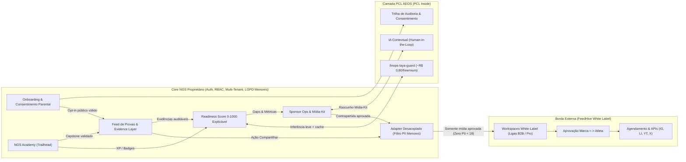

# Arquitetura Híbrida: FeedHive White Label + Core NGS Proprietário + Camada PCL AEOS

**Versão:** 1.0.0  
**Data:** 2026-11-20  
**Responsável:** Cortex Platform (Plataforma, Arquitetura, RAG & Memória Portável — PromptCore Labs)  
**Referências Vinculantes:**
- `.specs/specify.md` (Especificação Canônica Full SDD — Gate G-00)
- `brand/ANALISE_UX_GAP_FEEDHIVE.md` (Gap UX & 5 Telas Core)
- `qa/PARECER_COMPLIANCE_LGPD_PI.md` (Blindagem LGPD Menores, CVM/AML, DPA FeedHive)
- `finops/MODELAGEM_TCO_3_CENARIOS.md` (Decisão EBITDA Shield — Cenário B Híbrido)

---

## 1. Tese Arquitetural e Justificativa do Cenário B (Híbrido)

O **Next Gen Sports (NGS)** opera sob o **Cenário B (Híbrido)**, separando rigorosamente o **núcleo de rede social especializada e inteligência esportiva (100% proprietário)** da **borda de distribuição externa e Content Ops (terceirizada via FeedHive White Label)**:

- **Por que não Cenário A (FeedHive Puro)?** O FeedHive é uma ferramenta B2B de agendamento e publicação para redes de terceiros (Instagram, LinkedIn, YouTube, X), não uma rede social proprietária. Possui teto de `100 workspaces` / `500 contas sociais`, inviabiliza contas Freemium em escala e não oferece `Readiness Score`, `Proof of Talent`, `NGS Academy` ou grafo social próprio.
- **Por que não Cenário C (Build 100% Próprio)?** Desenvolver e manter integrações OAuth voláteis, aprovação de apps (Meta/X/LinkedIn) e filas de publicação desde o dia 1 eleva o CAPEX em **`+R$ 77.500`** (`R$ 147.000` vs. `R$ 69.500`) e o OPEX total em **`+R$ 5.146/mês`**, atrasando o *time-to-market* em 3 a 4 meses sem agregar diferenciação ao *Oceano Azul* da NGS.
- **Resultado do Cenário B:** Preserva 100% da propriedade intelectual, dados de atletas e efeito de rede dentro da infraestrutura NGS/PCL, enquanto acelera a entrega de valor de mídia para Ligas B2B e Patrocinadores.

---

## 2. Matriz de Capacidades (3 Camadas)

| Capacidade / Domínio | Core NGS Proprietário | FeedHive White Label (Borda Externa) | Camada PCL AEOS (`PCL Inside`) |
|---|---|---|---|
| **Identidade, Auth, RBAC & Multi-Tenancy** | **Responsável integral.** Gestão de contas, tenants (Ligas), papéis e segregação de dados. | Apenas workspaces espelhados para Ligas B2B / Atletas Pro adultos autorizados. | Governança de políticas e auditoria de acesso. |
| **Onboarding & Consentimento Parental (LGPD Art. 14)** | **Responsável integral.** Verificação de responsável (< 18 anos), *Privacy by Default*, revogação/expurgo. | **Proibido.** Nunca recebe dados cadastrais ou fluxos de menores. | Registro imutável de trilha de consentimento. |
| **Feed de Provas & Conquistas (*Proof of Talent*)** | **Responsável integral.** Feed interno mobile-first, reações técnicas, filtros por modalidade e `Evidence Layer`. | **Não possui.** Recebe apenas solicitação de publicação externa quando acionado pelo usuário. | Moderação assistida e indexação semântica futura. |
| **`Readiness Score 0–1000` Explicável** | **Responsável integral.** Cálculo nos 5 pilares, histórico longitudinal e exibição de evidências (Art. 20 LGPD). | **Não possui.** | Motor de inferência leve sob `finops-laya-guard` + cache. |
| **`NGS Academy` (Trilhas, XP, Badges, Patentes)** | **Responsável integral.** Catálogo estilo Trailhead, quizzes, upload de Capstones e progressão. | **Não possui.** | Geração assistida de feedback educativo (adultos/coordenadores). |
| **`Talent Network` & `Sponsor Ops` (CRM + Mídia-Kit)** | **Responsável integral.** Scouting por evidências, funil Kanban de patrocínio e geração de Mídia-Kit Dinâmico. | Executa apenas o **fluxo de aprovação e agendamento de posts** de contrapartida em redes externas. | Engine de geração de Mídia-Kit e *Neural Briefings* (*human-in-the-loop*). |
| **Agendamento, Reciclagem & Publicação Social Externa** | Mantém apenas **Adapter Desacoplado** (envia payload de mídia aprovada e recebe status/métricas agregadas). | **Responsável integral.** Composer, reciclagem com IA, calendário e APIs de IG, LinkedIn, YouTube e X. | Telemetria de custo e conversão do *Growth Loop*. |

---

## 3. Fronteiras de Dados e Blindagem Regulatória (LGPD Menores & Anti-Lock-in)

### 3.1 Classificação de Dados e Regra de Fronteira
1. **Dados Proibidos no MVP (Bloqueio na Ingestão):** Dados biométricos, frequência cardíaca, sono, saúde ou *wearables* (Art. 5º, II e Art. 11 LGPD) — bloqueados tanto no Core NGS quanto na borda.
2. **Dados Críticos Restritos ao Core NGS (Nunca saem para o FeedHive):**
   - Qualquer dado pessoal, documento, CPF, e-mail, localização ou histórico bruto de **atletas menores de 18 anos**;
   - Registros de verificação parental e termos de consentimento;
   - Base completa do `Evidence Layer`, logs brutos de telemetria e decomposição interna do `Readiness Score`.
3. **Dados Autorizados a Trafegar para a Borda (FeedHive White Label):**
   - Exclusivamente **peças de mídia finalizadas** (imagem/card de conquista, vídeo curto ou texto de ativação) **previamente aprovadas** pelo atleta adulto ou pelo responsável legal (no caso de destaque de liga envolvendo menor, somente após aprovação expressa e sem exposição de PII sensível);
   - Identificador opaco de workspace (`tenant_external_id`) vinculado à Liga B2B ou Atleta Pro adulto.

### 3.2 Salvaguardas Contratuais e Operacionais (Suboperador Internacional)
- **DPA Obrigatório:** Formalizar *Data Processing Addendum* compatível com o Art. 33 da LGPD e a **Resolução CD/ANPD nº 19/2024** (transferência internacional de dados).
- **Propriedade e Não-Treinamento:** Cláusula expressa garantindo propriedade integral dos conteúdos pela NGS/usuários e proibição de uso de ativos da base NGS para treinamento de modelos de IA do fornecedor.
- **Limitação de SLA:** Contratos B2B com Ligas e Patrocinadores devem desvincular o SLA da NGS de eventuais instabilidades das APIs externas (Meta/X/LinkedIn/YouTube).
- **Camada Anti-Lock-in & Gatilho de Saída:** O Core NGS comunica-se com o FeedHive exclusivamente via `ExternalDistributionPort` (interface interna desacoplada). Ao atingir **80 a 100 Ligas B2B ativas**, avalia-se a substituição do adapter por motor próprio sem impacto no banco de dados ou na experiência interna do atleta.

---

## 4. Fluxo de Dados e Topologia Híbrida

---

## 5. Fluxos Operacionais Críticos (Ponta a Ponta)

1. **Fluxo A — Publicação de Prova no Core → Distribuição Externa:**
   1. Atleta registra evidência (ex.: conclusão de trilha ou tempo de pista) no **Core NGS**; o registro entra no `Evidence Layer` e atualiza o `Readiness Score 0–1000`.
   2. Caso o atleta (adulto ou com aprovação parental registrada) clique em *"Compartilhar nas redes"*, o `Adapter Desacoplado` gera um pacote apenas com a arte/texto aprovado (sem PII sensível).
   3. O payload é enviado ao workspace da Liga/Atleta Pro no **FeedHive White Label**, passa pelo fluxo de aprovação (se for contrapartida de patrocinador no `Sponsor Ops`) e é agendado para redes externas.
2. **Fluxo B — Proteção de Menores (< 18 anos) na Fronteira:**
   1. No onboarding, a data de nascimento aciona o bloqueio automático *Privacy by Default* (perfil oculto na `Talent Network`).
   2. A liberação de visibilidade exige verificação do responsável legal registrada na trilha de auditoria da camada **PCL AEOS**.
   3. O `Adapter Desacoplado` bloqueia por regra de domínio qualquer envio automático de dados cadastrais ou evidências brutas de contas `< 18` para o ambiente externo do FeedHive.
3. **Fluxo C — Governança de Custo de IA (`finops-laya-guard`):**
   1. Atualizações de `Readiness Score` priorizam regras determinísticas sobre os 5 pilares; chamadas a LLM ocorrem apenas para síntese textual de *Mídia-Kit* ou explicação de gaps com **cache por janela** e teto por usuário Freemium (`~R$ 0,80/atleta/mês`).
