# Genealogia das Ideias & Conexões Invisíveis — Next Gen Sports (NGS)

> **Status:** Versão 2.0 (Consolidada — Arqueologia Profunda Completa)  
> **Responsável:** Lucca (Orquestrador Estratégico / Cérebro) com aportes de Arthur, Cortex Platform, Pulse Brand e Builder UI  
> **Regra de Ouro:** *Excesso de contexto é preferível à perda de contexto.* Nenhum conceito foi descartado; todas as peças foram preservadas com sua origem, motivação e conexão causal para validação no `qa/GRILL_ME_EDUARDO.md`.

---

## 1. Linha de Evolução Causal (Os 8 Elos da História)

```mermaid
flowchart LR
    E1["1. Semente: Vono NGS<br/>(Atleta-Sistemas & Mídia Viva)"] --> E2["2. Dor Real na Pista<br/>(Folha de Tempos KDB Interlagos)"]
    E2 --> E3["3. Telemetry Hub Agnóstico<br/>(Ingestão Multi-Fonte como Isca PLG)"]
    E3 --> E4["4. Wearables & ICTs<br/>(Meia Inteligente / Inova USCS / SENAI)"]
    E4 --> E5["5. Digital Twin & Readiness<br/>(Curva WOW + LMS Trailhead)"]
    E5 --> E6["6. Network + Marketplace<br/>(Estilo Fiverr Curado + White Label Ligas)"]
    E6 --> E7["7. Governança PCL & Equity<br/>(Guardião EBITDA + Equity Hub + Piloto ABC)"]
    E7 --> E8["8. Direcionamento Atual<br/>(Rede Social Especializada + FeedHive WL)"]
```

---

## 2. Detalhamento dos Elos & Evidências Reais

### Elo 1 — A Semente: *Vono NextGen Sports* e o Conceito de "Mídia Viva"
- **Evidência:** [PROJETO IDEAÇÃO.docx](file:///C:/Users/eduma/Downloads/Edu%20Organizar/00%20-%20%20PromptCore%20Labs%20Projetos%202026/05%20-%20Estudos/Organizar/PROJETO%20IDEAÇÃO.docx), [ANÁLISE ESTRATÉGICA DO PROJETO.docx](file:///C:/Users/eduma/Downloads/Edu%20Organizar/00%20-%20%20PromptCore%20Labs%20Projetos%202026/05%20-%20Estudos/Organizar/ANÁLISE%20ESTRATÉGICA%20DO%20PROJETO.docx), `discovery/02-notebooklm/07_vono_ngs_v1.md`.
- **Por que nasceu:** Centrado no piloto **Arthur Vono** (16 anos, ETEC Desenvolvimento de Sistemas, >3.000h em simuladores + kart/turismo, Rotary/Interact).
- **Conceito-chave:** Romper com o patrocínio passivo ("adesivo no carro") e transformar o atleta em **Mídia Viva** — hub dinâmico de marketing com narrativa autêntica e ROI baseado em dados.
- **Evolução:** Escalar esse modelo para qualquer talento criou a tese da **Camada Pré-Academia (Pre-Academy Layer)** e do *"Proof of Talent"*: transformar potencial invisível em trajetória comprovável e auditável.

### Elo 2 — A Dor Real na Pista: Folhas de Tempo de Endurance (KDB Interlagos)
- **Evidências:** [04 - Folhas de tempo](file:///C:/Users/eduma/Downloads/Edu%20Organizar/00%20-%20%20PromptCore%20Labs%20Projetos%202026/05%20-%20Estudos/04%20-%20Folhas%20de%20tempo) (`022 - Digital Twin Driver - Gráfico Lap to Lap - Endurance (exemplo 2 pilotos).jpeg`, `15.03 volta a volta kdb.pdf`), `06 - Mockup NGS\09b - Race Lap Chart.png` (*KDB DESAFIO*, 18 voltas, 11 pilotos).
- **Por que nasceu:** Em provas reais de endurance de kart em Interlagos (Arthur Vono #14 vs. Alexandre Botti #6, *Stints 1/2*, *Pit Stops* V19/V26), os dados ficavam presos em PDFs e folhas de cronometragem estáticas. Plotar velocidade média volta a volta revelou consistência, ritmo, recuperação pós-pit e tomada de decisão.
- **Conexão técnica (`Cortex Platform`):** Esse exercício real originou o pipeline **OCR/PDF → Base Estruturada → Insights de IA** e a lógica PLG já testada no `telemetry_simulator.py` legado: leitura gratuita de consistência → gatilho de upsell (*"Quer ver sua telemetria volta a volta com análise de IA?"*) → conexão direta com módulos do LMS.

### Elo 3 — *Telemetry Hub* Agnóstico & Ecossistema Baseado em Aplicativos (Motor PLG)
- **Evidências:** [Data Input.png](file:///C:/Users/eduma/Downloads/Edu%20Organizar/00%20-%20%20PromptCore%20Labs%20Projetos%202026/05%20-%20Estudos/01%20-%20Telemetry%20Hub/Data%20Input.png), `01 - Diagrams Pitch-Deck\05 - Telemetry Hub.png`, `CONEXOES_TECNICAS_ARQUEOLOGIA.md`.
- **Por que nasceu:** A NGS nunca quis competir com Strava, Garmin, RaceChrono, MyLaps ou Apple Health. O posicionamento **Oceano Azul** é atuar como **middleware agnóstico de inteligência acima dos aplicativos existentes**:
  - **Ingestão Multi-Fonte:** absorve dados estruturados e não estruturados de **Software & Apps** (`Dragy`, `HotLap.app`, `Race Studio`, `Lap Snap`, `DoChron`), **Hardware Tradicional** (`ADA Pro`, `Alfano`, `Mychron`, `AIM Race Studio 3`), PDFs de tempos e vídeos onboard, traduzindo tudo para um **contrato único de dados estruturados**.
  - **Contextualização & Correlação:** cruza performance × formação (`NGS Academy`) × consistência × carreira para gerar insights acionáveis — funcionando como **isca gratuita (PLG)** rumo aos planos pagos e serviços.

### Elo 4 — *Wearables* (Meia Inteligente) + Inova USCS + SENAI Têxtil & Indústria 4.0
- **Evidências:** [03 - Wearables\01.jpeg](file:///C:/Users/eduma/Downloads/Edu%20Organizar/00%20-%20%20PromptCore%20Labs%20Projetos%202026/05%20-%20Estudos/03%20-%20Wearables/01.jpeg), `TelemetryHub_Track_Intelligence & Diital Twin Driver.pptx` (slide 2), `discovery/03-chatgpt-gemini/03_chatgpt_meia_inteligente_uscs_senai.md`.
- **Conexão invisível completa:**
  - **Problema físico:** Em karts alugados ou categorias de entrada, o piloto não pode furar/instalar sensores nos pedais do chassi.
  - **Solução embrionária (Benchmark: *Sensoria Fitness*):** Meia inteligente com material condutivo na **própria trama do tecido**, ligando sensores na **planta do pé** a um módulo eletrônico no tornozelo que transmite dados de pressão plantar (inputs exatos de frenagem e aceleração/*footwork*).
  - **Tríplice narrativa & ICTs:** Conversas com **Inova USCS** (convênio com **SENAI Robótica/Indústria 4.0** para firmware/eletrônica + **SENAI Têxtil** para conforto, lavabilidade e fibras condutivas) cobrindo 3 frentes: *(1) Performance esportiva multiesporte, (2) Saúde/reabilitação (inclusive Anvisa / trombose) e (3) Telemetria automotiva/sim racing*.
  - **Impacto em PI & Fomento:** No Brasil (LPI), software puro não é patenteável; esse acoplamento físico/têxtil sustenta uma eventual **Patente de Modelo de Utilidade** e qualifica para editais de subvenção (FINEP, FAPESP PIPE, EMBRAPII, Pulsar Expo IPT).

### Elo 5 — *Digital Twin Driver*, Curva Emocional WOW & *NGS Academy (Trailhead)*
- **Evidências:** `INVENTARIO_VISUAL_MOCKUPS.md` (`06 - Digital Twin Driver.png`, `02_11_17 (3).png`, `008/011/012 - NGS Academy/Trailhead.png`), `PromptCore Labs - Engine as a Service.png`.
- **Conexão:** O *Digital Twin* gera o **"Momento WOW"** da Curva Emocional (`Curioso → Interessado → Encantado [WOW] → Motivado → Confidente → Realizado`), convertendo o atleta para o **LMS Gamificado estilo Trailhead** (5 pilares de badges, capstones e `Badge Sponsor Ready`), que por sua vez alimenta o **Readiness Score** e desbloqueia o mercado.
- **Tensão aberta:** Escala do `Readiness Score` (`0–100` nos mockups de Portal/Talent Network vs. `0–1000` na Academy e Token Hub) e nome do gêmeo (`Digital Twin Driver` vs. `Digital Twin Athlete`).

### Elo 6 — *Network* + *Marketplace* Estilo Fiverr + *White Label* para Ligas
- **Evidências:** `04 - Benchmark\Benchmark MarketPlace Fiverr` (`NextGen Sports - Mockup do MarketPlace - benchmark Fiverr.docx`, `Mockup das funções de Network`), `05 - Estudos\Workflow\White Label R&D\MindMap do Mapa de Navegação Completo.png`, `06 - Mockup NGS\06 - Commerce Hub.png`, `10 - Admin Panel & White-Label.png`.
- **Conexão:** O atleta que entra pela isca PLG constrói reputação verificável na rede e contrata serviços curados (coaches, mecânicos, fisio, mídia) no **Marketplace acoplado** (superando a guerra de preços do Fiverr). Paralelamente, a camada **White Label para Ligas** (`/pilot`, `/operator`, `/admin`, `/corporate`) reduz o CAC em massa trazendo ligas inteiras com tematização própria (`CRM Liga v1–v4`).

### Elo 7 — Governança Econômica (*Guardião EBITDA*), *Equity Hub* & Identidade Visual (*SAGA* vs. *NGS*)
- **Evidências:** `INVENTARIO_VISUAL_MOCKUPS.md` (Seção 3: `03 - Estruturação do Projeto`) e `INVENTARIO_VISUAL_BRANDING_NGS.md` (Seções 1–5).
- **Achados críticos antes ocultos:**
  - **Guardião EBITDA & EBITDA Shield:** Arquitetura econômica separando **Infra Open Source + Edge/Local** (para IA básica/aquisição) da **Camada Premium** (OpenAI/Anthropic/Google só quando gera ARPU/diferenciação).
  - **NGS Equity Hub & Política de Equity:** Proteção de cap table (`MOU/Piloto → Revenue Share → Advisor Vesting → Equity Estratégico`), com **Piloto Santo André / ABC** dimensionado em `2–3 ligas/escolas`, `100–300 atletas`, `1 dashboard executivo`, `1 trilha`, `1 relatório de impacto`.
  - **Evolução de Marca & Arquétipos:** Estudo profundo de 11+ variantes emocionais (*Confiança Analítica v06*, *Inovação v07*, *Energia v08*, *Humanidade v09*, *Poder v10*, *Prestígio Roxo v11 + Pantone + Powered by PromptCore Labs*) e marca paralela **`SAGA — Ecossistema Esportivo ("Do Potencial à Oportunidade")`**.
  - **Subsídio Cruzado & Camada Institucional:** Receitas B2B/Premium/Marketplace subsidiando atletas de baixa renda; futuro `Token/Capital Hub` e `Impact/Incentive OS` (LIE).

### Elo 8 — Editais, Parceiros & Direcionamento Atual (Rede Social + *FeedHive White Label*)
- **Evidências:** `06 - Editais` (`Regulamento Pulsar Expo IPT.pdf`, artigo `CaptSe` UNIFESP/PIT SJC), `Parceiros` (`Apresentação_Comercial_People2Biz_Maio2026.pdf`), `ANALISE_UX_GAP_FEEDHIVE.md`.
- **Conexão:** O direcionamento mais recente do Eduardo aponta para consolidar o NGS como **rede social especializada**, avaliando o **FeedHive White Label** (Agency ~US$ 299/mês, 100 workspaces). A arqueologia mostra que o FeedHive cobre com excelência a **saída** (distribuição externa multicanal para atletas e ligas), enquanto a essência insubstituível do **Core NGS** está na **entrada/correlação multi-fonte** (Telemetry Hub + Proof of Talent + Readiness Score + Feed interno).

---

## 3. Pendências Restantes (Se Houver)
- [ ] Incorporar eventual delta de dumps adicionais de ChatGPT (`Classes de Proteção Intelectual`, `Drax Sports & Amica`) e Gemini (`Podcast NGS`) caso ainda não tenham sido transcritos em `discovery/03-chatgpt-gemini/`.
- [ ] Realizar a sessão **Grill-Me** com o Eduardo usando `qa/GRILL_ME_EDUARDO.md` antes de descongelar `.specs/specify.md`.
