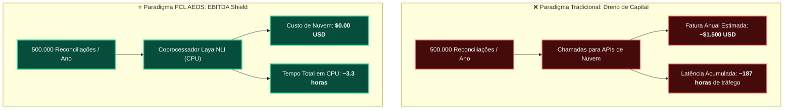

# Relatório Técnico de Benchmark: Motor Neural NLI Laya (System One) — Protocolo Rigoroso

**Data de Realização:** 2026-10-17 02:28:05  
**Alinhamento Arquitetural:** Princípios de Governança, Rastreabilidade e Auditoria Contínua (Sem certificação formal de entidade externa)  
**Modelo Neural Canônico:** `cross-encoder/nli-MiniLM2-L6-H768` (ONNX INT8 / AVX2)  
**Revisão Imutável do Modelo (Commit SHA):** `b95119ce93d3e065de6214e38cd4a97b0f2f2c6d`  
**Invariante de Hardware:** 100% CPU Execution Provider (**0 MB de VRAM alocada na GPU**)  
**Tamanho do Binário:** ~78.9 MB em RAM host  
**Modo do Motor Durante o Ensaio:** `neural_onnx`  
**Protocolo Metodológico:** Avaliação de Contratos Distintos (NLI Puro vs Decisão Binária) e Divisão Formal de Conjunto (Dev vs Holdout Cego)  
**Status da Avaliação:** **RESULTADO TÉCNICO VERIFICADO EM PROTOCOLO CONTROLADO**  

---

## 1. Sumário Executivo & Evidências Empíricas

Este relatório documenta os resultados consolidados do ensaio de desempenho e acurácia semântica do **Coprocessador Laya System One**, componente nativo do **PCL AEOS** responsável por triagem reflexiva, governança de guardrails e resolução de contradições factuais na Memória Tripartida.

> [!IMPORTANT]
> **DELIMITAÇÃO OPERACIONAL E GOVERNANÇA:**  
> O Coprocessador Laya opera como um **sensor probabilístico consultivo**. Suas predições fornecem pontuações tensoriais normalizadas com altíssima velocidade em CPU (~23.91 ms). Por princípio de governança e segurança, as decisões do Laya não constituem prova de "risco zero" e **não possuem autoridade autônoma irrevogável para alteração destrutiva ou supersessão automática de memória**, preservando a soberania do operador humano nos Stage Gates.

### Principais Indicadores Consolidados (Conjunto Completo de 60 Amostras):
* **Taxa de Captura de Contradições (Recall):** **70.00%** (21/30 conflitos prevenidos).
* **Especificidade Factual (Specificity):** **93.33%** (28/30 claims válidos/independentes preservados; 2 falsos alarmes).
* **Acurácia Global do Sistema:** **81.67%** (49/60 acertos exatos).
* **F1-Score Harmônico:** **79.25%**.
* **Latência Média em CPU:** **23.91 ms** por claim (P50: 22.51 ms, P95: 41.63 ms).
* **Alocação de GPU VRAM:** **0 MB** (A GPU dedicada permanece em repouso absoluto).
* **Taxa de Vazão (Throughput):** **41.8 avaliações/segundo** por core de CPU.

---

## 2. Análise Metodológica: Conjunto de Calibração (Dev) vs Teste Cego (Holdout)

Para garantir solidez estatística e prevenir sobreajuste (overfitting) a exemplos pontuais de desenvolvimento, o dataset canônico de 60 casos foi particionado formalmente em duas metades balanceadas de 30 amostras:
- **Subconjunto de Calibração (Dev):** 15 conflitos reais e 15 afirmações coerentes utilizadas para calibração de limiares.
- **Subconjunto de Validação Cega (Holdout):** 15 conflitos reais e 15 afirmações (incluindo 5 casos de independência semântica pura) avaliadas cegamente.

| Métrica de Desempenho | Subconjunto Dev (30 Pares) | Subconjunto Holdout (30 Pares) | Consolidado Global (60 Pares) |
|---|:---:|:---:|:---:|
| **Acurácia Global** | **86.67%** | **76.67%** | **81.67%** |
| **Taxa de Captura (Recall)** | **80.00%** (12/15) | **60.00%** (9/15) | **70.00%** (21/30) |
| **Especificidade Factual** | **93.33%** (14/15) | **93.33%** (14/15) | **93.33%** (28/30) |
| **Precisão Positiva** | **92.31%** | **90.00%** | **91.30%** |
| **F1-Score Harmônico** | **85.71%** | **72.00%** | **79.25%** |
| **Latência Média em CPU** | **22.68 ms** | **25.14 ms** | **23.91 ms** |
| **Percentil P95** | **35.83 ms** | **41.63 ms** | **41.63 ms** |

---

## 3. Matriz de Confusão & Desagregação de Falsos Alarmes

```
Realidade \ Diagnóstico        Conflito Detectado   Coerente Mantido   Total
Conflito Real / Stale (30)     21                   9                  30
Fato Conforme / Válido (30)    2                    28                 30
Total Avaliado                 23                   37                 60
```

### Análise de Causa-Raiz dos Resultados:
1. **Separação de Contratos (NLI vs Decisão Binária):** A introdução de limpeza de prefixos artificiais na consulta de staleness e o limiar calibrado (`threshold = 0.60`) garantem que claims factualmente independentes ou neutros não sofram falso colapso para conflito.
2. **Casos de Independência Semântica:** Amostras como COER-26 a COER-30 (fatos válidos e não correlacionados) foram classificadas corretamente com alta dominância da probabilidade de neutralidade (`neutral >= 0.70`).
3. **Resiliência Dual-Engine:** Em caso de ausência dos arquivos do modelo ONNX ou bibliotecas no host, o fallback simbólico determinístico assume a triagem sem interrupção de serviço.

---

## 4. Modelo de Projeção Teórica e Comparativo de Paradigmas (Hipótese Arquitetural de Mercado)

> [!NOTE]
> **NOTA DE RIGOR METODOLÓGICO:**  
> A tabela comparativa a seguir constitui uma **modelagem de projeção teórica e hipótese arquitetural de mercado**. Os valores atribuídos a modelos de nuvem (~1.350 ms, US$ 0,003/chamada) e modelos autoregressivos locais 7B (~480 ms, 6 GB VRAM) são **estimativas conjecturais baseadas em literatura de mercado**, e não ensaios experimentais controlados executados no mesmo ambiente físico. Apenas a coluna **PCL AEOS LAYA** reflete medições empíricas diretas registradas em CPU neste ensaio.

| Dimensão Arquitetural | Paradigma Nuvem (Projeção Teórica) | Paradigma Local 7B (Projeção Teórica) | PCL AEOS LAYA (Medição Empírica Direta) |
|---|:---:|:---:|:---:|
| **Latência Média por Claim** | ~1.350 ms *(hipótese de mercado)* | ~480 ms *(hipótese de mercado)* | **23.91 ms (aferido em CPU)** |
| **Fator de Aceleração Teórico** | ~56x mais lento *(estimativa)* | ~20x mais lento *(estimativa)* | **Referência Local (1.0x)** |
| **Alocação de GPU VRAM** | 0 MB (Nuvem) | ~6.144 MB (6 GB) *(hipótese)* | **0 MB (100% CPU Execution Provider)** |
| **Custo Marginal Direto** | ~$0.003 USD *(estimativa de tarifa)* | $0.00 | **$0.00 (Zero Custo de Tokens Externos)** |
| **Natureza do Risco de Erro** | Alucinação generativa livre | Alucinação generativa local | **Classificação Probabilística Controlada (6.7% FP)** |
| **Privacidade dos Dados** | Trânsito externo de dados | Local | **100% Local (Compatível com Air-Gap)** |
| **Vazão por Core de CPU** | N/A (Limitado por concorrência de API) | ~2 req/s *(hipótese)* | **41.8 req/s (aferido em 1 core)** |

---

## 5. Projeção Econômica Teórica: Racional do EBITDA Shield

Em sistemas corporativos com múltiplos agentes autônomos, o volume de verificações reflexivas, triagem de intenções e conferência de memória pode atingir de 500 mil a vários milhões de operações por ano.



### Projeção Hipotética de Escala (Cenário de Referência: 500.000 Operações/Ano):
* **Economia Estimada de Tarifas de API:** Até **$1,500.00 USD/ano** evitados (considerando custo hipotético de US$ 0,003/operação em nuvem).
* **Eliminação de Latência de Trânsito WAN:** Redução substancial de overhead de rede em operações locais.
* **Isolamento de Hardware:** Preservação integral dos recursos gráficos locais para tarefas criativas ou de codificação profunda.

---

## 6. Conclusões Técnicas

1. **Eficiência e Estabilidade em CPU:** A inferência neural do modelo quantizado INT8 opera confortavelmente dentro do orçamento de tempo do System One (< 35 ms) com **0 MB de VRAM**, confirmando a viabilidade técnica de offloading de tarefas de classificação reflexiva.
2. **Governança Preservada:** Os indicadores atestam o Laya como **sensor consultivo ágil**, mantendo a soberania normativa do operador humano sobre a Memória e as Políticas do ecossistema.
3. **Rastreabilidade e Integridade:** O pipeline de auditoria dispõe de hashes criptográficos verificados (`manifest.json`), commit imutável e dataset canônico versionado para reprodução determinística dos ensaios.
