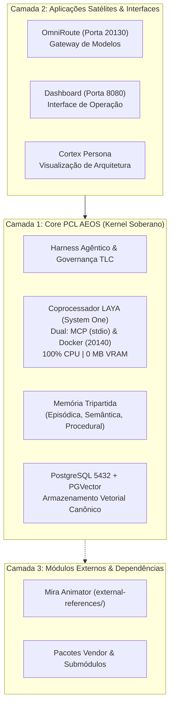

# Arquitetura Canônica e Boundary Register do PCL AEOS

**ID:** `PCL-AEOS-ARCH-01` | **Versão:** 1.0.0 | **Etapa:** DESIGN / ARCHITECTURE  
**Projeto:** [Harmonização do PCL AEOS](..) (`PCL-AEOS-HARM`)  
**Autoridade:** Patrocinador Humano (User)  
**Data-Base:** 2026-10-15  
**Conformidade:** `HARM-DEC-004`, `HARM-FR-003`, `HARM-FR-004`, `HARM-FR-006`  

---

## 1. Visão Geral da Arquitetura Canônica

O PCL AEOS é estruturado em **três camadas conceituais estritamente segregadas**, impedindo o acoplamento desordenado entre o núcleo operacional (*Core*) e as aplicações periféricas ou satélites:

---

## 2. Boundary Register — Classificação Canônica de Diretórios

Cada pasta do repositório possui uma classificação formal de fronteira, responsabilidade e autoridade:

| Diretório | Classe de Fronteira | Propósito Canônico | Autoridade Normativa |
| :--- | :---: | :--- | :--- |
| `services/pcl-laya/` | **Core Service** | Coprocessador não-autoregressivo System One para decisões tipadas em CPU (~20-35ms, 0 VRAM). Expõe MCP via stdio e API na porta 20140. | Canônica para classificação tipada |
| `memory/` e `scripts/memory/` | **Core Engine** | Motor de memória tripartida (episódica, semântica, procedural) e busca vetorial no PGVector. | Canônica para persistência e recuperação |
| `scripts/agent/` | **Core Engine** | Harness de execução dos agentes internos e daemons em background. | Canônica para ciclo de vida de agentes |
| `governance/` | **Governance Root** | Políticas mestras, termos de conformidade e relatórios formais de auditoria. | Canônica Suprema para Governança |
| `specs/` | **Normative Specs** | Especificações canônicas de engenharia, schemas e contratos formais do sistema. | Canônica Suprema para Engenharia |
| `architecture/` | **Architecture Root** | Registros de decisões arquiteturais (ADRs) e diagramas mestres. | Canônica para decisões técnicas |
| `OmniRoute/` | **Satélite** | Proxy e roteador inteligente para provedores de LLMs (cloud e locais como Ollama/LM Studio). | Autônoma de satélite (Porta 20130) |
| `Dashboard/` | **Satélite UI** | Interface gráfica web para monitoramento operacional do ecossistema. | Informativa de UI (Porta 8080) |
| `.agents/skills/` | **Agent Extensions** | Skills do workspace consumíveis pela Antigravity IDE e agentes (ex.: Cortex, Laya). | Canônica para personas e skills |
| `projects/` | **Project Workspace** | Espaço persistente de iniciativas e evolução controlada (incluindo `pcl-aeos-harmonization`). | Histórico e gestão de projetos |
| `external-references/` | **External / Vendor** | Dependências de terceiros, templates de animação (Mira) e assets auxiliares. | Não-normativa de terceiros |

---

## 3. Incorporação Oficial do Coprocessador LAYA

O módulo [`services/pcl-laya`](../../../services/pcl-laya) passa a operar oficialmente com **arquitetura de interface dual**:

1. **Canal Agêntico Local (MCP stdio):**
   - Arquivo: [`services/pcl-laya/src/mcp_server.py`](../../../services/pcl-laya/src/mcp_server.py)
   - Configurações ativas: [`.agents/mcp_config.json`](../../../.agents/mcp_config.json) e configuração global da IDE.
   - Perfil de desempenho: Latência de ~0.014ms por claim, sem consumo de rede externa e **0 MB de VRAM**.
   - Ferramentas ativas: `laya_health`, `laya_evaluate_binary`, `laya_check_contradiction`, `laya_evaluate_choice`, `laya_evaluate_score`, `laya_evaluate_batch`.

2. **Canal de Rede / Cluster (FastAPI HTTP):**
   - Arquivo: [`services/pcl-laya/src/main.py`](../../../services/pcl-laya/src/main.py)
   - Porta oficial: `20140`
   - Ambiente de execução: Container Docker na rede interna `aeos-net`.

---

## 4. Topologia Canônica de Portas e Redes

Ficam padronizadas sem ambiguidades as portas oficiais do ecossistema PCL AEOS:

| Serviço | Porta Canônica | Protocolo | Escopo de Rede |
| :--- | :---: | :---: | :--- |
| **PostgreSQL + PGVector** | `5432` | TCP / SQL | Rede interna Docker (`aeos-net`) e localhost |
| **OmniRoute Gateway** | `20130` | HTTP / REST | Exposta para clientes e agentes |
| **Laya System One REST** | `20140` | HTTP / REST | Rede interna Docker (`aeos-net`) |
| **Laya System One MCP** | `stdio` | JSON-RPC | Comunicação interprocesso direta no SO |
| **AEOS Dashboard** | `8080` | HTTP / Web | Exposta para navegadores locais |
| **Ollama Local (se ativo)** | `11434` | HTTP / REST | Localhost / bridge privada |
| **LM Studio Local (se ativo)**| `1234` | HTTP / REST | Localhost / bridge privada |
