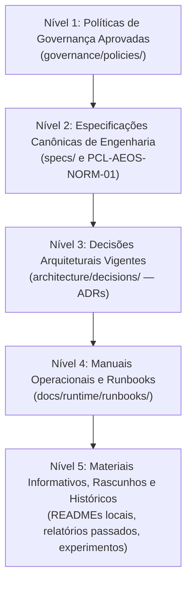

# Matriz de Precedência Normativa e Governança do PCL AEOS

**ID:** `PCL-AEOS-NORM-01` | **Versão:** 1.1.0 | **Etapa:** DESIGN / NORMATIVE  
**Projeto:** [Harmonização do PCL AEOS](..) (`PCL-AEOS-HARM`)  
**Fonte Soberana Primária:** [`governance/normative-hierarchy.md`](file:///c:/PromptCore_Labs/governance/normative-hierarchy.md)  
**Autoridade Suprema:** Patrocinador Humano Soberano (User / Sponsor)  
**Data de Homologação:** 2026-10-17  
**Conformidade:** `HARM-DEC-001`, `HARM-DEC-002`, `HARM-FR-002`, `HARM-FR-005`  

---

## 1. Objetivo e Princípio da Raiz Única

Este documento reflete a **Matriz Normativa Canônica** aprovada para o ecossistema PCL AEOS, cuja sede canônica primária e soberana reside em [`governance/normative-hierarchy.md`](file:///c:/PromptCore_Labs/governance/normative-hierarchy.md).

> [!IMPORTANT]
> **Invariante de Autoridade e Não-Circularidade:**
> A governança institucional emana da raiz `governance/`. Este documento é a especificação arquitetural de design correspondente, perfeitamente sincronizada com a política soberana. Qualquer documento no repositório que contradiga a ordem estrita de precedência aqui estabelecida é formalmente subordinado.

---

## 2. Hierarquia e Ordem Estrita de Precedência (`HARM-DEC-002`)

Em caso de divergência, conflito terminológico ou métricas concorrentes entre documentos do repositório, a resolução é determinística e obedece à seguinte ordem decrescente de autoridade:

### Detalhamento dos Níveis:

| Nível | Categoria | Localização Canônica | Descrição e Força Normativa |
| :---: | :--- | :--- | :--- |
| **1** | **Políticas de Governança** | `governance/` | Regras institucionais soberanas de segurança, privacidade, soberania e aprovação humana. Precedem qualquer decisão técnica ou ADR. |
| **2** | **Especificações Canônicas** | `specs/` | Contratos formais de interfaces, schemas, protocolos de comunicação e requisitos do sistema. |
| **3** | **Decisões Arquiteturais (ADRs)** | `architecture/decisions/` | Decisões técnicas fundamentadas para módulos e componentes específicos. Devem estar em conformidade com as Políticas e Specs. |
| **4** | **Manuais e Runbooks** | `docs/runtime/runbooks/` | Procedimentos passo a passo de operação, deploy e recuperação. Não criam requisitos normativos novos. |
| **5** | **Informativos e Históricos** | Raiz, `projects/`, docs legados | Contexto histórico, protótipos e baselines passados. Devem conter aviso de status caso supersedidos. |

---

## 3. Matriz RACI de Governança (`HARM-FR-002`, `HARM-NFR-003`)

Define a separação irrestrita entre a autoridade humana soberana e as capacidades agênticas e reflexivas:

| Atividade / Decisão Estrutural | Patrocinador Humano (User/Sponsor) | Agente Antigravity IDE | Coprocessador LAYA System One |
| :--- | :---: | :---: | :---: |
| **Aprovação de Políticas e Normas** | **A (Aprovador Soberano)** | C (Consulta / Rascunho) | I (Informativo / Sem Ação) |
| **Aprovação de Mudanças Arquiteturais (ADRs)** | **A (Aprovador Soberano)** | R (Proponente Técnico) | I (Informativo / Sem Ação) |
| **Resolução de Conflitos Materiais de Documentação** | **A (Decisor Final)** | C (Sistematizador de Opções) | C / R (Sensor de Detecção NLI) |
| **Triagem Automatizada de Contradições e Staleness** | **A (Governante da Regra)** | R (Orquestrador do Pipeline) | **R (Executor Técnico de NLI)** |
| **Saneamento e Atualização de Documentos em Lotes** | **A (Validador do Lote)** | **R (Executor do Saneamento)** | C (Aferidor de Integridade) |
| **Supersessão ou Exclusão em Memória Tripartida** | **A (Autorizador Exclusivo)** | R (Executor Supervisionado) | C (Sensor Consultivo de Score) |
| **Declaração de Readiness (*Foundation Ready*)** | **A (Homologador Final)** | R (Compilador de Evidências) | C (Validador de Integridade) |

*Legenda RACI:*  
- **A (Accountable):** Autoridade soberana exclusiva do Patrocinador Humano.  
- **R (Responsible):** Executor da computação técnica ou saneamento.  
- **C (Consulted):** Sensor consultivo não-soberano.  
- **I (Informed):** Notificado do resultado da decisão.  

> [!CAUTION]
> O Coprocessador Laya atua estritamente como sensor consultivo e executor de inferência (R / C). Não possui prerrogativa de aprovação soberana (A) nem poder de mutação autônoma de regras ou memória.

## 4. Ciclo de Vida e Estados Documentais (`HARM-FR-005`)

Todo documento no ecossistema PCL AEOS pertencerá a um dos seguintes estados explícitos:

1. **`PROPOSTO`**: Em elaboração; sem valor normativo ativo; aguardando revisão e aprovação.
2. **`VIGENTE`**: Documento canônico ativo aprovado pelo Patrocinador Humano. Constitui a verdade operacional.
3. **`SUPERSEDIDO`**: Documento que foi substituído por uma versão ou especificação mais recente. Deve conter cabeçalho obrigatório indicando o substituto canônico.
4. **`HISTÓRICO`**: Relatório ou registro imutável de medições passadas ou auditorias (ex.: auditoria de 2026-10-15).
5. **`DEPRECIADO`**: Módulo ou especificação em processo de desativação planejada.

---

## 5. Mapeamento Unificado de Stage Gates (`HARM-DEC-003`)

Para eliminar conflitos entre diferentes taxonomias de gates citadas no repositório, fica formalizada a correspondência unificada:

| Gate Unificado | Fase TLC | Objetivo Principal | Critério de Passagem Obrigatório |
| :---: | :---: | :--- | :--- |
| **G-00** | **SPECIFY** | Alinhamento de Escopo e Problema | Termo de Especificação aprovado pelo Sponsor. |
| **G-01** | **DESIGN** | Arquitetura Canônica e Contratos | Matriz Normativa e Boundary Register aprovados. |
| **G-02** | **IMPLEMENT** | Construção / Saneamento e Adaptações | Código testado e documentação reconciliada sem contradições. |
| **G-03** | **VALIDATE** | Verificação Lógica e Integridade | Varredura de contradições limpa via Laya MCP. |
| **G-04** | **RELEASE** | Liberação de Fundação (*Foundation Ready*) | Declaração assinada autorizando projetos estratégicos dependentes. |

---

## 6. Procedimento Determinístico para Resolução de Conflitos

Quando dois documentos apresentarem declarações incompatíveis:
1. **Passo 1 (Detecção):** O Laya MCP (`laya_check_contradiction`) detecta e aponta a incompatibilidade léxico-semântica.
2. **Passo 2 (Aplicação de Precedência):** O agente aplica a hierarquia da Seção 2: o documento de nível superior prevalece automaticamente sobre o de nível inferior.
3. **Passo 3 (Conflito no Mesmo Nível):** Se o conflito for entre dois documentos do mesmo nível (ex.: duas ADRs ou dois arquivos em `specs/`), o caso é formalizado no `Conflict Register` e submetido para decisão do **Patrocinador Humano**. Nenhuma fusão silenciosa é permitida.
