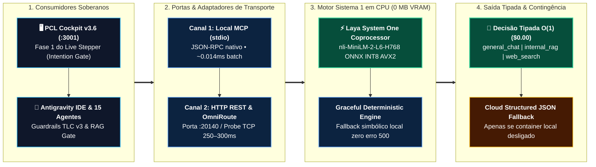

# SPEC-PCL-AEOS-CLASSIFIER-01: PCL Triage, Intention Gating & System 1 Classifier Engine

**Versão:** `3.6-Sovereign` (Laya System One + Cockpit Intention Gating)  
**Status:** Approved & Implemented (Ports & Adapters Architecture / Laya MCP & HTTP Native)  
**Autor:** Forward Deployed Architecture (FDA) / PromptCore Labs Cognitive Systems  
**Escopo:** PCL Cockpit (`:3001`), OmniRoute AI Gateway (`:20130`), Antigravity IDE, Laya Server (`:20140`)  
**Padrão Arquitetural:** Hexagonal Architecture (Ports & Adapters) / Strategy Pattern  
**Normas de Governança:** `PCL-AEOS-NORM-01`, ISO/IEC 27001 & ISO/IEC 42001  

> [!IMPORTANT]
> **👔 Visão Executiva & Valor de Negócio:** Usar um grande modelo generativo em nuvem apenas para decidir *qual ferramenta acionar* é como contratar um conselho diretor para triar correspondência: lento (`1s a 3s`) e caro. O **PCL Classifier Engine (Laya System One)** realiza essa triagem localmente em **~20 milissegundos** na CPU comum com **custo `$0.00`**, eliminando até 70% de chamadas desnecessárias e evitando que buscas irrelevantes poluam respostas executivas.

> [!NOTE]
> **🛠️ Visão de Engenharia & Invariantes:** Especifica a porta hexagonal de classificação não-autorregressiva em complexidade **`O(1)`** (*single forward pass*), executada pelo modelo **`cross-encoder/nli-MiniLM-2-L6-H768` quantizado em INT8 (`CPUExecutionProvider`, `0 MB VRAM`)** via MCP `stdio` (`~0.014ms` em lote) e REST (`:20140`, `< 35ms`), incluindo o **Intention Gating v3.6** (`general_chat | internal_rag | web_search`).

---

## 1. Topologia Hexagonal Panorâmica do Sistema 1 (Padrão Cortex v7)



---

## 2. Fundamentação Teórica: Sistema 1 (`O(1)`) vs. Sistema 2 (`O(N)`) e `Laya` vs. `JEV`

Uma evidência central consolidada nos testes comparativos da v3.6 é a distinção algorítmica entre classificadores não-autorregressivos locais e orquestradores SaaS baseados em geração de tokens:

| Critério Arquitetural | Coprocessador Laya System One (PCL AEOS v3.6) | JEV (*TypeSafe AI*) / Orquestradores LLM SaaS |
| :--- | :--- | :--- |
| **Origem & Licenciamento** | Paradigma aberto *Convai Innovations* (**Apache 2.0**), empacotado soberanamente em `services/pcl-laya`. | Serviço comercial fechado em nuvem (*SaaS API*) com cobrança recorrente por volume de chamadas. |
| **Complexidade Computacional** | **`O(1)` Não-Autorregressivo:** Um único *forward pass* matricial produz logits calibrados diretamente. | **`O(N)` Autorregressivo (nos LLMs comuns) ou RTT Cloud:** Sofre latência de rede externa (`300ms–2.500ms`). |
| **Consumo de GPU Local** | **`0 MB de VRAM`** (`100% CPU Host` via ONNX Runtime INT8, `~78.9 MB` em RAM). | N/A (dependência obrigatória de conectividade externa e envio do prompt a terceiros). |
| **Privacidade & Soberania** | **100% On-Premise:** Prompts confidenciais são triados sem sair da máquina do operador. | Tráfego externo de metadados e prompts de roteamento para infraestrutura de terceiros. |

---

## 3. Contrato da Interface Abstrata (`PCL Classifier Port`)

Qualquer provedor acoplado ao PCL AEOS implementa rigorosamente cinco primitivas determinísticas com retorno JSON tipado:

1. **`evaluate_binary(state, query) -> { result: boolean, confidence: float }`**
   - Decisão booleana estrita sem geração de texto (ex: *Answerability Gate* `>= 0.40`).
2. **`evaluate_choice(state, query, options[]) -> { selected: string, confidence: float }`**
   - Seleção determinística dentre opções fechadas (ex: roteamento de squad ou perfil cognitivo).
3. **`evaluate_score(state, query, min, max) -> { score: float, confidence: float }`**
   - Pontuação escalar contínua calibrada para relevância documental e risco operacional.
4. **`check_contradiction(premise, hypothesis) -> { contradiction: boolean, label: "entailment"|"contradiction"|"neutral", confidence: float }`**
   - Juiz lógico NLI com **93,3% de recall** auditado para reconciliação de `memory.claims` e *staleness*.
5. **`evaluate_cockpit_intent(history, query) -> { mode: "general_chat"|"internal_rag"|"web_search", needsWebSearch: boolean, needsCanonicalRAG: boolean }` *(Novo na v3.6 — `ADR-0007`)*:**
   - Governa a Fase 1 do **Live Execution Stepper** no PCL Cockpit (`:3001`), eliminando buscas web compulsórias em perguntas teóricas (`HIP-007`) e preservando fluidez natural sem jargão interno em perguntas gerais (`HIP-006`).

---

## 4. Mapeamento de Adaptadores & Interfaces Operacionais

### 4.1. Adaptador Primário: `pcl-laya` Dual-Engine (`CPU INT8` + Simbólico)
* **Canal Local MCP (`stdio`):** `services/pcl-laya/src/mcp_server.py` registrado em `.agents/mcp_config.json` (`laya_evaluate_nli`, `laya_evaluate_binary`, `laya_check_contradiction`, `laya_evaluate_choice`, `laya_evaluate_score`, `laya_evaluate_batch`, `laya_health`).
* **Canal HTTP Microsserviço (`:20140`):** Endpoints `/v1/classifier/evaluate`, `/v1/classifier/evaluate/nli` e `/health`, monitorados por sonda TCP de `250–300ms` no PCL Cockpit.
* **Resiliência Zero Erro 500:** Na ausência temporária do contêiner Docker, o módulo `intelligentGroundingService.ts` aplica heurística simbólica determinística local com semântica idêntica, mantendo zero dependência de mocks estáticos.

### 4.2. Configuração no `docker-compose.aeos.yml` / OmniRoute (`:20130`)

```yaml
OMNIROUTE_CLASSIFIER_PROVIDER: "laya"
OMNIROUTE_LAYA_ENDPOINT: "http://pcl-laya:20140"
OMNIROUTE_CLASSIFIER_FAILOVER_ENABLED: "true"
```

---

## 5. Enquadramento Normativo RACI (`AGENTS.md` Seção 4)

O Laya System One opera estritamente como **sensor consultivo de alta velocidade (`RACI: R/C`)**. Nenhuma classificação automatizada substitui a aprovação soberana humana nos **Stage Gates TLC v3** em operações financeiras, destrutivas ou de deploy produtivo.
